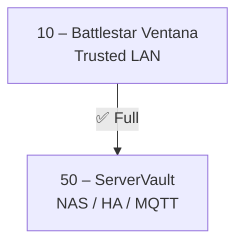

# GitHub Copilot Instructions — Battlestar Ventana Network Blueprint

## 🎯 Project Overview

This repository contains the **Battlestar Ventana Network Blueprint**, a comprehensive network infrastructure documentation project for a home/lab network using a Battlestar Galactica themed VLAN naming scheme.

**Core Purpose:** Document network architecture, VLAN segmentation, firewall rules, monitoring dashboards, and operational procedures for a secure, segmented home network.

**IP Scheme:** `10.76.X.0/24` where X = VLAN ID  
**Theme:** Colonies and ships from Battlestar Galactica mapped to VLANs for instant auditability

---

## 🛠️ Tech Stack

- **Documentation:** Markdown (`.md` files)
- **Configuration Files:** YAML (`.yaml`, `.yml` for alerts, dashboards, Home Assistant)
- **Dashboards:** JSON (Grafana dashboards)
- **Diagrams:** Mermaid (embedded in Markdown)
- **Version Control:** Git with semantic versioning
- **Changelog Format:** [Keep a Changelog](https://keepachangelog.com/en/1.0.0/)

---

## 📋 Coding Standards & Style

### Documentation Style
- Use emoji prefixes for headers (🔐 for security, 📡 for network, 🛠️ for tools, etc.)
- Maintain consistent heading hierarchy (H1 for title, H2 for major sections, H3 for subsections)
- Use tables for structured data (firewall rules, VLAN mappings, services)
- Include Mermaid diagrams for visual representations of network topology and flows
- Always include a horizontal rule (`---`) between major sections

### Naming Conventions
Follow the established naming patterns documented in `docs/naming-conventions.md`:

1. **VLANs & SSIDs:** Battlestar Galactica themed names (PascalCase)
   - Example: `BattlestarVentana` (VLAN 10), `CylonSynthLink` (VLAN 20)

2. **Physical Hosts:** `<Color/Element><Descriptor>` (PascalCase)
   - Example: `CrimsonRogue`, `MintRedoubt`, `AzureDefiant`
   - Names are unique per chassis and never reused

3. **Personal Computers:** Jaeger names from Pacific Rim (PascalCase)
   - Example: `GipsyDanger`, `StrykerEureka`, `ChernoAlpha`
   - From canonical pool, may be recycled for direct replacements

4. **Other Devices:** `<zone>-<role>-<index>` (lowercase, hyphen-separated)
   - Roles: `ctrl`, `sens`, `cast`, `stor`, `view`, `print`, `relay`, `edge`
   - Example: `iot-sens-01`, `media-cast-02`, `printer-print-01`

### File Organization
```
├── README.md                 # Master blueprint doc
├── CHANGELOG.md              # Versioned history
├── docs/                     # Supporting documentation
│   ├── firewall-matrix.md    # VLAN firewall rules
│   ├── dhcp-scopes.md        # Subnet configuration
│   ├── naming-conventions.md # Canonical naming rules
│   ├── audit-checklist.md    # Operational health
│   └── services.md           # Service/ports matrix
├── dashboards/               # Grafana dashboards (JSON)
├── alerts/                   # Prometheus alerts (YAML)
├── ha/                       # Home Assistant config (YAML)
├── baseline/                 # Architectural design docs
└── plan/                     # Planning documents
```

### YAML Style
- Use 2-space indentation
- Use lowercase with hyphens for keys where applicable
- Include comments for complex configurations
- Follow existing patterns in `alerts/` and `ha/` directories

### Changelog Management
- Follow [Keep a Changelog](https://keepachangelog.com/en/1.0.0/) format
- Use semantic versioning
- Categories: Added, Changed, Deprecated, Removed, Fixed, Security
- Always update `[Unreleased]` section first
- Include clear, descriptive entries with specific file references

---

## 🚫 What NOT to Touch

### Protected Files & Directories
- **DO NOT modify:** Existing symbolic links (e.g., `infrastructure` symlink)
- **DO NOT delete:** Historical changelog entries (only add to `[Unreleased]`)
- **DO NOT remove:** Existing VLAN IDs or core network architecture without explicit instruction
- **DO NOT change:** Established naming conventions without updating `docs/naming-conventions.md` first

### Sensitive Operations
- Never remove or modify existing firewall rules without understanding the full security implications
- Never change VLAN IDs or IP schemes without coordinated updates across all documentation
- Never remove monitoring alerts without justification
- Never modify visual assets (PNG files) unless replacing with new versions

---

## ✅ When Making Changes

### Always:
1. **Update CHANGELOG.md** with your changes in the `[Unreleased]` section
2. **Maintain consistency** across all documentation when updating network details
3. **Follow the established theme** (Battlestar Galactica) for any new VLAN names
4. **Include Mermaid diagrams** when documenting network flows or topology changes
5. **Use the legend symbols** consistently in firewall matrices:
   - ✅ Full access
   - 🟡 Limited access (restricted ports/services)
   - 🔵 View-only (monitoring, read-only)
   - ❌ Blocked
   - 🌐 Internet

### Before Adding New VLANs:
1. Choose an appropriate Battlestar Galactica themed name
2. Assign appropriate VLAN ID (update IP scheme accordingly)
3. Document in firewall matrix with all zone interactions
4. Update all affected diagrams (Mermaid flowcharts)
5. Add to services matrix with specific ports/protocols
6. Update CHANGELOG.md

### When Documenting Firewall Rules:
1. Update the main matrix table with access symbols
2. Add specific port/protocol details to the Service/Ports Reference Table
3. Update relevant Mermaid diagrams to reflect the flow
4. Include notes for any special considerations
5. Consider security implications and document in notes

---

## 🎨 Example Code Patterns

### Firewall Matrix Entry
```markdown
| **10 Trusted** | ✅ | 🟡 | ❌ | 🟡 | ✅ | ✅ | ✅ | ✅ | 🔵 | 🔵 | ❌ |
```

### Service/Ports Entry
```markdown
| **10 Trusted → 50 ServerVault** | SMB (445), NFS (2049), HTTPS (443) | TCP | File sharing & web services |
```

### VLAN Documentation
```markdown
* **Basestar Control (40):** Infrastructure switches/controllers
```

### Mermaid Diagram Pattern


---

## 📦 Dependencies & Tools

### No Package Management
This is a documentation-only repository with no build process, dependencies, or package managers. All files are plain text (Markdown, YAML, JSON).

### Validation Tools (if available)
- Markdown linters for documentation quality
- YAML validators for configuration files
- JSON validators for dashboard files

---

## 🔍 Testing & Validation

### Manual Validation
- Ensure all internal links work (between documentation files)
- Verify Mermaid diagrams render correctly
- Check YAML/JSON syntax is valid
- Confirm firewall matrix is internally consistent
- Validate VLAN IDs match throughout all documentation

### Documentation Review
- Read through changes to ensure clarity and consistency
- Verify emoji usage matches existing patterns
- Check that tables are properly formatted
- Ensure code blocks have appropriate syntax highlighting

---

## 🎯 Common Tasks

### Adding a New Device
1. Choose appropriate hostname based on device type (see naming conventions)
2. Add to relevant documentation file (`docs/physical-hosts.md`, `docs/other-devices.md`, etc.)
3. Update any affected network diagrams
4. Document in CHANGELOG.md

### Updating Firewall Rules
1. Update `docs/firewall-matrix.md` main access matrix
2. Add specific ports to Service/Ports Reference Table
3. Update relevant Mermaid diagrams
4. Consider bidirectional rules and update both source and destination
5. Document security implications in notes section
6. Update CHANGELOG.md

### Adding Documentation
1. Create file in appropriate directory (`docs/`, `dashboards/`, etc.)
2. Use emoji-prefixed headers matching repository style
3. Add references to new file in README.md
4. Update CHANGELOG.md with the addition
5. Ensure consistent formatting with existing docs

---

## 💡 Best Practices

1. **Be specific:** When documenting network rules, include specific ports, protocols, and justification
2. **Think security:** Always consider the security implications of any firewall rule changes
3. **Maintain the theme:** Keep the Battlestar Galactica naming consistent and meaningful
4. **Visual clarity:** Use tables, diagrams, and symbols to make information scannable
5. **Version everything:** Document all changes in CHANGELOG.md, no matter how small
6. **Cross-reference:** Link related documents together for easy navigation
7. **Explain why:** Don't just document what, explain why decisions were made

---

## 🔐 Security Principles

This network follows zero-trust segmentation principles:

1. **Default Deny:** All traffic blocked unless explicitly allowed
2. **Least Privilege:** VLANs only get access to services they absolutely need
3. **Guest Isolation:** Guest networks (30, 31) have no access to internal LANs
4. **IoT Containment:** IoT devices (VLAN 20) severely restricted, telemetry only
5. **Infrastructure Protection:** InfraCore (VLAN 40) has no direct Internet access
6. **Camera Segregation:** Camera VLANs are view-only from trusted zones
7. **Work Segmentation:** Work VLAN (90) isolated from home network but has VPN access

Always maintain these principles when proposing changes.

---

## 📚 Additional Resources

- [Keep a Changelog](https://keepachangelog.com/en/1.0.0/)
- [Semantic Versioning](https://semver.org/)
- [Mermaid Documentation](https://mermaid.js.org/)
- [Battlestar Galactica Wiki](https://battlestarwiki.org/) (for naming inspiration)

---

**Remember:** This is a living documentation project. When in doubt, maintain consistency with existing patterns and prioritize clarity and security in all changes.
