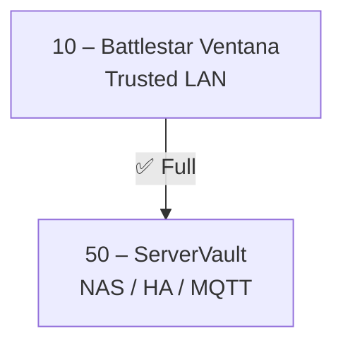

## Purpose
- Documentation-first network blueprint; prioritize updates to VLAN design, firewall policy, and service tables over code changes.

## Architecture & sources of truth
- Addressing uses `10.76.<VLAN>.0/24` with `.1` gateways; see `baseline/Battlestar-Ventana-Blueprint-Summary.md` and `docs/dhcp-scopes.md`.
- Directional, least-privilege rules live in `docs/firewall-matrix.md`; service/port allowlists live in `docs/services.md` and must match.
- Zone model and rationale are summarized in `docs/Project_Architecture_Blueprint.md`.
- Naming is Battlestar Galactica for VLANs/SSIDs and Pacific Rim for hosts; see `docs/naming-conventions.md`.

## Repo-specific workflows
- Linting is wired in `package.json`: `npm run lint` (eslint/markdownlint/yamllint) and `npm run fix` for auto-fixes.
- Ansible automation lives in `bootstrap/*.yml` and `roles/*` (e.g., `roles/proxmox_pihole_lxc_template/` and `bootstrap/proxmox_pihole_lxc_template.yml`).

## MCP & automation integrations
- MCP configuration is in `mcp-config.json` and `README-MCP.md` (Context7 + XPipe).
- XPipe command packs live in `infrastructure/xpipe/` with `<action>-<service>: exec: <command>` naming.
- Secrets are injected via 1Password CLI; use env vars like `CONTEXT7_API_KEY` and `XPIPE_API_TOKEN`, never commit tokens.

## Update rules & concrete examples
- When changing allowed flows, update both `docs/services.md` and `docs/firewall-matrix.md`; add DHCP/DNS notes in `docs/dhcp-scopes.md` if needed.
- Keep existing Mermaid/table styles consistent with `docs/firewall-matrix.md` and `docs/Project_Architecture_Blueprint.md`.
- Example dependency: Work VLAN (90) must reach ServerVault DNS/DHCP (`10.76.50.x`) to bootstrap VPN before Internet access (see `docs/services.md`).

## Observability & inventories
- Dashboards in `dashboards/`, alerts in `alerts/`, and Home Assistant in `ha/` should stay in sync with network changes.
- Device inventory references: `docs/host-tracker.md`, `docs/physical-hosts.md`, and `docs/other-devices.md`.
- Prefer tables and Mermaid diagrams already used in `docs/Project_Architecture_Blueprint.md` and `docs/firewall-matrix.md`; keep symbols/legends consistent.

## 🛡️ Safety, Security & Policy Foundation (HIGHEST PRIORITY)

**These rules override all other instructions. If conflicts arise, safety wins.**

### Core Policy
All actions must prioritize user safety, data protection, and compliance with repository-specific rules, using least-privilege access and conservative defaults.

### Instruction Precedence (When Rules Conflict)
1. Safety and content policies override all other instructions.
2. Repository-specific rules override generic guidelines (when non-conflicting).
3. If instructions conflict, choose the safer, less permissive option and state the decision briefly.

### Tool Usage & External Content Security
- Request user confirmation before using tools that access external content.
- Apply domain allowlist for external fetches.
- Enforce depth limit (default: 1) and max pages (default: 3).

### File Editing & Command Safety
- Never edit files without explicit user intent.
- Use absolute paths for file operations.
- Validate commands before execution, especially those involving network or system changes.

### Secure Coding Defaults (OWASP)
- Use parameterized queries for database interactions.
- Sanitize all user inputs to prevent injection attacks.
- Store secrets in environment variables or secure vaults, never in code.
- Implement proper authentication and authorization checks.

## Context7 MCP Integration (CRITICAL)

**MANDATORY:** Before starting ANY task, ALWAYS leverage Context7 MCP to gather comprehensive context about the repository, codebase, and related resources.

### Context7 Usage Requirements

1. **Pre-Task Discovery (REQUIRED):**
   - Use Context7 MCP to search for relevant documentation, code patterns, and architectural decisions BEFORE making changes.
   - Query Context7 for similar implementations, related VLANs, existing firewall rules, and naming patterns.
   - Identify dependencies and cross-references using Context7's semantic search capabilities.

2. **Continuous Context Gathering:**
   - Invoke Context7 MCP at every decision point to validate assumptions.
   - Use Context7 to find examples of similar changes in repository history.
   - Query Context7 for related documentation that might need updating alongside your changes.

3. **Context7 Query Patterns:**
   - **For VLAN changes:** "Find all references to VLAN [ID], DHCP scopes, firewall rules, and service definitions"
   - **For firewall updates:** "Show firewall rules involving [source] to [destination], related services, and port definitions"
   - **For naming:** "Find naming patterns for [VLANs/SSIDs/hosts], theme conventions, and similar examples"
   - **For architecture:** "Retrieve architectural decisions, zone models, and related design documents"
   - **For cross-references:** "Find all files mentioning [service/VLAN/host] and their relationships"

4. **Validation Before Commit:**
   - Use Context7 to verify all affected files are identified and updated.
   - Query for TODOs, cross-references, and dependencies that might be impacted.
   - Ensure consistency across documentation using Context7's semantic analysis.

**FAILURE TO USE CONTEXT7 MAY RESULT IN INCOMPLETE CHANGES, BROKEN CROSS-REFERENCES, OR INCONSISTENT DOCUMENTATION.**
- Addressing uses `10.76.<VLAN>.0/24` with `.1` gateways; see `baseline/Battlestar-Ventana-Blueprint-Summary.md` and `docs/dhcp-scopes.md`.
- Directional, least-privilege rules live in `docs/firewall-matrix.md`; service/port allowlists live in `docs/services.md` and must match.
- Zone model and rationale are summarized in `docs/Project_Architecture_Blueprint.md`.
- Naming is Battlestar Galactica for VLANs/SSIDs and Pacific Rim for hosts; see `docs/naming-conventions.md`.

## Repo-specific workflows
- Linting is wired in `package.json`: `npm run lint` (eslint/markdownlint/yamllint) and `npm run fix` for auto-fixes.
- Ansible automation lives in `bootstrap/*.yml` and `roles/*` (e.g., `roles/proxmox_pihole_lxc_template/` and `bootstrap/proxmox_pihole_lxc_template.yml`).

## MCP & automation integrations
- MCP configuration is in `mcp-config.json` and `README-MCP.md` (Context7 + XPipe).
- XPipe command packs live in `infrastructure/xpipe/` with `<action>-<service>: exec: <command>` naming.
- Secrets are injected via 1Password CLI; use env vars like `CONTEXT7_API_KEY` and `XPIPE_API_TOKEN`, never commit tokens.

## Update rules & concrete examples
- When changing allowed flows, update both `docs/services.md` and `docs/firewall-matrix.md`; add DHCP/DNS notes in `docs/dhcp-scopes.md` if needed.
- Keep existing Mermaid/table styles consistent with `docs/firewall-matrix.md` and `docs/Project_Architecture_Blueprint.md`.
- Example dependency: Work VLAN (90) must reach ServerVault DNS/DHCP (`10.76.50.x`) to bootstrap VPN before Internet access (see `docs/services.md`).

## Observability & inventories
- Dashboards in `dashboards/`, alerts in `alerts/`, and Home Assistant in `ha/` should stay in sync with network changes.
- Device inventory references: `docs/host-tracker.md`, `docs/physical-hosts.md`, and `docs/other-devices.md`.
- Prefer tables and Mermaid diagrams already used in `docs/Project_Architecture_Blueprint.md` and `docs/firewall-matrix.md`; keep symbols/legends consistent.

## 🛡️ Safety, Security & Policy Foundation (HIGHEST PRIORITY)

**These rules override all other instructions. If conflicts arise, safety wins.**

### Core Policy
All actions must prioritize user safety, data protection, and compliance with repository-specific rules, using least-privilege access and conservative defaults.

### Instruction Precedence (When Rules Conflict)
1. Safety and content policies override all other instructions.
2. Repository-specific rules override generic guidelines (when non-conflicting).
3. If instructions conflict, choose the safer, less permissive option and state the decision briefly.

### Tool Usage & External Content Security
- Request user confirmation before using tools that access external content.
- Apply domain allowlist for external fetches.
- Enforce depth limit (default: 1) and max pages (default: 3).

### File Editing & Command Safety
- Never edit files without explicit user intent.
- Use absolute paths for file operations.
- Validate commands before execution, especially those involving network or system changes.

### Secure Coding Defaults (OWASP)
- Use parameterized queries for database interactions.
- Sanitize all user inputs to prevent injection attacks.
- Store secrets in environment variables or secure vaults, never in code.
- Implement proper authentication and authorization checks.

## Context7 MCP Integration (CRITICAL)

**MANDATORY:** Before starting ANY task, ALWAYS leverage Context7 MCP to gather comprehensive context about the repository, codebase, and related resources.

### Context7 Usage Requirements

1. **Pre-Task Discovery (REQUIRED):**
   - Use Context7 MCP to search for relevant documentation, code patterns, and architectural decisions BEFORE making changes.
   - Query Context7 for similar implementations, related VLANs, existing firewall rules, and naming patterns.
   - Identify dependencies and cross-references using Context7's semantic search capabilities.

2. **Continuous Context Gathering:**
   - Invoke Context7 MCP at every decision point to validate assumptions.
   - Use Context7 to find examples of similar changes in repository history.
   - Query Context7 for related documentation that might need updating alongside your changes.

3. **Context7 Query Patterns:**
   - **For VLAN changes:** "Find all references to VLAN [ID], DHCP scopes, firewall rules, and service definitions"
   - **For firewall updates:** "Show firewall rules involving [source] to [destination], related services, and port definitions"
   - **For naming:** "Find naming patterns for [VLANs/SSIDs/hosts], theme conventions, and similar examples"
   - **For architecture:** "Retrieve architectural decisions, zone models, and related design documents"
   - **For cross-references:** "Find all files mentioning [service/VLAN/host] and their relationships"

4. **Validation Before Commit:**
   - Use Context7 to verify all affected files are identified and updated.
   - Query for TODOs, cross-references, and dependencies that might be impacted.
   - Ensure consistency across documentation using Context7's semantic analysis.

**FAILURE TO USE CONTEXT7 MAY RESULT IN INCOMPLETE CHANGES, BROKEN CROSS-REFERENCES, OR INCONSISTENT DOCUMENTATION.**
# GitHub Copilot Instructions — Battlestar Ventana Network Blueprint

## 🎯 Project Overview

This repository contains the **Battlestar Ventana Network Blueprint**, a comprehensive network infrastructure documentation project for a home/lab network using a Battlestar Galactica themed VLAN naming scheme.

**Core Purpose:** Document network architecture, VLAN segmentation, firewall rules, monitoring dashboards, and operational procedures for a secure, segmented home network.

**IP Scheme:** `10.76.X.0/24` where X = VLAN ID  
**Theme:** Colonies and ships from Battlestar Galactica mapped to VLANs for instant auditability

---

## 🛠️ Tech Stack

- **Documentation:** Markdown (`.md` files)
- **Configuration Files:** YAML (`.yaml`, `.yml` for alerts, dashboards, Home Assistant)
- **Dashboards:** JSON (Grafana dashboards)
- **Diagrams:** Mermaid (embedded in Markdown)
- **Version Control:** Git with semantic versioning
- **Changelog Format:** [Keep a Changelog](https://keepachangelog.com/en/1.0.0/)

---

## 🏗️ Architecture Context

### Network Segmentation Model

- **Zone-based security**: VLANs organized by trust level (Trusted, Semi-Trusted, Untrusted, Services, Infrastructure, Surveillance)
- **Address scheme**: `10.76.X.0/24` where X = VLAN ID
- **Naming convention**: Battlestar Galactica themed names for memorability and auditability

### Key Security Zones

- **Trusted (10, 90)**: Full access to services, strict authentication
- **Semi-Trusted (31, 60, 70)**: Function-specific access only
- **Untrusted (20, 30)**: Internet-only or minimal telemetry
- **Services (50)**: ServerVault - central service hub
- **Infrastructure (40)**: BasestarControl - management plane
- **Surveillance (81, 82)**: Camera networks with view-only access

---

## 📋 Coding Standards & Style

### Documentation Style

- Use emoji prefixes for headers (🔐 for security, 📡 for network, 🛠️ for tools, etc.)
- Maintain consistent heading hierarchy (H1 for title, H2 for major sections, H3 for subsections)
- Use tables for structured data (firewall rules, VLAN mappings, services)
- Include Mermaid diagrams for visual representations of network topology and flows
- Always include a horizontal rule (`---`) between major sections

### Naming Conventions

Follow the established naming patterns documented in `docs/naming-conventions.md`:

1. **VLANs & SSIDs:** Battlestar Galactica themed names (space-separated with capital words)
   - Example: `Battlestar Ventana` (VLAN 10), `CylonSynthLink` (VLAN 20)

2. **Physical Hosts:** `<Color/Element><Descriptor>` (PascalCase)
   - Example: `CrimsonRogue`, `MintRedoubt`, `AzureDefiant`
   - Names are unique per chassis and never reused

3. **Personal Computers:** Jaeger names from Pacific Rim (PascalCase)
   - Example: `GipsyDanger`, `StrykerEureka`, `ChernoAlpha`
   - From canonical pool, may be recycled for direct replacements

4. **Other Devices:** `<zone>-<role>-<index>` (lowercase, hyphen-separated)
   - Roles: `ctrl`, `sens`, `cast`, `stor`, `view`, `print`, `relay`, `edge`
   - Example: `iot-sens-01`, `media-cast-02`, `printer-print-01`

### File Organization

```
├── readme.md                 # Master blueprint doc
├── CHANGELOG.md              # Versioned history
├── docs/                     # Supporting documentation
│   ├── firewall-matrix.md    # VLAN firewall rules
│   ├── dhcp-scopes.md        # Subnet configuration
│   ├── naming-conventions.md # Canonical naming rules
│   ├── audit-checklist.md    # Operational health
│   └── services.md           # Service/ports matrix
├── dashboards/               # Grafana dashboards (JSON)
├── alerts/                   # Prometheus alerts (YAML)
├── ha/                       # Home Assistant config (YAML)
├── baseline/                 # Architectural design docs
└── plan/                     # Planning documents
```

### YAML Style

- Use 2-space indentation
- Use lowercase with hyphens for keys where applicable
- Include comments for complex configurations
- Follow existing patterns in `alerts/` and `ha/` directories

### Changelog Management

- Follow [Keep a Changelog](https://keepachangelog.com/en/1.0.0/) format
- Use semantic versioning
- Categories: Added, Changed, Deprecated, Removed, Fixed, Security
- Always update `[Unreleased]` section first
- Include clear, descriptive entries with specific file references

---

## 🔐 Security Patterns

### Least Privilege Principle

When suggesting firewall rules or service access:

- Always default to DENY
- Explicitly allow only required ports/protocols
- Document the business justification for each rule
- Prefer unidirectional flows (source → destination only)

Example:

```markdown
| Source VLAN | Destination VLAN | Ports | Protocol | Justification |
|-------------|------------------|-------|----------|---------------|
| 20 IoT | 50 ServerVault | 8883 | TCP | MQTT telemetry only |
```

### Rate-Limiting Standards

Apply rate limits to prevent abuse:

- **Authentication endpoints**: 5 attempts/minute per IP
- **API endpoints**: 60 requests/minute per client
- **MQTT telemetry**: 100 messages/second per device
- **DNS queries**: 50 queries/second per client
- **Guest network**: Bandwidth throttled to 10 Mbps

### Service Mesh Patterns

For service-to-service communication:

- Route all HTTP/HTTPS through reverse proxy on ServerVault
- Implement health checks for all services
- Use mutual TLS (mTLS) for internal service communication
- Apply circuit breaker patterns for external dependencies
- Implement retry logic with exponential backoff

Example service configuration:

```yaml
service:
  name: mqtt-broker
  health_check:
    endpoint: /health
    interval: 30s
    timeout: 5s
  rate_limit:
    requests_per_second: 100
  circuit_breaker:
    failure_threshold: 5
    timeout: 60s
```

### SIEM Integration Requirements

When adding logging or monitoring:

- Centralize all logs to ServerVault syslog
- Include structured fields: timestamp, source_vlan, destination_vlan, action, rule_id
- Define alert thresholds for security events
- Tag events by severity: critical, high, medium, low, info

Example log format:

```json
{
  "timestamp": "2026-01-21T21:00:00Z",
  "event_type": "firewall_deny",
  "severity": "medium",
  "source_vlan": 20,
  "destination_vlan": 10,
  "source_ip": "10.76.20.45",
  "destination_ip": "10.76.10.15",
  "port": 22,
  "protocol": "TCP",
  "rule_id": "DENY-UNTRUSTED-TO-TRUSTED"
}
```

---

## 🤖 Automation Patterns

### Infrastructure as Code (IaC)

When suggesting infrastructure changes:

- Prefer declarative configuration over imperative scripts
- Use Terraform for network infrastructure (VLANs, firewall rules, routing)
- Use Ansible for service deployment and configuration
- Version control all configuration in this repository
- Include validation and testing steps

Example Terraform structure:

```hcl
# firewall_rules.tf
resource "firewall_rule" "iot_to_servervault" {
  name        = "iot-mqtt-telemetry"
  source      = "10.76.20.0/24"
  destination = "10.76.50.0/24"
  port        = 8883
  protocol    = "TCP"
  action      = "ALLOW"
  log         = true
}
```

### GitOps Workflow

All changes should follow GitOps principles:

1. Make changes in a feature branch
2. Update documentation in same commit
3. Run validation/linting
4. Create pull request with description
5. Automated tests run in CI/CD
6. Manual approval for production deployment
7. Automated rollback on failure

### Configuration Management

For service configuration:

- Store secrets in external secret management (not in repo)
- Use environment-specific override files
- Implement configuration drift detection
- Automated remediation for drift from desired state

Example secrets pattern:

```yaml
# config.yaml (checked into repo)
mqtt:
  host: servervault.internal
  port: 8883
  username: ${MQTT_USERNAME}  # from secret manager
  password: ${MQTT_PASSWORD}  # from secret manager
```

### Automation Standards

When writing automation scripts:

- Use idempotent operations (safe to run multiple times)
- Include rollback procedures
- Add comprehensive logging
- Implement health checks before/after changes
- Follow the repository's naming conventions

Example automation script structure:

```bash
#!/bin/bash
set -euo pipefail

# Pre-flight checks
check_dependencies() { ... }
validate_config() { ... }

# Main operations
backup_current_state() { ... }
apply_changes() { ... }
verify_changes() { ... }

# Rollback on failure
rollback() { ... }
trap rollback ERR
```

---

## 📝 Documentation Patterns

### Markdown Structure

- Use ATX-style headers (`#`, `##`, `###`)
- Include table of contents for documents > 100 lines
- Use Mermaid diagrams for network flows
- Use tables for structured data (firewall rules, DHCP scopes)

### Documentation Requirements

When adding features or changes:

- Update `docs/Project_Architecture_Blueprint.md` for architectural changes
- Update `docs/firewall-matrix.md` for firewall rule changes
- Update `docs/dhcp-scopes.md` for network changes
- Add entry to `CHANGELOG.md` following Keep a Changelog format
- Update relevant diagrams if network topology changes

---

## 🚫 What NOT to Touch

### Protected Files & Directories

- **DO NOT modify:** Existing symbolic links (e.g., `infrastructure` symlink)
- **DO NOT delete:** Historical changelog entries (only add to `[Unreleased]`)
- **DO NOT remove:** Existing VLAN IDs or core network architecture without explicit instruction
- **DO NOT change:** Established naming conventions without updating `docs/naming-conventions.md` first

### Sensitive Operations

- Never remove or modify existing firewall rules without understanding the full security implications
- Never change VLAN IDs or IP schemes without coordinated updates across all documentation
- Never remove monitoring alerts without justification
- Never modify visual assets (PNG files) unless replacing with new versions

---

## ✅ When Making Changes

### Always:

1. **Update CHANGELOG.md** with your changes in the `[Unreleased]` section
2. **Maintain consistency** across all documentation when updating network details
3. **Follow the established theme** (Battlestar Galactica) for any new VLAN names
4. **Include Mermaid diagrams** when documenting network flows or topology changes
5. **Use the legend symbols** consistently in firewall matrices:
   - ✅ Full access
   - 🟡 Limited access (restricted ports/services)
   - 🔵 View-only (monitoring, read-only)
   - ❌ Blocked
   - 🌐 Internet

### Before Adding New VLANs:

1. Choose an appropriate Battlestar Galactica themed name
2. Assign appropriate VLAN ID (update IP scheme accordingly)
3. Document in firewall matrix with all zone interactions
4. Update all affected diagrams (Mermaid flowcharts)
5. Add to services matrix with specific ports/protocols
6. Update CHANGELOG.md

### When Documenting Firewall Rules:

1. Update the main matrix table with access symbols
2. Add specific port/protocol details to the Service/Ports Reference Table
3. Update relevant Mermaid diagrams to reflect the flow
4. Include notes for any special considerations
5. Consider security implications and document in notes

---

## 🎨 Example Code Patterns

### Firewall Matrix Entry

```markdown
| **10 Trusted** | ✅ | 🟡 | ❌ | 🟡 | ✅ | ✅ | ✅ | ✅ | 🔵 | 🔵 | ❌ |
```

### Service/Ports Entry

```markdown
| **10 Trusted → 50 ServerVault** | SMB (445), NFS (2049), HTTPS (443) | TCP | File sharing & web services |
```

### VLAN Documentation

```markdown
* **Basestar Control (40):** Infrastructure switches/controllers
```

### Mermaid Diagram Pattern



---

## 🔍 Testing and Validation

### Pre-Deployment Testing

Before suggesting deployment:

- Validate Markdown syntax with linter
- Render Mermaid diagrams to verify syntax
- Test firewall rules in isolated environment
- Verify DHCP scopes don't overlap
- Check for configuration conflicts

### Security Testing

For security-related changes:

- Run network policy tests (nmap scans from each VLAN)
- Verify authentication rate limits
- Test circuit breaker failover scenarios
- Validate log forwarding to SIEM
- Scan for exposed sensitive information

### Manual Validation

- Ensure all internal links work (between documentation files)
- Verify Mermaid diagrams render correctly
- Check YAML/JSON syntax is valid
- Confirm firewall matrix is internally consistent
- Validate VLAN IDs match throughout all documentation

### Monitoring and Observability

After deployment:

- Verify dashboards show expected metrics
- Confirm alerts fire for test scenarios
- Check log aggregation is working
- Validate service health checks
- Monitor for anomalies in first 24 hours

### Documentation Review

- Read through changes to ensure clarity and consistency
- Verify emoji usage matches existing patterns
- Check that tables are properly formatted
- Ensure code blocks have appropriate syntax highlighting

---

## 🎯 Common Tasks

### Adding a New Device

1. Choose appropriate hostname based on device type (see naming conventions)
2. Add to relevant documentation file (`docs/physical-hosts.md`, `docs/other-devices.md`, etc.)
3. Update any affected network diagrams
4. Document in CHANGELOG.md

### Adding a New VLAN

1. Choose next available VLAN ID
2. Assign subnet `10.76.X.0/24` with gateway `.1`
3. Select Battlestar-themed name
4. Update `docs/dhcp-scopes.md`
5. Define zone placement in architecture
6. Add firewall rules in `docs/firewall-matrix.md`
7. Update network diagrams
8. Add monitoring dashboard coverage

### Adding a New Service

1. Deploy to ServerVault (VLAN 50) by default
2. Configure reverse proxy endpoint
3. Implement health checks
4. Apply rate limiting
5. Add SIEM logging
6. Update service mesh configuration
7. Document in `docs/services.md`
8. Create monitoring alerts

### Updating Firewall Rules

1. Update `docs/firewall-matrix.md` main access matrix
2. Add specific ports to Service/Ports Reference Table
3. Update relevant Mermaid diagrams
4. Consider bidirectional rules and update both source and destination
5. Document security implications in notes section
6. Update CHANGELOG.md

### Hardening Existing Service

1. Review current firewall rules - tighten if possible
2. Add rate limiting if missing
3. Implement mTLS for internal communication
4. Enable SIEM logging and alerting
5. Add automated backup/recovery
6. Document security controls
7. Add security testing

### Adding Documentation

1. Create file in appropriate directory (`docs/`, `dashboards/`, etc.)
2. Use emoji-prefixed headers matching repository style
3. Add references to new file in README.md
4. Update CHANGELOG.md with the addition
5. Ensure consistent formatting with existing docs

---

## 📦 Dependencies & Tools

### No Package Management

This is a documentation-only repository with no build process, dependencies, or package managers. All files are plain text (Markdown, YAML, JSON).

### Validation Tools (if available)

- Markdown linters for documentation quality
- YAML validators for configuration files
- JSON validators for dashboard files

---

## 📊 Compliance and Audit

### Documentation Requirements

Maintain audit trail for:

- Firewall rule changes (who, what, when, why)
- VLAN additions/modifications
- Service deployments
- Security incidents
- Configuration changes

### Audit Checklist

Use `docs/audit-checklist.md` for periodic reviews:

- Verify zone isolation is maintained
- Confirm rate limits are enforced
- Check SIEM logs for anomalies
- Validate backup procedures
- Review access control lists
- Test disaster recovery

---

## 💡 Best Practices

1. **Be specific:** When documenting network rules, include specific ports, protocols, and justification
2. **Think security:** Always consider the security implications of any firewall rule changes
3. **Maintain the theme:** Keep the Battlestar Galactica naming consistent and meaningful
4. **Visual clarity:** Use tables, diagrams, and symbols to make information scannable
5. **Version everything:** Document all changes in CHANGELOG.md, no matter how small
6. **Cross-reference:** Link related documents together for easy navigation
7. **Explain why:** Don't just document what, explain why decisions were made

### Best Practices Summary

✅ **Do:**

- Follow the least privilege principle
- Document all changes thoroughly
- Use Infrastructure as Code
- Implement defense in depth
- Centralize logging to SIEM
- Apply rate limiting everywhere
- Use service mesh for internal communication
- Test changes in isolated environment
- Monitor and alert on anomalies

❌ **Don't:**

- Open bidirectional ports without justification
- Skip documentation updates
- Hardcode secrets in configuration
- Deploy to production without testing
- Bypass security controls
- Create single points of failure
- Forget to add monitoring
- Leave debug/verbose logging in production

---

## 🔐 Security Principles

This network follows zero-trust segmentation principles:

1. **Default Deny:** All traffic blocked unless explicitly allowed
2. **Least Privilege:** VLANs only get access to services they absolutely need
3. **Guest Isolation:** Guest networks (30, 31) have no access to internal LANs
4. **IoT Containment:** IoT devices (VLAN 20) severely restricted, telemetry only
5. **Infrastructure Protection:** InfraCore (VLAN 40) has no direct Internet access
6. **Camera Segregation:** Camera VLANs are view-only from trusted zones
7. **Work Segmentation:** Work VLAN (90) isolated from home network but has VPN access

Always maintain these principles when proposing changes.

---

## 📚 Additional Resources

- **Architecture**: `docs/Project_Architecture_Blueprint.md`
- **Firewall Rules**: `docs/firewall-matrix.md`
- **Network Config**: `docs/dhcp-scopes.md`
- **Service Catalog**: `docs/services.md`
- **Security Practices**: `ha/guidelines/06-security-practices.md`
- **Hardening Plan**: `docs/hardening-rollout-plan.md`
- **Change Log**: `CHANGELOG.md`
- [Keep a Changelog](https://keepachangelog.com/en/1.0.0/)
- [Semantic Versioning](https://semver.org/)
- [Mermaid Documentation](https://mermaid.js.org/)
- [Battlestar Galactica Wiki](https://battlestarwiki.org/) (for naming inspiration)

---

**Remember:** This is a living documentation project. When in doubt, maintain consistency with existing patterns and prioritize clarity and security in all changes.

*These instructions ensure that Copilot suggestions align with the Battlestar Ventana Network Blueprint's security-first, documentation-driven, and automation-focused approach.*
