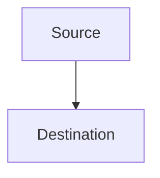

## Markdown Content Rules

Follow these repository Markdown rules when writing or editing documentation:

1. **Headings**: Use a single `#` H1 for the document title. Use `##` for major sections and `###` for subsections. Do not skip heading levels.
2. **Lists**: Use `-` for bullet points and `1.` for numbered lists. Indent nested lists with two spaces.
3. **Code Blocks**: Use fenced code blocks with a language identifier for syntax highlighting (e.g., ` ```yaml `, ` ```bash `).
4. **Links**: Use `[descriptive text](url)` syntax. Ensure links are valid and accessible.
5. **Images**: Use `` syntax. Include brief, meaningful alt text for accessibility.
6. **Tables**: Use markdown table syntax with a header row and aligned columns for readability.
7. **Line Length**: Keep lines under 400 characters. Use blank lines to separate logical sections.
8. **Whitespace**: Use a single blank line between paragraphs and sections. Avoid excessive blank lines.
9. **Emoji Headers**: Use emoji prefixes on major section headings to match the repo style where appropriate (e.g., `## 🔐 Security`, `## 📡 Network`).
10. **Front Matter**: Front matter is not required for standard documentation files. Use it only for Copilot instruction files (`.instructions.md`) and skill files (`SKILL.md`) where tooling requires metadata.

## Formatting and Structure

Follow these guidelines for formatting and structuring Markdown content in this repository:

- **Headings**: Start documents with a single `#` title, then use `##` and `###` hierarchically. Do not skip heading levels.
- **Lists**: Use `-` for bullet points and `1.` for numbered lists. Indent nested lists with two spaces.
- **Code Blocks**: Use fenced code blocks with triple backticks and include a language identifier such as `yaml`, `json`, `bash`, or `mermaid`.
- **Links**: Use descriptive link text in `[text](url)` format.
- **Images**: Use `` and write meaningful alt text.
- **Tables**: Use markdown tables for structured data such as firewall rules, VLAN mappings, and service references.
- **Line Length**: Keep lines under 400 characters for readability and compatibility with repo tooling.
- **Whitespace**: Use a single blank line between sections and paragraphs.
- **Diagrams**: Use Mermaid in fenced `mermaid` code blocks for topology maps and network flows.

## Diagrams

Use Mermaid for network flow diagrams and topology maps. Embed diagrams directly in markdown using a fenced `mermaid` code block:



## Tables

Use tables for structured data such as firewall rules, VLAN mappings, and service/port references. Align columns with spaces for readability:

```markdown
| Source VLAN | Destination VLAN | Ports | Protocol | Notes |
|-------------|------------------|-------|----------|-------|
| 10 Trusted  | 50 ServerVault   | 443   | TCP      | HTTPS |
```

## Validation Requirements

Ensure compliance with the following validation requirements:

- **Content Rules**: Verify that the content follows the Markdown content rules specified above.
- **Formatting**: Ensure that the content is properly formatted and structured according to the repository guidelines.
- **Front Matter**: Do not require front matter for standard documentation. If the file is a Copilot instruction file or `SKILL.md`, include only the metadata fields required by the relevant tooling.
- **Validation**: Run the repository Markdown validation tools to check compliance with these rules and fix issues before finalizing changes.
