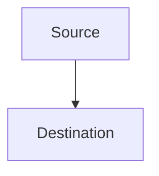

## Markdown Content Rules

Follow these rules when writing or editing documentation in this repository:

1. **Headings**: Use a single `#` H1 for the document title. Use `##` for major sections and `###` for subsections. Do not skip heading levels.
2. **Lists**: Use `-` for bullet points and `1.` for numbered lists. Indent nested lists with two spaces.
3. **Code Blocks**: Use fenced code blocks with a language identifier for syntax highlighting (e.g., ` ```yaml `, ` ```bash `).
4. **Links**: Use `[descriptive text](url)` syntax. Ensure links are valid and accessible.
5. **Images**: Use `` syntax. Include a brief, meaningful alt text for accessibility.
6. **Tables**: Use markdown table syntax with aligned columns and a header row.
7. **Line Length**: Keep lines under 400 characters. Use blank lines to separate logical sections.
8. **Whitespace**: Use a single blank line between paragraphs and sections. Avoid excessive blank lines.
9. **Emoji headers**: Use emoji prefixes on major section headings to match the repo style (e.g., `## 🔐 Security`, `## 📡 Network`).

## Front Matter

Front matter is **not required** for standard documentation files in this repository. It is only used on Copilot instruction files (`.instructions.md`) and skill files (`SKILL.md`) where tooling needs the `description` and `applyTo`/`name` fields.

## Diagrams

Use Mermaid for network flow diagrams and topology maps. Embed diagrams directly in markdown using a fenced `mermaid` code block:



## Tables

Use tables for structured data such as firewall rules, VLAN mappings, and service/port references. Align columns with spaces for readability:

```markdown
| Source VLAN | Destination VLAN | Ports | Protocol | Notes |
|-------------|------------------|-------|----------|-------|
| 10 Trusted  | 50 ServerVault   | 443   | TCP      | HTTPS |
```
