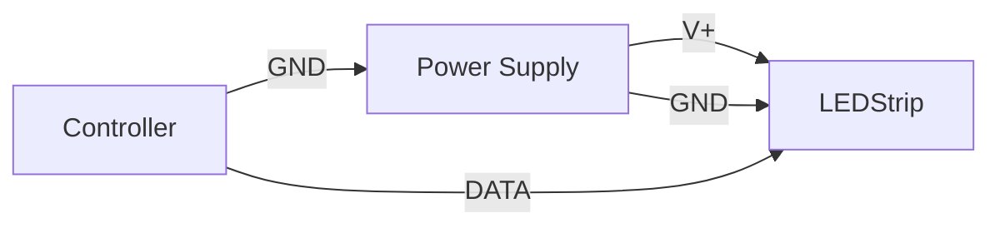

# LED Wiring Guide

## Power Requirements

- Total Wattage:
- Recommended PSU:
- PSU Overhead (20%+):
- Voltage Rail:

## Power Injection

Describe whether and where power injection is needed based on strip length and wattage. Specify injection points and wire gauge recommendations.

## Controller Wiring

- Controller Model (or type):
- DATA pin connection:
- GND connection:
- VCC/5V logic level consideration:

## Wiring Diagram

A representative Mermaid wiring diagram (see `wiring_template.mmd` for the reusable scaffold):

## Safety Notes

- Fuse recommendations based on total wattage and wire run length
- Wire gauge guidance (e.g. 18 AWG for runs > 1 m at > 5 A)
- Connector crimp or torque notes where applicable

## Reference Examples

See examples/wiringBasic.md.
