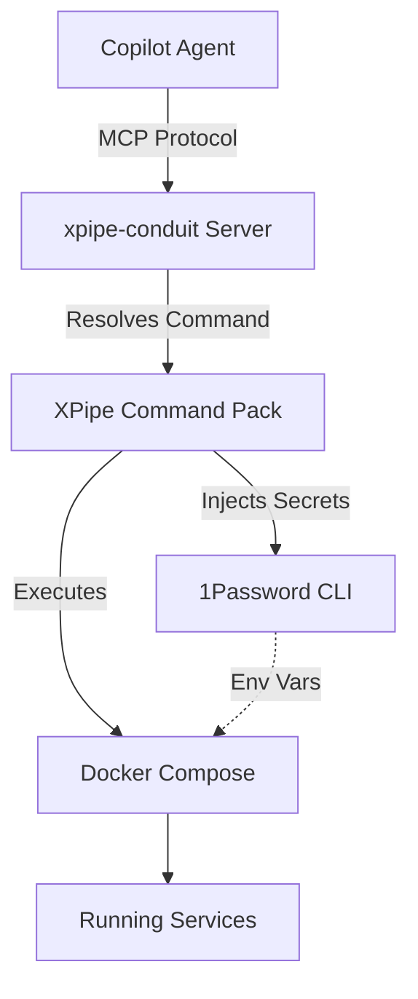

# XPipe MCP Automation Skill

Automate Docker Compose service lifecycle operations using the XPipe MCP conduit bridge. This skill enables secure, auditable service management without direct shell access, with automatic secret injection via 1Password CLI.

## When to Use This Skill

- User asks to "start a service", "stop core-network", "restart Pi-hole"
- User needs to "view logs" or "check container status"
- User wants to "exec into a container" or "run a shell command in a service"
- User requests "inject secrets and start service" with 1Password integration
- User needs to manage Docker Compose workloads: core-network, monitoring, cameras, etc.
- User asks about "XPipe commands", "MCP tools", or "service orchestration"

## Prerequisites

- XPipe installed with command pack configured (`xpipe/commands.yaml`)
- MCP server registered in `.vscode/mcp.json` pointing to `scripts/mcp/xpipe_conduit.py`
- Docker Compose service definitions under `compose/<service>/docker-compose.yml`
- 1Password CLI (`op`) installed and authenticated for secret injection
- Python 3.9+ for MCP server runtime

## Architecture Overview



**Key Principle:** MCP never runs shell commands directly. All operations are routed through named XPipe commands for auditability and safety.

## Available MCP Tools

### 1. `start_service`

Start a Docker Compose service.

**Parameters:**

- `service_name` (required): Name of service (e.g., "core-network", "pihole", "prometheus")

**Example:**

```
User: "Start the core-network service"
Agent: Calls start_service("core-network")
XPipe: Executes `docker compose -f compose/core-network/docker-compose.yml up -d core-network`
```

### 2. `stop_service`

Stop a running Docker Compose service.

**Parameters:**

- `service_name` (required): Name of service to stop

**Example:**

```
User: "Stop Pi-hole"
Agent: Calls stop_service("pihole")
XPipe: Executes `docker compose -f compose/pihole/docker-compose.yml down pihole`
```

### 3. `logs_service`

Stream logs from a service.

**Parameters:**

- `service_name` (required): Service to view logs
- `tail` (optional): Number of lines to show (default: 50)
- `follow` (optional): Follow logs in real-time (default: false)

**Example:**

```
User: "Show me the last 100 lines of Prometheus logs"
Agent: Calls logs_service("prometheus", tail=100)
XPipe: Executes `docker compose -f compose/prometheus/docker-compose.yml logs --tail=100 prometheus`
```

### 4. `shell_service`

Execute a command inside a running container.

**Parameters:**

- `service_name` (required): Service container to exec into
- `command` (required): Command to execute (e.g., "/bin/bash", "ps aux")

**Example:**

```
User: "Check running processes in core-network container"
Agent: Calls shell_service("core-network", "ps aux")
XPipe: Executes `docker compose exec core-network ps aux`
```

### 5. `inject_secrets`

Inject secrets from 1Password and start service.

**Parameters:**

- `service_name` (required): Service requiring secrets
- `secret_path` (required): 1Password reference (e.g., "op://Homelab/core-network/token")

**Example:**

```
User: "Start core-network with secrets"
Agent: Calls inject_secrets("core-network", "op://Homelab/core-network/token")
XPipe: Executes:
  export OP_SERVICE_ACCOUNT_TOKEN=$(op read "op://Homelab/core-network/token")
  docker compose -f compose/core-network/docker-compose.yml up -d core-network
```

## Supported Services

Based on `xpipe/commands.yaml`, available services include:

| Service | Compose File | Purpose |
|---------|--------------|---------|
| `core-network` | `compose/core-network/docker-compose.yml` | Pi-hole, DNS, DHCP |
| `pihole` | `compose/pihole/docker-compose.yml` | DNS ad-blocking |
| `prometheus` | `compose/prometheus/docker-compose.yml` | Metrics collection |
| `grafana` | `compose/grafana/docker-compose.yml` | Metrics visualization |
| `cameras-local` | `compose/cameras-local/docker-compose.yml` | Local camera NVR |
| `cameras-cloud` | `compose/cameras-cloud/docker-compose.yml` | Cloud camera relay |
| `home-assistant` | `compose/home-assistant/docker-compose.yml` | Smart home automation |

## Step-by-Step Workflows

### Workflow 1: Start a Service with Secrets

1. User requests: "Start the Prometheus service with secrets"
2. Identify service name: `prometheus`
3. Identify secret path: `op://Homelab/prometheus/api-key`
4. Call MCP tool: `inject_secrets("prometheus", "op://Homelab/prometheus/api-key")`
5. Wait for confirmation from XPipe
6. Verify service started: `logs_service("prometheus", tail=20)`

### Workflow 2: Debug a Failing Service

1. User reports: "Pi-hole is not responding"
2. Check logs: `logs_service("pihole", tail=100, follow=false)`
3. Analyze errors in output
4. If needed, exec into container: `shell_service("pihole", "/bin/bash")`
5. Run diagnostic commands: `shell_service("pihole", "pihole status")`
6. Restart if needed: `stop_service("pihole")` → `start_service("pihole")`

### Workflow 3: Monitor Service Health

1. User asks: "Is Grafana running properly?"
2. Check logs: `logs_service("grafana", tail=50)`
3. Look for startup completion messages
4. Check process status: `shell_service("grafana", "ps aux | grep grafana")`
5. Verify port listening: `shell_service("grafana", "netstat -tulpn | grep 3000")`

## Security Guarantees

✅ **No Arbitrary Shell Access:** MCP cannot execute shell commands outside XPipe command definitions  
✅ **Version-Controlled Commands:** All XPipe commands are in Git (`xpipe/commands.yaml`)  
✅ **Secrets Never Logged:** 1Password CLI injects secrets at runtime; not persisted  
✅ **Auditable Execution:** Every MCP tool call maps to a named XPipe command  
✅ **Least Privilege:** Services run with minimal required permissions  

## Troubleshooting

### Service Not Found

**Error:** `Unknown service: my-service`  
**Solution:** Check `xpipe/commands.yaml` for available service names. Add new service definition if needed.

### Secret Injection Fails

**Error:** `1Password CLI not authenticated`  
**Solution:** Run `op signin` to authenticate 1Password CLI before calling `inject_secrets`.

### Container Not Running

**Error:** `No container found for service: pihole`  
**Solution:** Start the service first with `start_service("pihole")` before using `shell_service` or `logs_service`.

### Permission Denied

**Error:** `docker: permission denied`  
**Solution:** Ensure user is in `docker` group or XPipe commands use `sudo` where appropriate.

## XPipe Command Structure

Commands are defined in `xpipe/commands.yaml`:

```yaml
commands:
  start-core-network:
    exec: docker compose -f compose/core-network/docker-compose.yml up -d core-network
    
  inject-secrets-core-network:
    exec: |
      export OP_SERVICE_ACCOUNT_TOKEN=$(op read "op://Homelab/core-network/token")
      docker compose -f compose/core-network/docker-compose.yml up -d core-network
```

**Naming Convention:** `<action>-<service-name>` (e.g., `start-pihole`, `stop-grafana`, `logs-prometheus`)

## Extending the Skill

### Adding a New Service

1. Create Compose file: `compose/<service>/docker-compose.yml`
2. Add XPipe commands in `xpipe/commands.yaml`:

   ```yaml
   start-<service>:
     exec: docker compose -f compose/<service>/docker-compose.yml up -d <service>
   stop-<service>:
     exec: docker compose -f compose/<service>/docker-compose.yml down <service>
   logs-<service>:
     exec: docker compose -f compose/<service>/docker-compose.yml logs <service>
   ```

3. No MCP server changes needed; conduit auto-resolves commands

### Adding Secret Paths

1. Store secret in 1Password: `op://Homelab/<service>/<key>`
2. Add inject command in `xpipe/commands.yaml`:

   ```yaml
   inject-secrets-<service>:
     exec: |
       export SECRET=$(op read "op://Homelab/<service>/<key>")
       docker compose -f compose/<service>/docker-compose.yml up -d <service>
   ```

## References

- **Full Architecture:** [docs/xpipe-mcp-conduit.md](../../../docs/xpipe-mcp-conduit.md)
- **XPipe Commands:** [xpipe/commands.yaml](../../../xpipe/commands.yaml)
- **MCP Server:** [scripts/mcp/xpipe_conduit.py](../../../scripts/mcp/xpipe_conduit.py)
- **Compose Definitions:** [compose/](../../../compose/)
- **1Password CLI:** <https://developer.1password.com/docs/cli>
- **XPipe Docs:** <https://xpipe.io>

## Quick Command Reference

| User Intent | MCP Tool Call | XPipe Command |
|-------------|---------------|---------------|
| Start service | `start_service("pihole")` | `start-pihole` |
| Stop service | `stop_service("pihole")` | `stop-pihole` |
| View logs | `logs_service("pihole", tail=100)` | `logs-pihole` |
| Exec command | `shell_service("pihole", "pihole status")` | `exec-pihole` |
| Inject secrets | `inject_secrets("pihole", "op://Homelab/pihole/key")` | `inject-secrets-pihole` |
