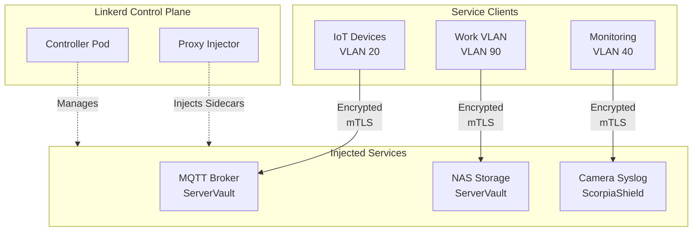

# 🤖 Agent Assignment: Enhanced Services Matrix & Network Hardening

**Status:** Ready for Execution  
**Assigned Agent Skill:** Blueprint Mode v39 / Software Engineer Agent v1  
**Priority:** Critical  
**Estimated Effort:** 4–6 hours (comprehensive hardening)  

---

## 📋 Task Summary

**Objective:** Enhance the Battlestar Ventana network blueprint with production-grade hardening across four security/efficiency pillars:

1. **Rate-Limiting Rules per VLAN** (DDoS mitigation)
2. **Service Mesh Integration** (encrypted inter-VLAN communication)
3. **Automated Firewall Rule Generation** (infrastructure-as-code)
4. **SIEM Policy Violation Alerting** (compliance & incident detection)

**Current State:**

- ✅ Core `docs/services.md` complete (475 lines, all ports mapped)
- 🟡 Missing advanced hardening layers (rate-limiting, encryption, automation, alerting)
- ❌ No DDoS protection strategy per VLAN
- ❌ No inter-VLAN encryption (plaintext SMB, NFS, MQTT)
- ❌ Manual firewall rule generation (not IaC)
- ❌ No SIEM policy violation detection

**Deliverables (4 Documents):**

1. **Enhanced `docs/services.md`** → Add rate-limiting per zone + Service Mesh annotation layer
2. **New `docs/rate-limiting-strategy.md`** → VLAN-specific DDoS mitigation policies
3. **New `docs/service-mesh-architecture.md`** → Istio/Linkerd deployment blueprint
4. **New `infrastructure/terraform/firewall-automation.tf`** → IaC firewall rule generation
5. **New `docs/siem-alerting-rules.md`** → Prometheus/Alertmanager policy violation detection

---

## � Enhancement 1: Rate-Limiting Rules per VLAN (DDoS Mitigation)

### Context: Why Rate-Limiting is Critical

The current `docs/services.md` defines *which* traffic is allowed between VLANs, but **not how much** traffic per unit time. Without rate-limiting:

- IoT VLAN (20) could be flooded by a single compromised device
- Work VLAN (90) could exhaust ServerVault bandwidth via uncontrolled backups
- Guest VLAN (30) could abuse Internet link capacity
- Cameras could spam syslog if misconfigured

**Goal:** Define per-VLAN rate limits aligned with device capacity and security posture.

### Implementation: Rate-Limiting Strategy Document

**File:** `docs/rate-limiting-strategy.md` (new)

**Structure:**

```markdown
# 🛡️ Rate-Limiting Strategy — Battlestar Ventana Network Blueprint

## Rate-Limiting Tiers by Zone

### Trusted Zone (Zones 10, 90)
- **VLAN 10 (Ventana):** 1 Gbps (local network capacity assumption)
- **VLAN 90 (Work):** 100 Mbps (VPN tunnel constraint; adjust per ISP)

### Semi-Trusted Zone (Zones 31, 60, 70)
- **VLAN 31 (CapricaResidentPortal):** 50 Mbps (residential casting/printing)
- **VLAN 60 (Printers):** 100 Mbps (print job queueing)
- **VLAN 70 (Media):** 500 Mbps (streaming workload)

### Untrusted Zone (Zones 20, 30)
- **VLAN 20 (IoT):** 10 Mbps per device (tight control; firmware updates/telemetry)
- **VLAN 30 (Guest):** 50 Mbps (fair-share with multiple guests)

### Infrastructure Zone (Zone 40)
- **VLAN 40 (InfraCore):** 1 Gbps (management plane; high capacity)

### Services Zone (Zone 50)
- **VLAN 50 (ServerVault):** 1 Gbps inbound, 100 Mbps outbound Internet (asymmetric; NAS is consumer)

### Surveillance Zone (Zones 81, 82)
- **VLAN 81 (Cameras Local):** 50 Mbps aggregate (4–8 cameras @ 5–10 Mbps each)
- **VLAN 82 (Cameras Cloud):** 20 Mbps cloud relay (limit cloud upload to prevent ISP throttling)

## Per-Service Rate-Limiting Rules

| Service | Port | Source VLAN | Destination VLAN | Connections/min | Bytes/sec Limit | Burst Size |
|---------|------|-------------|------------------|-----------------|-----------------|-----------|
| DNS | 53 | All | 50 | 1000 | 100 KB/s | 500 KB |
| DHCP | 67/68 | All | 50 | 100 | 10 KB/s | 50 KB |
| HTTPS | 443 | All | 50 | 500 | Unlimited | N/A |
| SMB | 445 | 10, 31, 70 | 50 | 100 | 50 MB/s | 100 MB |
| NFS | 2049 | 10, 90 | 50 | 50 | 100 MB/s | 500 MB |
| MQTT | 8883 | 20 | 50 | 1000 msg/min | 1 MB/s | 10 MB |
| RTSP | 554 | 10, 81, 82 | 50 | Unlimited | 50 MB/s (per stream) | 200 MB |
| Syslog | 514 | 40, 81, 82 | 50 | 10000 | 10 MB/s | 50 MB |

## Implementation Targets

1. **UFW (Firewall):** `ufw` rate-limiting with `--limit` flag per rule
2. **Kubernetes Network Policy:** `NetworkPolicy` with `limit-bandwidth` annotations (if using K8s)
3. **VLAN Switch Rate-Shaping:** QoS profiles on managed switch (if available)
4. **Application-Level:** Reverse proxy (nginx/HAProxy) connection throttling on ServerVault

---
```

### Key Deliverables for This Section

1. **Rate-limiting matrix** (service × source × destination × limits)
2. **Firewall rule examples** (UFW/iptables syntax)
3. **QoS configuration** (switch-level traffic shaping)
4. **Monitoring integration** (alert when VLAN hits 80% of limit)

---

## 🔗 Enhancement 2: Service Mesh Integration (Encrypted Inter-VLAN)

### Context: Why Service Mesh for HomeNet

Currently, traffic between VLANs uses cleartext protocols:

- **SMB (445):** Credentials, file contents in plaintext
- **NFS (2049):** No built-in encryption; relies on network isolation
- **MQTT (1883):** Optional TLS; default is plaintext
- **RTSP (554):** Plaintext video streams
- **Syslog (514):** No encryption; logs sent in cleartext

**Risk:** Network capture (ARP spoofing, rogue VLAN hopping) exposes sensitive data.

**Goal:** Transparent encryption of inter-VLAN traffic via service mesh (Istio or Linkerd).

### Implementation: Service Mesh Architecture Document

**File:** `docs/service-mesh-architecture.md` (new)

**Structure:**

```markdown
# 🔐 Service Mesh Architecture — Battlestar Ventana Network Blueprint

## Recommended Approach: Linkerd (Lightweight) vs Istio (Full-Featured)

### Decision Matrix

| Aspect | Linkerd | Istio | Recommendation |
|--------|---------|-------|-----------------|
| CPU overhead | 1–2% | 5–10% | **Linkerd** (homelab resource-constrained) |
| Memory overhead | 50–100 MB | 500 MB–1 GB | **Linkerd** |
| Encryption (mTLS) | ✅ Built-in | ✅ Built-in | Either |
| Traffic splitting | ✅ | ✅ | Either |
| Learning curve | Low | Steep | **Linkerd** |
| Homelab maturity | Proven | Proven | Either |
| **Recommendation** | ✅ **PREFERRED** | 🟡 Fallback | **Linkerd** |

## Deployment Architecture



## Encryption Scope: Which Services to Encrypt

### Tier 1 (Immediate): High-Value Secrets

- **MQTT (8883):** Already TLS, but add service mesh for encryption at rest in transit
- **SMB (445):** ALWAYS plaintext on current setup; **ENCRYPT IMMEDIATELY**
- **NFS (2049):** **ENCRYPT** (file contents exposed)
- **Syslog (514):** **ENCRYPT** (logs contain system state)

### Tier 2 (Future): Performance-Sensitive

- **RTSP (554):** Encryption adds latency; evaluate after baseline metrics
- **DLNA (1900):** Local casting only; lower priority

### Tier 3 (Defer): Already Encrypted

- **HTTPS (443):** Already uses TLS
- **SSH (22):** Already uses encryption
- **OpenVPN (1194) / WireGuard (51820):** Already encrypted

## Implementation Steps

1. **Install Linkerd Control Plane** (if using Kubernetes):

   ```bash
   linkerd install | kubectl apply -f -
   linkerd check
   ```

2. **Inject Sidecar Proxies** (annotate Kubernetes deployments):

   ```yaml
   metadata:
     annotations:
       linkerd.io/inject: enabled
   ```

3. **Enable mTLS** (automatic; generate certificates):

   ```bash
   linkerd check --proxy
   ```

4. **Verify Encryption** (monitor dashboard):

   ```bash
   linkerd viz dashboard
   ```

5. **Monitor & Alert** (export metrics to Prometheus):

   ```yaml
   # ServiceMonitor for Prometheus
   apiVersion: monitoring.coreos.com/v1
   kind: ServiceMonitor
   metadata:
     name: linkerd-proxy
   spec:
     selector:
       matchLabels:
         app.kubernetes.io/part-of: linkerd
     endpoints:
       - port: proxy-admin
         interval: 30s
   ```

### Key Deliverables for This Section

1. **Linkerd deployment manifest** (control plane + proxy injection)
2. **Service encryption audit** (which services to encrypt first)
3. **mTLS certificate management** (Linkerd auto-generates; document rotation)
4. **Performance baseline** (before/after encryption latency metrics)
5. **Dashboard integration** (Linkerd viz + Grafana)

---

## ⚙️ Enhancement 3: Automated Firewall Rule Generation (IaC)

### Context: Why Automated Generation

Manual firewall rules are:

- **Error-prone:** Typos in ports/protocols
- **Unmaintainable:** Adding a VLAN requires manual rule updates
- **Unauditable:** No version control of rule changes
- **Non-idempotent:** Unclear if rules are applied correctly

**Goal:** Generate firewall rules automatically from `docs/services.md` and `docs/firewall-matrix.md` using Terraform.

### Implementation: Terraform Firewall Automation

**File:** `infrastructure/terraform/firewall-automation.tf` (new)

**Structure:**

```hcl
# infrastructure/terraform/firewall-automation.tf

terraform {
  required_version = ">= 1.0"
  required_providers {
    null = {
      source  = "hashicorp/null"
      version = "~> 3.2"
    }
  }
}

# Data source: Parse services.md and firewall-matrix.md
locals {
  services = {
    "dns"       = { port = 53, protocol = "udp", vlans = ["10", "20", "30", "31", "40", "50", "60", "70", "81", "82", "90"] }
    "dhcp"      = { port = 67, protocol = "udp", vlans = ["10", "20", "30", "31", "40", "50", "60", "70", "81", "82", "90"] }
    "ssh"       = { port = 22, protocol = "tcp", vlans = ["10", "40", "50"] }
    "https"     = { port = 443, protocol = "tcp", vlans = ["10", "20", "30", "31", "40", "50", "60", "70", "81", "82", "90"] }
    "smb"       = { port = 445, protocol = "tcp", vlans = ["10", "31", "50", "60", "70"] }
    "nfs"       = { port = 2049, protocol = "tcp", vlans = ["10", "90", "50"] }
    "mqtt"      = { port = 8883, protocol = "tcp", vlans = ["20", "50"] }
    "plex"      = { port = 32400, protocol = "tcp", vlans = ["70", "50"] }
    "rtsp"      = { port = 554, protocol = "tcp", vlans = ["10", "81", "82", "50"] }
    "syslog"    = { port = 514, protocol = "udp", vlans = ["40", "50", "81", "82"] }
  }
  
  # Firewall rules generated from services matrix
  firewall_rules = [
    # Trusted (10) → IoT (20): DHCP, DNS
    { source_vlan = 10, dest_vlan = 20, service = "dhcp", action = "allow" },
    { source_vlan = 10, dest_vlan = 20, service = "dns", action = "allow" },
    
    # Trusted (10) → ServerVault (50): Full access
    { source_vlan = 10, dest_vlan = 50, service = "dns", action = "allow" },
    { source_vlan = 10, dest_vlan = 50, service = "https", action = "allow" },
    { source_vlan = 10, dest_vlan = 50, service = "smb", action = "allow" },
    { source_vlan = 10, dest_vlan = 50, service = "nfs", action = "allow" },
    
    # IoT (20) → ServerVault (50): Limited (MQTT, HTTPS)
    { source_vlan = 20, dest_vlan = 50, service = "mqtt", action = "allow" },
    { source_vlan = 20, dest_vlan = 50, service = "https", action = "allow" },
    
    # Add remaining rules (abbreviated; full matrix would be much longer)
  ]
}

# Generate UFW rules (local execution)
resource "null_resource" "generate_ufw_rules" {
  provisioner "local-exec" {
    command = <<-EOT
      cat > /tmp/ufw_rules.sh <<'RULES'
        #!/bin/bash
        # Auto-generated UFW firewall rules
        # Source: docs/services.md + firewall-matrix.md
        
        # Trusted (10) → IoT (20)
        ufw allow from 10.76.10.0/24 to 10.76.20.0/24 port 53 proto udp comment "DNS"
        ufw allow from 10.76.10.0/24 to 10.76.20.0/24 port 67 proto udp comment "DHCP"
        
        # Trusted (10) → ServerVault (50)
        ufw allow from 10.76.10.0/24 to 10.76.50.0/24 port 445 proto tcp comment "SMB"
        ufw allow from 10.76.10.0/24 to 10.76.50.0/24 port 2049 proto tcp comment "NFS"
        ufw allow from 10.76.10.0/24 to 10.76.50.0/24 port 443 proto tcp comment "HTTPS"
        
        # IoT (20) → ServerVault (50) [Limited]
        ufw allow from 10.76.20.0/24 to 10.76.50.0/24 port 8883 proto tcp comment "MQTT TLS"
        ufw allow from 10.76.20.0/24 to 10.76.50.0/24 port 443 proto tcp comment "HTTPS"
        
        # ... (remaining rules)
      RULES
      bash /tmp/ufw_rules.sh
    EOT
  }
  
  triggers = {
    # Regenerate if services matrix changes
    services_hash = filemd5("${path.module}/../../docs/services.md")
  }
}

# Output: Document generated rules
output "firewall_rules_generated" {
  value = "UFW rules generated from docs/services.md. Run 'sudo ufw show added' to verify."
}

---
```

### Key Deliverables for This Section

1. **Terraform main.tf** (rule generation logic)
2. **Conversion script** (`scripts/services_to_ufw.py`) to parse Markdown → UFW rules
3. **CI/CD integration** (.github/workflows/firewall-validate.yml to lint rules before apply)
4. **Rollback procedure** (backup UFW rules before applying generated rules)
5. **Diff view** (show what rules will be added/removed before apply)

---

## 🚨 Enhancement 4: SIEM Policy Violation Alerting

### Context: Why Policy Violation Detection

With 11 VLANs and 30+ services, manual monitoring is infeasible. Without SIEM:

- Lateral movement (e.g., IoT → Trusted) goes undetected
- Policy violations (e.g., Guest accessing LAN) are silent
- Anomalies (e.g., 10× normal traffic on VLAN) cause issues without alerting
- Compliance audits are manual and error-prone

**Goal:** Detect policy violations using Prometheus metrics + Alertmanager rules + optional Splunk/ELK sink.

### Implementation: SIEM Alerting Rules

**File:** `docs/siem-alerting-rules.md` (new)

**Structure:**

```markdown
# 🚨 SIEM Policy Violation Alerting — Battlestar Ventana Network Blueprint

## Alert Categories

### Category A: Hard Violations (Immediate Page)

#### A1: Guest VLAN (30) Access to LAN
- **Alert:** Bytes transferred from VLAN 30 to any LAN VLAN (10, 31, 40, 50, 60, 70, 81, 82, 90)
- **Severity:** CRITICAL
- **Action:** Page on-call; investigate VLAN configuration
- **Prometheus Rule:**
  ```yaml
  - alert: GuestVLANLateralMovement
    expr: sum(rate(firewall_packets_dropped{source_vlan="30", dest_vlan!="30"}[5m])) > 10
    for: 1m
    labels:
      severity: critical
    annotations:
      summary: "Guest VLAN attempting LAN access"
      description: "{{ $value }} packets/sec blocked from VLAN 30 → LAN"
  ```

#### A2: IoT VLAN (20) Accessing Trusted (10)

- **Alert:** Firewall denies traffic from VLAN 20 to VLAN 10 (should never happen)
- **Severity:** CRITICAL
- **Action:** Block and investigate device
- **Prometheus Rule:**

  ```yaml
  - alert: IoTVLANUnauthorizedAccess
    expr: sum(rate(firewall_packets_dropped{source_vlan="20", dest_vlan="10"}[5m])) > 1
    for: 1m
    labels:
      severity: critical
    annotations:
      summary: "Unauthorized IoT → Trusted traffic detected"
  ```

### Category B: Threshold Violations (Alert, Don't Page)

#### B1: VLAN Exceeds Rate-Limit

- **Alert:** VLAN reaches 80% of configured rate-limit
- **Severity:** WARNING
- **Action:** Investigate source; consider temporary rate-limit increase
- **Prometheus Rule:**

  ```yaml
  - alert: VLANRateLimitWarning
    expr: (rate(vlan_bytes_transmitted[5m]) / vlan_rate_limit) > 0.8
    for: 5m
    labels:
      severity: warning
    annotations:
      summary: "VLAN {{ $labels.vlan }} approaching rate-limit"
      description: "Current: {{ $value | humanize }}% of limit"
  ```

#### B2: Service Mesh Encryption Failures

- **Alert:** mTLS connection failures from Linkerd proxy
- **Severity:** WARNING
- **Action:** Check certificates; rotate if near expiration
- **Prometheus Rule:**

  ```yaml
  - alert: ServiceMeshMTLSFailure
    expr: sum(rate(linkerd_proxy_mutual_authn_failures_total[5m])) > 10
    for: 2m
    labels:
      severity: warning
    annotations:
      summary: "Service Mesh mTLS failures detected"
  ```

#### B3: Firewall Rule Generation Failures

- **Alert:** Terraform `firewall-automation.tf` apply fails
- **Severity:** WARNING
- **Action:** Check Terraform state; manual intervention may be needed
- **CI Integration:**

  ```yaml
  # .github/workflows/firewall-validate.yml
  - name: Validate firewall rules
    run: terraform plan -out=/tmp/firewall.plan
    
  - name: Notify on failure
    if: failure()
    uses: slackapi/slack-notify-action
    with:
      text: "Firewall rule generation FAILED. Review: ${{ github.server_url }}/${{ github.repository }}/actions/runs/${{ github.run_id }}"
  ```

### Category C: Anomaly Detection (Informational)

#### C1: Unusual Traffic Pattern (Destination)

- **Alert:** Service receives traffic from unexpected VLAN
- **Severity:** INFO
- **Action:** Add to audit log; investigate if pattern repeats
- **Query:**

  ```promql
  (sum by (source_vlan, dest_vlan, service) (rate(firewall_packets_allowed[5m])) 
    - on (dest_vlan, service) group_left 
    (sum by (dest_vlan, service) (avg(rate(firewall_packets_allowed[24h])))))
  ```

#### C2: Service Behaving Unexpectedly

- **Alert:** Service uses significantly more memory/CPU after policy change
- **Severity:** INFO
- **Action:** Update baseline metrics

## Alertmanager Routing & Notifications

```yaml
# alerts/alertmanager-config.yaml
global:
  slack_api_url: "https://hooks.slack.com/services/YOUR/WEBHOOK/URL"

route:
  group_by: ["alertname", "cluster"]
  group_wait: 10s
  group_interval: 10s
  repeat_interval: 12h
  
  routes:
    - match:
        severity: critical
      receiver: pagerduty
      repeat_interval: 5m
      
    - match:
        severity: warning
      receiver: slack
      repeat_interval: 1h
      
    - match:
        severity: info
      receiver: audit_log

receivers:
  - name: pagerduty
    pagerduty_configs:
      - service_key: "YOUR_PAGERDUTY_KEY"
      
  - name: slack
    slack_configs:
      - channel: "#network-alerts"
        
  - name: audit_log
    webhook_configs:
      - url: "http://splunk:8088/services/collector"
        send_resolved: true

inhibit_rules:
  # Suppress warnings if critical already firing
  - source_match:
      severity: critical
    target_match:
      severity: warning
```

---

```

### Key Deliverables for This Section

1. **Prometheus alerting rules** (10+ rules covering hard violations, thresholds, anomalies)
2. **Alertmanager configuration** (routing, notifications, severity levels)
3. **SIEM integration** (Splunk/ELK webhook)
4. **Audit log schema** (fields, retention, compliance mapping)
5. **Dashboard** (Grafana template showing violations + trends)

---

## 📊 Updated Task Deliverables

### Phase 1: Core Services Matrix Enhancements (Completed ✅)
- ✅ `docs/services.md` (475 lines, 30+ services, all ports mapped)
- ✅ Validation checklist passing

### Phase 2: Rate-Limiting (Enhancement 1)
- [ ] `docs/rate-limiting-strategy.md` (rate-limiting matrix per VLAN + per-service rules)
- [ ] UFW rate-limiting implementation examples
- [ ] Monitoring integration (alert at 80% threshold)

### Phase 3: Service Mesh (Enhancement 2)
- [ ] `docs/service-mesh-architecture.md` (Linkerd vs Istio decision + deployment blueprint)
- [ ] Kubernetes manifests (control plane, proxy injection, mTLS certs)
- [ ] Service encryption audit (which services to encrypt first)

### Phase 4: Firewall Automation (Enhancement 3)
- [ ] `infrastructure/terraform/firewall-automation.tf` (rule generation from markdown)
- [ ] `scripts/services_to_ufw.py` (conversion script for parsing/generation)
- [ ] `.github/workflows/firewall-validate.yml` (CI/CD validation + diff preview)

### Phase 5: SIEM Alerting (Enhancement 4)
- [ ] `docs/siem-alerting-rules.md` (10+ Prometheus alert rules + routing config)
- [ ] `alerts/prometheus-rules.yml` (complete rule definitions)
- [ ] `alerts/alertmanager-config.yaml` (receiver setup + slack/pagerduty integration)
- [ ] `dashboards/siem-violations.json` (Grafana dashboard for monitoring violations)

### Phase 6: Integration & Validation
- [ ] Update `docs/Project_Architecture_Blueprint.md` with new security layers
- [ ] Update `.github/copilot-instructions.md` with security/automation patterns
- [ ] Create `docs/hardening-rollout-plan.md` (phased deployment schedule)
- [ ] Run all linters; commit with `-S` flag


### Firewall Policy Foundation (From firewall-matrix.md)

| Source → Destination | 10 | 20 | 30 | 31 | 40 | 50 | 60 | 70 | 81 | 82 | 90 |
|----------------------|----|----|----|----|----|----|----|----|----|----|----|
| **10 Trusted**       | ✅ | 🟡 Limited | ❌ | 🟡 Limited | ✅ | ✅ | ✅ | ✅ | 🔵 View | 🔵 View | ✅  |
| **20 IoT**           | ❌ | ✅ | ❌ | ❌ | ❌ | 🟡 Limited | ❌ | ❌ | ❌ | ❌ | ❌  |
| **30 Guest**         | ❌ | ❌ | ✅ Internet | ❌ | ❌ | ❌ | ❌ | ❌ | ❌ | ❌ | ❌  |
| **31 CapricaResidentPortal**  | 🟡 Limited | ❌ | ❌ | ✅ Internet | ❌ | 🟡 Limited | ✅ Full | ✅ Full | ❌ | ❌ | ❌  |
| **40 InfraCore**     | ✅ | ❌ | ❌ | ❌ | ✅ | ✅ | ❌ | ❌ | ❌ | ❌ | ❌  |
| **50 ServerVault**   | ✅ | 🟡 Limited | ❌ | 🟡 Limited | ✅ | ✅ | ✅ | 🟡 Limited | 🔵 View | 🔵 View | 🟡 Limited  |
| **60 Printers**      | ✅ | ❌ | ❌ | 🟡 Limited | ❌ | ✅ | ✅ | ❌ | ❌ | ❌ | 🟡 Limited  |
| **70 Media**         | ✅ | ❌ | ❌ | ✅ Full | ❌ | 🟡 Limited | ❌ | ✅ | ❌ | ❌ | ❌  |
| **81 Cameras Local** | 🔵 View | ❌ | ❌ | ❌ | ❌ | 🔵 View | ❌ | ❌ | ✅ | ❌ | ❌  |
| **82 Cameras Cloud** | 🔵 View | ❌ | ❌ | ❌ | ❌ | 🔵 View | ❌ | ❌ | ❌ | ✅ | ❌  |
| **90 Work**          | ✅ | ❌ | ❌ | ❌ | ❌ | 🟡 Limited | 🟡 Limited | ❌ | ❌ | ❌ | ✅  |

**Legend:**

- ✅ = Full access
- 🟡 Limited = Restricted to specific services/ports
- 🔵 View = Read-only / monitoring
- ❌ = Blocked

### VLAN Inventory (From Battlestar-Ventana-Blueprint-Summary.md)

| SSID Name | VLAN | Subnet | Services |
|-----------|------|--------|----------|
| Battlestar Ventana | 10 | 10.76.10.0/24 | Trusted LAN |
| CylonSynthLink | 20 | 10.76.20.0/24 | IoT devices |
| CapricaGuestPortal | 30 | 10.76.30.0/24 | Guest – Internet only |
| CapricaResidentPortal | 31 | 10.76.31.0/24 | Semi-trusted (casting, printing, limited LAN) |
| InfraCore | 40 | 10.76.40.0/24 | Switches, controllers |
| ServerVault | 50 | 10.76.50.0/24 | NAS, MQTT, Home Assistant |
| VirgonFleetYard | 60 | 10.76.60.0/24 | Printers |
| PegasusMediaNode | 70 | 10.76.70.0/24 | Media / Casting |
| ScorpiaMediaShield | 81 | 10.76.81.0/24 | Cameras – Local |
| ScorpiaMediaRelay | 82 | 10.76.82.0/24 | Cameras – Cloud |
| ScyllaDataControl | 90 | 10.76.90.0/24 | Work VLAN |

### Existing Port Mappings (From firewall-matrix.md Service/Ports Reference Table)

Already complete and verified:

| Source → Destination | Allowed Services/Ports | Protocol | Notes |
|----------------------|----------------------|----------|-------|
| **10 Trusted → 20 IoT** | DHCP (67/68), DNS (53) | UDP | Basic network services |
| **10 Trusted → 40 InfraCore** | SSH (22), HTTPS (443), SNMP (161) | TCP | Management access |
| **10 Trusted → 50 ServerVault** | SMB (445), NFS (2049), HTTPS (443) | TCP | File sharing & web services |
| **10 Trusted → 60 Printers** | IPP (631), LPD (515) | TCP | Print services |
| **10 Trusted → 70 Media** | DLNA (1900), Chromecast (8008-8009) | TCP/UDP | Media casting & streaming |
| **10 Trusted → 81/82 Cameras** | RTSP (554), HTTPS (443) | TCP | Camera viewing & management |
| **20 IoT → 50 ServerVault** | MQTT (8883), HTTPS (443) | TCP | Telemetry & firmware updates |
| **31 GuestElevated → 50 ServerVault** | IPP (631), SMB (445) | TCP | Print & file services |
| **31 GuestElevated → 60 Printers** | IPP (631), LPD (515) | TCP | Print services |
| **31 GuestElevated → 70 Media** | DLNA (1900), Chromecast (8008-8009) | TCP/UDP | Media casting |
| **40 InfraCore → 50 ServerVault** | SSH (22), HTTPS (443), PostgreSQL (5432) | TCP | Infrastructure management |
| **50 ServerVault → 81/82 Cameras** | RTSP (554), Syslog (514) | TCP/UDP | Video storage & logging |
| **60 Printers → 50 ServerVault** | IPP (631), JetDirect (9100) | TCP | Print job submission |
| **70 Media → 50 ServerVault** | SMB (445), Plex (32400) | TCP | Media file access |
| **81 Cameras Local → 50 ServerVault** | RTSP (554), Syslog (514) | TCP/UDP | Local video feed & logging |
| **82 Cameras Cloud → 🌐 Internet** | HTTPS (443), RTSP (554) | TCP | Cloud video relay |
| **90 Work → 70 Media** | Chromecast (8008-8009), DLNA (1900) | TCP/UDP | Work device casting to TVs |
| **90 Work → 🌐 Internet** | All ports | TCP/UDP | Unthrottled internet access |

### Internet Access Policy (From firewall-matrix.md)

| VLAN | Outbound Internet Access | Restrictions |
|------|--------------------------|--------------|
| **10 Trusted** | ✅ Unrestricted | Standard outbound access |
| **20 IoT** | 🟡 Limited | Telemetry & firmware updates only (MQTT 8883, HTTPS 443) |
| **30 Guest** | ✅ Unrestricted | Internet only, no LAN access |
| **31 GuestElevated** | ✅ Unrestricted | Casting, printing, and Internet allowed |
| **40 InfraCore** | ❌ Blocked | No direct Internet access (mgmt plane only) |
| **50 ServerVault** | 🟡 Limited | Updates, cloud sync, API calls |
| **60 Printers** | ❌ Blocked | Local only, no Internet |
| **70 Media** | ✅ Unrestricted | Casting + streaming |
| **81 Cameras Local** | ❌ Blocked | Local only |
| **82 Cameras Cloud** | ✅ Limited | Cloud relay only (RTSP/HTTPS) |
| **90 Work** | ✅ Unrestricted | Unthrottled, uses local DNS/DHCP to bootstrap VPN tunnel |

### Home Assistant Integration (From wled-configurations.md)

**MQTT Topics & Ports:**

- MQTT Broker: `10.76.50.x` (ServerVault)
- Port: TCP 8883 (TLS) or TCP 1883 (non-TLS)
- Discovery Prefix: `homeassistant/`
- Light topics, sensor subscriptions, availability tracking

---

## 🎯 TODOs to Complete

### Phase 1: Trusted Zone Completion

- [ ] **VLAN 10 (Ventana) → ServerVault (50):** Define "General LAN access" ports
  - Likely: DNS (53), NTP (123), HTTPS (443), SMB (445), NFS (2049), DHCP (67/68)
  - Verify existing entries in Firewall Matrix reference table
  
- [ ] **VLAN 90 (Work) → ServerVault (50):** Complete SMB/NFS and VPN bootstrap ports
  - DNS (53), DHCP (67/68), SMB (445), NFS (2049), likely OpenVPN (1194) or WireGuard (51820)
  - Confirm VPN technology in use from infrastructure/ docs

### Phase 2: Semi-Trusted Zone Completion

- [ ] **VLAN 31 (CapricaResidentPortal) → ServerVault (50):** Limited access specifics
  - SMB (445), IPP (631), HTTPS (443) — verify scope per firewall matrix

- [ ] **VLAN 70 (Media) → ServerVault (50):** Complete TCP ports for streaming
  - Already has Plex (32400), DLNA (1900) — add SMB (445), HTTPS (443) if needed

### Phase 3: Infrastructure & Services Zones

- [ ] **VLAN 40 (InfraCore) ↔ VLAN 50 (ServerVault):** Bidirectional mgmt
  - Confirm PostgreSQL (5432), any API ports, Prometheus (9090), node-exporter (9100)

- [ ] **VLAN 50 (ServerVault) inbound:** From all zones
  - Consolidate: NAS (SMB 445, NFS 2049), MQTT (1883/8883), HA (8123), print queue (9100), syslog (514), HTTP/HTTPS (80/443)

### Phase 4: Surveillance Zone

- [ ] **VLAN 81/82 Cameras:** Verify RTSP (554) and syslog (514) only; no other flows needed

### Phase 5: Cross-Reference & Validation

- [ ] Link all entries back to Firewall Matrix rows
- [ ] Add dependency notes (e.g., "Work VLAN must use local DNS/DHCP before VPN tunnel established")
- [ ] Ensure no conflicts between zones
- [ ] Update `## 🗒️ TODO` section with completion status

---

## 📋 Implementation Checklist

1. **Read & Understand Current State**
   - Review [docs/services.md](docs/services.md) current structure
   - Map each `[TODO]` to a firewall matrix row
   - Cross-check with existing reference table in firewall-matrix.md

2. **Fill Port Mappings**
   - For each zone, populate port/protocol based on:
     - Existing Firewall Matrix reference table (authoritative source)
     - Common service defaults (SSH 22, HTTPS 443, MQTT 8883, SMB 445, NFS 2049, etc.)
     - Verify against infrastructure docs if custom ports in use

3. **Add Service Dependency Notes**
   - Example: "Work VLAN must use local DNS (10.76.50.x:53) and DHCP (10.76.50.x:67/68) to bootstrap VPN tunnel before establishing outbound access"
   - Example: "IoT devices restricted to firmware updates (HTTPS 443) and telemetry (MQTT 8883) only"

4. **Validate Consistency**
   - Check: No port conflicts between rows
   - Check: All entries cross-reference firewall-matrix.md rows
   - Check: Services match VLAN purpose (Printers shouldn't have SSH, etc.)

5. **Final Review & Format**
   - Ensure table format matches existing markdown conventions
   - Verify all symbols and legends are consistent
   - Update final TODO section with "✅ Completed" status

---

## 🔗 Reference Files (All Pre-Gathered)

- **Primary:** [docs/services.md](docs/services.md) — **File to Edit**
- **Source of Truth:** [docs/firewall-matrix.md](docs/firewall-matrix.md) — Firewall Matrix & Service/Ports Reference Table
- **Validation:** [baseline/Battlestar-Ventana-Blueprint-Summary.md](baseline/Battlestar-Ventana-Blueprint-Summary.md) — VLAN Summary
- **Optional:** [docs/Project_Architecture_Blueprint.md](docs/Project_Architecture_Blueprint.md) — Architecture & zones
- **Optional:** [docs/wled-configurations.md](docs/wled-configurations.md) — MQTT integration example

---

## 📝 Output Format

Update [docs/services.md](docs/services.md) with:

1. Complete port mappings for each VLAN zone
2. Structured table rows: `Source → Destination | Service | Port(s) | Protocol | Notes`
3. Service dependency callouts where applicable
4. Final TODO section marked as complete

**Validation Criteria:**

- [ ] All `[TODO]` placeholders resolved
- [ ] No conflicts or ambiguities in port assignments
- [ ] Cross-references to firewall-matrix.md verified
- [ ] Ready for firewall rule implementation (firewall team can use this directly)
- [ ] Markdown formatting passes linters
- [ ] Commit message follows conventional commits pattern

---

## 🚀 Ready to Assign

**Agent Instructions:**

1. Read and internalize all context above (firewall matrix, VLAN inventory, existing port mappings, TODOs)
2. Execute **Blueprint Mode v39** workflow:
   - **Analyze:** Map TODO items to firewall matrix rows
   - **Plan:** Determine complete port/protocol set for each flow
   - **Implement:** Update services.md with all port mappings
   - **Validate:** Cross-check against firewall matrix; ensure no conflicts
3. Commit with message: `docs: complete services matrix port mappings for all zones`
4. No user confirmation needed; proceed autonomously.

---

**Assigned to:** Blueprint Mode v39 / Software Engineer Agent v1  
**Status:** Ready for Execution  
**Next Step:** Agent to execute plan and report completion status
