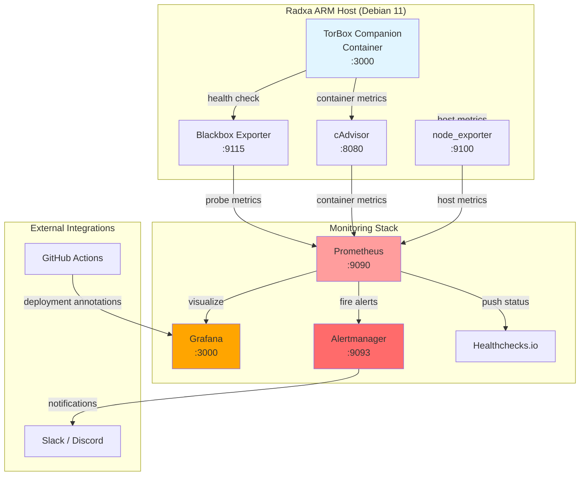

# TorBox Companion — Monitoring & Observability

Complete monitoring, alerting, and observability setup for the TorBox Companion service running on a Radxa ARM board in the Battlestar‑Ventana homelab.

---

## Overview

This monitoring stack provides:

- **Real-time metrics**: CPU, memory, network, disk I/O
- **Proactive alerting**: Service downtime, high latency, restart loops, API errors
- **Visual dashboards**: Grafana dashboard with auto-provisioning
- **Event tracking**: Deployment and restart annotations
- **SLO compliance**: 99.5% availability, p95 < 500ms, RTO < 5 minutes

---

## Monitoring Architecture



---

## Service Level Objectives (SLOs)

| Metric | Target | Alert Threshold | RTO |
|--------|--------|----------------|-----|
| Availability | 99.5% | Down for 2+ minutes | < 5 minutes |
| Latency (p95) | < 500ms | > 500ms for 5+ minutes | N/A |
| Error Rate | < 1% | > 1% for 5+ minutes | N/A |
| Restart Stability | < 1 restart/hour | > 3 restarts in 10 minutes | < 2 minutes |

---

## Deployment Architecture

### Component Placement

```text
/Blueprints/Services/TorBoxCompanion/
├── grafana/
│   ├── provisioning.yaml         # Auto-load dashboard config
│   └── dashboard.json             # (Optional) Dashboard definition
├── prometheus/
│   └── alert-rules.yml            # Alert definitions
├── exporters/
│   ├── cadvisor-compose.yml       # Container metrics exporter
│   └── node-exporter-compose.yml  # Host metrics exporter
├── annotations/
│   └── grafana-annotations.yaml   # Event annotation config
├── MONITORING-TORBOX-COMPANION.md # This file
├── TORBOX-COMPANION.md            # Service deployment guide
└── PROMPT-GENERATOR.md            # Artifact generation prompt
```

---

## Quick Start

### Step 1: Deploy Exporters

```bash
# Deploy cAdvisor for container metrics
cd /opt/monitoring/
cp /path/to/exporters/cadvisor-compose.yml .
docker compose -f cadvisor-compose.yml up -d

# Deploy node_exporter for host metrics
cp /path/to/exporters/node-exporter-compose.yml .
docker compose -f node-exporter-compose.yml up -d

# Verify exporters are running
curl http://localhost:8080/metrics  # cAdvisor
curl http://localhost:9100/metrics  # node_exporter
```

### Step 2: Configure Firewall

```bash
# Allow Prometheus to scrape metrics
sudo firewall-cmd --zone=home --add-port=8080/tcp --permanent  # cAdvisor
sudo firewall-cmd --zone=home --add-port=9100/tcp --permanent  # node_exporter
sudo firewall-cmd --zone=home --add-port=9115/tcp --permanent  # Blackbox Exporter (if used)
sudo firewall-cmd --reload
```

### Step 3: Configure Prometheus

Add the following scrape configs to `/etc/prometheus/prometheus.yml`:

```yaml
scrape_configs:
  # TorBox Companion service (via Blackbox Exporter)
  - job_name: 'torbox-companion'
    metrics_path: /probe
    params:
      module: [http_2xx]
    static_configs:
      - targets:
          - http://172.30.0.10:3000/health
    relabel_configs:
      - source_labels: [__address__]
        target_label: __param_target
      - source_labels: [__param_target]
        target_label: instance
      - target_label: __address__
        replacement: localhost:9115  # Blackbox Exporter address

  # cAdvisor (container metrics)
  - job_name: 'cadvisor'
    static_configs:
      - targets: ['localhost:8080']
        labels:
          host: 'radxa'
          service: 'torbox-companion'

  # node_exporter (host metrics)
  - job_name: 'node-exporter'
    static_configs:
      - targets: ['localhost:9100']
        labels:
          host: 'radxa'
          role: 'torbox-companion-host'
```

Add alert rules to `/etc/prometheus/prometheus.yml`:

```yaml
rule_files:
  - /etc/prometheus/rules/torbox-companion-alerts.yml
```

Copy the alert rules file:

```bash
sudo mkdir -p /etc/prometheus/rules
sudo cp prometheus/alert-rules.yml /etc/prometheus/rules/torbox-companion-alerts.yml
```

Reload Prometheus:

```bash
curl -X POST http://localhost:9090/-/reload
# Or restart: sudo systemctl restart prometheus
```

### Step 4: Configure Grafana

#### Auto-provision Dashboard

```bash
# Copy provisioning file
sudo cp grafana/provisioning.yaml /etc/grafana/provisioning/dashboards/torbox-companion.yaml

# Create dashboard directory
sudo mkdir -p /etc/grafana/dashboards/torbox-companion

# (Optional) Copy dashboard JSON if you have one
# sudo cp grafana/dashboard.json /etc/grafana/dashboards/torbox-companion/

# Restart Grafana
sudo systemctl restart grafana-server
```

#### Manual Dashboard Import

If not using auto-provisioning:

1. Navigate to Grafana → Dashboards → Import
2. Upload `grafana/dashboard.json` or create a new dashboard
3. Set UID to `torbox-companion` for annotation compatibility

---

## Alert Runbooks

### Service Down

**Severity**: Critical  
**Alert**: `TorBoxCompanionServiceDown`

#### Diagnosis

```bash
# Check service status
systemctl status torbox-companion

# Check container status
docker ps -a | grep torbox-companion

# Check Docker Compose status
cd /opt/torbox-companion
docker compose ps
```

#### Resolution

```bash
# Restart service
systemctl restart torbox-companion

# View logs
docker compose logs -f torbox-companion

# Check health endpoint
curl http://172.30.0.10:3000/health
```

#### Common Causes

- Container crash or OOM kill
- Docker daemon not running
- Network misconfiguration
- Missing environment variables (TORBOX_API_KEY)

---

### High Latency

**Severity**: Warning  
**Alert**: `TorBoxCompanionHighLatency`

#### Diagnosis

```bash
# Check container resource usage
docker stats torbox-companion

# Check host resource usage
top
free -h
df -h

# Test latency manually
time curl http://172.30.0.10:3000/health
```

#### Resolution

```bash
# Check for resource constraints
docker inspect torbox-companion | grep -A 10 "Memory"

# Increase resource limits (if needed)
# Edit docker-compose.yml:
# resources:
#   limits:
#     cpus: "2.0"
#     memory: "1G"

# Restart with new limits
docker compose up -d
```

#### Common Causes

- CPU throttling (ARM board under load)
- Memory pressure
- Slow TorBox API responses
- Network congestion

---

### Restart Loop

**Severity**: Critical  
**Alert**: `TorBoxCompanionRestartLoop`

#### Diagnosis

```bash
# Check recent restarts
docker ps -a --filter name=torbox-companion

# View logs for crash reason
docker compose logs --tail=100 torbox-companion

# Check exit codes
docker inspect torbox-companion | grep -A 5 "ExitCode"
```

#### Resolution

```bash
# Common fixes:
# 1. Missing or invalid API key
echo $TORBOX_API_KEY  # Should not be empty

# 2. Port conflict
netstat -tuln | grep 3000

# 3. Volume permission issues
ls -la /opt/torbox-companion/config
sudo chown -R $USER:$USER /opt/torbox-companion/config

# 4. Corrupted configuration
mv /opt/torbox-companion/config/settings.json /opt/torbox-companion/config/settings.json.bak

# Restart after fixing
systemctl restart torbox-companion
```

#### Common Causes

- Invalid TORBOX_API_KEY
- Port already in use
- Volume mount permission errors
- Application crash on startup
- Docker network misconfiguration

---

### API Errors

**Severity**: Warning  
**Alert**: `TorBoxCompanionAPIErrorRateHigh`

#### Diagnosis

```bash
# Check application logs for errors
docker compose logs -f torbox-companion | grep -i error

# Check TorBox API status
curl -I https://api.torbox.app/v1/health

# Test API connectivity from container
docker exec torbox-companion curl -I https://api.torbox.app/v1/health
```

#### Resolution

```bash
# Verify API key is valid
# (Check TorBox dashboard for key status)

# Check for rate limiting
# (Review application logs for 429 responses)

# Restart to clear any connection pooling issues
systemctl restart torbox-companion
```

#### Common Causes

- Invalid or expired API key
- TorBox API rate limiting
- Network connectivity issues
- TorBox API outage (check status page)

---

## Event Annotations

### Deployment Annotations

Annotate Grafana dashboards when deploying new versions.

#### Via GitHub Actions

Add to `.github/workflows/deploy-torbox-companion.yml`:

```yaml
- name: Annotate Grafana Dashboard
  if: success()
  env:
    GRAFANA_URL: ${{ secrets.GRAFANA_URL }}
    GRAFANA_API_KEY: ${{ secrets.GRAFANA_API_KEY }}
  run: |
    curl -X POST "${GRAFANA_URL}/api/annotations" \
      -H "Authorization: Bearer ${GRAFANA_API_KEY}" \
      -H "Content-Type: application/json" \
      -d '{
        "dashboardUID": "torbox-companion",
        "time": '$(date +%s000)',
        "tags": ["deployment", "torbox-companion", "github-actions"],
        "text": "🚀 Deployment: '"${GITHUB_REF_NAME}"' ('"${GITHUB_SHA:0:7}"') by @'"${GITHUB_ACTOR}"'"
      }'
```

#### Manual Annotation

```bash
# Create a deployment annotation
curl -X POST "http://grafana:3000/api/annotations" \
  -H "Authorization: Bearer YOUR_API_KEY" \
  -H "Content-Type: application/json" \
  -d '{
    "dashboardUID": "torbox-companion",
    "time": '$(date +%s000)',
    "tags": ["deployment", "manual"],
    "text": "🚀 Manual deployment: v1.2.3"
  }'
```

### Restart Annotations

Create a systemd hook script at `/opt/scripts/grafana-annotate-restart.sh`:

```bash
#!/bin/bash
# Annotate Grafana when torbox-companion restarts

GRAFANA_URL="http://grafana:3000"
GRAFANA_API_KEY="your-api-key-here"
TIMESTAMP=$(date +%s000)
UPTIME=$(systemctl show torbox-companion --property=ActiveEnterTimestamp --value)

curl -X POST "${GRAFANA_URL}/api/annotations" \
  -H "Authorization: Bearer ${GRAFANA_API_KEY}" \
  -H "Content-Type: application/json" \
  -d '{
    "dashboardUID": "torbox-companion",
    "time": '"${TIMESTAMP}"',
    "tags": ["restart", "torbox-companion", "systemd"],
    "text": "🔄 Container restart. Previous uptime: '"${UPTIME}"'"
  }'
```

Make it executable:

```bash
chmod +x /opt/scripts/grafana-annotate-restart.sh
```

---

## Healthchecks.io Integration

### Setup

1. Create a new check at [healthchecks.io](https://healthchecks.io)
2. Set check interval to 1 minute
3. Set grace period to 2 minutes
4. Copy the ping URL

### Configure Prometheus to Push Status

Add to `prometheus.yml`:

```yaml
# Remote write to Healthchecks.io (via push gateway or custom script)
# Alternative: Use a cron job or systemd timer
```

### Cron-based Health Check (Alternative)

```bash
# Add to crontab
* * * * * curl -fsS --retry 3 https://hc-ping.com/YOUR_UUID > /dev/null
```

Or use a systemd timer for better integration.

---

## Dashboard Panels (Suggested)

Create a Grafana dashboard with the following panels:

### Row 1: Service Health

- **Service Status**: `up{job="torbox-companion"}` (Stat panel, 0=Down, 1=Up)
- **Uptime**: `time() - process_start_time_seconds{job="torbox-companion"}` (Stat panel)
- **Response Time (p95)**: `histogram_quantile(0.95, rate(http_request_duration_seconds_bucket[5m]))` (Graph)
- **Request Rate**: `rate(http_requests_total{job="torbox-companion"}[5m])` (Graph)

### Row 2: Container Resources

- **CPU Usage**: `rate(container_cpu_usage_seconds_total{name="torbox-companion"}[5m]) * 100` (Gauge)
- **Memory Usage**: `container_memory_usage_bytes{name="torbox-companion"} / container_spec_memory_limit_bytes * 100` (Gauge)
- **Network I/O**: `rate(container_network_receive_bytes_total[5m])` and `rate(container_network_transmit_bytes_total[5m])` (Graph)
- **Disk I/O**: `rate(container_fs_reads_bytes_total[5m])` and `rate(container_fs_writes_bytes_total[5m])` (Graph)

### Row 3: Host Resources

- **Host CPU**: `100 - (avg(rate(node_cpu_seconds_total{mode="idle"}[5m])) * 100)` (Gauge)
- **Host Memory**: `(node_memory_MemTotal_bytes - node_memory_MemAvailable_bytes) / node_memory_MemTotal_bytes * 100` (Gauge)
- **Host Disk**: `(node_filesystem_size_bytes - node_filesystem_avail_bytes) / node_filesystem_size_bytes * 100` (Gauge)
- **System Load**: `node_load1`, `node_load5`, `node_load15` (Graph)

### Row 4: Application Metrics

- **API Error Rate**: `rate(http_requests_total{status=~"5.."}[5m]) / rate(http_requests_total[5m]) * 100` (Graph)
- **Request Duration Heatmap**: `http_request_duration_seconds_bucket` (Heatmap)
- **Container Restarts**: `changes(container_start_time_seconds{name="torbox-companion"}[1h])` (Stat)

---

## Alertmanager Configuration

Configure `/etc/alertmanager/alertmanager.yml`:

```yaml
global:
  resolve_timeout: 5m

route:
  group_by: ['alertname', 'service']
  group_wait: 10s
  group_interval: 5m
  repeat_interval: 12h
  receiver: 'default'
  routes:
    - match:
        severity: critical
      receiver: 'critical-alerts'
      continue: true
    - match:
        severity: warning
      receiver: 'warning-alerts'

receivers:
  - name: 'default'
    webhook_configs:
      - url: 'http://localhost:5001/alert'

  - name: 'critical-alerts'
    slack_configs:
      - api_url: 'YOUR_SLACK_WEBHOOK'
        channel: '#alerts-critical'
        title: '🚨 Critical: {{ .GroupLabels.alertname }}'
        text: '{{ range .Alerts }}{{ .Annotations.description }}{{ end }}'

  - name: 'warning-alerts'
    slack_configs:
      - api_url: 'YOUR_SLACK_WEBHOOK'
        channel: '#alerts-warning'
        title: '⚠️ Warning: {{ .GroupLabels.alertname }}'
        text: '{{ range .Alerts }}{{ .Annotations.description }}{{ end }}'
```

---

## Troubleshooting

### Exporters Not Scraping

```bash
# Check exporter health
curl http://localhost:8080/healthz  # cAdvisor
curl http://localhost:9100/metrics  # node_exporter

# Check Prometheus targets
curl http://localhost:9090/api/v1/targets | jq '.data.activeTargets[] | select(.labels.job=="cadvisor")'

# Check firewall
sudo firewall-cmd --list-ports
```

### Missing Metrics

```bash
# Verify metrics are exposed
curl http://localhost:8080/metrics | grep container_cpu_usage_seconds_total

# Check Prometheus query
curl -G http://localhost:9090/api/v1/query --data-urlencode 'query=up{job="torbox-companion"}'

# Check label matching
curl http://localhost:9090/api/v1/series?match[]={job="torbox-companion"}
```

### Alerts Not Firing

```bash
# Check alert rules are loaded
curl http://localhost:9090/api/v1/rules | jq '.data.groups[] | select(.name=="torbox_companion_alerts")'

# Check if conditions are met
curl -G http://localhost:9090/api/v1/query --data-urlencode 'query=up{job="torbox-companion"} == 0'

# Check Alertmanager is receiving alerts
curl http://localhost:9093/api/v2/alerts
```

---

## Maintenance

### Regular Tasks

- **Weekly**: Review alert thresholds and adjust based on actual usage
- **Monthly**: Review SLO compliance and update targets if needed
- **Quarterly**: Update exporter images to latest stable versions
- **Annually**: Archive old metrics and annotations

### Backup

```bash
# Backup Prometheus data
tar -czf prometheus-backup-$(date +%Y%m%d).tar.gz /var/lib/prometheus/

# Backup Grafana dashboards
grafana-cli admin export-dashboard torbox-companion > dashboard-backup.json

# Backup alert rules
cp /etc/prometheus/rules/torbox-companion-alerts.yml /backup/
```

---

## Related Documentation

- [TorBox Companion Deployment Guide](./TORBOX-COMPANION.md)
- [Prompt Generator for Monitoring Artifacts](./PROMPT-GENERATOR.md)
- [Healthchecks Integration](./HEALTHCHECKS-TORBOX-COMPANION.md)

---

## License

Internal homelab blueprint — unrestricted personal use.
