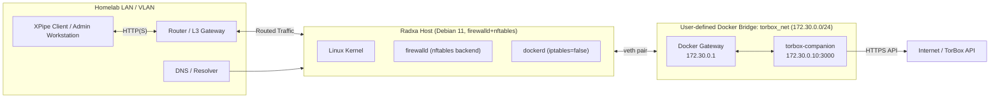
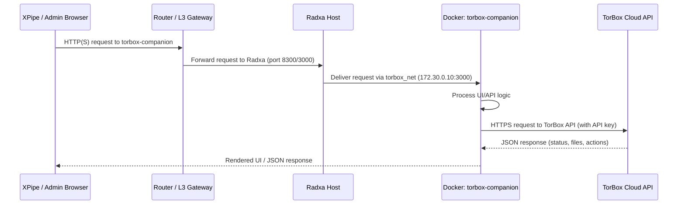

# TorBox Companion — Homelab Deployment Blueprint

A deterministic, reproducible deployment pattern for running TorBox Companion on a Radxa‑class ARM board using Docker, systemd, firewalld, and XPipe. This blueprint defines networking, service lifecycle, firewall boundaries, and operational workflows.

---

## Overview

TorBox Companion is a lightweight web UI and automation layer for interacting with the TorBox cloud service.

This deployment uses:

- Debian 11 ARM (Radxa / Cubie‑One)
- Docker with `iptables=false` (nftables‑safe)
- User‑defined bridge network (`torbox_net`)
- Static container addressing
- systemd wrapper for lifecycle control
- firewalld zone isolation
- XPipe integration for remote management

---

## Network topology

### Static Network Diagram



### Interaction Sequence Diagram



---

## Hardened Docker Compose stack

```yaml

services:
  torbox-companion:
    image: ghcr.io/jittarao/torbox-companion:latest
    container_name: torbox-companion
    restart: unless-stopped

    volumes:
      - ./config:/app/data

    environment:
      # Store TORBOX_API_KEY in a local .env file with 0600 permissions
      TORBOX_API_KEY: "${TORBOX_API_KEY}"

    healthcheck:
      test: ["CMD", "wget", "-qO-", "http://localhost:3000/health"]
      interval: 30s
      timeout: 5s
      retries: 5

    networks:
      torbox_net:
        ipv4_address: 172.30.0.10

    deploy:
      resources:
        limits:
          cpus: "1.0"
          memory: "512M"

networks:
  torbox_net:
    driver: bridge
    ipam:
      config:
        - subnet: 172.30.0.0/24
          gateway: 172.30.0.1
```

---

## Docker daemon hardening (nftables‑safe)

Create `/etc/docker/daemon.json`:

```json
{
  "iptables": false
}
```

Apply the change:

```bash
sudo systemctl restart docker
```

This prevents Docker from injecting iptables rules into nftables, eliminating common errors like:

- `COMMAND_FAILED: python-nftables failed`
- `Could not process rule: No such file or directory`

---

## systemd service wrapper

Create `/etc/systemd/system/torbox-companion.service`:

```ini
[Unit]
Description=TorBox Companion (Docker)
Requires=docker.service
After=docker.service

[Service]
Restart=always
RestartSec=5
WorkingDirectory=/opt/torbox-companion
EnvironmentFile=/opt/torbox-companion/.env

ExecStart=/usr/bin/docker compose up --remove-orphans
ExecStop=/usr/bin/docker compose down

TimeoutStartSec=0
KillMode=mixed

[Install]
WantedBy=multi-user.target
```

Enable the service:

```bash
sudo systemctl daemon-reload
sudo systemctl enable --now torbox-companion
```

---

## firewalld zone assignment

### Assign LAN interface to the correct zone

```bash
sudo firewall-cmd --zone=home --add-interface=eth0 --permanent
sudo firewall-cmd --reload
```

### Expose TorBox Companion UI (if publishing port)

```bash
sudo firewall-cmd --zone=home --add-port=8300/tcp --permanent
sudo firewall-cmd --reload
```

### Restrict access to admin VLAN (optional)

```bash
sudo firewall-cmd --zone=home \
  --add-rich-rule='rule family="ipv4" source address="10.10.50.0/24" port protocol="tcp" port="8300" accept' \
  --permanent
sudo firewall-cmd --reload
```

### Notes

- Docker’s internal network (`torbox_net`) is not exposed to firewalld.
- Only the published port (if used) is visible to the LAN.

---

## XPipe integration guide

### Option A — Published port (recommended)

Add to Compose:

```yaml
services:
  torbox-companion:
    ports:
      - "8300:3000"
```

XPipe endpoint:

- Host: Radxa LAN IP
- Port: 8300
- Protocol: HTTP
- Health URL: `/health`

### Option B — SSH tunnel

XPipe → SSH → Radxa → `localhost:3000`

Useful when:

- No ports should be exposed
- Admin VLAN separation is strict

### XPipe operations

- Open UI in browser
- Run remote commands:

```bash
docker compose ps
docker compose logs -f
docker stats
```

- Integrate into command palettes
- Monitor health via `/health` endpoint

---

## Full Radxa deployment checklist

### Phase 1 — Base system

```bash
sudo apt update && sudo apt full-upgrade -y
sudo apt install -y git curl wget ca-certificates
```

### Phase 2 — Docker

```bash
curl -fsSL https://get.docker.com | sudo sh
sudo usermod -aG docker $USER
```

Create `/etc/docker/daemon.json`:

```json
{ "iptables": false }
```

Restart Docker:

```bash
sudo systemctl restart docker
```

### Phase 3 — TorBox Companion

```bash
sudo mkdir -p /opt/torbox-companion
sudo chown $USER:$USER /opt/torbox-companion
```

Place the following in `/opt/torbox-companion/`:

- `docker-compose.yml`
- `.env` containing `TORBOX_API_KEY` (use 0600 permissions)

Start the service:

```bash
docker compose up -d
```

Verify:

```bash
curl http://172.30.0.10:3000
```

### Phase 4 — systemd

```bash
sudo systemctl daemon-reload
sudo systemctl enable --now torbox-companion
systemctl status torbox-companion
```

---

## Operational workflow

### Start/stop/restart

```bash
systemctl restart torbox-companion
```

### View logs

```bash
docker compose logs -f
```

### Update

```bash
docker compose pull
systemctl restart torbox-companion
```

### Backup

- Backup `/opt/torbox-companion/config`
- Backup `.env`

### Health check

```bash
curl http://172.30.0.10:3000/health
```

---

## Troubleshooting

### nftables errors during `docker compose up`

Cause: Docker attempted iptables injection.

Fix: Ensure `/etc/docker/daemon.json` contains `"iptables": false`.

### Container unreachable

- Check `docker inspect torbox-companion`.
- Ensure `torbox_net` exists.
- Validate static IP assignment.

### XPipe cannot connect

- Confirm port mapping (if used).
- Confirm firewalld rules.
- Validate `/health` endpoint.

---

## Changelog

- v1.0 — Initial blueprint: networking, systemd, firewalld, XPipe, Radxa checklist.

## License

Internal homelab blueprint — unrestricted personal use.
