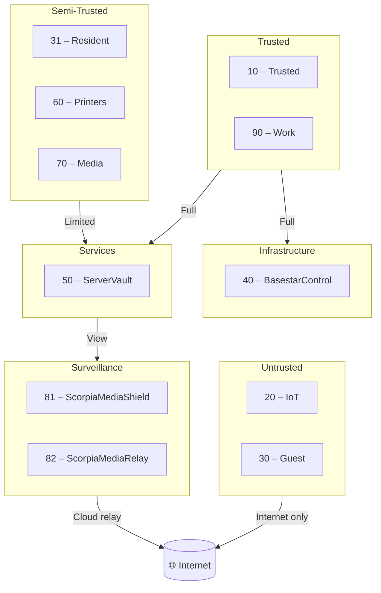

# 🧭 Project Architecture Blueprint — Battlestar Ventana Network Blueprint

Generated: 2025-10-14

This blueprint documents the effective architecture of the Battlestar Ventana homelab network and its supporting operational documentation. It consolidates patterns present across the repository (docs, dashboards, alerts, HA configs) and provides guidance for consistent extension and maintenance.

---

## 1. Architecture Detection and Analysis

Technologies and artifacts detected:

- Documentation-first architecture using Markdown with Mermaid diagrams
- Network segmentation design: VLANs with convention 10.76.X.0/24 (X = VLAN ID)
- Firewall policy specification with service/port granularity (`firewall-matrix.md`)
- DHCP scope definitions (`dhcp-scopes.md`)
- Operational runbooks and inventories: `host-tracker.md`, `other-devices.md`, `services.md`, `naming-conventions.md`
- Observability/UX:
  - Grafana dashboards (dashboards/)
  - Alertmanager style configuration (alerts/)
- Home Assistant configuration (ha/) for smart home services

Architectural patterns in use:

- Layered, zone-based network segmentation (Trusted, Semi-Trusted, Untrusted, Services, Infrastructure, Surveillance)
- Defense-in-depth via VLAN isolation + selective, directional firewall rules
- Declarative documentation of service-to-service contracts (Service/Ports Reference)
- Naming conventions and CIDR schema for consistent addressing and discoverability
- Intent for Infrastructure-as-Code (IaC) adoption noted in future enhancements

Boundaries and communication:

- One-way trust boundaries from less-trusted zones into services with minimal port exposure
- Explicit Internet egress policy per VLAN
* Service discovery and management centralized in ServerVault/BasestarControl

---

## 2. Architectural Overview

The system organizes the home network into clearly defined security zones backed by VLANs. Each zone contains devices with similar risk profiles and communication needs. Firewalls enforce least-privilege access based on documented service/protocol allowlists.

Guiding principles:

* Least privilege and explicit allowlists
* Clear, durable boundaries (VLANs, subnets, roles, and naming)
* Observability-first (dashboards, alert styles) to verify policy in practice
* Documentation-as-source for repeatability and audits

Key boundaries:

* Trusted user subnets (10, 90) → full access to core services, limited view to surveillance
* Semi-trusted (31, 60, 70) → restricted access to services required for function
* Untrusted (20, 30) → minimal or Internet-only
* Services (50) and Infra (40) → central management planes
* Surveillance (81/82) → view-only from trusted/services

Hybrid adaptation:

* Combines zone-based segmentation with service-contract tables for implementation-ready firewalling

---

## 3. Architecture Visualization

High-level zone diagram (derived from docs):



Component interactions focus on directional flows enforced by rules in `firewall-matrix.md`.

---

## 4. Core Architectural Components

For each component, this section summarizes purpose, internal structure, interaction, and evolution.

### 4.1 BasestarControl (VLAN 40)

- Purpose: Core switching, controllers, management plane
- Internal: Core switch/router, control services (DNS/DHCP often delegated), management interfaces
- Interactions: Full to Services (50) and Trusted (10/90); no direct Internet egress for management plane
- Evolution: Introduce automation/IaC for consistent switch/router policy; role-based admin access

### 4.2 ServerVault (VLAN 50)
- Purpose: Central services (NAS/HA/MQTT, logging, media indexes)
- Internal: Storage, MQTT broker, syslog targets, application services
- Interactions: Consumes management from Infra; provides select services to zones per Service/Ports table
- Evolution: Add service discovery/catalog; standardize reverse proxy/TLS; backup + DR

### 4.3 Trusted LAN (VLAN 10) and Work (VLAN 90)
- Purpose: End-user compute networks
- Interactions:
  - Trusted(10): Full to Infra/Services, view-only to Surveillance
  - Work(90): Internet + casting to Media (70); otherwise isolated from LAN
- Evolution: Conditional access, posture checks, per-user segmentation (e.g., Wi-Fi profiles)

### 4.4 Semi-Trusted (31 Resident, 60 Printers, 70 Media)
- Purpose: Function-driven subnets with constrained privileges
- Interactions: Limited to Services for specific ports (printing, media, files), Internet where appropriate
- Evolution: Tighten casts/uploads to least privilege; log interactions for audit

### 4.5 Untrusted (20 IoT, 30 Guest)
- Purpose: High-risk or unverified devices
- Interactions: Internet-only (30), limited telemetry to Services (20→50)
- Evolution: Per-device allowlists, device identity, and network access control (NAC)

### 4.6 Surveillance (81/82)
- Purpose: Camera networks
- Interactions: Local (81) streams to Services (50); Cloud (82) relays to Internet; view-only from Trusted/Services
- Evolution: Bandwidth QoS; storage policy; retention and privacy controls

---

## 5. Architectural Layers and Dependencies

Layers:

1) Physical/Link Layer → switches, cabling
2) Network Layer → VLANs, routing, DHCP/DNS
3) Security Layer → firewall/ACLs, Service/Ports allowlists
4) Services Layer → ServerVault apps (MQTT, storage, reverse proxy, syslog)
5) Observability Layer → dashboards, alerting, logs
6) Automation Layer → desired IaC/config management (future)

Dependency rules:

- Lower layers provide primitives; upper layers must not bypass security layer
- Cross-layer access only through documented service contracts
- No circular dependencies; Services do not depend on Untrusted/Semi-Trusted availability

---

## 6. Data Architecture

- Addressing data: `dhcp-scopes.md` defines subnets, gateways, DNS per VLAN
- Inventory data: `host-tracker.md`, `other-devices.md`, `naming-conventions.md`
- Event/telemetry: MQTT (IoT→ServerVault), syslog (Cameras→ServerVault), app logs
- Observability data: Grafana dashboards, Alertmanager styles
- Retention: Define per-source retention on ServerVault (recommendation: 7–30 days logs, 30–90 days camera footage per storage capacity)

Transformations and mapping:

- Normalize device names via naming conventions for consistent dashboards and ACLs
- Map VLAN to zone in policy engines for rule templating

Caching:

- DNS caching at Infra/Services for reliability and performance

Validation:

- Use `audit-checklist.md` to validate addressing, routing, and policy alignment

---

## 7. Cross-Cutting Concerns Implementation

### Authentication & Authorization
- Network-level auth via segmentation; service-level auth on ServerVault apps
- Admin access constrained to Trusted→Infra with strong auth (SSH/HTTPS)

### Error Handling & Resilience
- Prefer stateless services behind reverse proxy; restart-on-failure policies
- Redundant storage or backup for critical data on ServerVault

### Logging & Monitoring
- Centralize logs (syslog/MQTT consumers); dashboards for VLAN traffic; alert styles defined in `alerts/`

### Validation
- Input validation for firewall rules (ports, protocols); config linting

### Configuration Management
- Secrets externalized; environment-specific overrides; plan migration to IaC (Terraform/Ansible) as noted in future enhancements

---

## 8. Service Communication Patterns

- Protocols per Service/Ports Reference (e.g., MQTT 8883, RTSP 554, SMB 445, IPP 631)
- Synchronous: SMB/HTTPS/IPP; Asynchronous: MQTT, syslog streams
- API versioning: N/A (documentation-level); recommend documenting service endpoints in `services.md`
- Service discovery: Static mapping via docs; recommend adopting DNS-based service discovery

Resilience patterns:

- Minimize cross-zone dependencies; prefer pull-based telemetry to reduce open ports

---

## 9. Technology-Specific Architectural Patterns (Detected)

### Markdown + Mermaid
- Source of truth for diagrams and policies; renderable in multiple tools

### Home Assistant (ha/)
- YAML-driven automations and dashboards; aligns with semi-trusted device control

### Grafana/Alertmanager (dashboards/, alerts/)
- Dashboard-first observability; alert theming via styles

---

## 10. Implementation Patterns

### Interface/Contract Patterns
- Service contracts expressed as tables (source→destination, ports, protocols)
- VLAN-to-zone mapping enables templated rule generation

### Service Implementation Patterns
- Centralize services in ServerVault; expose least ports; terminate TLS at reverse proxy when possible

### Repository/Inventory Patterns
- Device inventories and naming conventions feed both policy and dashboards

### Controller/API Patterns
- For self-hosted apps, standardize on HTTPS, OAuth/OpenID where available, and role-based access

### Domain Model Implementation
- Treat VLANs, Zones, Services, and Contracts as first-class documented entities for tooling automation

---

## 11. Testing Architecture

- Unit-level: Lint Markdown, validate Mermaid diagrams render
- Integration-level: Network policy tests (nmap from representative VLANs), DHCP/DNS resolution checks
- System-level: Observability dashboards show expected flows; alert rules fire on anomalies

Test data strategies:

- Maintain synthetic hosts per VLAN to test reachability and DNS; record results in `host-tracker.md`

---

## 12. Deployment Architecture

- Topology: Core switch (InfraCore) interconnects VLANs; ServerVault provides services; Internet uplink at edge
- Environment-specific: Single-DC homelab; future option to add remote sites or cloud relay (82)
- Configuration management: Move toward IaC for firewall/DHCP/DNS; version control in this repo

---

## 13. Extension and Evolution Patterns

### Feature Addition Patterns
- Adding a new VLAN:
  1. Assign subnet `10.76.<VLAN>.0/24` and gateway `.1`
  2. Add DHCP scope row in `dhcp-scopes.md`
  3. Place VLAN in a zone and update diagrams
  4. Define allowlist entries in Service/Ports table
  5. Update dashboards/alerts for visibility

### Modification Patterns
- Change service exposure by updating Service/Ports entries and revalidating via tests and dashboards

### Integration Patterns
- For external systems, implement an adapter/proxy in ServerVault; add anti-corruption layer with strict ingress rules

---

## 14. Architectural Pattern Examples

### Example: Service/Ports Contract (excerpt)

| Source → Destination | Allowed Services/Ports | Protocol | Notes |
|----------------------|------------------------|----------|-------|
| 20 IoT → 50 ServerVault | MQTT (8883), HTTPS (443) | TCP | Telemetry & firmware |
| 90 Work → 70 Media | Chromecast (8008-8009), DLNA (1900) | TCP/UDP | Casting |

### Example: Alertmanager Style (excerpt)

```yaml
# alerts/Alertmanager style.yaml (excerpt)
route:
  group_by: ['alertname', 'severity']
  group_wait: 30s
  group_interval: 5m
```

### Example: HA Lovelace (excerpt)

```yaml
# ha/lovelace.yaml (excerpt)
views:
  - title: Network
    cards:
      - type: entities
        title: VLAN Status
```

---

## 15. Architectural Decision Records (ADRs)

### ADR-001: Zone-based Segmentation with VLANs
- Context: Mixed-trust devices on a single physical network
- Decision: Use VLANs per functional/risk grouping; enforce directional rules
- Consequences: Clear boundaries, simpler auditing; requires managed switching

### ADR-002: Address Convention 10.76.X.0/24
- Context: Need human-readable mapping from VLAN ID to subnet
- Decision: Adopt 10.76.<VLAN>.0/24 with `.1` gateways
- Consequences: Easy mental model; /24 simplifies DHCP and ACLs

### ADR-003: Work VLAN (90) Internet-first
- Context: Separate work devices and ensure performance
- Decision: Allow Internet and media casting only; management via local DNS/DHCP bootstrap
- Consequences: Reduced lateral movement; explicit exceptions via Media casting

### ADR-004: Surveillance Split (81 local, 82 cloud)
- Context: Privacy and reliability
- Decision: Separate local camera streaming from cloud relays
- Consequences: Finer control; independent failure domains

---

## 16. Architecture Governance

- Documentation updates required for any change to VLANs, scopes, or rules
- Automated checks recommended: markdown lint, Mermaid render check, table schema validation
- Periodic audit using `audit-checklist.md` with sign-off
- Change control: conventional commits; consider PR approvals for rule changes

---

## 17. Blueprint for New Development

### Development Workflow
1. Define the change (new VLAN, service, or rule)
2. Update DHCP scope, firewall matrix, and diagrams
3. Validate with lint/tests and a dry-run audit
4. Observe traffic and alerts post-change; tune as needed

### Implementation Templates
- DHCP scope row format and Service/Ports table row format as shown above
- Diagram blocks in Mermaid using existing styles

### Common Pitfalls
- Opening bi-directional ports without need
- Skipping documentation updates (causes drift)
- Missing observability coverage for new flows

---

Built with accessibility in mind (headings, tables, and descriptive labels). Please still review and test with tools like Accessibility Insights to ensure it meets your needs.
