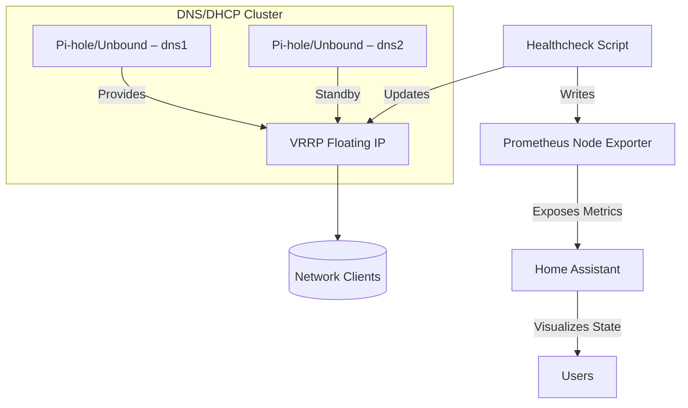

## DNS/DHCP Cluster Architecture Blueprint

### Overview

- Purpose: Provide a reproducible, highly available DNS/DHCP cluster aligned with the Battlestar Ventana documentation-first network architecture.
- Scope: Pi-hole + Unbound + keepalived (VRRP) high availability, runtime secrets via 1Password CLI, health checks, and observability via Prometheus and Home Assistant.
- Alignment: Follows VLAN/zone segmentation, least-privilege firewall policy, and addressing convention `10.76.<VLAN>.0/24`.

### Objectives

- High Availability: VRRP-managed floating IP with health-driven failover.
- Idempotent Automation: Safe re-runs via Ansible without configuration drift.
- Secret Hygiene: No secrets at rest; runtime injection only.
- Observability: Cluster state, latency, and failover visibility across dashboards.

### Components

- Pi-hole: DNS sinkhole and DHCP (optional) service endpoints.
- Unbound: Validating, recursive, caching DNS resolver.
- keepalived (VRRP): Floating IP management and failover.
- Ansible Role: `roles/pihole_ha/` defines installation, configuration, health checks, and monitoring.
- 1Password CLI: Environment-based secret injection for sensitive values (e.g., keepalived auth).
- XPipe / VS Code Tasks: Operational wrapper for consistent execution.
- Prometheus Node Exporter: Metrics collection, including VRRP state via textfile collector.
- Home Assistant: Sensors for Pi-hole, Prometheus metrics, and VRRP state via REST or MQTT.
- MQTT Broker: Optional state publication channel (e.g., `homelab/dns/state`).

### Deployment Blueprint

- Role structure (recommended):

``` yaml
roles/
  pihole_ha/
    tasks/
      main.yml
      pihole.yml
      unbound.yml
      keepalived.yml
      healthcheck.yml
    templates/
      keepalived.conf.j2
      unbound.conf.j2
    files/
      pihole_custom.list
    vars/
      main.yml
    handlers/
      main.yml
    meta/
      main.yml
```

- Example `tasks/main.yml`:

``` yaml
- name: Include Pi-hole tasks
  include_tasks: pihole.yml

- name: Include Unbound tasks
  include_tasks: unbound.yml

- name: Include keepalived tasks
  include_tasks: keepalived.yml

- name: Include healthcheck tasks
  include_tasks: healthcheck.yml
```

- Example `templates/keepalived.conf.j2`:

``` conf
vrrp_instance VI_1 {
  state {{ keepalived_state }}
  interface {{ keepalived_interface }}
  virtual_router_id {{ keepalived_vrid }}
  priority {{ keepalived_priority }}
  advert_int 1

  authentication {
    auth_type PASS
    auth_pass {{ keepalived_auth_pass }}
  }

  virtual_ipaddress {
    {{ keepalived_vip }}
  }

  track_script {
    chk_pihole
  }
}

vrrp_script chk_pihole {
  script "/usr/local/bin/pihole_healthcheck.sh"
  interval 5
  weight -20
}
```

### Inventory and Playbook

- Inventory group:

``` ini
[dns_cluster]
dns1 ansible_host=10.10.5.21 keepalived_state=MASTER keepalived_priority=100
dns2 ansible_host=10.10.5.22 keepalived_state=BACKUP keepalived_priority=90

[dns_cluster:vars]
keepalived_vip=10.10.5.10
keepalived_vrid=51
keepalived_interface=eth0
```

- Playbook snippet:

``` yaml
- hosts: dns_cluster
  vars:
    keepalived_auth_pass: "{{ lookup('ansible.builtin.env', 'KEEPALIVED_PASS') }}"
  roles:
    - pihole_ha
```

### Secrets Management

- Runtime injection via 1Password CLI:

``` bash
export KEEPALIVED_PASS=$(op read "op://Homelab/DNS Cluster/keepalived_auth_pass")
ansible-playbook deploy_dns.yml
```

- Principles:
  - No secrets touch disk
  - Works uniformly across Proxmox LXC and physical SBCs
  - Aligns with existing XPipe + Ansible guardrails

### Observability & Monitoring

- Prometheus Node Exporter installation:

``` yaml
- name: Install node exporter
  ansible.builtin.apt:
    name: prometheus-node-exporter
    state: present
```

- Textfile collector for VRRP state:

``` ini
/var/lib/node_exporter/textfile_collector/vrrp.prom

keepalived_state{instance="{{ inventory_hostname }}"} 1
```

- Home Assistant sensors:
  - Pi-hole integration
  - Prometheus integration
  - VRRP via REST or MQTT

- Example REST sensor:

``` yaml
sensor:
  - platform: rest
    name: DNS Cluster State
    resource: http://10.10.5.10:9615/metrics
    value_template: >
       MASTER  BACKUP 
```

- Example MQTT publication:

``` bash
mosquitto_pub -t homelab/dns/state -m "MASTER"
```

### Reliability & Failover Flow



### Security Model

- Zero Trust principles: assume breach, least privilege, verify access.
- Secret handling: environment-only injection; no persistent storage.
- Access control alignment: enforce directional flows per firewall matrix.
- Encryption: prefer TLS for integrations (REST/MQTT) where applicable.

### Performance Considerations

- Unbound caching reduces upstream queries and latency.
- VRRP heartbeat tuned for responsive failover without flapping.
- Resource monitoring ensures SBC thermal and network throughput visibility.

### Testing & Validation

- Idempotence: repeat role execution yields stable state.
- VRRP state transitions: simulate failover and verify VIP movement.
- DNS latency: monitor post-deployment and during failover.
- Policy checks: validate alignment with `docs/firewall-matrix.md` and `docs/dhcp-scopes.md`.

### Extension Patterns

- Add nodes: extend `[dns_cluster]` inventory and reuse role.
- Scale observability: centralize metrics; add alerts for failovers.
- Integrate backups: schedule configuration backups (non-secret) to ServerVault.

### References

- See `docs/firewall-matrix.md` for directional rules and Internet egress.
- See `docs/dhcp-scopes.md` for VLAN addressing conventions.
- See `docs/services.md` for service/port allowlists.
