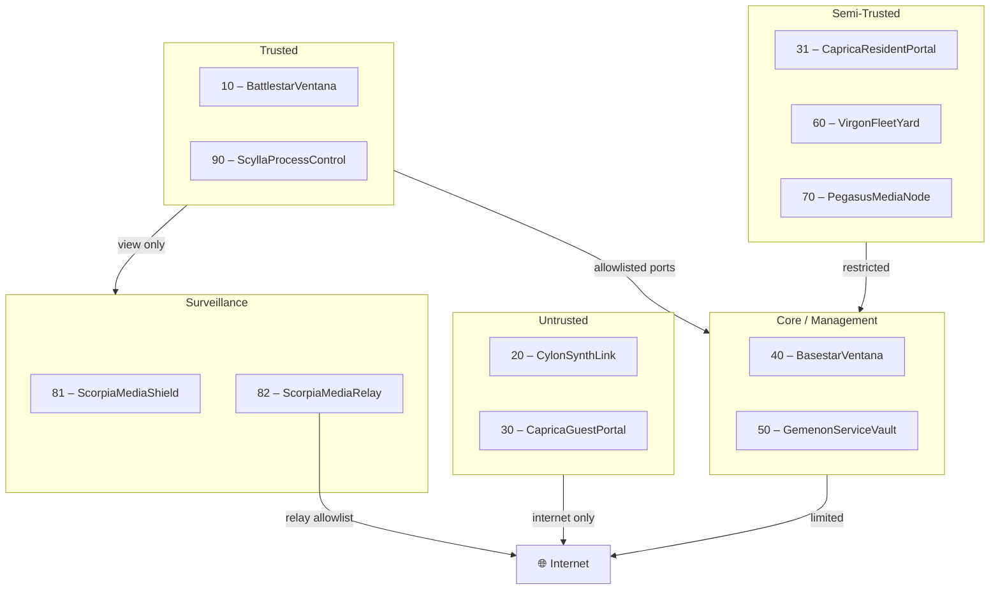

# 🏛️ Architecture Overview — Battlestar Ventana Network Blueprint

This directory is the canonical reference for architectural decisions, system design,
and component blueprints for the Battlestar Ventana homelab network.

---

## System Overview

The Battlestar Ventana platform is a documentation-first homelab network built on
zone-based VLAN segmentation, defense-in-depth firewall policy, and declarative
Infrastructure-as-Code automation.

**Guiding principles:**

- Least privilege and explicit allowlists at every zone boundary
- Deterministic addressing: `10.76.<VLAN_ID>.0/24` for all subnets
- Documentation-as-source: no value is invented; all config derives from canonical docs
- Observability-first: dashboards and alerts validate policy in practice
- Idempotent automation: all Ansible playbooks and scripts are safe to re-run

---

## Zone Architecture

The network is divided into named trust zones, each mapped to a VLAN and subnet.
Full VLAN details live in [`config/vlan-registry.yaml`](../../config/vlan-registry.yaml).

| Zone           | VLAN | Subnet        | SSID / Name           | Purpose                                |
| -------------- | ---- | ------------- | --------------------- | -------------------------------------- |
| Trusted        | 10   | 10.76.10.0/24 | BattlestarVentana     | User workstations, laptops, phones     |
| IoT            | 20   | 10.76.20.0/24 | CylonSynthLink        | Sensors, plugs, appliances             |
| Guest          | 30   | 10.76.30.0/24 | CapricaGuestPortal    | Internet-only guest access             |
| Elevated Guest | 31   | 10.76.31.0/24 | CapricaResidentPortal | Casting/printing, MAC allowlisted      |
| Infrastructure | 40   | 10.76.40.0/24 | BasestarVentana       | Hypervisors, switches, controllers     |
| Services       | 50   | 10.76.50.0/24 | GemenonServiceVault   | NAS, MQTT, Home Assistant, Pi-hole     |
| Printers       | 60   | 10.76.60.0/24 | VirgonFleetYard       | Printers only                          |
| Media          | 70   | 10.76.70.0/24 | PegasusMediaNode      | Smart TVs, streaming, casting targets  |
| Cameras Local  | 81   | 10.76.81.0/24 | ScorpiaMediaShield    | Cameras — local recording, no internet |
| Cameras Cloud  | 82   | 10.76.82.0/24 | ScorpiaMediaRelay     | Cameras — cloud relay only             |
| Work           | 90   | 10.76.90.0/24 | ScyllaProcessControl  | Corporate compliance bubble            |

---

## Tech Stack

Canonical reference: [`docs/tech-stack-baseline.md`](../tech-stack-baseline.md)

| Layer         | Technology                                                           |
| ------------- | -------------------------------------------------------------------- |
| Languages     | Python 3.11+, TypeScript 5+, Bash (POSIX)                            |
| Automation    | Ansible (idempotent playbooks, `roles/pihole_ha`)                    |
| DNS / DHCP    | Pi-hole + Unbound (recursive resolver)                               |
| HA Failover   | keepalived (VRRP floating IP)                                        |
| Secrets       | 1Password CLI — runtime injection only, no secrets at rest           |
| Observability | Prometheus Node Exporter, Grafana dashboards, Home Assistant sensors |
| Linting       | ansible-lint, ShellCheck, Ruff, ESLint, tflint                       |
| Testing       | Molecule, BATS, pytest, Vitest                                       |

---

## Key Components

### DNS/DHCP HA Cluster

Pi-hole + Unbound + keepalived deployed via the `roles/pihole_ha` Ansible role.
Floating VIPs: `10.76.50.10` (primary) / `10.76.50.11` (secondary).

→ Full blueprint: [`DNS-DHCP-Cluster-Blueprint.md`](DNS-DHCP-Cluster-Blueprint.md)

### Physical Hypervisors (VLAN 40)

| Hostname     | Role         | Management IP |
| ------------ | ------------ | ------------- |
| CrimsonRogue | ProxmoxNode1 | 10.76.40.10   |
| AmberNomad   | ProxmoxNode2 | 10.76.40.11   |
| AzureDefiant | ProxmoxNode3 | 10.76.40.12   |

All hypervisor IPs are static. Network topology source:
[`config/network-topology.yaml`](../../config/network-topology.yaml)

### Home Assistant

Smart home services run in VLAN 50 (GemenonServiceVault). HA sensors expose Pi-hole
metrics and VRRP state. Automations and dashboards live in [`ha/`](../../ha/).

### Observability

Prometheus scrapes Node Exporter on all cluster nodes. VRRP state is published via
textfile collector. Grafana dashboards in [`dashboards/`](../../dashboards/).
Alert rules in [`alerts/alert_rules.yaml`](../../alerts/alert_rules.yaml).

---

## Architectural Decision Records

| ADR                                                    | Title                                                     | Status   |
| ------------------------------------------------------ | --------------------------------------------------------- | -------- |
| [ADR-005](ADR-005-DNS-DHCP-HA-Cluster.md)              | Pi-hole + Unbound HA Cluster with keepalived              | Accepted |
| [ADR-006](ADR-006-Secrets-Management-1Password-CLI.md) | Secrets Management via 1Password CLI                      | Accepted |
| [ADR-007](ADR-007-Observability-Prometheus-HA.md)      | Observability via Prometheus Node Exporter and HA Sensors | Accepted |

---

## Canonical Source Files

Agents and automation MUST derive values from these files — never invent values.

| File                                                                                 | Authoritative For                            |
| ------------------------------------------------------------------------------------ | -------------------------------------------- |
| [`config/vlan-registry.yaml`](../../config/vlan-registry.yaml)                       | VLAN names, subnets, DHCP, trust zones       |
| [`config/network-topology.yaml`](../../config/network-topology.yaml)                 | Hypervisor IPs, service VIPs, topology index |
| [`config/dns-conventions.yaml`](../../config/dns-conventions.yaml)                   | DNS record naming scheme                     |
| [`docs/naming-conventions.md`](../naming-conventions.md)                             | Hostnames, SSID names, device tokens         |
| [`docs/firewall-matrix.md`](../firewall-matrix.md)                                   | Inter-VLAN and egress firewall policy        |
| [`docs/services.md`](../services.md)                                                 | Service/port contracts                       |
| [`docs/host-tracker.md`](../host-tracker.md)                                         | Static IP assignments per host               |
| [`ansible/group_vars/all/vlan-vars.yml`](../../ansible/group_vars/all/vlan-vars.yml) | Ansible VLAN variables                       |

---

## Related Documentation

- [Project Architecture Blueprint](../Project_Architecture_Blueprint.md)
- [DHCP Scopes](../dhcp-scopes.md)
- [IP Allocation](../ip-allocation.md)
- [Deployment Guide](../DEPLOYMENT_GUIDE.md)
- [Governance Mapping](../GOVERNANCE_MAPPING.md)
