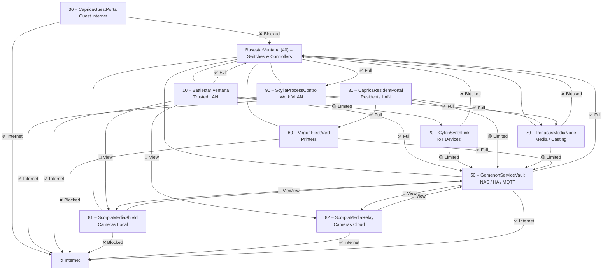
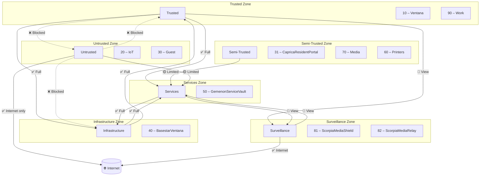
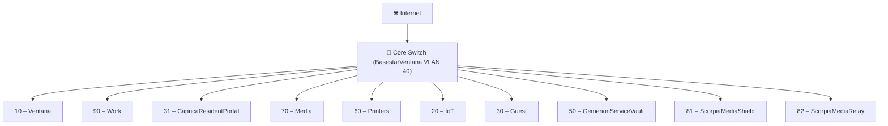

# 🔐 Firewall Matrix — Battlestar Ventana Network Blueprint

This document defines the directional access rules between VLANs in the Battlestar Ventana network. Each row represents the source VLAN, and each column represents the destination VLAN. Access levels are color-coded and symbolized for clarity.

---

## 🔣 Legend

| Symbol | Meaning                                    |
| ------ | ------------------------------------------ |
| ✅     | Full access                                |
| 🟡     | Limited access (restricted ports/services) |
| 🔵     | View-only (monitoring, read-only)          |
| ❌     | Blocked                                    |
| 🌐     | Internet                                   |

---

## 📡 VLAN Access Matrix

| Source → Destination         | 10 BattlestarVentana | 20 CylonSynthLink | 30 CapricaGuestPortal | 31 CapricaResidentPortal | 40 BasestarVentana | 50 GemenonServiceVault | 60 VirgonFleetYard | 70 PegasusMediaNode | 81 ScorpiaMediaShield | 82 ScorpiaMediaRelay | 90 ScyllaProcessControl |
| ---------------------------- | -------------------- | ----------------- | --------------------- | ------------------------ | ------------------ | ---------------------- | ------------------ | ------------------- | --------------------- | -------------------- | ----------------------- |
| **10 BattlestarVentana**     | ✅                   | 🟡                | ❌                    | 🟡                       | ✅                 | ✅                     | ✅                 | ✅                  | 🔵                    | 🔵                   | ❌                      |
| **20 CylonSynthLink**        | ❌                   | ✅                | ❌                    | ❌                       | ❌                 | 🟡                     | ❌                 | ❌                  | ❌                    | ❌                   | ❌                      |
| **30 CapricaGuestPortal**    | ❌                   | ❌                | ✅                    | ❌                       | ❌                 | ❌                     | ❌                 | ❌                  | ❌                    | ❌                   | ❌                      |
| **31 CapricaResidentPortal** | 🟡                   | ❌                | ❌                    | ✅                       | ❌                 | 🟡                     | ✅                 | ✅                  | ❌                    | ❌                   | ❌                      |
| **40 BasestarVentana**       | ✅                   | ❌                | ❌                    | ❌                       | ✅                 | ✅                     | ❌                 | ❌                  | ❌                    | ❌                   | ✅                      |
| **50 GemenonServiceVault**   | ✅                   | 🟡                | ❌                    | 🟡                       | ✅                 | ✅                     | ✅                 | 🟡                  | 🔵                    | 🔵                   | ❌                      |
| **60 VirgonFleetYard**       | ✅                   | ❌                | ❌                    | 🟡                       | ❌                 | ✅                     | ✅                 | ❌                  | ❌                    | ❌                   | ❌                      |
| **70 PegasusMediaNode**      | ✅                   | ❌                | ❌                    | ✅                       | ❌                 | 🟡                     | ❌                 | ✅                  | ❌                    | ❌                   | ❌                      |
| **81 ScorpiaMediaShield**    | 🔵                   | ❌                | ❌                    | ❌                       | ❌                 | 🔵                     | ❌                 | ❌                  | ✅                    | ❌                   | ❌                      |
| **82 ScorpiaMediaRelay**     | 🔵                   | ❌                | ❌                    | ❌                       | ❌                 | 🔵                     | ❌                 | ❌                  | ❌                    | ✅                   | ❌                      |
| **90 ScyllaProcessControl**  | ❌                   | ❌                | ❌                    | ❌                       | ❌                 | ❌                     | ❌                 | ✅                  | ❌                    | ❌                   | ✅                      |

---

### 🧠 Notes

- **Guest VLAN (30)** is fully isolated except for Internet access.
- **CylonSynthLink (20)** has limited access to GemenonServiceVault for telemetry and firmware updates.
- **CapricaResidentPortal (31)** can cast and print, but cannot access core infrastructure.
- **ScorpiaMediaShield (81)** and **ScorpiaMediaRelay (82)** are view-only from trusted zones.
- **Work VLAN (90)** is **unthrottled** for Internet but must use the **local DNS/DHCP stack** to establish its VPN tunnel.

---

## 🌐 Internet Access Policy

This table summarizes which VLANs are allowed outbound to the Internet, and under what conditions.

| VLAN                         | Outbound Internet Access | Notes / Restrictions                                           |
| ---------------------------- | ------------------------ | -------------------------------------------------------------- |
| **10 BattlestarVentana**     | ✅ Unrestricted          | Standard outbound access                                       |
| **20 CylonSynthLink**        | 🟡 Limited               | Telemetry & firmware updates only (e.g., MQTT 8883, HTTPS 443) |
| **30 CapricaGuestPortal**    | ✅ Unrestricted          | Internet only, no LAN access                                   |
| **31 CapricaResidentPortal** | ✅ Unrestricted          | Casting, printing, and Internet allowed                        |
| **40 BasestarVentana**       | ❌ Blocked               | No direct Internet access (mgmt plane only)                    |
| **50 GemenonServiceVault**   | 🟡 Limited               | Updates, cloud sync, API calls                                 |
| **60 VirgonFleetYard**       | ❌ Blocked               | Local only, no Internet                                        |
| **70 PegasusMediaNode**      | ✅ Unrestricted          | Casting + streaming                                            |
| **81 ScorpiaMediaShield**    | ❌ Blocked               | Local only                                                     |
| **82 ScorpiaMediaRelay**     | ✅ Limited               | Cloud relay only (RTSP/HTTPS)                                  |
| **90 ScyllaProcessControl**  | ✅ Unrestricted          | Unthrottled, but uses local DNS/DHCP to bootstrap VPN tunnel   |

---

## 📊 Topology & Firewall Flow

**Detailed VLAN visualization** showing individual firewall flows between all VLANs with access control indicators. Provides granular view of network segmentation and security policies.

---

## 🌐 Zone-Level Firewall Flow

**Zone-level visualization** clustering VLANs into functional zones (Trusted, Semi-Trusted, Untrusted, Infrastructure, Services, Surveillance) and showing zone-to-zone firewall relationships. Complements the detailed VLAN matrix above.

## 🗺️ Infrastructure Topology Diagram (Mermaid)

**Physical topology visualization** showing the core switch as central hub connecting all VLANs to the internet. Illustrates network architecture without access control rules.

This diagram shows:

- 🌐 Internet uplink

- 🔀 Core switch as the central hub

- 🧩 VLANs grouped by function

- 📦 GemenonServiceVault as the services backbone

## � Service/Ports Reference Table

**Technical implementation details** for firewall rules. Complements the access matrix above with specific ports, protocols, and services allowed between VLANs.

| Source → Destination                                  | Allowed Services/Ports                   | Protocol | Notes                        |
| ----------------------------------------------------- | ---------------------------------------- | -------- | ---------------------------- |
| **10 BattlestarVentana → 20 CylonSynthLink**          | DHCP (67/68), DNS (53)                   | UDP      | Basic network services       |
| **10 BattlestarVentana → 40 BasestarVentana**         | SSH (22), HTTPS (443), SNMP (161)        | TCP      | Management access            |
| **10 BattlestarVentana → 50 GemenonServiceVault**     | SMB (445), NFS (2049), HTTPS (443)       | TCP      | File sharing & web services  |
| **10 BattlestarVentana → 60 VirgonFleetYard**         | IPP (631), LPD (515)                     | TCP      | Print services               |
| **10 BattlestarVentana → 70 PegasusMediaNode**        | DLNA (1900), Chromecast (8008-8009)      | TCP/UDP  | Media casting & streaming    |
| **10 BattlestarVentana → 81/82 ScorpiaMedia**         | RTSP (554), HTTPS (443)                  | TCP      | Camera viewing & management  |
| **20 CylonSynthLink → 50 GemenonServiceVault**        | MQTT (8883), HTTPS (443)                 | TCP      | Telemetry & firmware updates |
| **31 CapricaResidentPortal → 50 GemenonServiceVault** | IPP (631), SMB (445)                     | TCP      | Print & file services        |
| **31 CapricaResidentPortal → 60 VirgonFleetYard**     | IPP (631), LPD (515)                     | TCP      | Print services               |
| **31 CapricaResidentPortal → 70 PegasusMediaNode**    | DLNA (1900), Chromecast (8008-8009)      | TCP/UDP  | Media casting                |
| **40 BasestarVentana → 50 GemenonServiceVault**       | SSH (22), HTTPS (443), PostgreSQL (5432) | TCP      | Infrastructure management    |
| **50 GemenonServiceVault → 81/82 ScorpiaMedia**       | RTSP (554), Syslog (514)                 | TCP/UDP  | Video storage & logging      |
| **60 VirgonFleetYard → 50 GemenonServiceVault**       | IPP (631), JetDirect (9100)              | TCP      | Print job submission         |
| **70 PegasusMediaNode → 50 GemenonServiceVault**      | SMB (445), Plex (32400)                  | TCP      | Media file access            |
| **81 ScorpiaMediaShield → 50 GemenonServiceVault**    | RTSP (554), Syslog (514)                 | TCP/UDP  | Local video feed & logging   |
| **82 ScorpiaMediaRelay → 🌐 Internet**                | HTTPS (443), RTSP (554)                  | TCP      | Cloud video relay            |
| **90 ScyllaProcessControl → 70 PegasusMediaNode**     | Chromecast (8008-8009), DLNA (1900)      | TCP/UDP  | Work device casting to TVs   |
| **90 ScyllaProcessControl → 🌐 Internet**             | All ports                                | TCP/UDP  | Unthrottled internet access  |

**Internet Access Details:**

- **30 CapricaGuestPortal**: HTTP (80), HTTPS (443) - Web browsing only
- **31 CapricaResidentPortal**: HTTP (80), HTTPS (443), DNS (53) - Full web access
- **70 PegasusMediaNode**: HTTP (80), HTTPS (443), RTSP (554) - Streaming services
- **82 ScorpiaMediaRelay**: HTTPS (443) - Cloud relay only
- **90 ScyllaProcessControl**: All ports - Unthrottled access via VPN tunnel

## 🛠️ Future Enhancements

- ✅ **COMPLETED:** Add dedicated Service/Ports Reference Table with specific ports, protocols, and services for firewall rule implementation
- Add anomaly-based firewall triggers (e.g., deny if >X failed logins/min).
- Integrate VLAN-to-zone mapping for dynamic segmentation.
- Visualize matrix in Mermaid for topology-aware audit overlays.
- Automate generation of this matrix from firewall configs for real-time accuracy.
- ⏳ **PLANNED:** Initialize the firewall rules in infrastructure-as-code (e.g., Terraform, Ansible)
- Link to monitoring dashboards showing traffic patterns per VLAN
- Flesh out the **Topology & Firewall Flow** section with more details on specific flows and rules providing an accurate, exhaustive, and comprehensive representation of the network segmentation and security policies.
