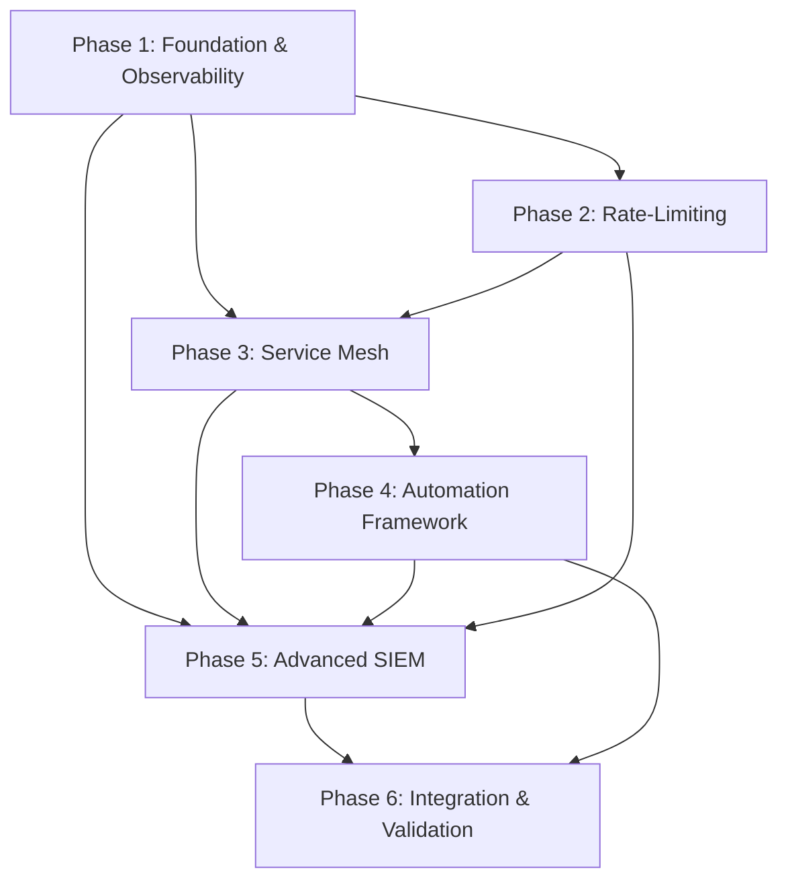

# Hardening Rollout Plan — Battlestar Ventana Network Blueprint

**Version**: 1.0  
**Created**: 2026-01-21  
**Status**: Planning

---

## Executive Summary

This document outlines the phased deployment schedule for implementing security hardening measures across the Battlestar Ventana Network. The plan emphasizes minimal disruption while progressively enhancing security posture through rate-limiting, service mesh architecture, automation frameworks, and SIEM integration.

**Target Completion**: 8-12 weeks from initiation  
**Risk Level**: Medium (requires careful sequencing to avoid service disruption)

---

## Table of Contents

1. [Rollout Phases](#rollout-phases)
2. [Phase Dependencies](#phase-dependencies)
3. [Implementation Timeline](#implementation-timeline)
4. [Risk Mitigation](#risk-mitigation)
5. [Testing and Validation](#testing-and-validation)
6. [Rollback Procedures](#rollback-procedures)
7. [Success Metrics](#success-metrics)

---

## Rollout Phases

### Phase 1: Foundation and Observability (Weeks 1-2)

**Objective**: Establish baseline monitoring and logging infrastructure required for subsequent phases.

#### Tasks

1. **Centralized Logging Infrastructure**
   - Deploy syslog server on ServerVault (VLAN 50)
   - Configure log retention policies (30 days standard, 90 days security events)
   - Implement log rotation and archival

2. **SIEM Integration - Initial Setup**
   - Install SIEM platform (Wazuh, Security Onion, or commercial alternative)
   - Configure basic log ingestion from firewall and core services
   - Define log schema and structured format requirements

3. **Monitoring Dashboards**
   - Extend Grafana dashboards for security metrics
   - Add VLAN traffic visualization
   - Create authentication attempt tracking
   - Implement anomaly detection baselines

4. **Documentation Updates**
   - Document logging architecture in `docs/Project_Architecture_Blueprint.md`
   - Create operational runbook for SIEM
   - Update `docs/services.md` with logging endpoints

#### Dependencies

- None (foundational phase)

#### Success Criteria

- All VLANs forwarding logs to central syslog
- SIEM platform operational and ingesting logs
- Dashboards displaying real-time security metrics
- Baseline anomaly detection thresholds established

#### Rollback Plan

- Disable log forwarding if performance impact detected
- Revert to previous Grafana dashboard configuration

---

### Phase 2: Rate-Limiting Implementation (Weeks 3-4)

**Objective**: Implement traffic shaping and rate-limiting controls to prevent abuse and resource exhaustion.

#### Tasks

1. **Firewall-Level Rate Limits**
   - Configure connection rate limits per VLAN at firewall:
     - Guest (30): 100 connections/minute per IP
     - GuestElevated (31): 200 connections/minute per IP
     - IoT (20): 50 connections/minute per device
   - Implement SYN flood protection
   - Enable connection tracking and state management

2. **Service-Level Rate Limits**
   - **MQTT Broker (ServerVault)**:
     - 100 messages/second per device
     - 1000 messages/second total
   - **DNS (InfraCore)**:
     - 50 queries/second per client
     - Block DNS amplification attempts
   - **HTTP/HTTPS Services**:
     - 60 requests/minute per IP for public endpoints
     - 300 requests/minute for authenticated users

3. **Bandwidth Throttling**
   - Guest network: 10 Mbps per device, 50 Mbps total
   - GuestElevated: 25 Mbps per device, 100 Mbps total
   - Surveillance QoS: Reserve 20 Mbps for camera streams

4. **Authentication Rate Limits**
   - SSH: 5 attempts per minute, lock after 3 failures
   - Web interfaces: 10 attempts per hour, CAPTCHA after 3 failures
   - MQTT: 3 failures locks device for 15 minutes

#### Dependencies

- Phase 1 (logging must be operational to monitor rate limit effectiveness)

#### Success Criteria

- Rate limits active and enforced on all specified services
- No legitimate traffic blocked (validate with test scenarios)
- SIEM showing rate limit hit statistics
- Performance impact < 5% on firewall/services

#### Rollback Plan

- Pre-configured firewall ruleset without rate limits
- Service configurations backed up before changes
- One-command rollback script: `./rollback_rate_limits.sh`

---

### Phase 3: Service Mesh Foundation (Weeks 5-7)

**Objective**: Implement service mesh architecture for improved security, observability, and resilience.

#### Tasks

1. **Reverse Proxy Layer**
   - Deploy Traefik or Nginx as reverse proxy on ServerVault
   - Configure TLS termination for all HTTP services
   - Implement automatic Let's Encrypt certificate management
   - Route all service traffic through proxy

2. **Service Discovery**
   - Implement internal DNS-based service discovery
   - Configure health check endpoints for all services:
     - HTTP GET /health returning 200 OK
     - 30-second check interval
     - 3 failures triggers unhealthy state
   - Integrate with reverse proxy for automatic routing updates

3. **Mutual TLS (mTLS) for Internal Services**
   - Generate internal Certificate Authority (CA)
   - Issue service certificates for all ServerVault services
   - Configure mTLS between services:
     - MQTT broker ↔ Home Assistant
     - NAS ↔ Backup services
     - Monitoring ↔ Data sources
   - Rotate certificates every 90 days (automated)

4. **Circuit Breaker Implementation**
   - Configure circuit breakers for external dependencies:
     - Cloud relay services (VLAN 82)
     - Internet-facing APIs
     - Firmware update endpoints
   - Settings:
     - Failure threshold: 5 consecutive failures
     - Timeout: 60 seconds
     - Half-open state: 30 seconds

#### Dependencies

- Phase 1 (monitoring required for health checks)
- Phase 2 (rate limits protect service mesh components)

#### Success Criteria

- All HTTP/HTTPS services routed through reverse proxy
- Health checks operational for all services
- mTLS enabled for internal service communication
- Circuit breakers tested with failure scenarios
- Service latency impact < 10ms (p99)

#### Rollback Plan

- Keep existing service configurations parallel during migration
- DNS-based cutover enables instant rollback
- Disable mTLS with single configuration flag

---

### Phase 4: Automation Framework (Weeks 8-9)

**Objective**: Implement Infrastructure-as-Code and automated configuration management.

#### Tasks

1. **Infrastructure as Code Setup**
   - Initialize Terraform workspace for network infrastructure
   - Create modules for:
     - VLAN definitions
     - Firewall rules
     - DHCP scopes
     - DNS records
   - Import existing infrastructure into Terraform state

2. **Configuration Management**
   - Deploy Ansible control node on InfraCore (VLAN 40)
   - Create playbooks for:
     - Service deployment
     - Configuration updates
     - Security patching
     - Backup operations
   - Implement secrets management with Ansible Vault

3. **GitOps Workflow**
   - Configure CI/CD pipeline (GitHub Actions or GitLab CI)
   - Implement validation stages:
     - Terraform plan/validate
     - Ansible syntax check
     - Markdown linting
     - Mermaid diagram validation
   - Require PR approval for production changes
   - Automated deployment on merge to main branch

4. **Configuration Drift Detection**
   - Schedule hourly drift detection scans
   - Alert on unauthorized configuration changes
   - Automated remediation for approved configurations
   - Manual review for unexpected drift

5. **Automated Backup and Recovery**
   - Daily configuration backups to NAS
   - Weekly full system backups
   - Automated backup validation (restore to test environment)
   - 30-day retention with monthly archives

#### Dependencies

- Phase 3 (service mesh provides stable foundation for automation)
- All phases (automation touches all systems)

#### Success Criteria

- All infrastructure managed by Terraform
- Service deployments automated via Ansible
- GitOps workflow operational with successful test deployments
- Drift detection catching manual changes within 1 hour
- Backup/restore tested successfully

#### Rollback Plan

- Manual configuration changes possible via documented procedures
- Terraform state backups for rollback
- Keep manual deployment scripts during transition period

---

### Phase 5: Advanced SIEM and Alerting (Weeks 10-11)

**Objective**: Enhance security monitoring with advanced threat detection and automated response.

#### Tasks

1. **Enhanced Log Collection**
   - Add logging for previously unmonitored sources:
     - Switch port status changes
     - DHCP lease assignments
     - DNS query logs (privacy-filtered)
     - IoT device telemetry patterns
     - Camera stream access logs

2. **Alert Rule Development**
   - **Critical Alerts** (immediate notification):
     - Unauthorized cross-zone communication attempts
     - Multiple failed authentication from single source
     - Surveillance camera offline or tampering detected
     - Firewall rule changes outside GitOps workflow
     - SIEM platform offline

   - **High Alerts** (5-minute delay, grouped):
     - Unusual data volume from IoT devices (>10x baseline)
     - New device appeared on trusted networks
     - Rate limit threshold exceeded repeatedly
     - Certificate expiration within 7 days

   - **Medium Alerts** (1-hour digest):
     - Unusual time-of-day access patterns
     - Geographic anomalies (if internet-facing services)
     - Software updates available

   - **Low Alerts** (daily digest):
     - Configuration drift detected and remediated
     - Backup completion status
     - Performance statistics

3. **Threat Intelligence Integration**
   - Configure threat feed ingestion:
     - Abuse.ch blocklist
     - Spamhaus DROP list
     - Custom IoT device fingerprints
   - Automatic firewall rule updates for known threats
   - Weekly threat intelligence report generation

4. **Automated Response Playbooks**
   - **Brute Force Attack Response**:
     1. Alert administrator
     2. Add source IP to temporary blocklist (24 hours)
     3. Log incident for review
     4. Escalate if repeated from multiple sources

   - **Compromised Device Response**:
     1. Isolate device (block at switch/VLAN level)
     2. Alert administrator with device details
     3. Capture network traffic for forensics
     4. Create incident ticket

   - **Service Failure Response**:
     1. Attempt automated restart
     2. Check dependencies and circuit breakers
     3. Alert if restart fails
     4. Initiate failover if HA available

#### Dependencies

- Phase 1 (foundational SIEM)
- Phase 3 (service mesh for service-level events)
- Phase 4 (automation for response actions)

#### Success Criteria

- All defined alert rules operational
- Alert false positive rate < 5%
- Automated response playbooks tested
- Threat intelligence feeds updating successfully
- Mean time to detect (MTTD) < 5 minutes for critical events

#### Rollback Plan

- Disable alert rules causing excessive false positives
- Deactivate automated responses (manual review only)
- Revert to Phase 1 basic alerting if needed

---

### Phase 6: Final Integration and Validation (Week 12)

**Objective**: Comprehensive testing, documentation, and handoff.

#### Tasks

1. **End-to-End Security Testing**
   - Penetration testing from each VLAN
   - Verify all security controls:
     - Firewall rules
     - Rate limits
     - Service mesh isolation
     - SIEM detection
     - Automated responses
   - Test disaster recovery procedures
   - Verify backup restoration

2. **Performance Validation**
   - Baseline performance metrics:
     - Network latency between zones
     - Service response times
     - Firewall throughput
     - Logging overhead
   - Compare against pre-hardening baseline
   - Ensure degradation < 10% for all metrics

3. **Documentation Finalization**
   - Update all documentation with final configurations
   - Create operational runbooks:
     - Daily operations checklist
     - Incident response procedures
     - Troubleshooting guides
     - Maintenance windows
   - Document all credentials and access procedures
   - Create architecture decision records (ADRs) for key choices

4. **Training and Knowledge Transfer**
   - Administrator training on new security features
   - SIEM dashboard walkthrough
   - Incident response drill
   - Automation workflow demonstration
   - Documentation review

5. **Production Cutover**
   - Final validation in production
   - Monitor for anomalies for 48 hours
   - Address any issues discovered
   - Declare production ready

#### Dependencies

- All previous phases complete and validated

#### Success Criteria

- All security controls tested and operational
- Performance within acceptable thresholds
- Documentation complete and reviewed
- Administrators trained and confident
- Zero critical issues in 48-hour monitoring period

#### Rollback Plan

- Full system snapshot available
- Step-by-step rollback procedures documented
- Support available for 2 weeks post-cutover

---

## Phase Dependencies



### Critical Path

Phase 1 → Phase 2 → Phase 3 → Phase 4 → Phase 5 → Phase 6

### Parallel Opportunities

- Phase 2 and early Phase 3 planning can overlap
- Phase 4 Terraform work can begin during Phase 3
- Phase 5 alert rule design can happen during Phase 4

---

## Implementation Timeline

| Week | Phase | Key Milestones | Go/No-Go Decision Point |
|------|-------|----------------|-------------------------|
| 1 | Phase 1 | Syslog deployed, SIEM installed | ✓ Logs flowing |
| 2 | Phase 1 | Dashboards live, baselines set | ✓ Monitoring operational |
| 3 | Phase 2 | Firewall rate limits active | ✓ No service impact |
| 4 | Phase 2 | Service rate limits complete | ✓ Legitimate traffic unaffected |
| 5 | Phase 3 | Reverse proxy deployed | ✓ All services accessible |
| 6 | Phase 3 | Health checks operational | ✓ Service discovery working |
| 7 | Phase 3 | mTLS and circuit breakers | ✓ Internal comms secured |
| 8 | Phase 4 | Terraform managing infrastructure | ✓ Drift detection working |
| 9 | Phase 4 | Ansible automating deployments | ✓ GitOps workflow tested |
| 10 | Phase 5 | Enhanced logging operational | ✓ Alert rules tuned |
| 11 | Phase 5 | Automated responses tested | ✓ False positives < 5% |
| 12 | Phase 6 | Final validation complete | ✓ Production ready |

---

## Risk Mitigation

### High Risk Items

1. **Service Disruption During Migration**
   - **Mitigation**: Parallel deployment, DNS-based cutover, immediate rollback capability
   - **Contingency**: Maintain old configuration for 2 weeks after cutover

2. **Rate-Limiting Blocking Legitimate Traffic**
   - **Mitigation**: Conservative initial limits, 2-week tuning period, whitelist for critical sources
   - **Contingency**: One-command disable for rate limits

3. **Performance Degradation**
   - **Mitigation**: Performance testing at each phase, baseline comparisons, capacity planning
   - **Contingency**: Hardware upgrade budget allocated if needed

4. **Automation Bugs Causing Outages**
   - **Mitigation**: Extensive testing in staging, manual approval gates, canary deployments
   - **Contingency**: Disable automation and revert to manual processes

5. **Alert Fatigue from SIEM**
   - **Mitigation**: Start with conservative thresholds, 2-week tuning period, alert aggregation
   - **Contingency**: Disable noisy alerts, tune based on incident priority

### Medium Risk Items

1. **Learning Curve for New Tools**
   - **Mitigation**: Training sessions, documentation, staged rollout

2. **Certificate Management Complexity**
   - **Mitigation**: Automation for cert rotation, monitoring for expiration

3. **Increased Operational Complexity**
   - **Mitigation**: Comprehensive documentation, runbooks, automation

---

## Testing and Validation

### Phase-Specific Testing

Each phase includes:

- **Unit Testing**: Individual components in isolation
- **Integration Testing**: Components working together
- **Regression Testing**: Existing functionality still works
- **Performance Testing**: No unacceptable degradation
- **Security Testing**: Controls are effective

### End-to-End Testing (Phase 6)

1. **Security Posture Validation**
   - Port scans from each VLAN
   - Attempt unauthorized access
   - Verify rate limits block attacks
   - Confirm SIEM detects and alerts

2. **Operational Validation**
   - Deploy new service via automation
   - Trigger circuit breaker and verify failover
   - Simulate device compromise and verify response
   - Test backup restoration

3. **Performance Validation**
   - Load testing on key services
   - Network throughput testing
   - Latency measurements
   - Resource utilization monitoring

### Acceptance Testing

- **Functional Requirements**: All hardening features operational
- **Non-Functional Requirements**: Performance, reliability, maintainability
- **Documentation**: Complete and accurate
- **Training**: Administrators competent with new systems

---

## Rollback Procedures

### Quick Rollback (< 15 minutes)

For critical issues during any phase:

```bash
# Execute rollback script
cd /opt/battlestar-ventana/automation
./rollback.sh --phase <phase_number> --confirm

# Verify services
./healthcheck.sh --all

# Notify stakeholders
./notify.sh --type rollback --phase <phase_number>
```

### Phase-Specific Rollback

Each phase has documented rollback procedures:

- Pre-change configuration backups
- Database/state rollback scripts
- DNS cutover for services
- Firewall rule reversion

### Full Rollback (< 1 hour)

If multiple phases need rollback:

1. Restore from snapshot taken before Phase 1
2. Verify all services operational
3. Review logs to identify root cause
4. Plan remediation before retry

---

## Success Metrics

### Security Metrics

- **Threat Detection**: MTTD < 5 minutes for critical events
- **False Positive Rate**: < 5% for alerts
- **Incident Response**: MTTR < 30 minutes for automated responses
- **Coverage**: 100% of traffic logged and monitored
- **Compliance**: Pass audit checklist with zero critical findings

### Performance Metrics

- **Latency**: < 10ms overhead added (p99)
- **Throughput**: No degradation in firewall throughput
- **Availability**: 99.9% uptime for core services
- **Resource Usage**: < 20% increase in CPU/memory/storage

### Operational Metrics

- **Automation Coverage**: 80% of operational tasks automated
- **Configuration Drift**: Detected within 1 hour, remediated within 4 hours
- **Documentation**: 100% of systems documented
- **Training**: 100% of administrators trained and certified

### Business Metrics

- **Time to Deploy New Service**: Reduced from days to hours
- **Security Incidents**: Reduced by 75%
- **Operational Overhead**: Reduced by 50% through automation
- **Audit Preparation Time**: Reduced from weeks to days

---

## Post-Rollout Activities

### Week 13-14: Stabilization

- Daily monitoring and tuning
- Address minor issues discovered
- Fine-tune alert thresholds
- Update documentation based on lessons learned

### Week 15-16: Optimization

- Identify automation opportunities
- Performance optimization
- Cost optimization
- User feedback incorporation

### Month 2-3: Continuous Improvement

- Monthly security reviews
- Quarterly penetration testing
- Regular alert rule updates
- Threat intelligence integration updates
- Automation expansion

---

## Appendices

### A. Pre-Rollout Checklist

- [ ] All documentation reviewed and current
- [ ] Backup and recovery procedures tested
- [ ] Rollback procedures documented and tested
- [ ] Stakeholders notified of timeline
- [ ] Maintenance windows scheduled
- [ ] Emergency contact list updated
- [ ] Support resources available
- [ ] Change advisory board approval (if applicable)

### B. Contact Information

- **Project Lead**: [Name, contact]
- **Network Administrator**: [Name, contact]
- **Security Lead**: [Name, contact]
- **Escalation Contact**: [Name, contact]

### C. Change Windows

- **Preferred**: Saturday 02:00-06:00 local time
- **Backup**: Wednesday 22:00-02:00 local time
- **Emergency**: Any time with approval

### D. Related Documents

- `docs/Project_Architecture_Blueprint.md` - Architecture overview
- `docs/firewall-matrix.md` - Firewall rules
- `.github/copilot-instructions.md` - Development guidelines
- `ha/guidelines/06-security-practices.md` - Security best practices
- `CHANGELOG.md` - Version history

---

**Document Status**: Final  
**Approved By**: [To be completed]  
**Approval Date**: [To be completed]  
**Next Review**: 3 months post-rollout

---

*This hardening rollout plan ensures systematic enhancement of the Battlestar Ventana Network's security posture with minimal risk and maximum automation.*
