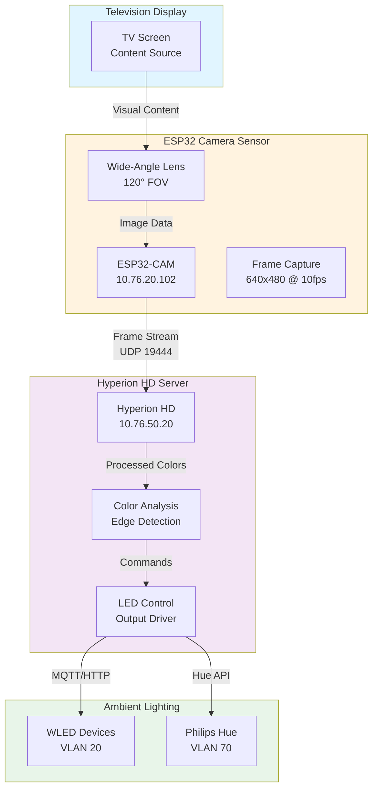
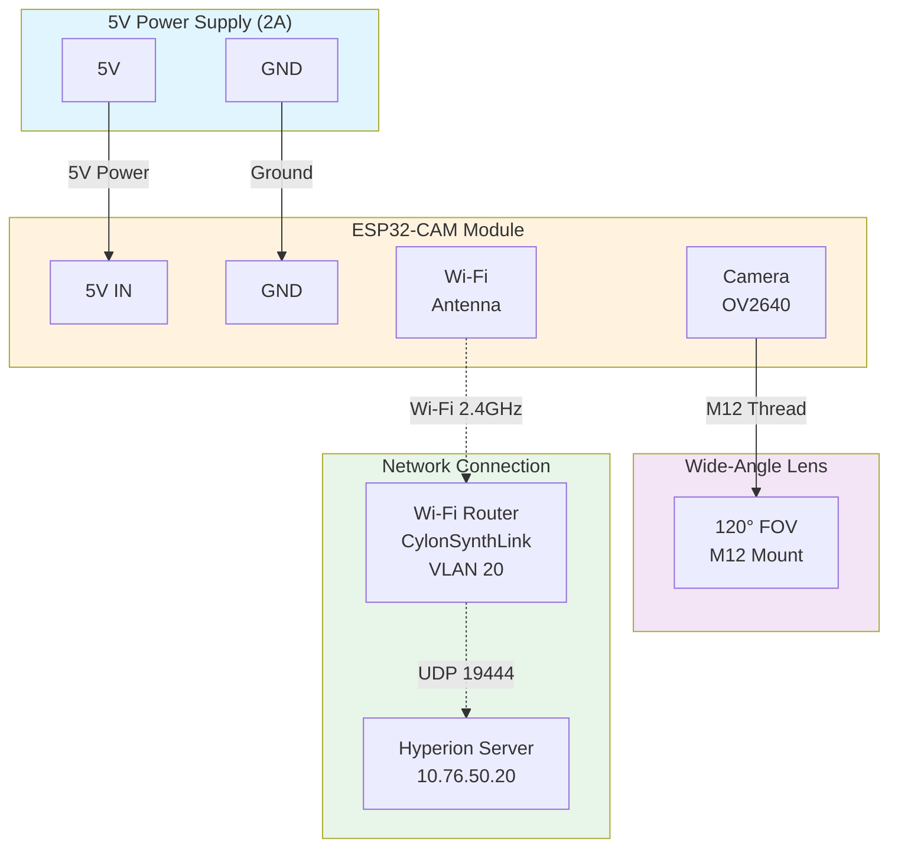

# 📹 Hyperion HD Camera Sensor — Battlestar Ventana Network Blueprint

This document details the configuration and deployment of ESP32-based camera sensors for capturing television content and streaming it to Hyperion HD for ambient lighting control.

---

## 🌐 Network Placement

- **VLAN:** 20 (CylonSynthLink - IoT)
- **Subnet:** 10.76.20.0/24
- **Access Policy:** Limited to Hyperion Protocol (UDP 19444) and HTTPS (443) to ServerVault (VLAN 50)
- **Internet Access:** Firmware updates and time sync only
- **Service Dependencies:** Hyperion HD server on ServerVault, MQTT broker for status reporting

---

## 🎯 System Overview

### Purpose

The ESP32 camera sensor captures frames from your television screen and streams them to Hyperion HD, which processes the color information to control ambient lighting (LED strips, smart bulbs, etc.) that matches the on-screen content in real-time.

### Architecture



---

## 📡 Device Inventory

| Hostname | IP Address | Camera Model | Resolution | FPS | Location | Notes |
|----------|------------|--------------|------------|-----|----------|-------|
| iot-hyperion-cam-01 | 10.76.20.102 | ESP32-CAM OV2640 | 640x480 | 10 | Living Room TV | Main TV sensor |
| iot-hyperion-cam-02 | TBD | ESP32-CAM OV5640 | 1280x720 | 15 | Bedroom TV | Reserved |
| iot-hyperion-cam-03 | TBD | ESP32-CAM OV2640 | 640x480 | 10 | Game Room | Reserved |

---

## 🔧 Hardware Configuration

### ESP32-CAM Module Specifications

| Component | Specification | Notes |
|-----------|---------------|-------|
| **Microcontroller** | ESP32-S (240MHz dual-core) | Sufficient for real-time frame processing |
| **Camera Module** | OV2640 (2MP) or OV5640 (5MP) | OV2640 recommended for cost/performance |
| **Lens** | Wide-angle 120-160° FOV | Captures entire TV screen from close distance |
| **Memory** | 4MB Flash, 520KB SRAM | PSRAM recommended for higher FPS |
| **Power** | 5V @ 500mA (USB or dedicated PSU) | Peak consumption during transmission |
| **Network** | Wi-Fi 802.11 b/g/n (2.4GHz) | Ethernet adapter optional for stability |

### Recommended Camera Models

#### Option 1: ESP32-CAM with OV2640 (Budget-Friendly)
- **Resolution:** 640x480 @ 10-15fps
- **Latency:** 100-150ms
- **Cost:** ~$10 USD
- **Best for:** Standard 1080p TVs, shorter distances (<2m)

#### Option 2: ESP32-CAM with OV5640 (High Performance)
- **Resolution:** 1280x720 @ 15-20fps
- **Latency:** 80-120ms
- **Cost:** ~$15 USD
- **Best for:** 4K TVs, larger screens, longer distances (2-3m)

### Wide-Angle Lens Selection

| Lens Type | Field of View | Minimum Distance | TV Size Coverage |
|-----------|---------------|------------------|------------------|
| Standard | 66° | 1.5m | Up to 55" |
| Wide-Angle | 120° | 0.8m | Up to 65" |
| Ultra-Wide | 160° | 0.5m | Up to 75" |

**Recommendation:** 120° wide-angle lens for most living room setups

---

## 🛠️ Firmware and Software

### Hyperion NG (New Generation)

The recommended Hyperion variant for modern setups:

- **Repository:** [https://github.com/hyperion-project/hyperion.ng](https://github.com/hyperion-project/hyperion.ng)
- **Web UI:** HTTP port 8090
- **Protocol:** UDP 19444 (default), TCP 19445 (JSON API)
- **Features:** Web-based configuration, MQTT support, multi-instance

### ESP32 Firmware Options

#### Option A: ESP32-Hyperion-Grabber (Recommended)
```bash
# Flash using PlatformIO
git clone https://github.com/hyperion-project/esp32-hyperion-grabber
cd esp32-hyperion-grabber
pio run --target upload
```

**Configuration:**
- Hyperion server IP: `10.76.50.20`
- Hyperion port: `19444` (UDP) or `19445` (TCP)
- Frame rate: `10fps` (adjustable based on performance)
- Resolution: `640x480` (default)

#### Option B: Custom ESPHome Integration
```yaml
# esphome/hyperion-camera.yaml
esphome:
  name: hyperion-cam-01
  platform: ESP32
  board: esp32cam

wifi:
  ssid: "CylonSynthLink"
  password: !secret wifi_iot_password
  manual_ip:
    static_ip: 10.76.20.102
    gateway: 10.76.20.1
    subnet: 255.255.255.0
    dns1: 10.76.50.10

mqtt:
  broker: 10.76.50.20
  port: 8883
  username: !secret mqtt_username
  password: !secret mqtt_password

camera:
  - platform: esp32_camera
    name: "Hyperion Camera 01"
    resolution: VGA
    jpeg_quality: 10
    max_framerate: 10fps

# Custom component for Hyperion streaming
external_components:
  - source: github://hyperion-project/esphome-hyperion
    components: [hyperion_grabber]

hyperion_grabber:
  server: 10.76.50.20
  port: 19444
  priority: 100
  width: 640
  height: 480
```

---

## 🏠 Hyperion HD Server Configuration

### Installation on ServerVault (VLAN 50)

#### Docker Deployment (Recommended)

```yaml
# docker-compose.yml for Hyperion HD
version: '3.8'

services:
  hyperion:
    image: hyperionproject/hyperion.ng:latest
    container_name: hyperion-hd
    restart: unless-stopped
    network_mode: host
    volumes:
      - /opt/hyperion/config:/root/.hyperion
      - /dev:/dev
    environment:
      - TZ=America/Los_Angeles
    ports:
      - "8090:8090"   # Web UI
      - "19444:19444/udp"  # Flatbuffers
      - "19445:19445"      # JSON API
    devices:
      - /dev/video0:/dev/video0  # Optional: USB capture card
```

**Deploy:**
```bash
cd /opt/hyperion
docker-compose up -d
```

#### Systemd Service (Alternative)

```ini
# /etc/systemd/system/hyperion.service
[Unit]
Description=Hyperion HD Ambient Lighting
After=network.target

[Service]
Type=simple
User=hyperion
ExecStart=/usr/bin/hyperiond --service --userdata /home/hyperion/.hyperion
Restart=on-failure
RestartSec=10

[Install]
WantedBy=multi-user.target
```

### Web UI Initial Setup

1. **Access Web Interface:**
   - URL: `http://10.76.50.20:8090`
   - Default login: No authentication (configure ASAP)

2. **Configure Input Source:**
   - Navigate to: **Configuration → Capturing Hardware**
   - Select: **Network (Flatbuffers)**
   - Listen Port: `19444` (UDP)
   - Priority: `100` (higher = higher priority)

3. **Configure LED Layout:**
   - Navigate to: **Configuration → LED Layout**
   - Choose TV screen edge mapping:
     - **Top:** 20 LEDs
     - **Bottom:** 20 LEDs
     - **Left:** 10 LEDs
     - **Right:** 10 LEDs
   - Total: 60 LEDs (adjust based on your setup)

4. **Configure Output Device:**
   - Navigate to: **Configuration → LED Controller**
   - Select output type:
     - **WLED:** HTTP JSON API (`http://10.76.20.101/json`)
     - **Philips Hue:** Bridge IP `10.76.70.10` with API key
     - **Generic SPI:** For direct LED strip control

5. **Save Configuration**

---

## 🔌 Hardware Wiring Diagram



### Component Assembly

1. **Mount Camera Lens:**
   - Carefully screw M12 wide-angle lens onto OV2640 module
   - Adjust focus by rotating lens (test with live preview)
   - Tighten lock ring to prevent focus drift

2. **Power Connection:**
   - Connect 5V regulated power supply to ESP32-CAM VCC/GND
   - **Warning:** Do NOT use 3.3V; camera requires 5V
   - Use quality USB power adapter (minimum 1A, 2A recommended)

3. **Initial Programming:**
   - Connect FTDI/USB-UART adapter:
     - FTDI TX → ESP32 RX
     - FTDI RX → ESP32 TX
     - FTDI GND → ESP32 GND
   - Bridge GPIO 0 to GND for bootloader mode
   - Flash firmware using Arduino IDE or PlatformIO
   - Remove GPIO 0 bridge and reset for normal operation

4. **Physical Mounting:**
   - Position camera facing TV screen
   - **Optimal Position:** Center of TV, 0.5-1.5m distance
   - **Angle:** Perpendicular to screen (0° tilt)
   - Use adjustable mount for fine-tuning
   - Avoid direct light sources in camera FOV

---

## 🔒 Security Considerations

### Network Security

1. **VLAN Isolation:**
   - Camera operates in IoT VLAN (20) with no direct LAN access
   - Communication only to ServerVault (50) via firewall rules
   - No peer-to-peer IoT device communication

2. **Firewall Rules:**
   - **Allow:** IoT (20) → ServerVault (50) on UDP 19444, TCP 8090
   - **Deny:** IoT (20) → Trusted (10), Work (90), Cameras (81/82)
   - **Limit:** Internet access to NTP (123) and firmware updates only

3. **Authentication:**
   - Enable Hyperion web UI authentication (Configuration → Network)
   - Use strong password (minimum 12 characters, alphanumeric + symbols)
   - Consider disabling web UI external access after initial setup

### Privacy Considerations

1. **Data Capture:**
   - Camera captures screen content ONLY (not room environment)
   - Frame data is transient (not recorded or stored)
   - All processing happens locally on ServerVault

2. **Disable When Not in Use:**
   - Use Home Assistant automation to disable camera when TV is off
   - Implement physical lens cover or power switch for absolute privacy

3. **Network Traffic Encryption:**
   - Consider using Hyperion TCP mode with TLS for encrypted transmission
   - Configure MQTT over TLS (port 8883) for status reporting

---

## 📊 Home Assistant Integration

### MQTT Sensor for Camera Status

Add to Home Assistant `configuration.yaml`:

```yaml
# MQTT Sensor for Hyperion Camera Status
mqtt:
  sensor:
    - name: "Hyperion Camera 01 Status"
      state_topic: "hyperion/camera-01/status"
      value_template: "{{ value_json.state }}"
      json_attributes_topic: "hyperion/camera-01/attributes"
      availability_topic: "hyperion/camera-01/availability"
      payload_available: "online"
      payload_not_available: "offline"
      
    - name: "Hyperion Camera 01 FPS"
      state_topic: "hyperion/camera-01/fps"
      unit_of_measurement: "fps"
      value_template: "{{ value | int }}"
      
    - name: "Hyperion Camera 01 Latency"
      state_topic: "hyperion/camera-01/latency"
      unit_of_measurement: "ms"
      value_template: "{{ value | int }}"
```

### Automation: Enable Camera When TV is On

```yaml
automation:
  - id: hyperion_camera_tv_sync
    alias: "Hyperion Camera - Sync with TV State"
    trigger:
      - platform: state
        entity_id: media_player.living_room_tv
        from: "off"
        to: "on"
    action:
      - service: switch.turn_on
        target:
          entity_id: switch.hyperion_camera_01_power
      - delay: "00:00:05"
      - service: mqtt.publish
        data:
          topic: "hyperion/camera-01/command"
          payload: '{"state": "on", "priority": 100}'
  
  - id: hyperion_camera_tv_off
    alias: "Hyperion Camera - Disable When TV Off"
    trigger:
      - platform: state
        entity_id: media_player.living_room_tv
        from: "on"
        to: "off"
    action:
      - service: mqtt.publish
        data:
          topic: "hyperion/camera-01/command"
          payload: '{"state": "off"}'
      - delay: "00:00:10"
      - service: switch.turn_off
        target:
          entity_id: switch.hyperion_camera_01_power
```

### Lovelace Dashboard Card

```yaml
type: vertical-stack
cards:
  - type: entities
    title: Hyperion Camera 01
    entities:
      - entity: sensor.hyperion_camera_01_status
        name: "Status"
      - entity: sensor.hyperion_camera_01_fps
        name: "Frame Rate"
      - entity: sensor.hyperion_camera_01_latency
        name: "Latency"
      - entity: switch.hyperion_camera_01_power
        name: "Power"
  
  - type: picture-entity
    entity: camera.hyperion_camera_01
    name: "Live Preview"
    show_state: false
    camera_view: live
```

---

## 🎨 Hyperion LED Mapping Configuration

### Edge-Based LED Layout (Recommended)

For standard TV ambient lighting with LED strips around the edges:

```json
{
  "leds": [
    {
      "index": 0,
      "hscan": {"minimum": 0.0, "maximum": 0.05},
      "vscan": {"minimum": 0.0, "maximum": 0.075}
    },
    {
      "index": 1,
      "hscan": {"minimum": 0.05, "maximum": 0.10},
      "vscan": {"minimum": 0.0, "maximum": 0.075}
    }
  ],
  "endOfJson": "endOfJson"
}
```

**Explanation:**
- `index`: LED position (0-59 for 60 LED setup)
- `hscan`: Horizontal position on screen (0.0 = left, 1.0 = right)
- `vscan`: Vertical position on screen (0.0 = top, 1.0 = bottom)

**Generate Complete Layout:**
Use Hyperion Web UI: Configuration → LED Layout → LED Matrix/Edge

### Zone-Based Mapping (Advanced)

For room-wide ambient lighting or multiple LED zones:

```json
{
  "zones": [
    {
      "name": "TV Top",
      "leds": [0, 1, 2, 3, 4, 5, 6, 7, 8, 9, 10, 11, 12, 13, 14, 15, 16, 17, 18, 19]
    },
    {
      "name": "TV Bottom",
      "leds": [20, 21, 22, 23, 24, 25, 26, 27, 28, 29, 30, 31, 32, 33, 34, 35, 36, 37, 38, 39]
    },
    {
      "name": "TV Left",
      "leds": [40, 41, 42, 43, 44, 45, 46, 47, 48, 49]
    },
    {
      "name": "TV Right",
      "leds": [50, 51, 52, 53, 54, 55, 56, 57, 58, 59]
    }
  ]
}
```

---

## 🚀 Deployment Checklist

### Pre-Deployment

- [ ] ESP32-CAM hardware assembled with wide-angle lens
- [ ] Firmware flashed and tested (verify frame capture)
- [ ] Static IP reserved in DHCP (10.76.20.102)
- [ ] Hyperion HD server installed on ServerVault (10.76.50.20)
- [ ] Network connectivity verified (ping test IoT → ServerVault)
- [ ] Camera positioned and focused on TV screen
- [ ] Power supply adequate (5V @ 2A minimum)

### Initial Configuration

- [ ] Connect to ESP32-CAM setup mode or web UI
- [ ] Configure Wi-Fi credentials (SSID: CylonSynthLink)
- [ ] Set Hyperion server IP (10.76.50.20) and port (19444)
- [ ] Test frame streaming (verify UDP packets received)
- [ ] Access Hyperion web UI (http://10.76.50.20:8090)
- [ ] Configure LED layout and output device
- [ ] Test ambient lighting response to screen content

### Post-Deployment

- [ ] Verify MQTT status reporting in Home Assistant
- [ ] Test camera enable/disable automation (TV on/off sync)
- [ ] Monitor frame rate and latency (target: 10fps, <150ms)
- [ ] Check firewall rules: IoT (20) → ServerVault (50) on UDP 19444
- [ ] Configure Hyperion web UI authentication
- [ ] Backup Hyperion configuration to Git repository
- [ ] Document camera position and lens focus settings
- [ ] Create user guide for family members (how to enable/disable)

---

## 🛠️ Troubleshooting Guide

### Camera Not Connecting to Wi-Fi

**Symptoms:** ESP32-CAM not showing up on network

**Solutions:**
1. Verify SSID and password in firmware configuration
2. Ensure VLAN 20 is configured correctly on router/switch
3. Check signal strength (ESP32 2.4GHz Wi-Fi only)
4. Reboot ESP32-CAM by power cycling
5. Flash firmware again with correct credentials

### No Frames Received by Hyperion

**Symptoms:** Hyperion web UI shows "No signal" or 0fps

**Solutions:**
1. Verify firewall rules allow UDP 19444 from IoT (20) to ServerVault (50)
2. Check Hyperion server IP and port in ESP32 configuration
3. Test UDP connectivity: `nc -u -l 19444` on server, send test frame from camera
4. Review ESP32-CAM logs for transmission errors
5. Try switching from UDP to TCP mode (port 19445)

### Poor Frame Rate or High Latency

**Symptoms:** <5fps, latency >200ms, choppy lighting

**Solutions:**
1. Reduce camera resolution (e.g., 640x480 → 320x240)
2. Lower JPEG quality setting (less compression = larger frames but faster)
3. Check Wi-Fi signal strength and interference (use 5GHz if supported)
4. Verify Hyperion server CPU usage (should be <30% idle)
5. Disable unnecessary Hyperion effects or processing

### Incorrect Color Mapping

**Symptoms:** LED colors don't match screen content accurately

**Solutions:**
1. Recalibrate camera white balance and exposure
2. Adjust Hyperion LED layout/mapping in web UI
3. Increase LED smoothing or transition time for more stable colors
4. Check camera positioning (should face screen directly, no angles)
5. Verify TV picture settings (disable dynamic contrast, auto brightness)

### Camera Overheating

**Symptoms:** ESP32-CAM becomes hot to touch, random reboots

**Solutions:**
1. Ensure adequate ventilation around camera module
2. Add small heatsink to ESP32 chip
3. Reduce frame rate (e.g., 10fps → 5fps)
4. Lower camera resolution
5. Use external power supply instead of USB (better voltage regulation)

---

## 📈 Performance Tuning

### Optimal Settings for 1080p TV

| Parameter | Recommended Value | Notes |
|-----------|-------------------|-------|
| **Resolution** | 640x480 (VGA) | Balance of quality and performance |
| **Frame Rate** | 10fps | Sufficient for smooth ambient lighting |
| **JPEG Quality** | 10 (0-63 scale) | Higher compression, smaller frames |
| **LED Count** | 60-100 LEDs | Edge-based layout for most TVs |
| **Smoothing** | 50-100ms | Reduces flickering, increases latency slightly |

### Optimal Settings for 4K TV

| Parameter | Recommended Value | Notes |
|-----------|-------------------|-------|
| **Resolution** | 1280x720 (HD) | Required for accurate color sampling |
| **Frame Rate** | 15fps | Higher detail requires more frequent updates |
| **JPEG Quality** | 15-20 | Less compression for better color accuracy |
| **LED Count** | 100-150 LEDs | More LEDs for larger screen coverage |
| **Smoothing** | 30-50ms | Faster response for dynamic content |

### Network Optimization

1. **Wi-Fi Channel Selection:**
   - Use Wi-Fi analyzer to find least congested channel
   - Prefer channels 1, 6, or 11 (non-overlapping)

2. **QoS (Quality of Service):**
   - Prioritize UDP 19444 traffic on router/switch
   - Assign higher priority to Hyperion camera traffic

3. **Ethernet Upgrade (Advanced):**
   - Use ESP32 with Ethernet adapter for stable, low-latency connection
   - Eliminates Wi-Fi interference and improves reliability

---

## 🔗 References

- [Hyperion Project Official Documentation](https://docs.hyperion-project.org/)
- [ESP32-CAM Official Documentation](https://github.com/espressif/esp32-camera)
- [Hyperion GitHub Repository](https://github.com/hyperion-project/hyperion.ng)
- [Home Assistant Hyperion Integration](https://www.home-assistant.io/integrations/hyperion/)
- [Firewall Matrix](firewall-matrix.md)
- [Services Matrix](services.md)
- [IoT Device Inventory](other-devices.md)
- [WLED Integration Guide](wled-configurations.md)

---

## 📝 TODO

- [ ] Test ESP32-CAM with different lens types (66°, 120°, 160°)
- [ ] Benchmark latency across UDP vs TCP protocol modes
- [ ] Create comparison matrix: ESP32-CAM vs USB capture card vs HDMI grabber
- [ ] Develop automated camera calibration script (white balance, exposure)
- [ ] Integrate with Frigate NVR for dual-purpose camera (ambient + monitoring)
- [ ] Create 3D-printable camera mount with adjustable angle
- [ ] Document multi-camera setup for ultra-wide or multi-TV configurations
- [ ] Add support for HDR content capture and processing

---

## 💡 Advanced Features

### Multi-Camera Setup (Ultra-Wide TV or Multiple Displays)

For TVs >75" or multi-display setups, deploy multiple ESP32 cameras:

```yaml
# Hyperion Multi-Instance Configuration
instances:
  - instance: 0
    name: "Left Display"
    grabber:
      input: camera-01
      ip: 10.76.20.102
      port: 19444
    leds: [0-29]  # Left half LEDs
    
  - instance: 1
    name: "Right Display"
    grabber:
      input: camera-02
      ip: 10.76.20.103
      port: 19444
    leds: [30-59]  # Right half LEDs
```

### Integration with Frigate NVR (Dual-Purpose Camera)

Use same camera for both ambient lighting and video recording:

```yaml
# frigate.yml
cameras:
  hyperion_cam_01:
    ffmpeg:
      inputs:
        - path: rtsp://10.76.20.102:554/stream
          roles:
            - detect
            - record
    detect:
      enabled: true
      width: 640
      height: 480
      fps: 10
    record:
      enabled: true
      retain:
        days: 7
        mode: motion
```

### HDR Content Handling

For accurate color reproduction with HDR content:

1. Enable HDR tone mapping in Hyperion:
```json
{
  "color": {
    "channelAdjustment": [
      {
        "id": "default",
        "white": [255, 255, 255],
        "gamma": [2.2, 2.2, 2.2],
        "toneCurve": "hdr10"
      }
    ]
  }
}
```

2. Adjust camera exposure compensation:
```cpp
// In ESP32 firmware
sensor_t *s = esp_camera_sensor_get();
s->set_aec_value(s, 1200);  // Increase exposure for HDR
s->set_gainceiling(s, GAINCEILING_128X);  // Max gain
```

---

Built with accessibility in mind. Review and test with tools like Accessibility Insights to ensure it meets your needs.
