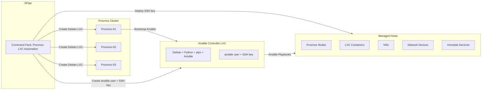

# Proxmox + XPipe + LXC + Ansible Controller

This document defines a full workflow for:

- XPipe command pack for:
  - Creating Debian LXC
  - Bootstrapping Ansible
  - Creating an `ansible` user + SSH key
  - Deploying keys to arbitrary servers
- Recommended XPipe folder layout for multi-host Proxmox
- Cluster-aware Ansible inventory template
- Mermaid diagram of the XPipe → Proxmox → LXC → Ansible pipeline
- Ansible:
  - Controller-hardening playbook
  - Base roles (common, ssh_hardening, firewall, fail2ban, motd)
  - `sudo_hardening` role that **restricts sudo** and aligns with the recommendation
  - Role skeletons for `proxmox_host`, `lxc_orchestrator`, `openwrt_edge`

Designed to be used with **VS Code** and XPipe configuration (manual, API, or config sync).

---

## 1. XPipe command pack: Proxmox LXC automation

This pack is attached to each Proxmox host in XPipe. All commands are host-agnostic and parameterized.

### 1.1 Command 1: Create Debian LXC (Ansible Controller)

**Purpose:** Create a clean Debian LXC via community script.

**Name:**
`Create Debian LXC (Ansible Controller)`

**Run on:** Proxmox host

**Command:**

```bash
bash -c "$(curl -fsSL https://raw.githubusercontent.com/community-scripts/ProxmoxVE/main/ct/debian.sh)"
```

This is interactive by design (CTID, hostname, disk, RAM, network).

---

### 1.2 Command 2: Bootstrap Ansible inside LXC

**Purpose:** Install minimal dependencies for Ansible inside the controller CT.

**Name:**
`Bootstrap Ansible Controller`

**Run on:** Proxmox host

**Variables (XPipe):**

- `ctid` – LXC container ID for the Ansible controller (required)

**Command:**

```bash
pct exec {{ctid}} -- bash -c "
set -e

apt update
apt upgrade -y

apt install -y \
  python3 \
  python3-pip \
  python3-venv \
  ssh \
  git \
  curl \
  nano \
  pipx

pipx ensurepath
pipx install ansible
"
```

**Note:** `sshpass` is intentionally excluded due to security concerns. Use
1Password CLI (`op`) for secure credential management instead. See Command 4 for
details.

---

### 1.3 Command 3: Create `ansible` user + SSH key

**Purpose:** Create dedicated automation user and SSH key inside the controller CT.

**Name:**
`Create Ansible User + SSH Key`

**Run on:** Proxmox host

**Variables:**

- `ctid` – LXC container ID for the Ansible controller (required)

**Command:**

```bash
pct exec {{ctid}} -- bash -c "
set -e

# Create ansible user if it does not exist
if ! id ansible >/dev/null 2>&1; then
  useradd -m -s /bin/bash ansible
fi

# Ensure .ssh directory
mkdir -p /home/ansible/.ssh
chmod 700 /home/ansible/.ssh
chown ansible:ansible /home/ansible/.ssh

# Generate SSH key if missing
if [ ! -f /home/ansible/.ssh/id_ed25519 ]; then
  sudo -u ansible ssh-keygen -t ed25519 -N '' -C 'ansible@controller' -f /home/ansible/.ssh/id_ed25519
fi

# Output public key
cat /home/ansible/.ssh/id_ed25519.pub
"
```

XPipe will display the public key for you to use wherever needed.

---

### 1.4 Command 4: Deploy `ansible` key to arbitrary server

**Purpose:** Push `ansible` user's public key to any target server.

**Name:**
`Deploy Ansible Key to Server`

**Run on:** Proxmox host

**Variables:**

- `ctid` – LXC container ID (required)
- `target_user` – user on the target server (required)
- `target_host` – IP/hostname of target server (required)

**Secure Key Deployment Approach:**

Instead of using `sshpass` with passwords on the command line (which exposes
credentials in process listings, shell history, and logs), use one of these
secure alternatives:

#### Option 1: Interactive ssh-copy-id (Recommended for initial setup)

```bash
pct exec {{ctid}} -- bash -c "
set -e

# Interactive password prompt (not logged)
ssh-copy-id -i /home/ansible/.ssh/id_ed25519.pub {{target_user}}@{{target_host}}
"
```

#### Option 2: Using SSH_ASKPASS with environment (for automation)

```bash
# Retrieve password from 1Password on the Proxmox host
PASSWORD=$(op read --no-newline 'op://{{op_vault}}/{{op_item}}/password') || {
  echo "ERROR: Failed to retrieve password from 1Password" >&2
  exit 1
}

# Deploy the key inside the container
pct exec {{ctid}} -- /bin/bash -c "
set -e

# Use SSH_ASKPASS to provide password securely
export SSH_ASKPASS_REQUIRE=force
export SSH_ASKPASS=\$(mktemp)
export DISPLAY=:0
export TARGET_PASSWORD='$PASSWORD'

# Set up cleanup trap to ensure temporary file is removed even on error
trap 'rm -f \$SSH_ASKPASS' EXIT INT TERM

# Create temporary askpass script that returns the password from environment
cat > \$SSH_ASKPASS << 'EOF'
#!/bin/bash
printf '%s' \"\$TARGET_PASSWORD\"
EOF

# Set ownership and permissions for ansible user to execute
chown ansible:ansible \$SSH_ASKPASS
chmod 700 \$SSH_ASKPASS

# Deploy the key - preserve environment variables through sudo
sudo -u ansible \
  TARGET_PASSWORD=\"\$TARGET_PASSWORD\" \
  SSH_ASKPASS=\$SSH_ASKPASS \
  SSH_ASKPASS_REQUIRE=force \
  DISPLAY=:0 \
  ssh-copy-id -f -i /home/ansible/.ssh/id_ed25519.pub \
  {{target_user}}@{{target_host}}

# Clean up (trap will also handle this)
unset TARGET_PASSWORD
"
```

**Note:** The `-f` flag forces the key copy even if the key already exists.
Remove if you want to skip already-deployed keys.

**Security Benefits:**

- Credentials retrieved at runtime from encrypted vault
- No passwords in XPipe variables, shell history, or process listings
- Audit trail in 1Password shows when/who accessed credentials
- Centralized credential rotation without updating scripts
- Works seamlessly with XPipe's command templating

#### Option B: Interactive ssh-copy-id

```bash
pct exec {{ctid}} -- sudo -u ansible ssh-copy-id \
  -i /home/ansible/.ssh/id_ed25519.pub \
  {{target_user}}@{{target_host}}
```

This prompts interactively for the password, keeping credentials secure and
maintaining host key verification.

#### Option C: Ansible vault with pre-populated known_hosts

1. First, manually verify and accept the host key:

```bash
pct exec {{ctid}} -- sudo -u ansible ssh-keyscan -H {{target_host}} >> /home/ansible/.ssh/known_hosts
```

1. Then use Ansible's `authorized_key` module with vault-encrypted passwords in
   a playbook rather than XPipe commands for production deployments.

#### Option D: Out-of-band key deployment

Manually copy the public key content and add it to the target server's
`~/.ssh/authorized_keys` file through a secure channel (console access, existing
secure connection, etc.).

After key deployment, the `ansible` user in the CT can SSH to that host with keys.

---

### 1.5 Command 5: Create Ansible directory structure inside controller

**Purpose:** Set up a basic Ansible project layout inside the controller CT.

**Name:**
`Create Ansible Inventory Structure`

**Run on:** Proxmox host

**Variables:**

- `ctid` – LXC container ID (required)

**Command:**

```bash
pct exec {{ctid}} -- bash -c "
set -e

mkdir -p /home/ansible/ansible/{inventory,group_vars,host_vars,roles,playbooks,files,templates}
touch /home/ansible/ansible/inventory/hosts.ini
chown -R ansible:ansible /home/ansible/ansible
"
```

---

## 2. XPipe folder layout for multi-host Proxmox

Recommended XPipe structure:

```text
Proxmox-Cluster/
├── Proxmox-01
│   └── Commands: Proxmox LXC Automation
├── Proxmox-02
│   └── Commands: Proxmox LXC Automation
├── Proxmox-03
│   └── Commands: Proxmox LXC Automation
└── Proxmox-Backup
    └── Commands: Proxmox LXC Automation
```

- Each Proxmox host is a separate SSH connection.
- Attach the **same command pack** (`Proxmox LXC Automation`) to each host.

---

## 3. Cluster-aware Ansible inventory template

Place this inside your controller CT at:

`/home/ansible/ansible/inventory/hosts.ini`

```ini
[controllers]
ansible-ctl-pve1 ansible_host=10.10.10.11 ansible_user=ansible
ansible-ctl-pve2 ansible_host=10.10.10.12 ansible_user=ansible

[proxmox]
pve1 ansible_host=10.10.5.11 ansible_user=root
pve2 ansible_host=10.10.5.12 ansible_user=root
pve3 ansible_host=10.10.5.13 ansible_user=root

[lxc_containers]
lxc-ansible-pve1 ansible_host=10.10.20.11 ansible_user=ansible
lxc-ansible-pve2 ansible_host=10.10.20.12 ansible_user=ansible

[vms]
vm-app-01 ansible_host=10.10.30.21 ansible_user=ansible
vm-app-02 ansible_host=10.10.30.22 ansible_user=ansible

[network_devices]
core-router ansible_host=10.10.1.1 ansible_user=admin
edge-router ansible_host=10.10.1.2 ansible_user=admin

[homelab_services]
ha-main ansible_host=10.10.40.10 ansible_user=ansible
frigate ansible_host=10.10.40.11 ansible_user=ansible

[all:vars]
ansible_python_interpreter=/usr/bin/python3
```

You can refine with `group_vars`.

Example: `group_vars/proxmox.yml`:

```yaml
ansible_user: root
ansible_become: false
```

Example: `group_vars/lxc_containers.yml`:

```yaml
ansible_user: ansible
ansible_become: true
```

---

## 4. Mermaid diagram: XPipe → Proxmox → LXC → Ansible pipeline



---

## 5. Ansible controller hardening and base roles

All paths assume:

`/home/ansible/ansible` as your Ansible project root.

### 5.1 Playbook: `playbooks/controller-harden.yml`

```yaml
---
- name: Harden Ansible Controller
  hosts: controllers
  become: true
  roles:
    - common
    - ssh_hardening
    - firewall
    - fail2ban
    - motd
    - sudo_hardening
```

---

### 5.2 Role: `common`

`roles/common/tasks/main.yml`:

```yaml
---
- name: Ensure timezone is set
  timezone:
    name: America/Chicago

- name: Install base packages
  apt:
    name:
      - sudo
      - curl
      - git
      - htop
      - nano
      - bash-completion
    state: present
    update_cache: true
```

---

### 5.3 Role: `ssh_hardening`

`roles/ssh_hardening/tasks/main.yml`:

```yaml
---
- name: Harden SSH configuration
  lineinfile:
    path: /etc/ssh/sshd_config
    regexp: "{{ item.regexp }}"
    line: "{{ item.line }}"
    state: present
    backrefs: yes
  loop:
    - { regexp: '^#?PermitRootLogin', line: 'PermitRootLogin no' }
    - { regexp: '^#?PasswordAuthentication', line: 'PasswordAuthentication no' }
    - { regexp: '^#?X11Forwarding', line: 'X11Forwarding no' }
    - { regexp: '^#?UseDNS', line: 'UseDNS no' }

- name: Restart SSH service
  service:
    name: ssh
    state: restarted
```

---

### 5.4 Role: `firewall` (UFW)

`roles/firewall/tasks/main.yml`:

```yaml
---
- name: Install UFW
  apt:
    name: ufw
    state: present

- name: Default deny incoming
  ufw:
    direction: incoming
    policy: deny

- name: Default allow outgoing
  ufw:
    direction: outgoing
    policy: allow

- name: Allow SSH
  ufw:
    rule: allow
    port: 22
    proto: tcp

- name: Enable UFW
  ufw:
    state: enabled
```

---

### 5.5 Role: `fail2ban`

`roles/fail2ban/tasks/main.yml`:

```yaml
---
- name: Install fail2ban
  apt:
    name: fail2ban
    state: present
    update_cache: true

- name: Ensure fail2ban is running and enabled
  service:
    name: fail2ban
    state: started
    enabled: true
```

---

### 5.6 Role: `motd`

`roles/motd/templates/motd.j2`:

```text
Welcome to {{ inventory_hostname }}
Managed by Ansible — {{ ansible_date_time.date }}
```

`roles/motd/tasks/main.yml`:

```yaml
---
- name: Set custom MOTD
  template:
    src: motd.j2
    dest: /etc/motd
    owner: root
    group: root
    mode: '0644'
```

---

## 6. `sudo_hardening` role (aligned with recommendation)

This is the key part that brings you into line with:

> Tighten sudoers, restrict commands, and document compensating controls.

### 6.1 Structure

```text
roles/sudo_hardening/
├── defaults/
│   └── main.yml
├── tasks/
│   └── main.yml
└── templates/
    └── ansible_sudoers.j2
```

---

### 6.2 `defaults/main.yml`

```yaml
---
# User Ansible uses to manage systems
sudo_user: ansible

# Commands that ansible can run with sudo
sudo_commands:
  - /usr/bin/apt
  - /usr/bin/apt-get
  - /usr/bin/systemctl
  - /usr/bin/journalctl
  - /usr/sbin/reboot

# Whether these commands can be run without a password
sudo_nopasswd: true

# Optionally enable auditd as compensating control
enable_auditd: true

# Optionally set ansible user shell to nologin for extra hardening
ansible_nologin: false
```

You can override these per-group or per-host in `group_vars` / `host_vars`.

---

### 6.3 `templates/ansible_sudoers.j2`

```jinja
{{ sudo_user }} ALL=(ALL){{ ' NOPASSWD:' if sudo_nopasswd else '' }} {{ sudo_commands | join(', ') }}
```

This avoids `NOPASSWD:ALL` and limits the command set to what Ansible needs.

---

### 6.4 `tasks/main.yml`

```yaml
---
- name: Ensure ansible user exists
  user:
    name: "{{ sudo_user }}"
    state: present
    shell: "{{ '/usr/sbin/nologin' if ansible_nologin else '/bin/bash' }}"

- name: Create sudoers file for Ansible user
  template:
    src: ansible_sudoers.j2
    dest: "/etc/sudoers.d/{{ sudo_user }}"
    owner: root
    group: root
    mode: '0440'
    validate: '/usr/sbin/visudo -cf %s'

- name: Install and enable auditd (compensating control)
  when: enable_auditd
  block:
    - name: Install auditd
      apt:
        name: auditd
        state: present
        update_cache: true

    - name: Ensure auditd is running and enabled
      service:
        name: auditd
        state: started
        enabled: true
```

---

### 6.5 Example `group_vars/controllers.yml`

```yaml
sudo_user: ansible
sudo_commands:
  - /usr/bin/apt
  - /usr/bin/apt-get
  - /usr/bin/systemctl
  - /usr/bin/journalctl
  - /usr/sbin/reboot
sudo_nopasswd: true          # Only these commands, no ALL
enable_auditd: true
ansible_nologin: false       # Set to true if you want to block interactive shells
```

---

## 7. Role skeletons for Proxmox, LXC, and OpenWrt/edge devices

These are starting points; you'll fill them with tasks tailored to your environment.

### 7.1 `proxmox_host` role

Structure:

```text
roles/proxmox_host/
├── tasks/
│   └── main.yml
├── defaults/
│   └── main.yml
└── templates/
```

`tasks/main.yml` example skeleton:

```yaml
---
- name: Ensure Proxmox utilities are installed
  apt:
    name:
      - vim
      - jq
      - curl
    state: present
    update_cache: true

# Add tasks for:
# - Repo configuration
# - Network config
# - Storage setup
# - Backup configuration
```

---

### 7.2 `lxc_orchestrator` role

Structure:

```text
roles/lxc_orchestrator/
├── tasks/
│   └── main.yml
├── defaults/
│   └── main.yml
└── templates/
```

`defaults/main.yml` example:

```yaml
---
lxc_default_template: local:vztmpl/debian-12-standard_12.0-1_amd64.tar.zst
lxc_default_bridge: vmbr0
```

`tasks/main.yml` skeleton:

```yaml
---
- name: Create LXC container (example)
  command: >
    pct create {{ lxc_ctid }}
    {{ lxc_default_template }}
    --hostname {{ lxc_hostname }}
    --net0 name=eth0,bridge={{ lxc_default_bridge }},ip={{ lxc_ip }}
  args:
    creates: "/etc/pve/lxc/{{ lxc_ctid }}.conf"

# Expand with:
# - pct set for nesting/keyctl
# - Start/stop containers
# - Apply resources (CPU/RAM)
```

---

### 7.3 `openwrt_edge` role

Structure:

```text
roles/openwrt_edge/
├── tasks/
│   └── main.yml
├── templates/
└── files/
```

`tasks/main.yml` skeleton:

```yaml
---
- name: Push network config to OpenWrt
  template:
    src: network.j2
    dest: /etc/config/network
  notify: Reload network

- name: Push firewall config to OpenWrt
  template:
    src: firewall.j2
    dest: /etc/config/firewall
  notify: Reload firewall

- name: Ensure required packages are installed
  shell: "opkg update && opkg install {{ item }}"
  loop: "{{ openwrt_packages | default([]) }}"

handlers:
  - name: Reload network
    shell: "/etc/init.d/network reload"

  - name: Reload firewall
    shell: "/etc/init.d/firewall reload"
```

You can add `templates/network.j2`, `templates/firewall.j2` based on your topology.

---

## 8. Minimal first-run sequence

1. In XPipe:
   - Add each Proxmox host as an SSH connection.
   - Attach the **Proxmox LXC Automation** command pack.

2. For each controller CT:
   - Run `Create Debian LXC (Ansible Controller)`
   - Run `Bootstrap Ansible Controller`
   - Run `Create Ansible User + SSH Key`
   - Run `Create Ansible Inventory Structure`

3. Inside the controller CT:
   - Clone or create `/home/ansible/ansible/`
   - Add the roles and playbooks from this file.
   - Populate `inventory/hosts.ini`.

4. Run:

```bash
cd /home/ansible/ansible
ansible-playbook playbooks/controller-harden.yml
```

From that point onward, **Ansible is the source of truth**, and XPipe is just your ergonomic launcher for Proxmox and controller bootstrapping.

---

If you want, the next step could be: a `site.yml` that ties together `proxmox_host`, `lxc_orchestrator`, and `openwrt_edge` into a full homelab orchestration story.
