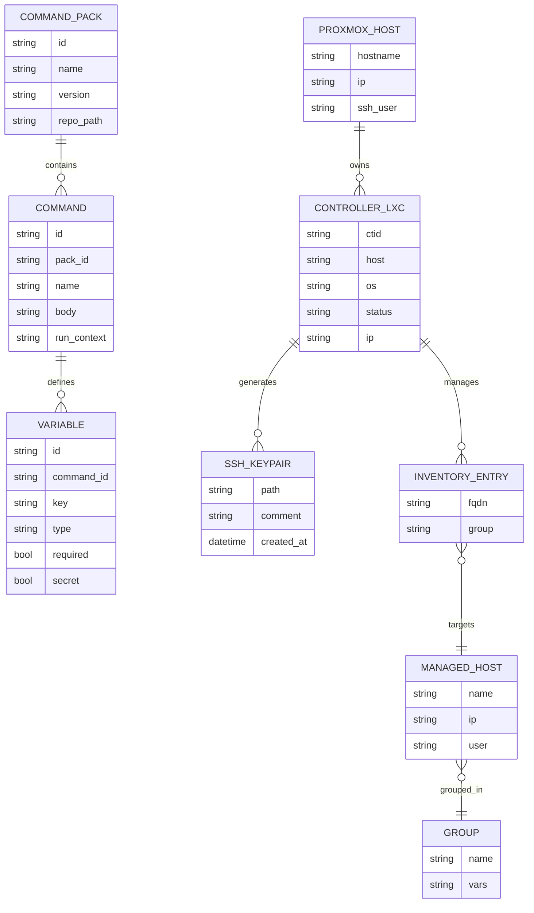
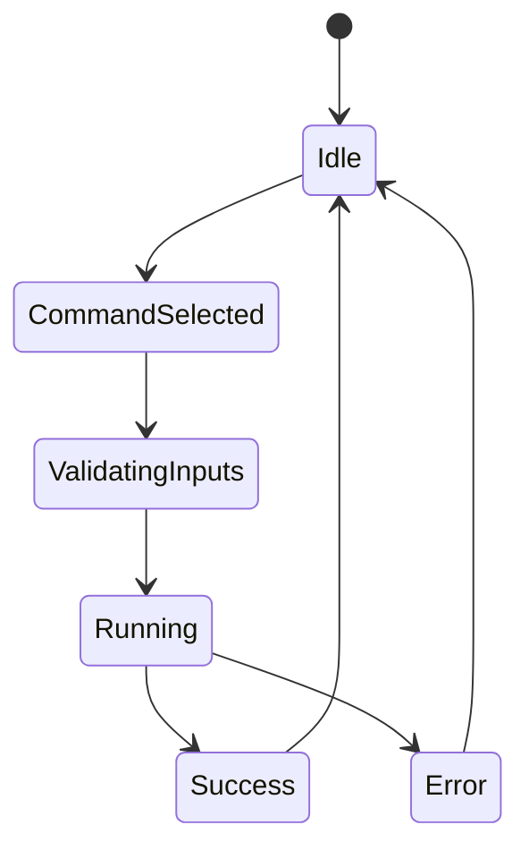

## Goal

Deliver a reusable Proxmox + XPipe + Ansible controller automation pack that creates Debian controller LXCs, bootstraps Ansible, and provisions an `ansible` user with SSH keys. Standardize XPipe folder layout, inventory structure, and validation paths so Proxmox clusters can onboard controllers quickly and maintain Ansible as the single source of truth. Keep the bootstrap minimal (OS + Ansible + keys) while ensuring repeatable, host-agnostic runs across PVE nodes. Reduce first-run friction by templating variables and documenting the minimal operator flow in XPipe.

## Requirements

- Four XPipe commands: create Debian LXC controller, bootstrap Ansible, create `ansible` user + SSH key, deploy the key to managed hosts via `sshpass`.
- Host-agnostic, parameterized execution (`ctid`, `target_user`, `target_host`, `password`, resource sizing) with validation guards.
- Document XPipe folder/connection layout for multi-node Proxmox clusters and provide a minimal first-run checklist.
- Ship a cluster-aware Ansible inventory template with group vars for controllers, Proxmox, LXCs, VMs, network devices, and services.
- Include Mermaid diagrams for the pipeline (XPipe → Proxmox → LXC → Ansible) and the overall architecture.
- Keep automation bootstrap-only; delegate configuration management to the downstream Ansible repo once keys and inventory exist.
- Provision a standard admin-level user across all Proxmox hosts and guests (LXCs/VMs) with SSH key-based access and membership in `sudo`, avoiding cluster-wide `NOPASSWD` by default; where passwordless sudo is required for automation, scope it to a minimal set of commands via host-specific `sudoers` entries and document compensating controls (key management, rotation, auditing).

## Technical Considerations

### System Architecture Overview

```mermaid
flowchart TB
  subgraph Frontend[Frontend Layer]
    IDE[VS Code + XPipe desktop]
    VaultSync[XPipe vault synced to Git]
  end

  subgraph API[API Layer]
    XPCLI[XPipe CLI + connection launches]
    Auth[SSH keys + sudo elevation]
    Validate[Param validation + templating]
  end

  subgraph Biz[Business Logic Layer]
    Pack[Command pack orchestrator]
    Workflow[Sequence: create CT → bootstrap → ansible user/key → deploy key]
    InventorySync[Inventory lint + push/pull]
  end

  subgraph Data[Data Layer]
    Inv[Inventory + group_vars repo]
    Keys[Controller SSH keypairs]
    Logs[Command run logs]
    Repo[Git: docs + pack specs]
  end

  subgraph Infra[Infrastructure Layer]
    PVE[Proxmox hosts]
    CT[Controller LXCs (Debian)]
    Targets[Managed hosts: PVE, LXCs, VMs, network, services]
  end

  IDE -->|Run command| XPCLI
  XPCLI -->|Templated vars| Pack
  Pack -->|pct create/exec| PVE
  PVE -->|spawn| CT
  Pack -->|inventory sync| Repo
  CT -->|SSH + git| Repo
  CT -->|Ansible playbooks| Targets
  Keys --> CT
  InventorySync --> Inv
  Logs --> Repo
```

**Technology Stack Selection**: Proxmox for virtualization; Debian LXCs for lightweight controllers; XPipe CLI/desktop for orchestration; SSH + `sshpass` for first-run auth; Ansible via `pipx`; Git for docs/inventory.

**Integration Points**: XPipe commands run on PVE hosts with `pct create/exec`; controller SSH keys land on targets; inventory and pack specs live in Git; XPipe vault sync keeps command definitions versioned.

**Deployment Architecture**: Attach the command pack to each PVE connection in XPipe; provision per-host controller LXCs; store inventories alongside docs; optional container runners for validation/local dry-runs.

**Scalability Considerations**: Scale horizontally by adding controllers per PVE; parameterized commands avoid host drift; inventory grouping handles new device classes; `sshpass` limited to first auth then replaced with keys.

### Database Schema Design



- **Table specifications**: file-backed structures; command packs store repo path; commands include run context (host vs controller); controllers track IP/status; keypairs track creation time.
- **Indexing strategy**: index by `command_pack.name/version`, `command.name`, `ctid`, `managed_host.name`, and `inventory_entry.group` for faster lookups in tooling.
- **Foreign keys**: command → pack; variable → command; controller → proxmox_host; inventory entry → managed_host/group; keypair → controller.
- **Migration strategy**: version pack specs and inventories in Git with semantic tags; apply changes via PRs; keep changelog per pack version.

### API Design

- Conceptual endpoints (or XPipe command abstractions):
  - `POST /packs/proxmox-lxc/controllers` → create controller (vars: `host`, `ctid?`, `hostname?`, `disk_gb`, `mem_mb`, `net`).
  - `POST /packs/proxmox-lxc/bootstrap` → install Ansible via `pct exec` (vars: `host`, `ctid`).
  - `POST /packs/proxmox-lxc/ansible-user` → create user + key; response includes public key (vars: `host`, `ctid`, `username?`).
  - `POST /packs/proxmox-lxc/deploy-key` → deploy key to `target_user@target_host` using `sshpass` (vars: `ctid`, `target_user`, `target_host`, `password`).
  - `POST /packs/proxmox-lxc/admin-user` → run controller Ansible play to provision a standard admin user on all inventory hosts (vars: `ctid`, `admin_username`, `admin_pubkey`, `sudo_nopasswd=true`, `extra_groups?`).
- Request/response shapes (TypeScript-style):
  - `type RunCommandRequest = { command: string; vars: Record<string, string | number | boolean>; }`
  - `type RunCommandResponse = { status: "ok" | "error"; message: string; logs?: string; duration_ms?: number; }`
- Authentication/authorization: XPipe SSH connections per PVE host; sudo required for `pct`; restrict command templates to prevent injection; XPipe role-based access if enabled.
- Error handling: surface `pct` exit codes and stderr; redact secrets; provide remediation hints (missing `sshpass`, invalid `ctid`, insufficient resources).
- Rate limiting and caching: low-volume; optionally throttle repeated controller creation per host; cache last-known CTID list and controller IPs in the vault.

### Frontend Architecture

#### Component Hierarchy (shadcn/ui flavor for a "Command Pack" dashboard)

```
Command Pack Page
├── Header (Card)
│   ├── Title h1
│   ├── Run Command Button (Dropdown: Create CT, Bootstrap, Create User+Key, Deploy Key, Provision Admin User)
│   └── Search Input
├── Main Content (flex)
│   ├── Filter Sidebar (PVE host, status)
│   │   ├── Host filter (Checkbox group)
│   │   └── Status filter (Badge toggles)
│   └── Pack Grid
│       └── Pack Card
│           ├── Host/CT metadata
│           ├── Command status badges
│           ├── Quick Actions (Run, View Logs)
│           └── Last run summary
└── Log Drawer (sheet)
```

#### State Flow Diagram



- State management: local reducer or Zustand; command runs via React Query mutations; optimistic status updates for queued runs.
- Reusable components: CommandDropdown, HostSelector, CTStatusBadge, LogDrawer, InventoryStatusChip.
- Types: `CommandRun { id; command; host; ctid; status; startedAt; finishedAt; logs; vars }` and `InventoryHost { name; group; ip; reachable }`.

### Security & Performance

- Authentication: XPipe SSH keys with sudo; use `sshpass` only for initial key drop, then disable password auth where permitted.
- Input validation: numeric checks for `ctid`, `mem_mb`, `disk_gb`; sanitize hostnames/IPs; template guardrails to prevent command injection.
- Least privilege: confine `pct exec` to expected paths; avoid long-running daemons on controllers; rotate keys on rebuilds.
- Performance: batch `apt` installs; reuse controllers; cache inventory snapshots and last-known CTID/IP data in the vault to avoid repeated discovery.
- Observability: store run logs; capture durations; surface failures with remediation hints.
- Admin user policy: default to passwordless sudo (NOPASSWD) with SSH key-only access; optionally enforce MFA or disable password auth post-provisioning; audit sudoers entries and log all elevations.

### XPipe Docs Alignment (<https://docs.xpipe.io/>)

- Installation and desktop/Webtop: Follow Getting started → Installation and Webtop to provision local XPipe plus browser-accessible desktop if remote-only use is needed.
- Proxmox integration: Use Guide → Proxmox to mirror host/CT navigation patterns; keep commands shell-based (`pct exec`) per XPipe shell-connection model.
- Automation: Use Guide → Automating actions and Connection launches to register the four commands as reusable actions on each PVE host; MCP server guide if exposing to external orchestrators.
- Sync: Use Guide → Synchronization to git-back the XPipe vault so pack definitions stay versioned alongside this repo.
- Security: Reference Security in XPipe (Reference → Security) to align SSH key handling and vault protection with org policy.

### Implementation Steps

1) Finalize pack definitions and variables; store specs in `xpipe/command-packs/` and sync the XPipe vault to Git.
2) Configure XPipe folder `Proxmox-Cluster` with per-host connections; attach the pack and set default vars (resource sizing, network bridge).
3) Run commands in order per host: create controller CT → bootstrap Ansible → create `ansible` user/key → deploy key to one target for smoke test.
4) Validate controller reachability (`ansible --version`, `whoami`) and update `hosts.ini` + `group_vars` with controller and target entries, including `admin_username`, `admin_pubkey`, `admin_groups`, and `sudo_nopasswd`.
5) Execute the Admin User provision action: from XPipe, run the controller Ansible play against `all` to create the standard admin user across Proxmox hosts and guests.
6) Commit inventory changes and pack updates; tag the pack version; document the admin-user policy and rollback/revoke procedure in README for operators.

### Success Criteria

- A new PVE host can be onboarded end-to-end in <15 minutes using the pack.
- Controllers come up with Ansible available via `pipx`, unique SSH keys, and reachability to at least one managed host.
- Inventory and docs live in Git; steps are repeatable and parameterized across hosts.
