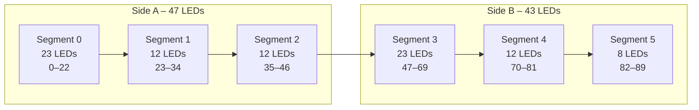
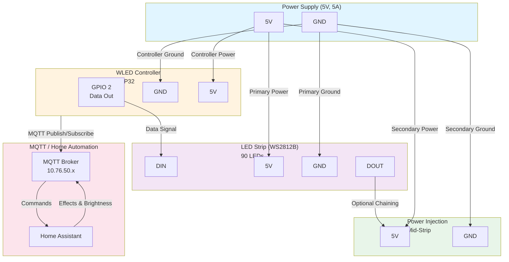

# 💡 WLED Configurations — Battlestar Ventana Network Blueprint

This document tracks WLED device configurations, segment mappings, and presets for LED strip deployments on the Battlestar Ventana network.

---

## 🌐 Network Placement

- **VLAN:** 20 (CylonSynthLink - IoT)
- **Subnet:** 10.76.20.0/24
- **Access Policy:** Limited to MQTT (8883) and HTTPS (443) to ServerVault (VLAN 50)
- **Internet Access:** Firmware updates and time sync only

---

## 📡 WLED Device Inventory

| Hostname | IP Address | LED Count | Segments | Location | Notes |
|----------|------------|-----------|----------|----------|-------|
| iot-wled-01 | 10.76.20.101 | 90 | 6 | [TODO] | Main strip - 2-sided layout |
| iot-wled-02 | TBD | TBD | TBD | [TODO] | Reserved |
| iot-wled-03 | TBD | TBD | TBD | [TODO] | Reserved |

---

## 🎨 LED Strip Layout: iot-wled-01 (90 LEDs)

### Configuration Summary

- **Total LEDs:** 90
- **Side A:** 47 LEDs (Segments 0, 1, 2)
- **Side B:** 43 LEDs (Segments 3, 4, 5)

### Segment Breakdown

| Segment ID | Start LED | Stop LED | Count | Side | Purpose |
|------------|-----------|----------|-------|------|---------|
| 0 | 0 | 22 | 23 | A | Main side A |
| 1 | 23 | 34 | 12 | A | Side A middle |
| 2 | 35 | 46 | 12 | A | Side A end |
| 3 | 47 | 69 | 23 | B | Main side B |
| 4 | 70 | 81 | 12 | B | Side B middle |
| 5 | 82 | 89 | 8 | B | Side B end |

### Visual Layout



---

## 🔧 WLED JSON Preset (Import-Ready)

### Preset: 6-Segment Layout

Import this configuration via:  
**Config → Security & Updates → Presets → Import preset JSON**

```json
{
  "seg": [
    {
      "id": 0,
      "start": 0,
      "stop": 23,
      "rev": false
    },
    {
      "id": 1,
      "start": 23,
      "stop": 35,
      "rev": false
    },
    {
      "id": 2,
      "start": 35,
      "stop": 47,
      "rev": false
    },
    {
      "id": 3,
      "start": 47,
      "stop": 70,
      "rev": false
    },
    {
      "id": 4,
      "start": 70,
      "stop": 82,
      "rev": false
    },
    {
      "id": 5,
      "start": 82,
      "stop": 90,
      "rev": false
    }
  ],
  "on": true,
  "bri": 128,
  "transition": 7
}
```

---

## 🏠 Home Assistant Integration

### MQTT Discovery

WLED devices automatically publish to MQTT when configured. Ensure:

1. **MQTT Broker:** Running on ServerVault (10.76.50.x)
2. **Discovery Prefix:** `homeassistant/`
3. **WLED MQTT Settings:**
   - Broker: `10.76.50.x`
   - Port: `8883` (TLS) or `1883` (non-TLS)
   - Client ID: `wled-<hostname>`

### Example HA Configuration

Add to Home Assistant `configuration.yaml`:

```yaml
# WLED Integration
light:
  - platform: mqtt
    name: "WLED Main Strip"
    state_topic: "wled/iot-wled-01/status"
    command_topic: "wled/iot-wled-01/set"
    brightness_state_topic: "wled/iot-wled-01/brightness"
    brightness_command_topic: "wled/iot-wled-01/brightness/set"
    rgb_state_topic: "wled/iot-wled-01/color"
    rgb_command_topic: "wled/iot-wled-01/color/set"
```

### Lovelace Card Example

```yaml
type: light
entity: light.wled_main_strip
name: Main LED Strip
```

---

## 🔒 Security Considerations

1. **Disable Web Interface Internet Access:** WLED web UI should only be accessible from Trusted VLAN (10) or Semi-Trusted (31)
2. **Firmware Updates:** Use local firmware file upload or restrict update URLs to trusted sources
3. **MQTT Authentication:** Enable username/password authentication on MQTT broker
4. **API Access:** Disable or secure the WLED API endpoint if not needed

### Firewall Rules

From Trusted VLAN (10) → IoT VLAN (20):

- **HTTP/HTTPS:** TCP 80, 443 (WLED web interface)
- **UDP Discovery:** UDP 21324 (WLED discovery protocol)

From IoT VLAN (20) → ServerVault (50):

- **MQTT:** TCP 8883 (TLS) or 1883 (standard)

---

## 🛠️ Advanced Configurations

### Power Injection Points

For strips exceeding 150 LEDs or high brightness, document power injection:

| Strip | Injection Points | Voltage | Current Draw |
|-------|------------------|---------|--------------|
| iot-wled-01 | Start only | 5V | ~2.5A @ full white |

### Bidirectional Mapping

For mirrored animations across Side A and Side B:

```json
{
  "seg": [
    {
      "id": 0,
      "start": 0,
      "stop": 47,
      "rev": false,
      "mi": true
    },
    {
      "id": 1,
      "start": 47,
      "stop": 90,
      "rev": true,
      "mi": true
    }
  ]
}
```

### LedFx Integration

For music-reactive effects, map WLED devices in LedFx:

```yaml
devices:
  - name: Main Strip
    type: wled
    ip_address: 10.76.20.101
    pixel_count: 90
```

---

## 📋 Maintenance Checklist

- [ ] Static IP assigned via DHCP reservation
- [ ] MQTT credentials configured
- [ ] Firmware updated to latest stable version
- [ ] Segments verified and tested
- [ ] Home Assistant discovery working
- [ ] Power supply adequate for LED count
- [ ] Physical mounting secure
- [ ] Network firewall rules validated

---

## 🔗 References

- [WLED Official Documentation](https://kno.wled.ge/)
- [WLED JSON API](https://kno.wled.ge/interfaces/json-api/)
- [Home Assistant WLED Integration](https://www.home-assistant.io/integrations/wled/)
- [Firewall Matrix](firewall-matrix.md)
- [Services Matrix](services.md)
- [IoT Device Inventory](other-devices.md)

---

## � Bidirectional Mapping (Mirrored Animations)

For synchronized animations that mirror across Side A and Side B, use this configuration:

### Two-Zone Mirrored Setup

```json
{
  "seg": [
    {
      "id": 0,
      "start": 0,
      "stop": 47,
      "rev": false,
      "mi": true,
      "gp": 0
    },
    {
      "id": 1,
      "start": 47,
      "stop": 90,
      "rev": true,
      "mi": true,
      "gp": 1
    }
  ],
  "on": true,
  "bri": 128,
  "transition": 7
}
```

**Parameters:**

- `"mi": true` — Enable mirroring within segment
- `"rev": true` — Reverse direction (for Side B)
- `"gp": N` — Group ID for synchronized effects

### Three-Zone Symmetrical Setup

```json
{
  "seg": [
    {
      "id": 0,
      "start": 0,
      "stop": 23,
      "rev": false,
      "mi": true
    },
    {
      "id": 1,
      "start": 23,
      "stop": 47,
      "rev": true,
      "mi": true
    },
    {
      "id": 2,
      "start": 47,
      "stop": 90,
      "rev": true,
      "mi": true
    }
  ]
}
```

---

## 🏠 Home Assistant YAML Package

Save this as `packages/wled_lighting.yaml` in your Home Assistant config:

```yaml
# packages/wled_lighting.yaml
# WLED Strip Integration Package

homeassistant:
  customize:
    light.wled_main_strip:
      friendly_name: "Main LED Strip"
      icon: mdi:led-strip

mqtt:
  light:
    - name: "WLED Main Strip"
      unique_id: wled_main_strip_light
      state_topic: "wled/iot-wled-01/api"
      command_topic: "wled/iot-wled-01/api"
      brightness: true
      brightness_state_topic: "wled/iot-wled-01/api"
      brightness_command_topic: "wled/iot-wled-01/api"
      brightness_scale: 255
      color_mode: true
      supported_color_modes:
        - rgb
        - rgbw
      effect: true
      effect_list:
        - "Solid"
        - "Blink"
        - "Breathe"
        - "Wipe"
        - "Wipe Random"
        - "Random Colors"
        - "Sweep"
        - "Dynamic"
        - "Colorloop"
        - "Rainbow"
        - "Scan"
        - "Twinkle"
        - "Sparkle"
      json_attributes_topic: "wled/iot-wled-01/info"
      availability_topic: "wled/iot-wled-01/status"
      payload_available: "online"
      payload_not_available: "offline"

automation:
  - id: wled_bedtime_fade
    alias: "WLED Bedtime Fade"
    trigger:
      platform: time
      at: "22:30:00"
    action:
      service: light.turn_on
      target:
        entity_id: light.wled_main_strip
      data:
        brightness: 50
        effect: "Breathe"
        color_name: "blue"

  - id: wled_morning_wake
    alias: "WLED Morning Wake"
    trigger:
      platform: time
      at: "07:00:00"
    action:
      service: light.turn_on
      target:
        entity_id: light.wled_main_strip
      data:
        brightness: 255
        effect: "Sunrise"
        color_name: "orange"

script:
  wled_rainbow_animate:
    sequence:
      - service: light.turn_on
        target:
          entity_id: light.wled_main_strip
        data:
          brightness: 200
          effect: "Rainbow"
          transition: 2

  wled_party_mode:
    sequence:
      - service: light.turn_on
        target:
          entity_id: light.wled_main_strip
        data:
          brightness: 255
          effect: "Dynamic"
          transition: 1

sensor:
  - platform: mqtt
    name: "WLED Main Strip Uptime"
    state_topic: "wled/iot-wled-01/uptime"
    unit_of_measurement: "seconds"
    value_template: "{{ value | int }}"

  - platform: mqtt
    name: "WLED Main Strip Free Heap"
    state_topic: "wled/iot-wled-01/heap"
    unit_of_measurement: "bytes"
    value_template: "{{ value | int }}"
```

### Include in configuration.yaml

```yaml
homeassistant:
  packages:
    wled: !include packages/wled_lighting.yaml
```

---

## 🎵 LedFx Integration

LedFx provides music-reactive and advanced effects for WLED devices.

### LedFx Configuration File

Save as `config/devices.json` in your LedFx installation:

```json
{
  "devices": {
    "main_strip": {
      "name": "Main Strip",
      "type": "wled",
      "config": {
        "ip_address": "10.76.20.101",
        "port": 80,
        "protocol_version": 2
      },
      "pixel_count": 90,
      "segments": [
        {
          "id": 0,
          "start": 0,
          "end": 23,
          "name": "Side A – Main"
        },
        {
          "id": 1,
          "start": 23,
          "end": 35,
          "name": "Side A – Middle"
        },
        {
          "id": 2,
          "start": 35,
          "end": 47,
          "name": "Side A – End"
        },
        {
          "id": 3,
          "start": 47,
          "end": 70,
          "name": "Side B – Main"
        },
        {
          "id": 4,
          "start": 70,
          "end": 82,
          "name": "Side B – Middle"
        },
        {
          "id": 5,
          "start": 82,
          "end": 90,
          "name": "Side B – End"
        }
      ]
    }
  },
  "integrations": {
    "spotify": {
      "enabled": true
    },
    "audio": {
      "enabled": true,
      "input_device": "default"
    }
  }
}
```

### Recommended LedFx Effects

- **Spectrum:** Audio reactive spectrum analyzer across all segments
- **Waveform:** Oscilloscope-style waveform visualization
- **Energy:** Energy level reactive effect
- **Pulse:** Beat-synced pulse effect
- **Scroll:** Scrolling text with music reactivity

---

## 🔌 Hardware Wiring Diagram

### Power Injection & Controller Data Flow



### Component Specifications

| Component | Specification | Notes |
|-----------|---------------|-------|
| **Power Supply** | 5V, 5A minimum | Adequate for ~2.5A @ full white, 90 LEDs |
| **LED Stripe** | WS2812B (or compatible) | ~300mA per 10 LEDs @ full white |
| **Controller** | ESP32 with WLED firmware | GPIO 2 for data output |
| **Data Cable** | Shielded, short run | Keep <1m to strip start |
| **Power Injection** | 14-16 AWG wire | At mid-strip (after LED ~45) |
| **Connectors** | JST SM or XT60 | Rated for 5A minimum |

### Assembly Steps

1. **Connect Primary Power:**
   - PSU 5V → Strip 5V (JST connector)
   - PSU GND → Strip GND (JST connector)
   - PSU 5V → ESP32 VIN
   - PSU GND → ESP32 GND

2. **Connect Data Signal:**
   - ESP32 GPIO 2 → Strip DIN (data input)
   - Keep cable <1m and shielded

3. **Add Power Injection (Optional but Recommended):**
   - Install secondary 5V/GND connections at LED ~45-50
   - Reduces voltage drop across long strips
   - Use separate PSU supply or taps from main PSU

4. **Network Connectivity:**
   - ESP32 via Wi-Fi to MQTT broker (10.76.50.x:8883)
   - Or use Ethernet adapter if available

---

## 🔧 Deployment Checklist

### Pre-Deployment

- [ ] Verify all power connectors are secure
- [ ] Test power supply output (5V ±0.2V)
- [ ] Verify ESP32 boots and shows WLED web UI
- [ ] Confirm Wi-Fi/Ethernet connectivity to MQTT broker
- [ ] Load 6-segment JSON preset into WLED
- [ ] Test each segment individually (verify LED ranges)

### Post-Deployment

- [ ] Verify MQTT discovery in Home Assistant
- [ ] Test brightness and color controls
- [ ] Verify all effects cycle properly
- [ ] Check firewall rules: Trusted (10) → IoT (20) on TCP 80/443
- [ ] Check firewall rules: IoT (20) → ServerVault (50) on TCP 8883
- [ ] Monitor WLED web UI for heap/uptime stability
- [ ] Configure automations in Home Assistant
- [ ] Backup WLED settings and preset

---

## 📝 TODO

- [ ] Finalize physical locations for all WLED devices
- [ ] Deploy LedFx instance and configure Spotify integration
- [ ] Create Home Assistant dashboard with WLED controls and visualizations
- [ ] Set up automated backup of WLED presets to GitHub
- [ ] Configure WLED sync groups for multi-device coordination
- [ ] Test failover behavior if MQTT broker is unavailable
- [ ] Document strip mounting and cable management
- [ ] Create Home Assistant scene for "Movie Night" / "Party" / "Sleep"
