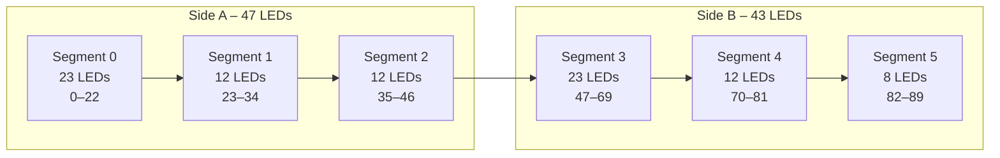

# 💡 WLED Configurations — Battlestar Ventana Network Blueprint

This document tracks WLED device configurations, segment mappings, and presets for LED strip deployments on the Battlestar Ventana network.

---

## 🌐 Network Placement

- **VLAN:** 20 (CylonSynthLink - IoT)
- **Subnet:** 10.76.20.0/24
- **Access Policy:** Limited to MQTT (8883) and HTTPS (443) to ServerVault (VLAN 50)
- **Internet Access:** Firmware updates and time sync only

---

## 📡 WLED Device Inventory

| Hostname | IP Address | LED Count | Segments | Location | Notes |
|----------|------------|-----------|----------|----------|-------|
| iot-wled-01 | 10.76.20.101 | 90 | 6 | [TODO] | Main strip - 2-sided layout |
| iot-wled-02 | TBD | TBD | TBD | [TODO] | Reserved |
| iot-wled-03 | TBD | TBD | TBD | [TODO] | Reserved |

---

## 🎨 LED Strip Layout: iot-wled-01 (90 LEDs)

### Configuration Summary

- **Total LEDs:** 90
- **Side A:** 47 LEDs (Segments 0, 1, 2)
- **Side B:** 43 LEDs (Segments 3, 4, 5)

### Segment Breakdown

| Segment ID | Start LED | Stop LED | Count | Side | Purpose |
|------------|-----------|----------|-------|------|---------|
| 0 | 0 | 22 | 23 | A | Main side A |
| 1 | 23 | 34 | 12 | A | Side A middle |
| 2 | 35 | 46 | 12 | A | Side A end |
| 3 | 47 | 69 | 23 | B | Main side B |
| 4 | 70 | 81 | 12 | B | Side B middle |
| 5 | 82 | 89 | 8 | B | Side B end |

### Visual Layout



---

## 🔧 WLED JSON Preset (Import-Ready)

### Preset: 6-Segment Layout

Import this configuration via:  
**Config → Security & Updates → Presets → Import preset JSON**

```json
{
  "seg": [
    {
      "id": 0,
      "start": 0,
      "stop": 23,
      "rev": false
    },
    {
      "id": 1,
      "start": 23,
      "stop": 35,
      "rev": false
    },
    {
      "id": 2,
      "start": 35,
      "stop": 47,
      "rev": false
    },
    {
      "id": 3,
      "start": 47,
      "stop": 70,
      "rev": false
    },
    {
      "id": 4,
      "start": 70,
      "stop": 82,
      "rev": false
    },
    {
      "id": 5,
      "start": 82,
      "stop": 90,
      "rev": false
    }
  ],
  "on": true,
  "bri": 128,
  "transition": 7
}
```

---

## 🏠 Home Assistant Integration

### MQTT Discovery

WLED devices automatically publish to MQTT when configured. Ensure:

1. **MQTT Broker:** Running on ServerVault (10.76.50.x)
2. **Discovery Prefix:** `homeassistant/`
3. **WLED MQTT Settings:**
   - Broker: `10.76.50.x`
   - Port: `8883` (TLS) or `1883` (non-TLS)
   - Client ID: `wled-<hostname>`

### Example HA Configuration

Add to Home Assistant `configuration.yaml`:

```yaml
# WLED Integration
light:
  - platform: mqtt
    name: "WLED Main Strip"
    state_topic: "wled/iot-wled-01/status"
    command_topic: "wled/iot-wled-01/set"
    brightness_state_topic: "wled/iot-wled-01/brightness"
    brightness_command_topic: "wled/iot-wled-01/brightness/set"
    rgb_state_topic: "wled/iot-wled-01/color"
    rgb_command_topic: "wled/iot-wled-01/color/set"
```

### Lovelace Card Example

```yaml
type: light
entity: light.wled_main_strip
name: Main LED Strip
```

---

## 🔒 Security Considerations

1. **Disable Web Interface Internet Access:** WLED web UI should only be accessible from Trusted VLAN (10) or Semi-Trusted (31)
2. **Firmware Updates:** Use local firmware file upload or restrict update URLs to trusted sources
3. **MQTT Authentication:** Enable username/password authentication on MQTT broker
4. **API Access:** Disable or secure the WLED API endpoint if not needed

### Firewall Rules

From Trusted VLAN (10) → IoT VLAN (20):

- **HTTP/HTTPS:** TCP 80, 443 (WLED web interface)
- **UDP Discovery:** UDP 21324 (WLED discovery protocol)

From IoT VLAN (20) → ServerVault (50):

- **MQTT:** TCP 8883 (TLS) or 1883 (standard)

---

## 🛠️ Advanced Configurations

### Power Injection Points

For strips exceeding 150 LEDs or high brightness, document power injection:

| Strip | Injection Points | Voltage | Current Draw |
|-------|------------------|---------|--------------|
| iot-wled-01 | Start only | 5V | ~2.5A @ full white |

### Bidirectional Mapping

For mirrored animations across Side A and Side B:

```json
{
  "seg": [
    {
      "id": 0,
      "start": 0,
      "stop": 47,
      "rev": false,
      "mi": true
    },
    {
      "id": 1,
      "start": 47,
      "stop": 90,
      "rev": true,
      "mi": true
    }
  ]
}
```

### LedFx Integration

For music-reactive effects, map WLED devices in LedFx:

```yaml
devices:
  - name: Main Strip
    type: wled
    ip_address: 10.76.20.101
    pixel_count: 90
```

---

## 📋 Maintenance Checklist

- [ ] Static IP assigned via DHCP reservation
- [ ] MQTT credentials configured
- [ ] Firmware updated to latest stable version
- [ ] Segments verified and tested
- [ ] Home Assistant discovery working
- [ ] Power supply adequate for LED count
- [ ] Physical mounting secure
- [ ] Network firewall rules validated

---

## 🔗 References

- [WLED Official Documentation](https://kno.wled.ge/)
- [WLED JSON API](https://kno.wled.ge/interfaces/json-api/)
- [Home Assistant WLED Integration](https://www.home-assistant.io/integrations/wled/)
- [Firewall Matrix](firewall-matrix.md)
- [Services Matrix](services.md)
- [IoT Device Inventory](other-devices.md)

---

## 📝 TODO

- [ ] Finalize physical locations for all WLED devices
- [ ] Document power injection strategy for larger strips
- [ ] Create Home Assistant dashboard package for WLED controls
- [ ] Set up automated backup of WLED presets
- [ ] Configure WLED sync groups for multi-device coordination
- [ ] Test failover behavior if MQTT broker is unavailable
