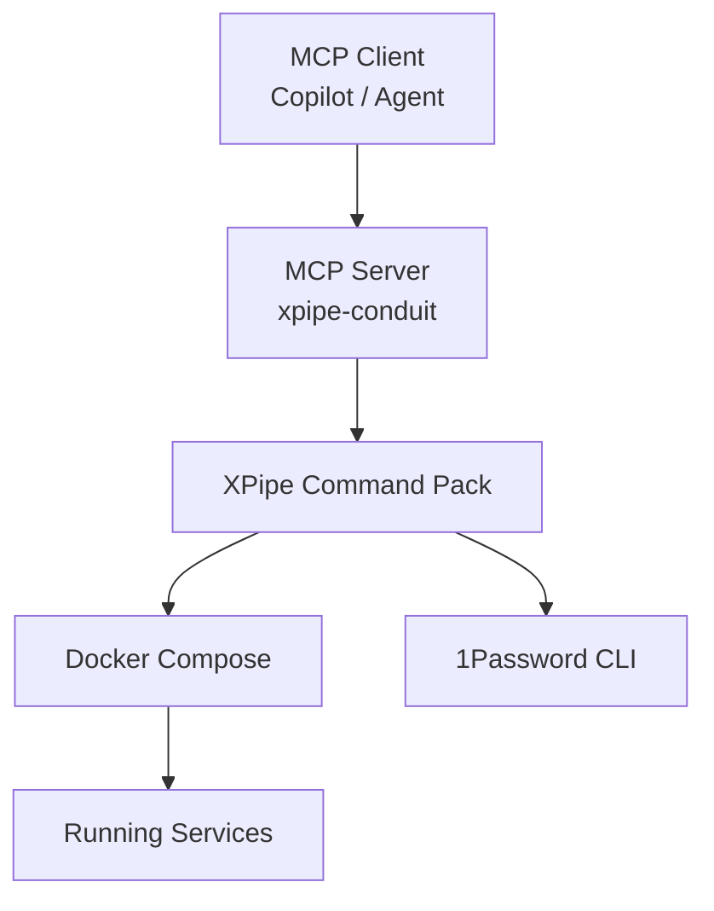

XPipe ↔ MCP Conduit Architecture

Purpose

The XPipe–MCP conduit provides a secure, auditable bridge between:

Model Context Protocol (MCP) agents (Copilot, tools, automation)

XPipe command packs

Docker Compose–managed services

This ensures:

No duplicated orchestration logic

No direct container manipulation by agents

Centralized guardrails for secrets, execution, and lifecycle control

High‑Level Architecture



Design Principles

Compose‑first: All services are managed via Docker Compose.

XPipe‑only execution: MCP never runs shell commands directly.

Secrets never leave runtime: Injected via 1Password CLI at execution time.

Idempotent operations: Start/stop/logs/exec are safe to repeat.

Auditable: Every action maps to a named XPipe command.

MCP Server Responsibilities

The xpipe-conduit MCP server:

Exposes XPipe commands as MCP tools

Validates requested service names

Executes XPipe commands verbatim

Returns stdout/stderr to the MCP client

Never stores secrets or state

MCP Server Registration

Defined in .vscode/mcp.json:

| Tool Name     | Description             |
|---------------|-------------------------|
| start_service | Start a Compose service |
| stop_service  | Stop a Compose service  |
| logs_service  | View logs for a service |

Stop a Compose service

logs_service

Stream service logs

shell_service

Exec into a service

inject_secrets

Inject secrets and start

XPipe Command Mapping

Each MCP tool maps to a named XPipe command:

```yaml
commands: start-core-network: exec: docker compose -f compose/core-network/docker-compose.yml up -d core-network ```

The conduit resolves:

``` start_service("core-network") → start-core-network ```

Secret Injection Flow

MCP tool inject_secrets("core-network") is called

XPipe executes:

```bash export OP_SERVICE_ACCOUNT_TOKEN=$(op read "op://Homelab/core-network/token") docker compose -f compose/core-network/docker-compose.yml up -d core-network ```

Secrets exist only in process memory

Container receives secrets via environment variables

Security Guarantees

MCP cannot execute arbitrary shell commands

XPipe commands are version‑controlled

Secrets are never logged or persisted

Compose files contain no credentials

All execution paths are reviewable in Git

Failure Modes & Guardrails

Failure

Behavior

Unknown service
| Failure       | Behavior                     |
|---------------|------------------------------|
| Unknown service | MCP returns validation error |
| XPipe failure | stderr returned to client    |


Docker error surfaced

Extending the Conduit

To add a new service:

Add Compose definition under compose/<service>/

Add XPipe commands

No MCP changes required

Non‑Goals

Direct Docker API access

Stateful orchestration logic

Secret caching

Agent‑side container control

Summary

The XPipe–MCP conduit enforces a clean separation of concerns:

MCP = intent

XPipe = execution

Compose = orchestration

1Password = secrets
XPipe ↔ MCP Conduit Architecture
🧾 .vscode/tasks.json — One‑Command Guardrails
This keeps automation safe, reproducible, and scalable.

```

🧾 .vscode/tasks.json — One‑Command Guardrails (using ``` fences)

```json { "version": "2.0.0", "tasks": [ { "label": "Guardrails: All", "dependsOrder": "sequence", "dependsOn": [ "Guardrails: Commitlint", "Guardrails: YAML", "Guardrails: Ansible", "Guardrails: MCP", "Guardrails: Compose" ], "group": { "kind": "build", "isDefault": true } },

{
  "label": "Guardrails: Commitlint",
  "type": "shell",
  "command": "npx commitlint --from=origin/main --to=HEAD"
},

{
  "label": "Guardrails: YAML",
  "type": "shell",
  "command": "yamllint ."
},

{
  "label": "Guardrails: Ansible",
  "type": "shell",
  "command": "ansible-lint"
},

{
  "label": "Guardrails: MCP",
  "type": "shell",
  "command": "jq empty .vscode/mcp.json"
},

{
  "label": "Guardrails: Compose",
  "type": "shell",
  "command": "docker compose config"
}

] } ```
