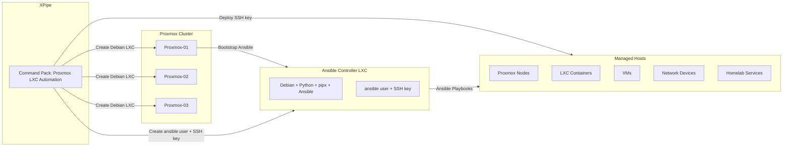

# Proxmox + XPipe + Ansible Controller

This document defines:

- **XPipe command pack** (copy/paste‑ready)
- **Recommended XPipe folder layout** for multi‑host Proxmox
- **Cluster‑aware Ansible inventory template**
- **Mermaid diagram** of the full pipeline
- A structure suitable for **VS Code** and XPipe’s config mechanisms (MCV/API)
- Use Context7

All commands are **minimal bootstrap only** — Ansible becomes the single source of truth afterward.

---

## 1. XPipe command pack specification

This section defines four XPipe commands meant to be attached to any Proxmox host:

1. **Create Debian LXC (Ansible Controller)**
2. **Bootstrap Ansible inside LXC**
3. **Create `ansible` user + SSH key inside LXC**
4. **Deploy `ansible` SSH key to arbitrary server**

You only maintain this pack **once**, then attach it to each Proxmox node in XPipe.

### 1.1 Command 1: Create Debian LXC (Ansible Controller)

**Purpose:**  
Use the community‑scripts installer to create a clean Debian CT optimized for Proxmox and systemd.

**XPipe metadata (conceptual):**

```yaml
name: Create Debian LXC (Ansible Controller)
scope: host
runner: shell
variables: {}
```

**Command body:**

```bash
bash -c "$(curl -fsSL https://raw.githubusercontent.com/community-scripts/ProxmoxVE/main/ct/debian.sh)"
```

**Notes:**

- Runs **on the Proxmox host**.
- Interactive on purpose (CTID, hostname, disk, RAM, network).
- Produces a Debian LXC that will become your Ansible control node.

---

### 1.2 Command 2: Bootstrap Ansible inside LXC

**Purpose:**  
Install only what’s needed for Ansible to function inside the LXC. No config management beyond that.

**XPipe metadata (conceptual):**

```yaml
name: Bootstrap Ansible Controller
scope: host
runner: shell
variables:
  ctid:
    description: "LXC container ID for the Ansible controller"
    required: true
```

**Command body:**

```bash
pct exec {{ctid}} -- bash -c "
set -e

apt update
apt upgrade -y

apt install -y \
  python3 \
  python3-pip \
  python3-venv \
  ssh \
  git \
  curl \
  nano \
  pipx

pipx ensurepath
pipx install ansible
"
```

**Notes:**

- Run after the CT is created.
- No system hardening, no inventory logic here.
- After this, you can SSH into the CT as root or via console and use `ansible` from `ansible`’s venv (provided by `pipx`).

---

### 1.3 Command 3: Create `ansible` user + SSH key in LXC

**Purpose:**  
Create a dedicated `ansible` user, set up `~/.ssh`, and generate an SSH keypair if missing.

**XPipe metadata (conceptual):**

```yaml
name: Create Ansible User + SSH Key
scope: host
runner: shell
variables:
  ctid:
    description: "LXC container ID for the Ansible controller"
    required: true
```

**Command body:**

```bash
pct exec {{ctid}} -- bash -c "
set -e

# Create ansible user if it does not exist
if ! id ansible >/dev/null 2>&1; then
  useradd -m -s /bin/bash ansible
fi

# Ensure .ssh directory
mkdir -p /home/ansible/.ssh
chmod 700 /home/ansible/.ssh
chown ansible:ansible /home/ansible/.ssh

# Generate SSH key if missing
if [ ! -f /home/ansible/.ssh/id_ed25519 ]; then
  sudo -u ansible ssh-keygen -t ed25519 -N '' -C 'ansible@controller' -f /home/ansible/.ssh/id_ed25519
fi

# Output public key
cat /home/ansible/.ssh/id_ed25519.pub
"
```

**Usage pattern:**

- Run this once per controller CT.
- XPipe will show the public key in the terminal.
- You can manually copy it, or use the next command to deploy it.

---

### 1.4 Command 4: Deploy `ansible` key to arbitrary server

**Purpose:**  
Push the `ansible` user’s public key from the controller CT to any target server using `ssh-copy-id`.

**XPipe metadata (conceptual):**

```yaml
name: Deploy Ansible Key to Server
scope: host
runner: shell
variables:
  ctid:
    description: "LXC container ID for the Ansible controller"
    required: true
  target_user:
    description: "Remote user on the target server"
    required: true
  target_host:
    description: "Target server hostname or IP"
    required: true
  password:
    description: "Password for target_user on target_host (first-time auth)"
    required: true
    secret: true
```

**Pre‑req:**  
Install `sshpass` in the controller CT (one‑time):

```bash
pct exec {{ctid}} -- bash -c "apt update && apt install -y sshpass"
```

**Command body:**

```bash
pct exec {{ctid}} -- bash -c "
set -e

sshpass -p '{{password}}' ssh-copy-id \
  -o StrictHostKeyChecking=no \
  -i /home/ansible/.ssh/id_ed25519.pub \
  {{target_user}}@{{target_host}}
"
```

**What this gives you:**

- First-time password‑based auth handled by `sshpass`.
- After that, `ansible@controller` (actually user `ansible` in CT) can SSH to `{{target_user}}@{{target_host}}` using keys.
- Ansible can then manage that host with key‑based authentication.

---

## 2. Recommended XPipe folder layout for multi‑host Proxmox

You can mirror your Proxmox cluster structure inside XPipe to keep things clean and scalable.

### 2.1 High‑level structure

```text
Proxmox-Cluster/
├── Proxmox-01 (PVE1)
│   └── Commands: Proxmox LXC Automation
├── Proxmox-02 (PVE2)
│   └── Commands: Proxmox LXC Automation
├── Proxmox-03 (PVE3)
│   └── Commands: Proxmox LXC Automation
└── Proxmox-Backup (Optional)
    └── Commands: Proxmox LXC Automation
```

### 2.2 Suggested XPipe organization

- **Folder:** `Proxmox-Cluster`
  - **Connections:**
    - `Proxmox-01` → SSH to PVE1
    - `Proxmox-02` → SSH to PVE2
    - `Proxmox-03` → SSH to PVE3
    - `Proxmox-Backup` (if applicable)
- **Command Pack:** `Proxmox LXC Automation`
  - Attach this single pack to *each* Proxmox connection.
  - The commands are host‑agnostic; `{{ctid}}` is supplied per host at runtime.

This lets you:

- Use **one** definition of the automation pack.
- Apply it to **all** Proxmox nodes.
- Ensure consistent controller deployment logic cluster‑wide.

---

## 3. Cluster‑aware Ansible inventory template

This template assumes:

- One or more **Ansible controller CTs**, e.g.:
  - `ansible-ctl-pve1` on Proxmox‑01
  - `ansible-ctl-pve2` on Proxmox‑02
- Multiple host groups:
  - Proxmox nodes
  - LXC containers
  - VMs
  - Network devices (routers, switches, firewalls)
  - Misc homelab services

You can drop this into:

`~/ansible/inventory/hosts.ini`

```ini
[controllers]
ansible-ctl-pve1 ansible_host=10.10.10.11 ansible_user=ansible
ansible-ctl-pve2 ansible_host=10.10.10.12 ansible_user=ansible

[proxmox]
pve1 ansible_host=10.10.5.11 ansible_user=root
pve2 ansible_host=10.10.5.12 ansible_user=root
pve3 ansible_host=10.10.5.13 ansible_user=root

[lxc_containers]
lxc-ansible-pve1 ansible_host=10.10.20.11 ansible_user=ansible
lxc-ansible-pve2 ansible_host=10.10.20.12 ansible_user=ansible
# Add application LXCs here…

[vms]
vm-app-01 ansible_host=10.10.30.21 ansible_user=ansible
vm-app-02 ansible_host=10.10.30.22 ansible_user=ansible

[network_devices]
core-router ansible_host=10.10.1.1 ansible_user=admin
edge-router ansible_host=10.10.1.2 ansible_user=admin

[homelab_services]
ha-main ansible_host=10.10.40.10 ansible_user=ansible
frigate ansible_host=10.10.40.11 ansible_user=ansible

[all:vars]
ansible_python_interpreter=/usr/bin/python3
```

You can support per‑group variables with:

- `group_vars/controllers.yml`
- `group_vars/proxmox.yml`
- `group_vars/lxc_containers.yml`
- etc.

Example `group_vars/proxmox.yml`:

```yaml
ansible_user: root
ansible_become: false
```

Example `group_vars/lxc_containers.yml`:

```yaml
ansible_user: ansible
ansible_become: true
```

---

## 4. Mermaid diagram: XPipe → Proxmox → LXC → Ansible pipeline

You can render this in VS Code with a Mermaid extension, in docs, or any static site generator.



---

## 5. VS Code + XPipe config/API usage

This section is about making the workflow friendly to VS Code and any XPipe config export/import or API/MCV you use.

### 5.1 Suggested repo structure in VS Code

You can maintain everything under a single repo:

```text
homelab-automation/
├── docs/
│   └── proxmox-xpipe-ansible-controller.md
├── xpipe/
│   ├── command-packs/
│   │   └── proxmox-lxc-automation.yml   # (optional representation)
│   └── README.md
└── ansible/
    ├── inventory/
    │   └── hosts.ini
    ├── group_vars/
    ├── host_vars/
    ├── roles/
    └── playbooks/
```

You can treat `proxmox-xpipe-ansible-controller.md` as the **human‑readable spec**, and optionally create a machine‑readable XPipe config (YAML/JSON) under `xpipe/command-packs/`.

### 5.2 Example XPipe command pack (YAML‑style representation)

If XPipe accepts external definition or sync via API/MCV, you can model something like this:

```yaml
name: Proxmox LXC Automation
description: "Create Debian LXC-based Ansible controllers and bootstrap them"
commands:
  - name: Create Debian LXC (Ansible Controller)
    type: shell
    body: |
      bash -c "$(curl -fsSL https://raw.githubusercontent.com/community-scripts/ProxmoxVE/main/ct/debian.sh)"
  - name: Bootstrap Ansible Controller
    type: shell
    variables:
      ctid:
        description: "LXC container ID"
        required: true
    body: |
      pct exec {{ctid}} -- bash -c "
      set -e
      apt update
      apt upgrade -y
      apt install -y python3 python3-pip python3-venv ssh git curl nano pipx
      pipx ensurepath
      pipx install ansible
      "
  - name: Create Ansible User + SSH Key
    type: shell
    variables:
      ctid:
        description: "LXC container ID"
        required: true
    body: |
      pct exec {{ctid}} -- bash -c "
      set -e
      if ! id ansible >/dev/null 2>&1; then
        useradd -m -s /bin/bash ansible
      fi
      mkdir -p /home/ansible/.ssh
      chmod 700 /home/ansible/.ssh
      chown ansible:ansible /home/ansible/.ssh
      if [ ! -f /home/ansible/.ssh/id_ed25519 ]; then
        sudo -u ansible ssh-keygen -t ed25519 -N '' -C 'ansible@controller' -f /home/ansible/.ssh/id_ed25519
      fi
      cat /home/ansible/.ssh/id_ed25519.pub
      "
  - name: Deploy Ansible Key to Server
    type: shell
    variables:
      ctid:
        description: "LXC container ID"
        required: true
      target_user:
        description: "Remote user on target host"
        required: true
      target_host:
        description: "Target hostname/IP"
        required: true
      password:
        description: "Password for remote user (first-time auth)"
        required: true
        secret: true
    body: |
      pct exec {{ctid}} -- bash -c "
      set -e
      sshpass -p '{{password}}' ssh-copy-id \
        -o StrictHostKeyChecking=no \
        -i /home/ansible/.ssh/id_ed25519.pub \
        {{target_user}}@{{target_host}}
      "
```

This YAML is **illustrative**; you can adapt it to whatever XPipe’s actual import/export, “MCV”, or API format is. The important thing is:

- Commands are **parameterized**, not hardcoded.
- Commands are **host‑agnostic**, so you can attach this pack to multiple PVE nodes.
- All bootstrap logic is concentrated in one reusable definition.

---

## 6. Minimal first‑run sequence

When provisioning a new Proxmox host in this pattern:

1. **In XPipe:**
   - Add SSH connection for the new Proxmox host.
   - Attach the `Proxmox LXC Automation` command pack.

2. **Run on new host:**
   - `Create Debian LXC (Ansible Controller)`
   - `Bootstrap Ansible Controller`
   - `Create Ansible User + SSH Key`
   - `Deploy Ansible Key to Server` (for any hosts you want to manage)

3. **In Ansible repo:**
   - Add the controller and new hosts into `inventory/hosts.ini`.
   - Start writing playbooks/roles for real config management.

From that point on, XPipe just launches controllers and bootstraps new environments; **Ansible owns the configuration story**.
