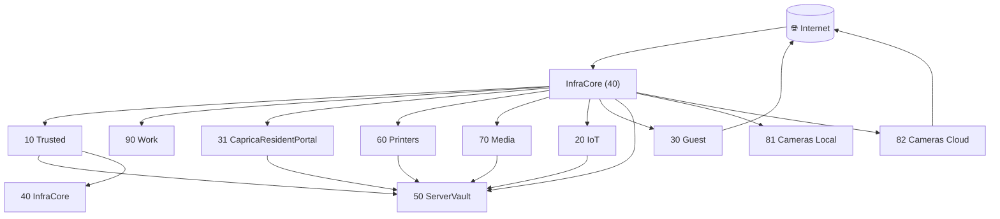

# 🌐 Network Map — Battlestar Ventana

## Overview

- **IP Scheme:** `10.76.<VLAN>.0/24` (gateway `.1`)
- **Core Services:** VLAN 50 (ServerVault) provides DNS/DHCP, storage, MQTT, logging
- **Management Plane:** VLAN 40 (InfraCore) for switches/controllers
- **Zones:** Trusted (10, 90), Semi‑Trusted (31, 60, 70), Untrusted (20, 30), Services (50), Infra (40), Surveillance (81, 82)

## VLAN Map

| VLAN | Name | Subnet | Zone | Purpose |
|------|------|--------|------|---------|
| 10 | Battlestar Ventana | 10.76.10.0/24 | Trusted | Primary LAN |
| 20 | CylonSynthLink | 10.76.20.0/24 | Untrusted | IoT |
| 30 | CapricaGuestPortal | 10.76.30.0/24 | Untrusted | Guest Internet |
| 31 | CapricaResidentPortal | 10.76.31.0/24 | Semi‑Trusted | Residents |
| 40 | InfraCore | 10.76.40.0/24 | Infra | Switches/controllers |
| 50 | ServerVault | 10.76.50.0/24 | Services | NAS, MQTT, DNS/DHCP |
| 60 | VirgonFleetYard | 10.76.60.0/24 | Semi‑Trusted | Printers |
| 70 | PegasusMediaNode | 10.76.70.0/24 | Semi‑Trusted | Media/Casting |
| 81 | ScorpiaMediaShield | 10.76.81.0/24 | Surveillance | Cameras (Local) |
| 82 | ScorpiaMediaRelay | 10.76.82.0/24 | Surveillance | Cameras (Cloud) |
| 90 | ScyllaDataControl | 10.76.90.0/24 | Trusted | Work VLAN |

## Key Flows (High Level)

- **Trusted → Services/Infra:** Full access for admin and core services
- **Semi‑Trusted → Services:** Limited, per service/port allowlists
- **Untrusted → Internet:** Guest (30) Internet only; IoT (20) limited to telemetry/updates
- **Surveillance → Services:** View/logging only (RTSP/Syslog)
- **Work (90) → Internet:** Unthrottled; bootstraps via local DNS/DHCP

## Topology (Mermaid)

## References

- [Firewall Matrix](docs/firewall-matrix.md)
- [Services Matrix](docs/services.md)
- [DHCP Scopes](docs/dhcp-scopes.md)
- [Architecture Blueprint](docs/Project_Architecture_Blueprint.md)
- [Naming Conventions](docs/naming-conventions.md)
- [Audit Checklist](docs/audit-checklist.md)
- [Host Tracker](docs/host-tracker.md)
- [Physical Hosts](docs/physical-hosts.md)
- [Baseline Summary](baseline/Battlestar-Ventana-Blueprint-Summary.md)
- [Alerting Style](alerts/Alertmanager%20style.yaml)
- [Dashboards](dashboards/)
- [Home Assistant](ha/)
- [Monitoring](docs/monitoring.md)
- [Device Inventory](docs/device-inventory.md)
- [Other Devices](docs/other-devices.md)
- [Jaeger Pool](docs/jaeger-pool.md)

- [Device Inventory](docs/device-inventory.md)
- [Other Devices](docs/other-devices.md)
- [Jaeger Pool](docs/jaeger-pool.md)
- [WLED Configurations](docs/wled-configurations.md)
- [Naming Conventions](docs/naming-conventions.md)
- [Project Architecture Blueprint](docs/Project_Architecture_Blueprint.md)
- [Services Matrix](docs/services.md)
- [Firewall Matrix](docs/firewall-matrix.md)
- [DHCP Scopes](docs/dhcp-scopes.md)
- [Audit Checklist](docs/audit-checklist.md)
- [Host Tracker](docs/host-tracker.md)
- [Physical Hosts](docs/physical-hosts.md)
- [Baseline Summary](baseline/Battlestar-Ventana-Blueprint-Summary.md)
- [Alertmanager Style](alerts/Alertmanager%20style.yaml)
- [Dashboards](dashboards/)
- [Home Assistant](ha/)
- [Monitoring](docs/monitoring.md)
- [Device Inventory](docs/device-inventory.md)
- [Other Devices](docs/other-devices.md)
- [Jaeger Pool](docs/jaeger-pool.md)
- [WLED Configurations](docs/wled-configurations.md)
- [Naming Conventions](docs/naming-conventions.md)
- [Project Architecture Blueprint](docs/Project_Architecture_Blueprint.md)
- [Services Matrix](docs/services.md)
- [Firewall Matrix](docs/firewall-matrix.md)
- [DHCP Scopes](docs/dhcp-scopes.md)
- [Audit Checklist](docs/audit-checklist.md)
- [Host Tracker](docs/host-tracker.md)
- [Physical Hosts](docs/physical-hosts.md)
- [Baseline Summary](baseline/Battlestar-Ventana-Blueprint-Summary.md)
- [Alertmanager Style](alerts/Alertmanager%20style.yaml)
- [Dashboards](dashboards/)
- [Home Assistant](ha/)
- [Monitoring](docs/monitoring.md)
- [Device Inventory](docs/device-inventory.md)
- [Other Devices](docs/other-devices.md)
- [Jaeger Pool](docs/jaeger-pool.md)
- [WLED Configurations](docs/wled-configurations.md)
- [Naming Conventions](docs/naming-conventions.md)
- [Project Architecture Blueprint](docs/Project_Architecture_Blueprint.md)
- [Services Matrix](docs/services.md)
- [Firewall Matrix](docs/firewall-matrix.md)
- [DHCP Scopes](docs/dhcp-scopes.md)
- [Audit Checklist](docs/audit-checklist.md)
- [Host Tracker](docs/host-tracker.md)
- [Physical Hosts](docs/physical-hosts.md)
- [Baseline Summary](baseline/Battlestar-Ventana-Blueprint-Summary.md)
- [Alertmanager Style](alerts/Alertmanager%20style.yaml)
- [Dashboards](dashboards/)
- [Home Assistant](ha/)
- [Monitoring](docs/monitoring.md)
- [Device Inventory](docs/device-inventory.md)
- [Other Devices](docs/other-devices.md)
- [Jaeger Pool](docs/jaeger-pool.md)
- [WLED Configurations](docs/wled-configurations.md)
- [Naming Conventions](docs/naming-conventions.md)
- [Project Architecture Blueprint](docs/Project_Architecture_Blueprint.md)
- [Services Matrix](docs/services.md)
- [Firewall Matrix](docs/firewall-matrix.md)
- [DHCP Scopes](docs/dhcp-scopes.md)
- [Audit Checklist](docs/audit-checklist.md)
- [Host Tracker](docs/host-tracker.md)
- [Physical Hosts](docs/physical-hosts.md)
- [Baseline Summary](baseline/Battlestar-Ventana-Blueprint-Summary.md)
- [Alertmanager Style](alerts/Alertmanager%20style.yaml)
- [Dashboards](dashboards/)
- [Home Assistant](ha/)
- [Monitoring](docs/monitoring.md)
- [Device Inventory](docs/device-inventory.md)
- [Other Devices](docs/other-devices.md)
- [Jaeger Pool](docs/jaeger-pool.md)
- [WLED Configurations](docs/wled-configurations.md)
- [Naming Conventions](docs/naming-conventions.md)
- [Project Architecture Blueprint](docs/Project_Architecture_Blueprint.md)
- [Services Matrix](docs/services.md)
- [Firewall Matrix](docs/firewall-matrix.md)
- [DHCP Scopes](docs/dhcp-scopes.md)
- [Audit Checklist](docs/audit-checklist.md)
- [Host Tracker](docs/host-tracker.md)
- [Physical Hosts](docs/physical-hosts.md)
- [Baseline Summary](baseline/Battlestar-Ventana-Blueprint-Summary.md)
- [Alertmanager Style](alerts/Alertmanager%20style.yaml)
- [Dashboards](dashboards/)
- [Home Assistant](ha/)
- [Monitoring](docs/monitoring.md)
- [Device Inventory](docs/device-inventory.md)
- [Other Devices](docs/other-devices.md)
- [Jaeger Pool](docs/jaeger-pool.md)
- [WLED Configurations](docs/wled-configurations.md)
- [Naming Conventions](docs/naming-conventions.md)
- [Project Architecture Blueprint](docs/Project_Architecture_Blueprint.md)
- [Services Matrix](docs/services.md)
- [Firewall Matrix](docs/firewall-matrix.md)
- [DHCP Scopes](docs/dhcp-scopes.md)
- [Audit Checklist](docs/audit-checklist.md)
- [Host Tracker](docs/host-tracker.md)
- [Physical Hosts](docs/physical-hosts.md)
- [Baseline Summary](baseline/Battlestar-Ventana-Blueprint-Summary.md)
- [Alertmanager Style](alerts/Alertmanager%20style.yaml)
- [Dashboards](dashboards/)
- [Home Assistant](ha/)
- [Monitoring](docs/monitoring.md)
- [Device Inventory](docs/device-inventory.md)
- [Other Devices](docs/other-devices.md)
- [Jaeger Pool](docs/jaeger-pool.md)
- [WLED Configurations](docs/wled-configurations.md)
- [Naming Conventions](docs/naming-conventions.md)
- [Project Architecture Blueprint](docs/Project_Architecture_Blueprint.md)
- [Services Matrix](docs/services.md)
- [Firewall Matrix](docs/firewall-matrix.md)
- [DHCP Scopes](docs/dhcp-scopes.md)
- [Audit Checklist](docs/audit-checklist.md)
- [Host Tracker](docs/host-tracker.md)
- [Physical Hosts](docs/physical-hosts.md)
- [Baseline Summary](baseline/Battlestar-Ventana-Blueprint-Summary.md)
- [Alertmanager Style](alerts/Alertmanager%20style.yaml)
- [Dashboards](dashboards/)
- [Home Assistant](ha/)
- [Monitoring](docs/monitoring.md)
- [Device Inventory](docs/device-inventory.md)
- [Other Devices](docs/other-devices.md)
- [Jaeger Pool](docs/jaeger-pool.md)
- [WLED Configurations](docs/wled-configurations.md)
- [Naming Conventions](docs/naming-conventions.md)
- [Project Architecture Blueprint](docs/Project_Architecture_Blueprint.md)
- [Services Matrix](docs/services.md)
- [Firewall Matrix](docs/firewall-matrix.md)
- [DHCP Scopes](docs/dhcp-scopes.md)
- [Audit Checklist](docs/audit-checklist.md)
- [Host Tracker](docs/host-tracker.md)
- [Physical Hosts](docs/physical-hosts.md)
- [Baseline Summary](baseline/Battlestar-Ventana-Blueprint-Summary.md)
- [Alertmanager Style](alerts/Alertmanager%20style.yaml)
- [Dashboards](dashboards/)
- [Home Assistant](ha/)
- [Monitoring](docs/monitoring.md)
- [Device Inventory](docs/device-inventory.md)
- [Other Devices](docs/other-devices.md)
- [Jaeger Pool](docs/jaeger-pool.md)
- [WLED Configurations](docs/wled-configurations.md)
- [Naming Conventions](docs/naming-conventions.md)
- [Project Architecture Blueprint](docs/Project_Architecture_Blueprint.md)
- [Services Matrix](docs/services.md)
- [Firewall Matrix](docs/firewall-matrix.md)
- [DHCP Scopes](docs/dhcp-scopes.md)
- [Audit Checklist](docs/audit-checklist.md)
- [Host Tracker](docs/host-tracker.md)
- [Physical Hosts](docs/physical-hosts.md)
- [Baseline Summary](baseline/Battlestar-Ventana-Blueprint-Summary.md)
- [Alertmanager Style](alerts/Alertmanager%20style.yaml)
- [Dashboards](dashboards/)
- [Home Assistant](ha/)
- [Monitoring](docs/monitoring.md)
- [Device Inventory](docs/device-inventory.md)
- [Other Devices](docs/other-devices.md)
- [Jaeger Pool](docs/jaeger-pool.md)
- [WLED Configurations](docs/wled-configurations.md)
- [Naming Conventions](docs/naming-conventions.md)
- [Project Architecture Blueprint](docs/Project_Architecture_Blueprint.md)
- [Services Matrix](docs/services.md)
- [Firewall Matrix](docs/firewall-matrix.md)
- [DHCP Scopes](docs/dhcp-scopes.md)
- [Audit Checklist](docs/audit-checklist.md)
- [Host Tracker](docs/host-tracker.md)
- [Physical Hosts](docs/physical-hosts.md)
- [Baseline Summary](baseline/Battlestar-Ventana-Blueprint-Summary.md)
- [Alertmanager Style](alerts/Alertmanager%20style.yaml)
- [Dashboards](dashboards/)
- [Home Assistant](ha/)
- [Monitoring](docs/monitoring.md)
- [Device Inventory](docs/device-inventory.md)
- [Other Devices](docs/other-devices.md)
- [Jaeger Pool](docs/jaeger-pool.md)
- [WLED Configurations](docs/wled-configurations.md)
- [Naming Conventions](docs/naming-conventions.md)
- [Project Architecture Blueprint](docs/Project_Architecture_Blueprint.md)
- [Services Matrix](docs/services.md)
- [Firewall Matrix](docs/firewall-matrix.md)
- [DHCP Scopes](docs/dhcp-scopes.md)
- [Audit Checklist](docs/audit-checklist.md)
- [Host Tracker](docs/host-tracker.md)
- [Physical Hosts](docs/physical-hosts.md)
- [Baseline Summary](baseline/Battlestar-Ventana-Blueprint-Summary.md)
- [Alertmanager Style](alerts/Alertmanager%20style.yaml)
- [Dashboards](dashboards/)
- [Home Assistant](ha/)
- [Monitoring](docs/monitoring.md)
- [Device Inventory](docs/device-inventory.md)
- [Other Devices](docs/other-devices.md)
- [Jaeger Pool](docs/jaeger-pool.md)
- [WLED Configurations](docs/wled-configurations.md)
- [Naming Conventions](docs/naming-conventions.md)
- [Project Architecture Blueprint](docs/Project_Architecture_Blueprint.md)
- [Services Matrix](docs/services.md)
- [Firewall Matrix](docs/firewall-matrix.md)
- [DHCP Scopes](docs/dhcp-scopes.md)
- [Audit Checklist](docs/audit-checklist.md)
- [Host Tracker](docs/host-tracker.md)
- [Physical Hosts](docs/physical-hosts.md)
- [Baseline Summary](baseline/Battlestar-Ventana-Blueprint-Summary.md)
- [Alertmanager Style](alerts/Alertmanager%20style.yaml)
- [Dashboards](dashboards/)
- [Home Assistant](ha/)
- [Monitoring](docs/monitoring.md)
- [Device Inventory](docs/device-inventory.md)
- [Other Devices](docs/other-devices.md)
- [Jaeger Pool](docs/jaeger-pool.md)
- [WLED Configurations](docs/wled-configurations.md)
- [Naming Conventions](docs/naming-conventions.md)
- [Project Architecture Blueprint](docs/Project_Architecture_Blueprint.md)
- [Services Matrix](docs/services.md)
- [Firewall Matrix](docs/firewall-matrix.md)
- [DHCP Scopes](docs/dhcp-scopes.md)
- [Audit Checklist](docs/audit-checklist.md)
- [Host Tracker](docs/host-tracker.md)
- [Physical Hosts](docs/physical-hosts.md)
- [Baseline Summary](baseline/Battlestar-Ventana-Blueprint-Summary.md)
- [Alertmanager Style](alerts/Alertmanager%20style.yaml)
- [Dashboards](dashboards/)
- [Home Assistant](ha/)
- [Monitoring](docs/monitoring.md)
- [Device Inventory](docs/device-inventory.md)
- [Other Devices](docs/other-devices.md)
- [Jaeger Pool](docs/jaeger-pool.md)
- [WLED Configurations](docs/wled-configurations.md)
- [Naming Conventions](docs/naming-conventions.md)
- [Project Architecture Blueprint](docs/Project_Architecture_Blueprint.md)
- [Services Matrix](docs/services.md)
- [Firewall Matrix](docs/firewall-matrix.md)
- [DHCP Scopes](docs/dhcp-scopes.md)
- [Audit Checklist](docs/audit-checklist.md)
- [Host Tracker](docs/host-tracker.md)
- [Physical Hosts](docs/physical-hosts.md)
- [Baseline Summary](baseline/Battlestar-Ventana-Blueprint-Summary.md)
- [Alertmanager Style](alerts/Alertmanager%20style.yaml)
- [Dashboards](dashboards/)
- [Home Assistant](ha/)
- [Monitoring](docs/monitoring.md)
- [Device Inventory](docs/device-inventory.md)
- [Other Devices](docs/other-devices.md)
- [Jaeger Pool](docs/jaeger-pool.md)
- [WLED Configurations](docs/wled-configurations.md)
- [Naming Conventions](docs/naming-conventions.md)
- [Project Architecture Blueprint](docs/Project_Architecture_Blueprint.md)
- [Services Matrix](docs/services.md)
- [Firewall Matrix](docs/firewall-matrix.md)
- [DHCP Scopes](docs/dhcp-scopes.md)
- [Audit Checklist](docs/audit-checklist.md)
- [Host Tracker](docs/host-tracker.md)
- [Physical Hosts](docs/physical-hosts.md)
- [Baseline Summary](baseline/Battlestar-Ventana-Blueprint-Summary.md)
- [Alertmanager Style](alerts/Alertmanager%20style.yaml)
- [Dashboards](dashboards/)
- [Home Assistant](ha/)
- [Monitoring](docs/monitoring.md)
- [Device Inventory](docs/device-inventory.md)
- [Other Devices](docs/other-devices.md)
- [Jaeger Pool](docs/jaeger-pool.md)
- [WLED Configurations](docs/wled-configurations.md)
- [Naming Conventions](docs/naming-conventions.md)
- [Project Architecture Blueprint](docs/Project_Architecture_Blueprint.md)
- [Services Matrix](docs/services.md)
- [Firewall Matrix](docs/firewall-matrix.md)
- [DHCP Scopes](docs/dhcp-scopes.md)
- [Audit Checklist](docs/audit-checklist.md)
- [Host Tracker](docs/host-tracker.md)
- [Physical Hosts](docs/physical-hosts.md)
- [Baseline Summary](baseline/Battlestar-Ventana-Blueprint-Summary.md)
- [Alertmanager Style](alerts/Alertmanager%20style.yaml)
- [Dashboards](dashboards/)
- [Home Assistant](ha/)
- [Monitoring](docs/monitoring.md)
- [Device Inventory](docs/device-inventory.md)
- [Other Devices](docs/other-devices.md)
- [Jaeger Pool](docs/jaeger-pool.md)
- [WLED Configurations](docs/wled-configurations.md)
- [Naming Conventions](docs/naming-conventions.md)
- [Project Architecture Blueprint](docs/Project_Architecture_Blueprint.md)
- [Services Matrix](docs/services.md)
- [Firewall Matrix](docs/firewall-matrix.md)
- [DHCP Scopes](docs/dhcp-scopes.md)
- [Audit Checklist](docs/audit-checklist.md)
- [Host Tracker](docs/host-tracker.md)
- [Physical Hosts](docs/physical-hosts.md)
- [Baseline Summary](baseline/Battlestar-Ventana-Blueprint-Summary.md)
- [Alertmanager Style](alerts/Alertmanager%20style.yaml)
- [Dashboards](dashboards/)
- [Home Assistant](ha/)
- [Monitoring](docs/monitoring.md)
- [Device Inventory](docs/device-inventory.md)
- [Other Devices](docs/other-devices.md)
- [Jaeger Pool](docs/jaeger-pool.md)
- [WLED Configurations](docs/wled-configurations.md)
- [Naming Conventions](docs/naming-conventions.md)
- [Project Architecture Blueprint](docs/Project_Architecture_Blueprint.md)
- [Services Matrix](docs/services.md)
- [Firewall Matrix](docs/firewall-matrix.md)
- [DHCP Scopes](docs/dhcp-scopes.md)
- [Audit Checklist](docs/audit-checklist.md)
- [Host Tracker](docs/host-tracker.md)
- [Physical Hosts](docs/physical-hosts.md)
- [Baseline Summary](baseline/Battlestar-Ventana-Blueprint-Summary.md)
- [Alertmanager Style](alerts/Alertmanager%20style.yaml)
- [Dashboards](dashboards/)
- [Home Assistant](ha/)
- [Monitoring](docs/monitoring.md)
- [Device Inventory](docs/device-inventory.md)
- [Other Devices](docs/other-devices.md)
- [Jaeger Pool](docs/jaeger-pool.md)
- [WLED Configurations](docs/wled-configurations.md)
- [Naming Conventions](docs/naming-conventions.md)
- [Project Architecture Blueprint](docs/Project_Architecture_Blueprint.md)
- [Services Matrix](docs/services.md)
- [Firewall Matrix](docs/firewall-matrix.md)
- [DHCP Scopes](docs/dhcp-scopes.md)
- [Audit Checklist](docs/audit-checklist.md)
- [Host Tracker](docs/host-tracker.md)
- [Physical Hosts](docs/physical-hosts.md)
- [Baseline Summary](baseline/Battlestar-Ventana-Blueprint-Summary.md)
- [Alertmanager Style](alerts/Alertmanager%20style.yaml)
- [Dashboards](dashboards/)
- [Home Assistant](ha/)
- [Monitoring](docs/monitoring.md)
- [Device Inventory](docs/device-inventory.md)
- [Other Devices](docs/other-devices.md)
- [Jaeger Pool](docs/jaeger-pool.md)
- [WLED Configurations](docs/wled-configurations.md)
- [Naming Conventions](docs/naming-conventions.md)
- [Project Architecture Blueprint](docs/Project_Architecture_Blueprint.md)
- [Services Matrix](docs/services.md)
- [Firewall Matrix](docs/firewall-matrix.md)
- [DHCP Scopes](docs/dhcp-scopes.md)
- [Audit Checklist](docs/audit-checklist.md)
- [Host Tracker](docs/host-tracker.md)
- [Physical Hosts](docs/physical-hosts.md)
- [Baseline Summary](baseline/Battlestar-Ventana-Blueprint-Summary.md)
- [Alertmanager Style](alerts/Alertmanager%20style.yaml)
- [Dashboards](dashboards/)
- [Home Assistant](ha/)
- [Monitoring](docs/monitoring.md)
- [Device Inventory](docs/device-inventory.md)
- [Other Devices](docs/other-devices.md)
- [Jaeger Pool](docs/jaeger-pool.md)
- [WLED Configurations](docs/wled-configurations.md)
- [Naming Conventions](docs/naming-conventions.md)
- [Project Architecture Blueprint](docs/Project_Architecture_Blueprint.md)
- [Services Matrix](docs/services.md)
- [Firewall Matrix](docs/firewall-matrix.md)
- [DHCP Scopes](docs/dhcp-scopes.md)
- [Audit Checklist](docs/audit-checklist.md)
- [Host Tracker](docs/host-tracker.md)
- [Physical Hosts](docs/physical-hosts.md)
- [Baseline Summary](baseline/Battlestar-Ventana-Blueprint-Summary.md)
- [Alertmanager Style](alerts/Alertmanager%20style.yaml)
- [Dashboards](dashboards/)
- [Home Assistant](ha/)
- [Monitoring](docs/monitoring.md)
- [Device Inventory](docs/device-inventory.md)
- [Other Devices](docs/other-devices.md)
- [Jaeger Pool](docs/jaeger-pool.md)
- [WLED Configurations](docs/wled-configurations.md)
- [Naming Conventions](docs/naming-conventions.md)
- [Project Architecture Blueprint](docs/Project_Architecture_Blueprint.md)
- [Services Matrix](docs/services.md)
- [Firewall Matrix](docs/firewall-matrix.md)
- [DHCP Scopes](docs/dhcp-scopes.md)
- [Audit Checklist](docs/audit-checklist.md)
- [Host Tracker](docs/host-tracker.md)
- [Physical Hosts](docs/physical-hosts.md)
- [Baseline Summary](baseline/Battlestar-Ventana-Blueprint-Summary.md)
- [Alertmanager Style](alerts/Alertmanager%20style.yaml)
- [Dashboards](dashboards/)
- [Home Assistant](ha/)
- [Monitoring](docs/monitoring.md)
- [Device Inventory](docs/device-inventory.md)
- [Other Devices](docs/other-devices.md)
- [Jaeger Pool](docs/jaeger-pool.md)
- [WLED Configurations](docs/wled-configurations.md)
- [Naming Conventions](docs/naming-conventions.md)
- [Project Architecture Blueprint](docs/Project_Architecture_Blueprint.md)
- [Services Matrix](docs/services.md)
- [Firewall Matrix](docs/firewall-matrix.md)
- [DHCP Scopes](docs/dhcp-scopes.md)
- [Audit Checklist](docs/audit-checklist.md)
- [Host Tracker](docs/host-tracker.md)
- [Physical Hosts](docs/physical-hosts.md)
- [Baseline Summary](baseline/Battlestar-Ventana-Blueprint-Summary.md)
- [Alertmanager Style](alerts/Alertmanager%20style.yaml)
- [Dashboards](dashboards/)
- [Home Assistant](ha/)
- [Monitoring](docs/monitoring.md)
- [Device Inventory](docs/device-inventory.md)
- [Other Devices](docs/other-devices.md)
- [Jaeger Pool](docs/jaeger-pool.md)
- [WLED Configurations](docs/wled-configurations.md)
- [Naming Conventions](docs/naming-conventions.md)
- [Project Architecture Blueprint](docs/Project_Architecture_Blueprint.md)
- [Services Matrix](docs/services.md)
- [Firewall Matrix](docs/firewall-matrix.md)
- [DHCP Scopes](docs/dhcp-scopes.md)
- [Audit Checklist](docs/audit-checklist.md)
- [Host Tracker](docs/host-tracker.md)
- [Physical Hosts](docs/physical-hosts.md)
- [Baseline Summary](baseline/Battlestar-Ventana-Blueprint-Summary.md)
- [Alertmanager Style](alerts/Alertmanager%20style.yaml)
- [Dashboards](dashboards/)
- [Home Assistant](ha/)
- [Monitoring](docs/monitoring.md)
- [Device Inventory](docs/device-inventory.md)
- [Other Devices](docs/other-devices.md)
- [Jaeger Pool](docs/jaeger-pool.md)
- [WLED Configurations](docs/wled-configurations.md)
- [Naming Conventions](docs/naming-conventions.md)
- [Project Architecture Blueprint](docs/Project_Architecture_Blueprint.md)
- [Services Matrix](docs/services.md)
- [Firewall Matrix](docs/firewall-matrix.md)
- [DHCP Scopes](docs/dhcp-scopes.md)
- [Audit Checklist](docs/audit-checklist.md)
- [Host Tracker](docs/host-tracker.md)
- [Physical Hosts](docs/physical-hosts.md)
- [Baseline Summary](baseline/Battlestar-Ventana-Blueprint-Summary.md)
- [Alertmanager Style](alerts/Alertmanager%20style.yaml)
- [Dashboards](dashboards/)
- [Home Assistant](ha/)
- [Monitoring](docs/monitoring.md)
- [Device Inventory](docs/device-inventory.md)
- [Other Devices](docs/other-devices.md)
- [Jaeger Pool](docs/jaeger-pool.md)
- [WLED Configurations](docs/wled-configurations.md)
- [Naming Conventions](docs/naming-conventions.md)
- [Project Architecture Blueprint](docs/Project_Architecture_Blueprint.md)
- [Services Matrix](docs/services.md)
- [Firewall Matrix](docs/firewall-matrix.md)
- [DHCP Scopes](docs/dhcp-scopes.md)
- [Audit Checklist](docs/audit-checklist.md)
- [Host Tracker](docs/host-tracker.md)
- [Physical Hosts](docs/physical-hosts.md)
- [Baseline Summary](baseline/Battlestar-Ventana-Blueprint-Summary.md)
- [Alertmanager Style](alerts/Alertmanager%20style.yaml)
- [Dashboards](dashboards/)
- [Home Assistant](ha/)
- [Monitoring](docs/monitoring.md)
- [Device Inventory](docs/device-inventory.md)
- [Other Devices](docs/other-devices.md)
- [Jaeger Pool](docs/jaeger-pool.md)
- [WLED Configurations](docs/wled-configurations.md)
- [Naming Conventions](docs/naming-conventions.md)
- [Project Architecture Blueprint](docs/Project_Architecture_Blueprint.md)
- [Services Matrix](docs/services.md)
- [Firewall Matrix](docs/firewall-matrix.md)
- [DHCP Scopes](docs/dhcp-scopes.md)
- [Audit Checklist](docs/audit-checklist.md)
- [Host Tracker](docs/host-tracker.md)
- [Physical Hosts](docs/physical-hosts.md)
- [Baseline Summary](baseline/Battlestar-Ventana-Blueprint-Summary.md)
- [Alertmanager Style](alerts/Alertmanager%20style.yaml)
- [Dashboards](dashboards/)
- [Home Assistant](ha/)
- [Monitoring](docs/monitoring.md)
- [Device Inventory](docs/device-inventory.md)
- [Other Devices](docs/other-devices.md)
- [Jaeger Pool](docs/jaeger-pool.md)
- [WLED Configurations](docs/wled-configurations.md)
- [Naming Conventions](docs/naming-conventions.md)
- [Project Architecture Blueprint](docs/Project_Architecture_Blueprint.md)
- [Services Matrix](docs/services.md)
- [Firewall Matrix](docs/firewall-matrix.md)
- [DHCP Scopes](docs/dhcp-scopes.md)
- [Audit Checklist](docs/audit-checklist.md)
- [Host Tracker](docs/host-tracker.md)
- [Physical Hosts](docs/physical-hosts.md)
- [Baseline Summary](baseline/Battlestar-Ventana-Blueprint-Summary.md)
- [Alertmanager Style](alerts/Alertmanager%20style.yaml)
- [Dashboards](dashboards/)
- [Home Assistant](ha/)
- [Monitoring](docs/monitoring.md)
- [Device Inventory](docs/device-inventory.md)
- [Other Devices](docs/other-devices.md)
- [Jaeger Pool](docs/jaeger-pool.md)
- [WLED Configurations](docs/wled-configurations.md)
- [Naming Conventions](docs/naming-conventions.md)
- [Project Architecture Blueprint](docs/Project_Architecture_Blueprint.md)
- [Services Matrix](docs/services.md)
- [Firewall Matrix](docs/firewall-matrix.md)
- [DHCP Scopes](docs/dhcp-scopes.md)
- [Audit Checklist](docs/audit-checklist.md)
- [Host Tracker](docs/host-tracker.md)
- [Physical Hosts](docs/physical-hosts.md)
- [Baseline Summary](baseline/Battlestar-Ventana-Blueprint-Summary.md)
- [Alertmanager Style](alerts/Alertmanager%20style.yaml)
- [Dashboards](dashboards/)
- [Home Assistant](ha/)
- [Monitoring](docs/monitoring.md)
- [Device Inventory](docs/device-inventory.md)
- [Other Devices](docs/other-devices.md)
- [Jaeger Pool](docs/jaeger-pool.md)
- [WLED Configurations](docs/wled-configurations.md)
- [Naming Conventions](docs/naming-conventions.md)
- [Project Architecture Blueprint](docs/Project_Architecture_Blueprint.md)
- [Services Matrix](docs/services.md)
- [Firewall Matrix](docs/firewall-matrix.md)
- [DHCP Scopes](docs/dhcp-scopes.md)
- [Audit Checklist](docs/audit-checklist.md)
- [Host Tracker](docs/host-tracker.md)
- [Physical Hosts](docs/physical-hosts.md)
- [Baseline Summary](baseline/Battlestar-Ventana-Blueprint-Summary.md)
- [Alertmanager Style](alerts/Alertmanager%20style.yaml)
- [Dashboards](dashboards/)
- [Home Assistant](ha/)
- [Monitoring](docs/monitoring.md)
- [Device Inventory](docs/device-inventory.md)
- [Other Devices](docs/other-devices.md)
- [Jaeger Pool](docs/jaeger-pool.md)
- [WLED Configurations](docs/wled-configurations.md)
- [Naming Conventions](docs/naming-conventions.md)
- [Project Architecture Blueprint](docs/Project_Architecture_Blueprint.md)
- [Services Matrix](docs/services.md)
- [Firewall Matrix](docs/firewall-matrix.md)
- [DHCP Scopes](docs/dhcp-scopes.md)
- [Audit Checklist](docs/audit-checklist.md)
- [Host Tracker](docs/host-tracker.md)
- [Physical Hosts](docs/physical-hosts.md)
- [Baseline Summary](baseline/Battlestar-Ventana-Blueprint-Summary.md)
- [Alertmanager Style](alerts/Alertmanager%20style.yaml)
- [Dashboards](dashboards/)
- [Home Assistant](ha/)
- [Monitoring](docs/monitoring.md)
- [Device Inventory](docs/device-inventory.md)
- [Other Devices](docs/other-devices.md)
- [Jaeger Pool](docs/jaeger-pool.md)
- [WLED Configurations](docs/wled-configurations.md)
- [Naming Conventions](docs/naming-conventions.md)
- [Project Architecture Blueprint](docs/Project_Architecture_Blueprint.md)
- [Services Matrix](docs/services.md)
- [Firewall Matrix](docs/firewall-matrix.md)
- [DHCP Scopes](docs/dhcp-scopes.md)
- [Audit Checklist](docs/audit-checklist.md)
- [Host Tracker](docs/host-tracker.md)
- [Physical Hosts](docs/physical-hosts.md)
- [Baseline Summary](baseline/Battlestar-Ventana-Blueprint-Summary.md)
- [Alertmanager Style](alerts/Alertmanager%20style.yaml)
- [Dashboards](dashboards/)
- [Home Assistant](ha/)
- [Monitoring](docs/monitoring.md)
- [Device Inventory](docs/device-inventory.md)
- [Other Devices](docs/other-devices.md)
- [Jaeger Pool](docs/jaeger-pool.md)
- [WLED Configurations](docs/wled-configurations.md)
- [Naming Conventions](docs/naming-conventions.md)
- [Project Architecture Blueprint](docs/Project_Architecture_Blueprint.md)
- [Services Matrix](docs/services.md)
- [Firewall Matrix](docs/firewall-matrix.md)
- [DHCP Scopes](docs/dhcp-scopes.md)
- [Audit Checklist](docs/audit-checklist.md)
- [Host Tracker](docs/host-tracker.md)
- [Physical Hosts](docs/physical-hosts.md)
- [Baseline Summary](baseline/Battlestar-Ventana-Blueprint-Summary.md)
- [Alertmanager Style](alerts/Alertmanager%20style.yaml)
- [Dashboards](dashboards/)
- [Home Assistant](ha/)
- [Monitoring](docs/monitoring.md)
- [Device Inventory](docs/device-inventory.md)
- [Other Devices](docs/other-devices.md)
- [Jaeger Pool](docs/jaeger-pool.md)
- [WLED Configurations](docs/wled-configurations.md)
- [Naming Conventions](docs/naming-conventions.md)
- [Project Architecture Blueprint](docs/Project_Architecture_Blueprint.md)
- [Services Matrix](docs/services.md)
- [Firewall Matrix](docs/firewall-matrix.md)
- [DHCP Scopes](docs/dhcp-scopes.md)
- [Audit Checklist](docs/audit-checklist.md)
- [Host Tracker](docs/host-tracker.md)
- [Physical Hosts](docs/physical-hosts.md)
- [Baseline Summary](baseline/Battlestar-Ventana-Blueprint-Summary.md)
- [Alertmanager Style](alerts/Alertmanager%20style.yaml)
- [Dashboards](dashboards/)
- [Home Assistant](ha/)
- [Monitoring](docs/monitoring.md)
- [Device Inventory](docs/device-inventory.md)
- [Other Devices](docs/other-devices.md)
- [Jaeger Pool](docs/jaeger-pool.md)
- [WLED Configurations](docs/wled-configurations.md)
- [Naming Conventions](docs/naming-conventions.md)
- [Project Architecture Blueprint](docs/Project_Architecture_Blueprint.md)
- [Services Matrix](docs/services.md)
- [Firewall Matrix](docs/firewall-matrix.md)
- [DHCP Scopes](docs/dhcp-scopes.md)
- [Audit Checklist](docs/audit-checklist.md)
- [Host Tracker](docs/host-tracker.md)
- [Physical Hosts](docs/physical-hosts.md)
- [Baseline Summary](baseline/Battlestar-Ventana-Blueprint-Summary.md)
- [Alertmanager Style](alerts/Alertmanager%20style.yaml)
- [Dashboards](dashboards/)
- [Home Assistant](ha/)
- [Monitoring](docs/monitoring.md)
- [Device Inventory](docs/device-inventory.md)
- [Other Devices](docs/other-devices.md)
- [Jaeger Pool](docs/jaeger-pool.md)
- [WLED Configurations](docs/wled-configurations.md)
- [Naming Conventions](docs/naming-conventions.md)
- [Project Architecture Blueprint](docs/Project_Architecture_Blueprint.md)
- [Services Matrix](docs/services.md)
- [Firewall Matrix](docs/firewall-matrix.md)
- [DHCP Scopes](docs/dhcp-scopes.md)
- [Audit Checklist](docs/audit-checklist.md)
- [Host Tracker](docs/host-tracker.md)
- [Physical Hosts](docs/physical-hosts.md)
- [Baseline Summary](baseline/Battlestar-Ventana-Blueprint-Summary.md)
- [Alertmanager Style](alerts/Alertmanager%20style.yaml)
- [Dashboards](dashboards/)
- [Home Assistant](ha/)
- [Monitoring](docs/monitoring.md)
- [Device Inventory](docs/device-inventory.md)
- [Other Devices](docs/other-devices.md)
- [Jaeger Pool](docs/jaeger-pool.md)
- [WLED Configurations](docs/wled-configurations.md)
- [Naming Conventions](docs/naming-conventions.md)
- [Project Architecture Blueprint](docs/Project_Architecture_Blueprint.md)
- [Services Matrix](docs/services.md)
- [Firewall Matrix](docs/firewall-matrix.md)
- [DHCP Scopes](docs/dhcp-scopes.md)
- [Audit Checklist](docs/audit-checklist.md)
- [Host Tracker](docs/host-tracker.md)
- [Physical Hosts](docs/physical-hosts.md)
- [Baseline Summary](baseline/Battlestar-Ventana-Blueprint-Summary.md)
- [Alertmanager Style](alerts/Alertmanager%20style.yaml)
- [Dashboards](dashboards/)
- [Home Assistant](ha/)
- [Monitoring](docs/monitoring.md)
- [Device Inventory](docs/device-inventory.md)
- [Other Devices](docs/other-devices.md)
- [Jaeger Pool](docs/jaeger-pool.md)
- [WLED Configurations](docs/wled-configurations.md)
- [Naming Conventions](docs/naming-conventions.md)
- [Project Architecture Blueprint](docs/Project_Architecture_Blueprint.md)
- [Services Matrix](docs/services.md)
- [Firewall Matrix](docs/firewall-matrix.md)
- [DHCP Scopes](docs/dhcp-scopes.md)
- [Audit Checklist](docs/audit-checklist.md)
- [Host Tracker](docs/host-tracker.md)
- [Physical Hosts](docs/physical-hosts.md)
- [Baseline Summary](baseline/Battlestar-Ventana-Blueprint-Summary.md)
- [Alertmanager Style](alerts/Alertmanager%20style.yaml)
- [Dashboards](dashboards/)
- [Home Assistant](ha/)
- [Monitoring](docs/monitoring.md)
- [Device Inventory](docs/device-inventory.md)
- [Other Devices](docs/other-devices.md)
- [Jaeger Pool](docs/jaeger-pool.md)
- [WLED Configurations](docs/wled-configurations.md)
- [Naming Conventions](docs/naming-conventions.md)
- [Project Architecture Blueprint](docs/Project_Architecture_Blueprint.md)
- [Services Matrix](docs/services.md)
- [Firewall Matrix](docs/firewall-matrix.md)
- [DHCP Scopes](docs/dhcp-scopes.md)
- [Audit Checklist](docs/audit-checklist.md)
- [Host Tracker](docs/host-tracker.md)
- [Physical Hosts](docs/physical-hosts.md)
- [Baseline Summary](baseline/Battlestar-Ventana-Blueprint-Summary.md)
- [Alertmanager Style](alerts/Alertmanager%20style.yaml)
- [Dashboards](dashboards/)
- [Home Assistant](ha/)
- [Monitoring](docs/monitoring.md)
- [Device Inventory](docs/device-inventory.md)
- [Other Devices](docs/other-devices.md)
- [Jaeger Pool](docs/jaeger-pool.md)
- [WLED Configurations](docs/wled-configurations.md)
- [Naming Conventions](docs/naming-conventions.md)
- [Project Architecture Blueprint](docs/Project_Architecture_Blueprint.md)
- [Services Matrix](docs/services.md)
- [Firewall Matrix](docs/firewall-matrix.md)
- [DHCP Scopes](docs/dhcp-scopes.md)
- [Audit Checklist](docs/audit-checklist.md)
- [Host Tracker](docs/host-tracker.md)
- [Physical Hosts](docs/physical-hosts.md)
- [Baseline Summary](baseline/Battlestar-Ventana-Blueprint-Summary.md)
- [Alertmanager Style](alerts/Alertmanager%20style.yaml)
- [Dashboards](dashboards/)
- [Home Assistant](ha/)
- [Monitoring](docs/monitoring.md)
- [Device Inventory](docs/device-inventory.md)
- [Other Devices](docs/other-devices.md)
- [Jaeger Pool](docs/jaeger-pool.md)
- [WLED Configurations](docs/wled-configurations.md)
- [Naming Conventions](docs/naming-conventions.md)
- [Project Architecture Blueprint](docs/Project_Architecture_Blueprint.md)
- [Services Matrix](docs/services.md)
- [Firewall Matrix](docs/firewall-matrix.md)
- [DHCP Scopes](docs/dhcp-scopes.md)
- [Audit Checklist](docs/audit-checklist.md)
- [Host Tracker](docs/host-tracker.md)
- [Physical Hosts](docs/physical-hosts.md)
- [Baseline Summary](baseline/Battlestar-Ventana-Blueprint-Summary.md)
- [Alertmanager Style](alerts/Alertmanager%20style.yaml)
- [Dashboards](dashboards/)
- [Home Assistant](ha/)
- [Monitoring](docs/monitoring.md)
- [Device Inventory](docs/device-inventory.md)
- [Other Devices](docs/other-devices.md)
- [Jaeger Pool](docs/jaeger-pool.md)
- [WLED Configurations](docs/wled-configurations.md)
- [Naming Conventions](docs/naming-conventions.md)
- [Project Architecture Blueprint](docs/Project_Architecture_Blueprint.md)
- [Services Matrix](docs/services.md)
- [Firewall Matrix](docs/firewall-matrix.md)
- [DHCP Scopes](docs/dhcp-scopes.md)
- [Audit Checklist](docs/audit-checklist.md)
- [Host Tracker](docs/host-tracker.md)
- [Physical Hosts](docs/physical-hosts.md)
- [Baseline Summary](baseline/Battlestar-Ventana-Blueprint-Summary.md)
- [Alertmanager Style](alerts/Alertmanager%20style.yaml)
- [Dashboards](dashboards/)
- [Home Assistant](ha/)
- [Monitoring](docs/monitoring.md)
- [Device Inventory](docs/device-inventory.md)
- [Other Devices](docs/other-devices.md)
- [Jaeger Pool](docs/jaeger-pool.md)
- [WLED Configurations](docs/wled-configurations.md)
- [Naming Conventions](docs/naming-conventions.md)
- [Project Architecture Blueprint](docs/Project_Architecture_Blueprint.md)
- [Services Matrix](docs/services.md)
- [Firewall Matrix](docs/firewall-matrix.md)
- [DHCP Scopes](docs/dhcp-scopes.md)
- [Audit Checklist](docs/audit-checklist.md)
- [Host Tracker](docs/host-tracker.md)
- [Physical Hosts](docs/physical-hosts.md)
- [Baseline Summary](baseline/Battlestar-Ventana-Blueprint-Summary.md)
- [Alertmanager Style](alerts/Alertmanager%20style.yaml)
- [Dashboards](dashboards/)
- [Home Assistant](ha/)
- [Monitoring](docs/monitoring.md)
- [Device Inventory](docs/device-inventory.md)
- [Other Devices](docs/other-devices.md)
- [Jaeger Pool](docs/jaeger-pool.md)
- [WLED Configurations](docs/wled-configurations.md)
- [Naming Conventions](docs/naming-conventions.md)
- [Project Architecture Blueprint](docs/Project_Architecture_Blueprint.md)
- [Services Matrix](docs/services.md)
- [Firewall Matrix](docs/firewall-matrix.md)
- [DHCP Scopes](docs/dhcp-scopes.md)
- [Audit Checklist](docs/audit-checklist.md)
- [Host Tracker](docs/host-tracker.md)
- [Physical Hosts](docs/physical-hosts.md)
- [Baseline Summary](baseline/Battlestar-Ventana-Blueprint-Summary.md)
- [Alertmanager Style](alerts/Alertmanager%20style.yaml)
- [Dashboards](dashboards/)
- [Home Assistant](ha/)
- [Monitoring](docs/monitoring.md)
- [Device Inventory](docs/device-inventory.md)
- [Other Devices](docs/other-devices.md)
- [Jaeger Pool](docs/jaeger-pool.md)
- [WLED Configurations](docs/wled-configurations.md)
- [Naming Conventions](docs/naming-conventions.md)
- [Project Architecture Blueprint](docs/Project_Architecture_Blueprint.md)
- [Services Matrix](docs/services.md)
- [Firewall Matrix](docs/firewall-matrix.md)
- [DHCP Scopes](docs/dhcp-scopes.md)
- [Audit Checklist](docs/audit-checklist.md)
- [Host Tracker](docs/host-tracker.md)
- [Physical Hosts](docs/physical-hosts.md)
- [Baseline Summary](baseline/Battlestar-Ventana-Blueprint-Summary.md)
- [Alertmanager Style](alerts/Alertmanager%20style.yaml)
- [Dashboards](dashboards/)
- [Home Assistant](ha/)
- [Monitoring](docs/monitoring.md)
- [Device Inventory](docs/device-inventory.md)
- [Other Devices](docs/other-devices.md)
- [Jaeger Pool](docs/jaeger-pool.md)
- [WLED Configurations](docs/wled-configurations.md)
- [Naming Conventions](docs/naming-conventions.md)
- [Project Architecture Blueprint](docs/Project_Architecture_Blueprint.md)
- [Services Matrix](docs/services.md)
- [Firewall Matrix](docs/firewall-matrix.md)
- [DHCP Scopes](docs/dhcp-scopes.md)
- [Audit Checklist](docs/audit-checklist.md)
- [Host Tracker](docs/host-tracker.md)
- [Physical Hosts](docs/physical-hosts.md)
- [Baseline Summary](baseline/Battlestar-Ventana-Blueprint-Summary.md)
- [Alertmanager Style](alerts/Alertmanager%20style.yaml)
- [Dashboards](dashboards/)
- [Home Assistant](ha/)
- [Monitoring](docs/monitoring.md)
- [Device Inventory](docs/device-inventory.md)
- [Other Devices](docs/other-devices.md)
- [Jaeger Pool](docs/jaeger-pool.md)
- [WLED Configurations](docs/wled-configurations.md)
- [Naming Conventions](docs/naming-conventions.md)
- [Project Architecture Blueprint](docs/Project_Architecture_Blueprint.md)
- [Services Matrix](docs/services.md)
- [Firewall Matrix](docs/firewall-matrix.md)
- [DHCP Scopes](docs/dhcp-scopes.md)
- [Audit Checklist](docs/audit-checklist.md)
- [Host Tracker](docs/host-tracker.md)
- [Physical Hosts](docs/physical-hosts.md)
- [Baseline Summary](baseline/Battlestar-Ventana-Blueprint-Summary.md)
- [Alertmanager Style](alerts/Alertmanager%20style.yaml)
- [Dashboards](dashboards/)
- [Home Assistant](ha/)
- [Monitoring](docs/monitoring.md)
- [Device Inventory](docs/device-inventory.md)
- [Other Devices](docs/other-devices.md)
- [Jaeger Pool](docs/jaeger-pool.md)
- [WLED Configurations](docs/wled-configurations.md)
- [Naming Conventions](docs/naming-conventions.md)
- [Project Architecture Blueprint](docs/Project_Architecture_Blueprint.md)
- [Services Matrix](docs/services.md)
- [Firewall Matrix](docs/firewall-matrix.md)
- [DHCP Scopes](docs/dhcp-scopes.md)
- [Audit Checklist](docs/audit-checklist.md)
- [Host Tracker](docs/host-tracker.md)
- [Physical Hosts](docs/physical-hosts.md)
- [Baseline Summary](baseline/Battlestar-Ventana-Blueprint-Summary.md)
- [Alertmanager Style](alerts/Alertmanager%20style.yaml)
- [Dashboards](dashboards/)
- [Home Assistant](ha/)
- [Monitoring](docs/monitoring.md)
- [Device Inventory](docs/device-inventory.md)
- [Other Devices](docs/other-devices.md)
- [Jaeger Pool](docs/jaeger-pool.md)
- [WLED Configurations](docs/wled-configurations.md)
- [Naming Conventions](docs/naming-conventions.md)
- [Project Architecture Blueprint](docs/Project_Architecture_Blueprint.md)
- [Services Matrix](docs/services.md)
- [Firewall Matrix](docs/firewall-matrix.md)
- [DHCP Scopes](docs/dhcp-scopes.md)
- [Audit Checklist](docs/audit-checklist.md)
- [Host Tracker](docs/host-tracker.md)
- [Physical Hosts](docs/physical-hosts.md)
- [Baseline Summary](baseline/Battlestar-Ventana-Blueprint-Summary.md)
- [Alertmanager Style](alerts/Alertmanager%20style.yaml)
- [Dashboards](dashboards/)
- [Home Assistant](ha/)
- [Monitoring](docs/monitoring.md)
- [Device Inventory](docs/device-inventory.md)
- [Other Devices](docs/other-devices.md)
- [Jaeger Pool](docs/jaeger-pool.md)
- [WLED Configurations](docs/wled-configurations.md)
- [Naming Conventions](docs/naming-conventions.md)
- [Project Architecture Blueprint](docs/Project_Architecture_Blueprint.md)
- [Services Matrix](docs/services.md)
- [Firewall Matrix](docs/firewall-matrix.md)
- [DHCP Scopes](docs/dhcp-scopes.md)
- [Audit Checklist](docs/audit-checklist.md)
- [Host Tracker](docs/host-tracker.md)
- [Physical Hosts](docs/physical-hosts.md)
- [Baseline Summary](baseline/Battlestar-Ventana-Blueprint-Summary.md)
- [Alertmanager Style](alerts/Alertmanager%20style.yaml)
- [Dashboards](dashboards/)
- [Home Assistant](ha/)
- [Monitoring](docs/monitoring.md)
- [Device Inventory](docs/device-inventory.md)
- [Other Devices](docs/other-devices.md)
- [Jaeger Pool](docs/jaeger-pool.md)
- [WLED Configurations](docs/wled-configurations.md)
- [Naming Conventions](docs/naming-conventions.md)
- [Project Architecture Blueprint](docs/Project_Architecture_Blueprint.md)
- [Services Matrix](docs/services.md)
- [Firewall Matrix](docs/firewall-matrix.md)
- [DHCP Scopes](docs/dhcp-scopes.md)
- [Audit Checklist](docs/audit-checklist.md)
- [Host Tracker](docs/host-tracker.md)
- [Physical Hosts](docs/physical-hosts.md)
- [Baseline Summary](baseline/Battlestar-Ventana-Blueprint-Summary.md)
- [Alertmanager Style](alerts/Alertmanager%20style.yaml)
- [Dashboards](dashboards/)
- [Home Assistant](ha/)
- [Monitoring](docs/monitoring.md)
- [Device Inventory](docs/device-inventory.md)
- [Other Devices](docs/other-devices.md)
- [Jaeger Pool](docs/jaeger-pool.md)
- [WLED Configurations](docs/wled-configurations.md)
- [Naming Conventions](docs/naming-conventions.md)
- [Project Architecture Blueprint](docs/Project_Architecture_Blueprint.md)
- [Services Matrix](docs/services.md)
- [Firewall Matrix](docs/firewall-matrix.md)
- [DHCP Scopes](docs/dhcp-scopes.md)
- [Audit Checklist](docs/audit-checklist.md)
- [Host Tracker](docs/host-tracker.md)
- [Physical Hosts](docs/physical-hosts.md)
- [Baseline Summary](baseline/Battlestar-Ventana-Blueprint-Summary.md)
- [Alertmanager Style](alerts/Alertmanager%20style.yaml)
- [Dashboards](dashboards/)
- [Home Assistant](ha/)
- [Monitoring](docs/monitoring.md)
- [Device Inventory](docs/device-inventory.md)
- [Other Devices](docs/other-devices.md)
- [Jaeger Pool](docs/jaeger-pool.md)
- [WLED Configurations](docs/wled-configurations.md)
- [Naming Conventions](docs/naming-conventions.md)
- [Project Architecture Blueprint](docs/Project_Architecture_Blueprint.md)
- [Services Matrix](docs/services.md)
- [Firewall Matrix](docs/firewall-matrix.md)
- [DHCP Scopes](docs/dhcp-scopes.md)
- [Audit Checklist](docs/audit-checklist.md)
- [Host Tracker](docs/host-tracker.md)
- [Physical Hosts](docs/physical-hosts.md)
- [Baseline Summary](baseline/Battlestar-Ventana-Blueprint-Summary.md)
- [Alertmanager Style](alerts/Alertmanager%20style.yaml)
- [Dashboards](dashboards/)
- [Home Assistant](ha/)
- [Monitoring](docs/monitoring.md)
- [Device Inventory](docs/device-inventory.md)
- [Other Devices](docs/other-devices.md)
- [Jaeger Pool](docs/jaeger-pool.md)
- [WLED Configurations](docs/wled-configurations.md)
- [Naming Conventions](docs/naming-conventions.md)
- [Project Architecture Blueprint](docs/Project_Architecture_Blueprint.md)
- [Services Matrix](docs/services.md)
- [Firewall Matrix](docs/firewall-matrix.md)
- [DHCP Scopes](docs/dhcp-scopes.md)
- [Audit Checklist](docs/audit-checklist.md)
- [Host Tracker](docs/host-tracker.md)
- [Physical Hosts](docs/physical-hosts.md)
- [Baseline Summary](baseline/Battlestar-Ventana-Blueprint-Summary.md)
- [Alertmanager Style](alerts/Alertmanager%20style.yaml)
- [Dashboards](dashboards/)
- [Home Assistant](ha/)
- [Monitoring](docs/monitoring.md)
- [Device Inventory](docs/device-inventory.md)
- [Other Devices](docs/other-devices.md)
- [Jaeger Pool](docs/jaeger-pool.md)
- [WLED Configurations](docs/wled-configurations.md)
- [Naming Conventions](docs/naming-conventions.md)
- [Project Architecture Blueprint](docs/Project_Architecture_Blueprint.md)
- [Services Matrix](docs/services.md)
- [Firewall Matrix](docs/firewall-matrix.md)
- [DHCP Scopes](docs/dhcp-scopes.md)
- [Audit Checklist](docs/audit-checklist.md)
- [Host Tracker](docs/host-tracker.md)
- [Physical Hosts](docs/physical-hosts.md)
- [Baseline Summary](baseline/Battlestar-Ventana-Blueprint-Summary.md)
- [Alertmanager Style](alerts/Alertmanager%20style.yaml)
- [Dashboards](dashboards/)
- [Home Assistant](ha/)
- [Monitoring](docs/monitoring.md)
- [Device Inventory](docs/device-inventory.md)
- [Other Devices](docs/other-devices.md)
- [Jaeger Pool](docs/jaeger-pool.md)
- [WLED Configurations](docs/wled-configurations.md)
- [Naming Conventions](docs/naming-conventions.md)
- [Project Architecture Blueprint](docs/Project_Architecture_Blueprint.md)
- [Services Matrix](docs/services.md)
- [Firewall Matrix](docs/firewall-matrix.md)
- [DHCP Scopes](docs/dhcp-scopes.md)
- [Audit Checklist](docs/audit-checklist.md)
- [Host Tracker](docs/host-tracker.md)
- [Physical Hosts](docs/physical-hosts.md)
- [Baseline Summary](baseline/Battlestar-Ventana-Blueprint-Summary.md)
- [Alertmanager Style](alerts/Alertmanager%20style.yaml)
- [Dashboards](dashboards/)
- [Home Assistant](ha/)
- [Monitoring](docs/monitoring.md)
- [Device Inventory](docs/device-inventory.md)
- [Other Devices](docs/other-devices.md)
- [Jaeger Pool](docs/jaeger-pool.md)
- [WLED Configurations](docs/wled-configurations.md)
- [Naming Conventions](docs/naming-conventions.md)
- [Project Architecture Blueprint](docs/Project_Architecture_Blueprint.md)
- [Services Matrix](docs/services.md)
- [Firewall Matrix](docs/firewall-matrix.md)
- [DHCP Scopes](docs/dhcp-scopes.md)
- [Audit Checklist](docs/audit-checklist.md)
- [Host Tracker](docs/host-tracker.md)
- [Physical Hosts](docs/physical-hosts.md)
- [Baseline Summary](baseline/Battlestar-Ventana-Blueprint-Summary.md)
- [Alertmanager Style](alerts/Alertmanager%20style.yaml)
- [Dashboards](dashboards/)
- [Home Assistant](ha/)
- [Monitoring](docs/monitoring.md)
- [Device Inventory](docs/device-inventory.md)
- [Other Devices](docs/other-devices.md)
- [Jaeger Pool](docs/jaeger-pool.md)
- [WLED Configurations](docs/wled-configurations.md)
- [Naming Conventions](docs/naming-conventions.md)
- [Project Architecture Blueprint](docs/Project_Architecture_Blueprint.md)
- [Services Matrix](docs/services.md)
- [Firewall Matrix](docs/firewall-matrix.md)
- [DHCP Scopes](docs/dhcp-scopes.md)
- [Audit Checklist](docs/audit-checklist.md)
- [Host Tracker](docs/host-tracker.md)
- [Physical Hosts](docs/physical-hosts.md)
- [Baseline Summary](baseline/Battlestar-Ventana-Blueprint-Summary.md)
- [Alertmanager Style](alerts/Alertmanager%20style.yaml)
- [Dashboards](dashboards/)
- [Home Assistant](ha/)
- [Monitoring](docs/monitoring.md)
- [Device Inventory](docs/device-inventory.md)
- [Other Devices](docs/other-devices.md)
- [Jaeger Pool](docs/jaeger-pool.md)
- [WLED Configurations](docs/wled-configurations.md)
- [Naming Conventions](docs/naming-conventions.md)
- [Project Architecture Blueprint](docs/Project_Architecture_Blueprint.md)
- [Services Matrix](docs/services.md)
- [Firewall Matrix](docs/firewall-matrix.md)
- [DHCP Scopes](docs/dhcp-scopes.md)
- [Audit Checklist](docs/audit-checklist.md)
- [Host Tracker](docs/host-tracker.md)
- [Physical Hosts](docs/physical-hosts.md)
- [Baseline Summary](baseline/Battlestar-Ventana-Blueprint-Summary.md)
- [Alertmanager Style](alerts/Alertmanager%20style.yaml)
- [Dashboards](dashboards/)
- [Home Assistant](ha/)
- [Monitoring](docs/monitoring.md)
- [Device Inventory](docs/device-inventory.md)
- [Other Devices](docs/other-devices.md)
- [Jaeger Pool](docs/jaeger-pool.md)
- [WLED Configurations](docs/wled-configurations.md)
- [Naming Conventions](docs/naming-conventions.md)
- [Project Architecture Blueprint](docs/Project_Architecture_Blueprint.md)
- [Services Matrix](docs/services.md)
- [Firewall Matrix](docs/firewall-matrix.md)
- [DHCP Scopes](docs/dhcp-scopes.md)
- [Audit Checklist](docs/audit-checklist.md)
- [Host Tracker](docs/host-tracker.md)
- [Physical Hosts](docs/physical-hosts.md)
- [Baseline Summary](baseline/Battlestar-Ventana-Blueprint-Summary.md)
- [Alertmanager Style](alerts/Alertmanager%20style.yaml)
- [Dashboards](dashboards/)
- [Home Assistant](ha/)
- [Monitoring](docs/monitoring.md)
- [Device Inventory](docs/device-inventory.md)
- [Other Devices](docs/other-devices.md)
- [Jaeger Pool](docs/jaeger-pool.md)
- [WLED Configurations](docs/wled-configurations.md)
- [Naming Conventions](docs/naming-conventions.md)
- [Project Architecture Blueprint](docs/Project_Architecture_Blueprint.md)
- [Services Matrix](docs/services.md)
- [Firewall Matrix](docs/firewall-matrix.md)
- [DHCP Scopes](docs/dhcp-scopes.md)
- [Audit Checklist](docs/audit-checklist.md)
- [Host Tracker](docs/host-tracker.md)
- [Physical Hosts](docs/physical-hosts.md)
- [Baseline Summary](baseline/Battlestar-Ventana-Blueprint-Summary.md)
- [Alertmanager Style](alerts/Alertmanager%20style.yaml)
- [Dashboards](dashboards/)
- [Home Assistant](ha/)
- [Monitoring](docs/monitoring.md)
- [Device Inventory](docs/device-inventory.md)
- [Other Devices](docs/other-devices.md)
- [Jaeger Pool](docs/jaeger-pool.md)
- [WLED Configurations](docs/wled-configurations.md)
- [Naming Conventions](docs/naming-conventions.md)
- [Project Architecture Blueprint](docs/Project_Architecture_Blueprint.md)
- [Services Matrix](docs/services.md)
- [Firewall Matrix](docs/firewall-matrix.md)
- [DHCP Scopes](docs/dhcp-scopes.md)
- [Audit Checklist](docs/audit-checklist.md)
- [Host Tracker](docs/host-tracker.md)
- [Physical Hosts](docs/physical-hosts.md)
- [Baseline Summary](baseline/Battlestar-Ventana-Blueprint-Summary.md)
- [Alertmanager Style](alerts/Alertmanager%20style.yaml)
- [Dashboards](dashboards/)
- [Home Assistant](ha/)
- [Monitoring](docs/monitoring.md)
- [Device Inventory](docs/device-inventory.md)
- [Other Devices](docs/other-devices.md)
- [Jaeger Pool](docs/jaeger-pool.md)
- [WLED Configurations](docs/wled-configurations.md)
- [Naming Conventions](docs/naming-conventions.md)
- [Project Architecture Blueprint](docs/Project_Architecture_Blueprint.md)
- [Services Matrix](docs/services.md)
- [Firewall Matrix](docs/firewall-matrix.md)
- [DHCP Scopes](docs/dhcp-scopes.md)
- [Audit Checklist](docs/audit-checklist.md)
- [Host Tracker](docs/host-tracker.md)
- [Physical Hosts](docs/physical-hosts.md)
- [Baseline Summary](baseline/Battlestar-Ventana-Blueprint-Summary.md)
- [Alertmanager Style](alerts/Alertmanager%20style.yaml)
- [Dashboards](dashboards/)
- [Home Assistant](ha/)
- [Monitoring](docs/monitoring.md)
- [Device Inventory](docs/device-inventory.md)
- [Other Devices](docs/other-devices.md)
- [Jaeger Pool](docs/jaeger-pool.md)
- [WLED Configurations](docs/wled-configurations.md)
- [Naming Conventions](docs/naming-conventions.md)
- [Project Architecture Blueprint](docs/Project_Architecture_Blueprint.md)
- [Services Matrix](docs/services.md)
- [Firewall Matrix](docs/firewall-matrix.md)
- [DHCP Scopes](docs/dhcp-scopes.md)
- [Audit Checklist](docs/audit-checklist.md)
- [Host Tracker](docs/host-tracker.md)
- [Physical Hosts](docs/physical-hosts.md)
- [Baseline Summary](baseline/Battlestar-Ventana-Blueprint-Summary.md)
- [Alertmanager Style](alerts/Alertmanager%20style.yaml)
- [Dashboards](dashboards/)
- [Home Assistant](ha/)
- [Monitoring](docs/monitoring.md)
- [Device Inventory](docs/device-inventory.md)
- [Other Devices](docs/other-devices.md)
- [Jaeger Pool](docs/jaeger-pool.md)
- [WLED Configurations](docs/wled-configurations.md)
- [Naming Conventions](docs/naming-conventions.md)
- [Project Architecture Blueprint](docs/Project_Architecture_Blueprint.md)
- [Services Matrix](docs/services.md)
- [Firewall Matrix](docs/firewall-matrix.md)
- [DHCP Scopes](docs/dhcp-scopes.md)
- [Audit Checklist](docs/audit-checklist.md)
- [Host Tracker](docs/host-tracker.md)
- [Physical Hosts](docs/physical-hosts.md)
- [Baseline Summary](baseline/Battlestar-Ventana-Blueprint-Summary.md)
- [Alertmanager Style](alerts/Alertmanager%20style.yaml)
- [Dashboards](dashboards/)
- [Home Assistant](ha/)
- [Monitoring](docs/monitoring.md)
- [Device Inventory](docs/device-inventory.md)
- [Other Devices](docs/other-devices.md)
- [Jaeger Pool](docs/jaeger-pool.md)
- [WLED Configurations](docs/wled-configurations.md)
- [Naming Conventions](docs/naming-conventions.md)
- [Project Architecture Blueprint](docs/Project_Architecture_Blueprint.md)
- [Services Matrix](docs/services.md)
- [Firewall Matrix](docs/firewall-matrix.md)
- [DHCP Scopes](docs/dhcp-scopes.md)
- [Audit Checklist](docs/audit-checklist.md)
- [Host Tracker](docs/host-tracker.md)
- [Physical Hosts](docs/physical-hosts.md)
- [Baseline Summary](baseline/Battlestar-Ventana-Blueprint-Summary.md)
- [Alertmanager Style](alerts/Alertmanager%20style.yaml)
- [Dashboards](dashboards/)
- [Home Assistant](ha/)
- [Monitoring](docs/monitoring.md)
- [Device Inventory](docs/device-inventory.md)
- [Other Devices](docs/other-devices.md)
- [Jaeger Pool](docs/jaeger-pool.md)
- [WLED Configurations](docs/wled-configurations.md)
- [Naming Conventions](docs/naming-conventions.md)
- [Project Architecture Blueprint](docs/Project_Architecture_Blueprint.md)
- [Services Matrix](docs/services.md)
- [Firewall Matrix](docs/firewall-matrix.md)
- [DHCP Scopes](docs/dhcp-scopes.md)
- [Audit Checklist](docs/audit-checklist.md)
- [Host Tracker](docs/host-tracker.md)
- [Physical Hosts](docs/physical-hosts.md)
- [Baseline Summary](baseline/Battlestar-Ventana-Blueprint-Summary.md)
- [Alertmanager Style](alerts/Alertmanager%20style.yaml)
- [Dashboards](dashboards/)
- [Home Assistant](ha/)
- [Monitoring](docs/monitoring.md)
- [Device Inventory](docs/device-inventory.md)
- [Other Devices](docs/other-devices.md)
- [Jaeger Pool](docs/jaeger-pool.md)
- [WLED Configurations](docs/wled-configurations.md)
- [Naming Conventions](docs/naming-conventions.md)
- [Project Architecture Blueprint](docs/Project_Architecture_Blueprint.md)
- [Services Matrix](docs/services.md)
- [Firewall Matrix](docs/firewall-matrix.md)
- [DHCP Scopes](docs/dhcp-scopes.md)
- [Audit Checklist](docs/audit-checklist.md)
- [Host Tracker](docs/host-tracker.md)
- [Physical Hosts](docs/physical-hosts.md)
- [Baseline Summary](baseline/Battlestar-Ventana-Blueprint-Summary.md)
- [Alertmanager Style](alerts/Alertmanager%20style.yaml)
- [Dashboards](dashboards/)
- [Home Assistant](ha/)
- [Monitoring](docs/monitoring.md)
- [Device Inventory](docs/device-inventory.md)
- [Other Devices](docs/other-devices.md)
- [Jaeger Pool](docs/jaeger-pool.md)
- [WLED Configurations](docs/wled-configurations.md)
- [Naming Conventions](docs/naming-conventions.md)
- [Project Architecture Blueprint](docs/Project_Architecture_Blueprint.md)
- [Services Matrix](docs/services.md)
- [Firewall Matrix](docs/firewall-matrix.md)
- [DHCP Scopes](docs/dhcp-scopes.md)
- [Audit Checklist](docs/audit-checklist.md)
- [Host Tracker](docs/host-tracker.md)
- [Physical Hosts](docs/physical-hosts.md)
- [Baseline Summary](baseline/Battlestar-Ventana-Blueprint-Summary.md)
- [Alertmanager Style](alerts/Alertmanager%20style.yaml)
- [Dashboards](dashboards/)
- [Home Assistant](ha/)
- [Monitoring](docs/monitoring.md)
- [Device Inventory](docs/device-inventory.md)
- [Other Devices](docs/other-devices.md)
- [Jaeger Pool](docs/jaeger-pool.md)
- [WLED Configurations](docs/wled-configurations.md)
- [Naming Conventions](docs/naming-conventions.md)
- [Project Architecture Blueprint](docs/Project_Architecture_Blueprint.md)
- [Services Matrix](docs/services.md)
- [Firewall Matrix](docs/firewall-matrix.md)
- [DHCP Scopes](docs/dhcp-scopes.md)
- [Audit Checklist](docs/audit-checklist.md)
- [Host Tracker](docs/host-tracker.md)
- [Physical Hosts](docs/physical-hosts.md)
- [Baseline Summary](baseline/Battlestar-Ventana-Blueprint-Summary.md)
- [Alertmanager Style](alerts/Alertmanager%20style.yaml)
- [Dashboards](dashboards/)
- [Home Assistant](ha/)
- [Monitoring](docs/monitoring.md)
- [Device Inventory](docs/device-inventory.md)
- [Other Devices](docs/other-devices.md)
- [Jaeger Pool](docs/jaeger-pool.md)
- [WLED Configurations](docs/wled-configurations.md)
- [Naming Conventions](docs/naming-conventions.md)
- [Project Architecture Blueprint](docs/Project_Architecture_Blueprint.md)
- [Services Matrix](docs/services.md)
- [Firewall Matrix](docs/firewall-matrix.md)
- [DHCP Scopes](docs/dhcp-scopes.md)
- [Audit Checklist](docs/audit-checklist.md)
- [Host Tracker](docs/host-tracker.md)
- [Physical Hosts](docs/physical-hosts.md)
- [Baseline Summary](baseline/Battlestar-Ventana-Blueprint-Summary.md)
- [Alertmanager Style](alerts/Alertmanager%20style.yaml)
- [Dashboards](dashboards/)
- [Home Assistant](ha/)
- [Monitoring](docs/monitoring.md)
- [Device Inventory](docs/device-inventory.md)
- [Other Devices](docs/other-devices.md)
- [Jaeger Pool](docs/jaeger-pool.md)
- [WLED Configurations](docs/wled-configurations.md)
- [Naming Conventions](docs/naming-conventions.md)
- [Project Architecture Blueprint](docs/Project_Architecture_Blueprint.md)
- [Services Matrix](docs/services.md)
- [Firewall Matrix](docs/firewall-matrix.md)
- [DHCP Scopes](docs/dhcp-scopes.md)
- [Audit Checklist](docs/audit-checklist.md)
- [Host Tracker](docs/host-tracker.md)
- [Physical Hosts](docs/physical-hosts.md)
- [Baseline Summary](baseline/Battlestar-Ventana-Blueprint-Summary.md)
- [Alertmanager Style](alerts/Alertmanager%20style.yaml)
- [Dashboards](dashboards/)
- [Home Assistant](ha/)
- [Monitoring](docs/monitoring.md)
- [Device Inventory](docs/device-inventory.md)
- [Other Devices](docs/other-devices.md)
- [Jaeger Pool](docs/jaeger-pool.md)
- [WLED Configurations](docs/wled-configurations.md)
- [Naming Conventions](docs/naming-conventions.md)
- [Project Architecture Blueprint](docs/Project_Architecture_Blueprint.md)
- [Services Matrix](docs/services.md)
- [Firewall Matrix](docs/firewall-matrix.md)
- [DHCP Scopes](docs/dhcp-scopes.md)
- [Audit Checklist](docs/audit-checklist.md)
- [Host Tracker](docs/host-tracker.md)
- [Physical Hosts](docs/physical-hosts.md)
- [Baseline Summary](baseline/Battlestar-Ventana-Blueprint-Summary.md)
- [Alertmanager Style](alerts/Alertmanager%20style.yaml)
- [Dashboards](dashboards/)
- [Home Assistant](ha/)
- [Monitoring](docs/monitoring.md)
- [Device Inventory](docs/device-inventory.md)
- [Other Devices](docs/other-devices.md)
- [Jaeger Pool](docs/jaeger-pool.md)
- [WLED Configurations](docs/wled-configurations.md)
- [Naming Conventions](docs/naming-conventions.md)
- [Project Architecture Blueprint](docs/Project_Architecture_Blueprint.md)
- [Services Matrix](docs/services.md)
- [Firewall Matrix](docs/firewall-matrix.md)
- [DHCP Scopes](docs/dhcp-scopes.md)
- [Audit Checklist](docs/audit-checklist.md)
- [Host Tracker](docs/host-tracker.md)
- [Physical Hosts](docs/physical-hosts.md)
- [Baseline Summary](baseline/Battlestar-Ventana-Blueprint-Summary.md)
- [Alertmanager Style](alerts/Alertmanager%20style.yaml)
- [Dashboards](dashboards/)
- [Home Assistant](ha/)
- [Monitoring](docs/monitoring.md)
- [Device Inventory](docs/device-inventory.md)
- [Other Devices](docs/other-devices.md)
- [Jaeger Pool](docs/jaeger-pool.md)
- [WLED Configurations](docs/wled-configurations.md)
- [Naming Conventions](docs/naming-conventions.md)
- [Project Architecture Blueprint](docs/Project_Architecture_Blueprint.md)
- [Services Matrix](docs/services.md)
- [Firewall Matrix](docs/firewall-matrix.md)
- [DHCP Scopes](docs/dhcp-scopes.md)
- [Audit Checklist](docs/audit-checklist.md)
- [Host Tracker](docs/host-tracker.md)
- [Physical Hosts](docs/physical-hosts.md)
- [Baseline Summary](baseline/Battlestar-Ventana-Blueprint-Summary.md)
- [Alertmanager Style](alerts/Alertmanager%20style.yaml)
- [Dashboards](dashboards/)
- [Home Assistant](ha/)
- [Monitoring](docs/monitoring.md)
- [Device Inventory](docs/device-inventory.md)
- [Other Devices](docs/other-devices.md)
- [Jaeger Pool](docs/jaeger-pool.md)
- [WLED Configurations](docs/wled-configurations.md)
- [Naming Conventions](docs/naming-conventions.md)
- [Project Architecture Blueprint](docs/Project_Architecture_Blueprint.md)
- [Services Matrix](docs/services.md)
- [Firewall Matrix](docs/firewall-matrix.md)
- [DHCP Scopes](docs/dhcp-scopes.md)
- [Audit Checklist](docs/audit-checklist.md)
- [Host Tracker](docs/host-tracker.md)
- [Physical Hosts](docs/physical-hosts.md)
- [Baseline Summary](baseline/Battlestar-Ventana-Blueprint-Summary.md)
- [Alertmanager Style](alerts/Alertmanager%20style.yaml)
- [Dashboards](dashboards/)
- [Home Assistant](ha/)
- [Monitoring](docs/monitoring.md)
- [Device Inventory](docs/device-inventory.md)
- [Other Devices](docs/other-devices.md)
- [Jaeger Pool](docs/jaeger-pool.md)
- [WLED Configurations](docs/wled-configurations.md)
- [Naming Conventions](docs/naming-conventions.md)
- [Project Architecture Blueprint](docs/Project_Architecture_Blueprint.md)
- [Services Matrix](docs/services.md)
- [Firewall Matrix](docs/firewall-matrix.md)
- [DHCP Scopes](docs/dhcp-scopes.md)
- [Audit Checklist](docs/audit-checklist.md)
- [Host Tracker](docs/host-tracker.md)
- [Physical Hosts](docs/physical-hosts.md)
- [Baseline Summary](baseline/Battlestar-Ventana-Blueprint-Summary.md)
- [Alertmanager Style](alerts/Alertmanager%20style.yaml)
- [Dashboards](dashboards/)
- [Home Assistant](ha/)
- [Monitoring](docs/monitoring.md)
- [Device Inventory](docs/device-inventory.md)
- [Other Devices](docs/other-devices.md)
- [Jaeger Pool](docs/jaeger-pool.md)
- [WLED Configurations](docs/wled-configurations.md)
- [Naming Conventions](docs/naming-conventions.md)
- [Project Architecture Blueprint](docs/Project_Architecture_Blueprint.md)
- [Services Matrix](docs/services.md)
- [Firewall Matrix](docs/firewall-matrix.md)
- [DHCP Scopes](docs/dhcp-scopes.md)
- [Audit Checklist](docs/audit-checklist.md)
- [Host Tracker](docs/host-tracker.md)
- [Physical Hosts](docs/physical-hosts.md)
- [Baseline Summary](baseline/Battlestar-Ventana-Blueprint-Summary.md)
- [Alertmanager Style](alerts/Alertmanager%20style.yaml)
- [Dashboards](dashboards/)
- [Home Assistant](ha/)
- [Monitoring](docs/monitoring.md)
- [Device Inventory](docs/device-inventory.md)
- [Other Devices](docs/other-devices.md)
- [Jaeger Pool](docs/jaeger-pool.md)
- [WLED Configurations](docs/wled-configurations.md)
- [Naming Conventions](docs/naming-conventions.md)
- [Project Architecture Blueprint](docs/Project_Architecture_Blueprint.md)
- [Services Matrix](docs/services.md)
- [Firewall Matrix](docs/firewall-matrix.md)
- [DHCP Scopes](docs/dhcp-scopes.md)
- [Audit Checklist](docs/audit-checklist.md)
- [Host Tracker](docs/host-tracker.md)
- [Physical Hosts](docs/physical-hosts.md)
- [Baseline Summary](baseline/Battlestar-Ventana-Blueprint-Summary.md)
- [Alertmanager Style](alerts/Alertmanager%20style.yaml)
- [Dashboards](dashboards/)
- [Home Assistant](ha/)
- [Monitoring](docs/monitoring.md)
- [Device Inventory](docs/device-inventory.md)
- [Other Devices](docs/other-devices.md)
- [Jaeger Pool](docs/jaeger-pool.md)
- [WLED Configurations](docs/wled-configurations.md)
- [Naming Conventions](docs/naming-conventions.md)
- [Project Architecture Blueprint](docs/Project_Architecture_Blueprint.md)
- [Services Matrix](docs/services.md)
- [Firewall Matrix](docs/firewall-matrix.md)
- [DHCP Scopes](docs/dhcp-scopes.md)
- [Audit Checklist](docs/audit-checklist.md)
- [Host Tracker](docs/host-tracker.md)
- [Physical Hosts](docs/physical-hosts.md)
- [Baseline Summary](baseline/Battlestar-Ventana-Blueprint-Summary.md)
- [Alertmanager Style](alerts/Alertmanager%20style.yaml)
- [Dashboards](dashboards/)
- [Home Assistant](ha/)
- [Monitoring](docs/monitoring.md)
- [Device Inventory](docs/device-inventory.md)
- [Other Devices](docs/other-devices.md)
- [Jaeger Pool](docs/jaeger-pool.md)
- [WLED Configurations](docs/wled-configurations.md)
- [Naming Conventions](docs/naming-conventions.md)
- [Project Architecture Blueprint](docs/Project_Architecture_Blueprint.md)
- [Services Matrix](docs/services.md)
- [Firewall Matrix](docs/firewall-matrix.md)
- [DHCP Scopes](docs/dhcp-scopes.md)
- [Audit Checklist](docs/audit-checklist.md)
- [Host Tracker](docs/host-tracker.md)
- [Physical Hosts](docs/physical-hosts.md)
- [Baseline Summary](baseline/Battlestar-Ventana-Blueprint-Summary.md)
- [Alertmanager Style](alerts/Alertmanager%20style.yaml)
- [Dashboards](dashboards/)
- [Home Assistant](ha/)
- [Monitoring](docs/monitoring.md)
- [Device Inventory](docs/device-inventory.md)
- [Other Devices](docs/other-devices.md)
- [Jaeger Pool](docs/jaeger-pool.md)
- [WLED Configurations](docs/wled-configurations.md)
- [Naming Conventions](docs/naming-conventions.md)
- [Project Architecture Blueprint](docs/Project_Architecture_Blueprint.md)
- [Services Matrix](docs/services.md)
- [Firewall Matrix](docs/firewall-matrix.md)
- [DHCP Scopes](docs/dhcp-scopes.md)
- [Audit Checklist](docs/audit-checklist.md)
- [Host Tracker](docs/host-tracker.md)
- [Physical Hosts](docs/physical-hosts.md)
- [Baseline Summary](baseline/Battlestar-Ventana-Blueprint-Summary.md)
- [Alertmanager Style](alerts/Alertmanager%20style.yaml)
- [Dashboards](dashboards/)
- [Home Assistant](ha/)
- [Monitoring](docs/monitoring.md)
- [Device Inventory](docs/device-inventory.md)
- [Other Devices](docs/other-devices.md)
- [Jaeger Pool](docs/jaeger-pool.md)
- [WLED Configurations](docs/wled-configurations.md)
- [Naming Conventions](docs/naming-conventions.md)
- [Project Architecture Blueprint](docs/Project_Architecture_Blueprint.md)
- [Services Matrix](docs/services.md)
- [Firewall Matrix](docs/firewall-matrix.md)
- [DHCP Scopes](docs/dhcp-scopes.md)
- [Audit Checklist](docs/audit-checklist.md)
- [Host Tracker](docs/host-tracker.md)
- [Physical Hosts](docs/physical-hosts.md)
- [Baseline Summary](baseline/Battlestar-Ventana-Blueprint-Summary.md)
- [Alertmanager Style](alerts/Alertmanager%20style.yaml)
- [Dashboards](dashboards/)
- [Home Assistant](ha/)
- [Monitoring](docs/monitoring.md)
- [Device Inventory](docs/device-inventory.md)
- [Other Devices](docs/other-devices.md)
- [Jaeger Pool](docs/jaeger-pool.md)
- [WLED Configurations](docs/wled-configurations.md)
- [Naming Conventions](docs/naming-conventions.md)
- [Project Architecture Blueprint](docs/Project_Architecture_Blueprint.md)
- [Services Matrix](docs/services.md)
- [Firewall Matrix](docs/firewall-matrix.md)
- [DHCP Scopes](docs/dhcp-scopes.md)
- [Audit Checklist](docs/audit-checklist.md)
- [Host Tracker](docs/host-tracker.md)
- [Physical Hosts](docs/physical-hosts.md)
- [Baseline Summary](baseline/Battlestar-Ventana-Blueprint-Summary.md)
- [Alertmanager Style](alerts/Alertmanager%20style.yaml)
- [Dashboards](dashboards/)
- [Home Assistant](ha/)
- [Monitoring](docs/monitoring.md)
- [Device Inventory](docs/device-inventory.md)
- [Other Devices](docs/other-devices.md)
- [Jaeger Pool](docs/jaeger-pool.md)
- [WLED Configurations](docs/wled-configurations.md)
- [Naming Conventions](docs/naming-conventions.md)
- [Project Architecture Blueprint](docs/Project_Architecture_Blueprint.md)
- [Services Matrix](docs/services.md)
- [Firewall Matrix](docs/firewall-matrix.md)
- [DHCP Scopes](docs/dhcp-scopes.md)
- [Audit Checklist](docs/audit-checklist.md)
- [Host Tracker](docs/host-tracker.md)
- [Physical Hosts](docs/physical-hosts.md)
- [Baseline Summary](baseline/Battlestar-Ventana-Blueprint-Summary.md)
- [Alertmanager Style](alerts/Alertmanager%20style.yaml)
- [Dashboards](dashboards/)
- [Home Assistant](ha/)
- [Monitoring](docs/monitoring.md)
- [Device Inventory](docs/device-inventory.md)
- [Other Devices](docs/other-devices.md)
- [Jaeger Pool](docs/jaeger-pool.md)
- [WLED Configurations](docs/wled-configurations.md)
- [Naming Conventions](docs/naming-conventions.md)
- [Project Architecture Blueprint](docs/Project_Architecture_Blueprint.md)
- [Services Matrix](docs/services.md)
- [Firewall Matrix](docs/firewall-matrix.md)
- [DHCP Scopes](docs/dhcp-scopes.md)
- [Audit Checklist](docs/audit-checklist.md)
- [Host Tracker](docs/host-tracker.md)
- [Physical Hosts](docs/physical-hosts.md)
- [Baseline Summary](baseline/Battlestar-Ventana-Blueprint-Summary.md)
- [Alertmanager Style](alerts/Alertmanager%20style.yaml)
- [Dashboards](dashboards/)
- [Home Assistant](ha/)
- [Monitoring](docs/monitoring.md)
- [Device Inventory](docs/device-inventory.md)
- [Other Devices](docs/other-devices.md)
- [Jaeger Pool](docs/jaeger-pool.md)
- [WLED Configurations](docs/wled-configurations.md)
- [Naming Conventions](docs/naming-conventions.md)
- [Project Architecture Blueprint](docs/Project_Architecture_Blueprint.md)
- [Services Matrix](docs/services.md)
- [Firewall Matrix](docs/firewall-matrix.md)
- [DHCP Scopes](docs/dhcp-scopes.md)
- [Audit Checklist](docs/audit-checklist.md)
- [Host Tracker](docs/host-tracker.md)
- [Physical Hosts](docs/physical-hosts.md)
- [Baseline Summary](baseline/Battlestar-Ventana-Blueprint-Summary.md)
- [Alertmanager Style](alerts/Alertmanager%20style.yaml)
- [Dashboards](dashboards/)
- [Home Assistant](ha/)
- [Monitoring](docs/monitoring.md)
- [Device Inventory](docs/device-inventory.md)
- [Other Devices](docs/other-devices.md)
- [Jaeger Pool](docs/jaeger-pool.md)
- [WLED Configurations](docs/wled-configurations.md)
- [Naming Conventions](docs/naming-conventions.md)
- [Project Architecture Blueprint](docs/Project_Architecture_Blueprint.md)
- [Services Matrix](docs/services.md)
- [Firewall Matrix](docs/firewall-matrix.md)
- [DHCP Scopes](docs/dhcp-scopes.md)
- [Audit Checklist](docs/audit-checklist.md)
- [Host Tracker](docs/host-tracker.md)
- [Physical Hosts](docs/physical-hosts.md)
- [Baseline Summary](baseline/Battlestar-Ventana-Blueprint-Summary.md)
- [Alertmanager Style](alerts/Alertmanager%20style.yaml)
- [Dashboards](dashboards/)
- [Home Assistant](ha/)
- [Monitoring](docs/monitoring.md)
- [Device Inventory](docs/device-inventory.md)
- [Other Devices](docs/other-devices.md)
- [Jaeger Pool](docs/jaeger-pool.md)
- [WLED Configurations](docs/wled-configurations.md)
- [Naming Conventions](docs/naming-conventions.md)
- [Project Architecture Blueprint](docs/Project_Architecture_Blueprint.md)
- [Services Matrix](docs/services.md)
- [Firewall Matrix](docs/firewall-matrix.md)
- [DHCP Scopes](docs/dhcp-scopes.md)
- [Audit Checklist](docs/audit-checklist.md)
- [Host Tracker](docs/host-tracker.md)
- [Physical Hosts](docs/physical-hosts.md)
- [Baseline Summary](baseline/Battlestar-Ventana-Blueprint-Summary.md)
- [Alertmanager Style](alerts/Alertmanager%20style.yaml)
- [Dashboards](dashboards/)
- [Home Assistant](ha/)
- [Monitoring](docs/monitoring.md)
- [Device Inventory](docs/device-inventory.md)
- [Other Devices](docs/other-devices.md)
- [Jaeger Pool](docs/jaeger-pool.md)
- [WLED Configurations](docs/wled-configurations.md)
- [Naming Conventions](docs/naming-conventions.md)
- [Project Architecture Blueprint](docs/Project_Architecture_Blueprint.md)
- [Services Matrix](docs/services.md)
- [Firewall Matrix](docs/firewall-matrix.md)
- [DHCP Scopes](docs/dhcp-scopes.md)
- [Audit Checklist](docs/audit-checklist.md)
- [Host Tracker](docs/host-tracker.md)
- [Physical Hosts](docs/physical-hosts.md)
- [Baseline Summary](baseline/Battlestar-Ventana-Blueprint-Summary.md)
- [Alertmanager Style](alerts/Alertmanager%20style.yaml)
- [Dashboards](dashboards/)
- [Home Assistant](ha/)
- [Monitoring](docs/monitoring.md)
- [Device Inventory](docs/device-inventory.md)
- [Other Devices](docs/other-devices.md)
- [Jaeger Pool](docs/jaeger-pool.md)
- [WLED Configurations](docs/wled-configurations.md)
- [Naming Conventions](docs/naming-conventions.md)
- [Project Architecture Blueprint](docs/Project_Architecture_Blueprint.md)
- [Services Matrix](docs/services.md)
- [Firewall Matrix](docs/firewall-matrix.md)
- [DHCP Scopes](docs/dhcp-scopes.md)
- [Audit Checklist](docs/audit-checklist.md)
- [Host Tracker](docs/host-tracker.md)
- [Physical Hosts](docs/physical-hosts.md)
- [Baseline Summary](baseline/Battlestar-Ventana-Blueprint-Summary.md)
- [Alertmanager Style](alerts/Alertmanager%20style.yaml)
- [Dashboards](dashboards/)
- [Home Assistant](ha/)
- [Monitoring](docs/monitoring.md)
- [Device Inventory](docs/device-inventory.md)
- [Other Devices](docs/other-devices.md)
- [Jaeger Pool](docs/jaeger-pool.md)
- [WLED Configurations](docs/wled-configurations.md)
- [Naming Conventions](docs/naming-conventions.md)
- [Project Architecture Blueprint](docs/Project_Architecture_Blueprint.md)
- [Services Matrix](docs/services.md)
- [Firewall Matrix](docs/firewall-matrix.md)
- [DHCP Scopes](docs/dhcp-scopes.md)
- [Audit Checklist](docs/audit-checklist.md)
- [Host Tracker](docs/host-tracker.md)
- [Physical Hosts](docs/physical-hosts.md)
- [Baseline Summary](baseline/Battlestar-Ventana-Blueprint-Summary.md)
- [Alertmanager Style](alerts/Alertmanager%20style.yaml)
- [Dashboards](dashboards/)
- [Home Assistant](ha/)
- [Monitoring](docs/monitoring.md)
- [Device Inventory](docs/device-inventory.md)
- [Other Devices](docs/other-devices.md)
- [Jaeger Pool](docs/jaeger-pool.md)
- [WLED Configurations](docs/wled-configurations.md)
- [Naming Conventions](docs/naming-conventions.md)
- [Project Architecture Blueprint](docs/Project_Architecture_Blueprint.md)
- [Services Matrix](docs/services.md)
- [Firewall Matrix](docs/firewall-matrix.md)
- [DHCP Scopes](docs/dhcp-scopes.md)
- [Audit Checklist](docs/audit-checklist.md)
- [Host Tracker](docs/host-tracker.md)
- [Physical Hosts](docs/physical-hosts.md)
- [Baseline Summary](baseline/Battlestar-Ventana-Blueprint-Summary.md)
- [Alertmanager Style](alerts/Alertmanager%20style.yaml)
- [Dashboards](dashboards/)
- [Home Assistant](ha/)
- [Monitoring](docs/monitoring.md)
- [Device Inventory](docs/device-inventory.md)
- [Other Devices](docs/other-devices.md)
- [Jaeger Pool](docs/jaeger-pool.md)
- [WLED Configurations](docs/wled-configurations.md)
- [Naming Conventions](docs/naming-conventions.md)
- [Project Architecture Blueprint](docs/Project_Architecture_Blueprint.md)
- [Services Matrix](docs/services.md)
- [Firewall Matrix](docs/firewall-matrix.md)
- [DHCP Scopes](docs/dhcp-scopes.md)
- [Audit Checklist](docs/audit-checklist.md)
- [Host Tracker](docs/host-tracker.md)
- [Physical Hosts](docs/physical-hosts.md)
- [Baseline Summary](baseline/Battlestar-Ventana-Blueprint-Summary.md)
- [Alertmanager Style](alerts/Alertmanager%20style.yaml)
- [Dashboards](dashboards/)
- [Home Assistant](ha/)
- [Monitoring](docs/monitoring.md)
- [Device Inventory](docs/device-inventory.md)
- [Other Devices](docs/other-devices.md)
- [Jaeger Pool](docs/jaeger-pool.md)
- [WLED Configurations](docs/wled-configurations.md)
- [Naming Conventions](docs/naming-conventions.md)
- [Project Architecture Blueprint](docs/Project_Architecture_Blueprint.md)
- [Services Matrix](docs/services.md)
- [Firewall Matrix](docs/firewall-matrix.md)
- [DHCP Scopes](docs/dhcp-scopes.md)
- [Audit Checklist](docs/audit-checklist.md)
- [Host Tracker](docs/host-tracker.md)
- [Physical Hosts](docs/physical-hosts.md)
- [Baseline Summary](baseline/Battlestar-Ventana-Blueprint-Summary.md)
- [Alertmanager Style](alerts/Alertmanager%20style.yaml)
- [Dashboards](dashboards/)
- [Home Assistant](ha/)
- [Monitoring](docs/monitoring.md)
- [Device Inventory](docs/device-inventory.md)
- [Other Devices](docs/other-devices.md)
- [Jaeger Pool](docs/jaeger-pool.md)
- [WLED Configurations](docs/wled-configurations.md)
- [Naming Conventions](docs/naming-conventions.md)
- [Project Architecture Blueprint](docs/Project_Architecture_Blueprint.md)
- [Services Matrix](docs/services.md)
- [Firewall Matrix](docs/firewall-matrix.md)
- [DHCP Scopes](docs/dhcp-scopes.md)
- [Audit Checklist](docs/audit-checklist.md)
- [Host Tracker](docs/host-tracker.md)
- [Physical Hosts](docs/physical-hosts.md)
- [Baseline Summary](baseline/Battlestar-Ventana-Blueprint-Summary.md)
- [Alertmanager Style](alerts/Alertmanager%20style.yaml)
- [Dashboards](dashboards/)
- [Home Assistant](ha/)
- [Monitoring](docs/monitoring.md)
- [Device Inventory](docs/device-inventory.md)
- [Other Devices](docs/other-devices.md)
- [Jaeger Pool](docs/jaeger-pool.md)
- [WLED Configurations](docs/wled-configurations.md)
- [Naming Conventions](docs/naming-conventions.md)
- [Project Architecture Blueprint](docs/Project_Architecture_Blueprint.md)
- [Services Matrix](docs/services.md)
- [Firewall Matrix](docs/firewall-matrix.md)
- [DHCP Scopes](docs/dhcp-scopes.md)
- [Audit Checklist](docs/audit-checklist.md)
- [Host Tracker](docs/host-tracker.md)
- [Physical Hosts](docs/physical-hosts.md)
- [Baseline Summary](baseline/Battlestar-Ventana-Blueprint-Summary.md)
- [Alertmanager Style](alerts/Alertmanager%20style.yaml)
- [Dashboards](dashboards/)
- [Home Assistant](ha/)
- [Monitoring](docs/monitoring.md)
- [Device Inventory](docs/device-inventory.md)
- [Other Devices](docs/other-devices.md)
- [Jaeger Pool](docs/jaeger-pool.md)
- [WLED Configurations](docs/wled-configurations.md)
- [Naming Conventions](docs/naming-conventions.md)
- [Project Architecture Blueprint](docs/Project_Architecture_Blueprint.md)
- [Services Matrix](docs/services.md)
- [Firewall Matrix](docs/firewall-matrix.md)
- [DHCP Scopes](docs/dhcp-scopes.md)
- [Audit Checklist](docs/audit-checklist.md)
- [Host Tracker](docs/host-tracker.md)
- [Physical Hosts](docs/physical-hosts.md)
- [Baseline Summary](baseline/Battlestar-Ventana-Blueprint-Summary.md)
- [Alertmanager Style](alerts/Alertmanager%20style.yaml)
- [Dashboards](dashboards/)
- [Home Assistant](ha/)
- [Monitoring](docs/monitoring.md)
- [Device Inventory](docs/device-inventory.md)
- [Other Devices](docs/other-devices.md)
- [Jaeger Pool](docs/jaeger-pool.md)
- [WLED Configurations](docs/wled-configurations.md)
- [Naming Conventions](docs/naming-conventions.md)
- [Project Architecture Blueprint](docs/Project_Architecture_Blueprint.md)
- [Services Matrix](docs/services.md)
- [Firewall Matrix](docs/firewall-matrix.md)
- [DHCP Scopes](docs/dhcp-scopes.md)
- [Audit Checklist](docs/audit-checklist.md)
- [Host Tracker](docs/host-tracker.md)
- [Physical Hosts](docs/physical-hosts.md)
- [Baseline Summary](baseline/Battlestar-Ventana-Blueprint-Summary.md)
- [Alertmanager Style](alerts/Alertmanager%20style.yaml)
- [Dashboards](dashboards/)
- [Home Assistant](ha/)
- [Monitoring](docs/monitoring.md)
- [Device Inventory](docs/device-inventory.md)
- [Other Devices](docs/other-devices.md)
- [Jaeger Pool](docs/jaeger-pool.md)
- [WLED Configurations](docs/wled-configurations.md)
- [Naming Conventions](docs/naming-conventions.md)
- [Project Architecture Blueprint](docs/Project_Architecture_Blueprint.md)
- [Services Matrix](docs/services.md)
- [Firewall Matrix](docs/firewall-matrix.md)
- [DHCP Scopes](docs/dhcp-scopes.md)
- [Audit Checklist](docs/audit-checklist.md)
- [Host Tracker](docs/host-tracker.md)
- [Physical Hosts](docs/physical-hosts.md)
- [Baseline Summary](baseline/Battlestar-Ventana-Blueprint-Summary.md)
- [Alertmanager Style](alerts/Alertmanager%20style.yaml)
- [Dashboards](dashboards/)
- [Home Assistant](ha/)
- [Monitoring](docs/monitoring.md)
- [Device Inventory](docs/device-inventory.md)
- [Other Devices](docs/other-devices.md)
- [Jaeger Pool](docs/jaeger-pool.md)
- [WLED Configurations](docs/wled-configurations.md)
- [Naming Conventions](docs/naming-conventions.md)
- [Project Architecture Blueprint](docs/Project_Architecture_Blueprint.md)
- [Services Matrix](docs/services.md)
- [Firewall Matrix](docs/firewall-matrix.md)
- [DHCP Scopes](docs/dhcp-scopes.md)
- [Audit Checklist](docs/audit-checklist.md)
- [Host Tracker](docs/host-tracker.md)
- [Physical Hosts](docs/physical-hosts.md)
- [Baseline Summary](baseline/Battlestar-Ventana-Blueprint-Summary.md)
- [Alertmanager Style](alerts/Alertmanager%20style.yaml)
- [Dashboards](dashboards/)
- [Home Assistant](ha/)
- [Monitoring](docs/monitoring.md)
- [Device Inventory](docs/device-inventory.md)
- [Other Devices](docs/other-devices.md)
- [Jaeger Pool](docs/jaeger-pool.md)
- [WLED Configurations](docs/wled-configurations.md)
- [Naming Conventions](docs/naming-conventions.md)
- [Project Architecture Blueprint](docs/Project_Architecture_Blueprint.md)
- [Services Matrix](docs/services.md)
- [Firewall Matrix](docs/firewall-matrix.md)
- [DHCP Scopes](docs/dhcp-scopes.md)
- [Audit Checklist](docs/audit-checklist.md)
- [Host Tracker](docs/host-tracker.md)
- [Physical Hosts](docs/physical-hosts.md)
- [Baseline Summary](baseline/Battlestar-Ventana-Blueprint-Summary.md)
- [Alertmanager Style](alerts/Alertmanager%20style.yaml)
- [Dashboards](dashboards/)
- [Home Assistant](ha/)
- [Monitoring](docs/monitoring.md)
- [Device Inventory](docs/device-inventory.md)
- [Other Devices](docs/other-devices.md)
- [Jaeger Pool](docs/jaeger-pool.md)
- [WLED Configurations](docs/wled-configurations.md)
- [Naming Conventions](docs/naming-conventions.md)
- [Project Architecture Blueprint](docs/Project_Architecture_Blueprint.md)
- [Services Matrix](docs/services.md)
- [Firewall Matrix](docs/firewall-matrix.md)
- [DHCP Scopes](docs/dhcp-scopes.md)
- [Audit Checklist](docs/audit-checklist.md)
- [Host Tracker](docs/host-tracker.md)
- [Physical Hosts](docs/physical-hosts.md)
- [Baseline Summary](baseline/Battlestar-Ventana-Blueprint-Summary.md)
- [Alertmanager Style](alerts/Alertmanager%20style.yaml)
- [Dashboards](dashboards/)
- [Home Assistant](ha/)
- [Monitoring](docs/monitoring.md)
- [Device Inventory](docs/device-inventory.md)
- [Other Devices](docs/other-devices.md)
- [Jaeger Pool](docs/jaeger-pool.md)
- [WLED Configurations](docs/wled-configurations.md)
- [Naming Conventions](docs/naming-conventions.md)
- [Project Architecture Blueprint](docs/Project_Architecture_Blueprint.md)
- [Services Matrix](docs/services.md)
- [Firewall Matrix](docs/firewall-matrix.md)
- [DHCP Scopes](docs/dhcp-scopes.md)
- [Audit Checklist](docs/audit-checklist.md)
- [Host Tracker](docs/host-tracker.md)
- [Physical Hosts](docs/physical-hosts.md)
- [Baseline Summary](baseline/Battlestar-Ventana-Blueprint-Summary.md)
- [Alertmanager Style](alerts/Alertmanager%20style.yaml)
- [Dashboards](dashboards/)
- [Home Assistant](ha/)
- [Monitoring](docs/monitoring.md)
- [Device Inventory](docs/device-inventory.md)
- [Other Devices](docs/other-devices.md)
- [Jaeger Pool](docs/jaeger-pool.md)
- [WLED Configurations](docs/wled-configurations.md)
- [Naming Conventions](docs/naming-conventions.md)
- [Project Architecture Blueprint](docs/Project_Architecture_Blueprint.md)
- [Services Matrix](docs/services.md)
- [Firewall Matrix](docs/firewall-matrix.md)
- [DHCP Scopes](docs/dhcp-scopes.md)
- [Audit Checklist](docs/audit-checklist.md)
- [Host Tracker](docs/host-tracker.md)
- [Physical Hosts](docs/physical-hosts.md)
- [Baseline Summary](baseline/Battlestar-Ventana-Blueprint-Summary.md)
- [Alertmanager Style](alerts/Alertmanager%20style.yaml)
- [Dashboards](dashboards/)
- [Home Assistant](ha/)
- [Monitoring](docs/monitoring.md)
- [Device Inventory](docs/device-inventory.md)
- [Other Devices](docs/other-devices.md)
- [Jaeger Pool](docs/jaeger-pool.md)
- [WLED Configurations](docs/wled-configurations.md)
- [Naming Conventions](docs/naming-conventions.md)
- [Project Architecture Blueprint](docs/Project_Architecture_Blueprint.md)
- [Services Matrix](docs/services.md)
- [Firewall Matrix](docs/firewall-matrix.md)
- [DHCP Scopes](docs/dhcp-scopes.md)
- [Audit Checklist](docs/audit-checklist.md)
- [Host Tracker](docs/host-tracker.md)
- [Physical Hosts](docs/physical-hosts.md)
- [Baseline Summary](baseline/Battlestar-Ventana-Blueprint-Summary.md)
- [Alertmanager Style](alerts/Alertmanager%20style.yaml)
- [Dashboards](dashboards/)
- [Home Assistant](ha/)
- [Monitoring](docs/monitoring.md)
- [Device Inventory](docs/device-inventory.md)
- [Other Devices](docs/other-devices.md)
- [Jaeger Pool](docs/jaeger-pool.md)
- [WLED Configurations](docs/wled-configurations.md)
- [Naming Conventions](docs/naming-conventions.md)
- [Project Architecture Blueprint](docs/Project_Architecture_Blueprint.md)
- [Services Matrix](docs/services.md)
- [Firewall Matrix](docs/firewall-matrix.md)
- [DHCP Scopes](docs/dhcp-scopes.md)
- [Audit Checklist](docs/audit-checklist.md)
- [Host Tracker](docs/host-tracker.md)
- [Physical Hosts](docs/physical-hosts.md)
- [Baseline Summary](baseline/Battlestar-Ventana-Blueprint-Summary.md)
- [Alertmanager Style](alerts/Alertmanager%20style.yaml)
- [Dashboards](dashboards/)
- [Home Assistant](ha/)
- [Monitoring](docs/monitoring.md)
- [Device Inventory](docs/device-inventory.md)
- [Other Devices](docs/other-devices.md)
- [Jaeger Pool](docs/jaeger-pool.md)
- [WLED Configurations](docs/wled-configurations.md)
- [Naming Conventions](docs/naming-conventions.md)
- [Project Architecture Blueprint](docs/Project_Architecture_Blueprint.md)
- [Services Matrix](docs/services.md)
- [Firewall Matrix](docs/firewall-matrix.md)
- [DHCP Scopes](docs/dhcp-scopes.md)
- [Audit Checklist](docs/audit-checklist.md)
- [Host Tracker](docs/host-tracker.md)
- [Physical Hosts](docs/physical-hosts.md)
- [Baseline Summary](baseline/Battlestar-Ventana-Blueprint-Summary.md)
- [Alertmanager Style](alerts/Alertmanager%20style.yaml)
- [Dashboards](dashboards/)
- [Home Assistant](ha/)
- [Monitoring](docs/monitoring.md)
- [Device Inventory](docs/device-inventory.md)
- [Other Devices](docs/other-devices.md)
- [Jaeger Pool](docs/jaeger-pool.md)
- [WLED Configurations](docs/wled-configurations.md)
- [Naming Conventions](docs/naming-conventions.md)
- [Project Architecture Blueprint](docs/Project_Architecture_Blueprint.md)
- [Services Matrix](docs/services.md)
- [Firewall Matrix](docs/firewall-matrix.md)
- [DHCP Scopes](docs/dhcp-scopes.md)
- [Audit Checklist](docs/audit-checklist.md)
- [Host Tracker](docs/host-tracker.md)
- [Physical Hosts](docs/physical-hosts.md)
- [Baseline Summary](baseline/Battlestar-Ventana-Blueprint-Summary.md)
- [Alertmanager Style](alerts/Alertmanager%20style.yaml)
- [Dashboards](dashboards/)
- [Home Assistant](ha/)
- [Monitoring](docs/monitoring.md)
- [Device Inventory](docs/device-inventory.md)
- [Other Devices](docs/other-devices.md)
- [Jaeger Pool](docs/jaeger-pool.md)
- [WLED Configurations](docs/wled-configurations.md)
- [Naming Conventions](docs/naming-conventions.md)
- [Project Architecture Blueprint](docs/Project_Architecture_Blueprint.md)
- [Services Matrix](docs/services.md)
- [Firewall Matrix](docs/firewall-matrix.md)
- [DHCP Scopes](docs/dhcp-scopes.md)
- [Audit Checklist](docs/audit-checklist.md)
- [Host Tracker](docs/host-tracker.md)
- [Physical Hosts](docs/physical-hosts.md)
- [Baseline Summary](baseline/Battlestar-Ventana-Blueprint-Summary.md)
- [Alertmanager Style](alerts/Alertmanager%20style.yaml)
- [Dashboards](dashboards/)
- [Home Assistant](ha/)
- [Monitoring](docs/monitoring.md)
- [Device Inventory](docs/device-inventory.md)
- [Other Devices](docs/other-devices.md)
- [Jaeger Pool](docs/jaeger-pool.md)
- [WLED Configurations](docs/wled-configurations.md)
- [Naming Conventions](docs/naming-conventions.md)
- [Project Architecture Blueprint](docs/Project_Architecture_Blueprint.md)
- [Services Matrix](docs/services.md)
- [Firewall Matrix](docs/firewall-matrix.md)
- [DHCP Scopes](docs/dhcp-scopes.md)
- [Audit Checklist](docs/audit-checklist.md)
- [Host Tracker](docs/host-tracker.md)
- [Physical Hosts](docs/physical-hosts.md)
- [Baseline Summary](baseline/Battlestar-Ventana-Blueprint-Summary.md)
- [Alertmanager Style](alerts/Alertmanager%20style.yaml)
- [Dashboards](dashboards/)
- [Home Assistant](ha/)
- [Monitoring](docs/monitoring.md)
- [Device Inventory](docs/device-inventory.md)
- [Other Devices](docs/other-devices.md)
- [Jaeger Pool](docs/jaeger-pool.md)
- [WLED Configurations](docs/wled-configurations.md)
- [Naming Conventions](docs/naming-conventions.md)
- [Project Architecture Blueprint](docs/Project_Architecture_Blueprint.md)
- [Services Matrix](docs/services.md)
- [Firewall Matrix](docs/firewall-matrix.md)
- [DHCP Scopes](docs/dhcp-scopes.md)
- [Audit Checklist](docs/audit-checklist.md)
- [Host Tracker](docs/host-tracker.md)
- [Physical Hosts](docs/physical-hosts.md)
- [Baseline Summary](baseline/Battlestar-Ventana-Blueprint-Summary.md)
- [Alertmanager Style](alerts/Alertmanager%20style.yaml)
- [Dashboards](dashboards/)
- [Home Assistant](ha/)
- [Monitoring](docs/monitoring.md)
- [Device Inventory](docs/device-inventory.md)
- [Other Devices](docs/other-devices.md)
- [Jaeger Pool](docs/jaeger-pool.md)
- [WLED Configurations](docs/wled-configurations.md)
- [Naming Conventions](docs/naming-conventions.md)
- [Project Architecture Blueprint](docs/Project_Architecture_Blueprint.md)
- [Services Matrix](docs/services.md)
- [Firewall Matrix](docs/firewall-matrix.md)
- [DHCP Scopes](docs/dhcp-scopes.md)
- [Audit Checklist](docs/audit-checklist.md)
- [Host Tracker](docs/host-tracker.md)
- [Physical Hosts](docs/physical-hosts.md)
- [Baseline Summary](baseline/Battlestar-Ventana-Blueprint-Summary.md)
- [Alertmanager Style](alerts/Alertmanager%20style.yaml)
- [Dashboards](dashboards/)
- [Home Assistant](ha/)
- [Monitoring](docs/monitoring.md)
- [Device Inventory](docs/device-inventory.md)
- [Other Devices](docs/other-devices.md)
- [Jaeger Pool](docs/jaeger-pool.md)
- [WLED Configurations](docs/wled-configurations.md)
- [Naming Conventions](docs/naming-conventions.md)
- [Project Architecture Blueprint](docs/Project_Architecture_Blueprint.md)
- [Services Matrix](docs/services.md)
- [Firewall Matrix](docs/firewall-matrix.md)
- [DHCP Scopes](docs/dhcp-scopes.md)
- [Audit Checklist](docs/audit-checklist.md)
- [Host Tracker](docs/host-tracker.md)
- [Physical Hosts](docs/physical-hosts.md)
- [Baseline Summary](baseline/Battlestar-Ventana-Blueprint-Summary.md)
- [Alertmanager Style](alerts/Alertmanager%20style.yaml)
- [Dashboards](dashboards/)
- [Home Assistant](ha/)
- [Monitoring](docs/monitoring.md)
- [Device Inventory](docs/device-inventory.md)
- [Other Devices](docs/other-devices.md)
- [Jaeger Pool](docs/jaeger-pool.md)
- [WLED Configurations](docs/wled-configurations.md)
- [Naming Conventions](docs/naming-conventions.md)
- [Project Architecture Blueprint](docs/Project_Architecture_Blueprint.md)
- [Services Matrix](docs/services.md)
- [Firewall Matrix](docs/firewall-matrix.md)
- [DHCP Scopes](docs/dhcp-scopes.md)
- [Audit Checklist](docs/audit-checklist.md)
- [Host Tracker](docs/host-tracker.md)
- [Physical Hosts](docs/physical-hosts.md)
- [Baseline Summary](baseline/Battlestar-Ventana-Blueprint-Summary.md)
- [Alertmanager Style](alerts/Alertmanager%20style.yaml)
- [Dashboards](dashboards/)
- [Home Assistant](ha/)
- [Monitoring](docs/monitoring.md)
- [Device Inventory](docs/device-inventory.md)
- [Other Devices](docs/other-devices.md)
- [Jaeger Pool](docs/jaeger-pool.md)
- [WLED Configurations](docs/wled-configurations.md)
- [Naming Conventions](docs/naming-conventions.md)
- [Project Architecture Blueprint](docs/Project_Architecture_Blueprint.md)
- [Services Matrix](docs/services.md)
- [Firewall Matrix](docs/firewall-matrix.md)
- [DHCP Scopes](docs/dhcp-scopes.md)
- [Audit Checklist](docs/audit-checklist.md)
- [Host Tracker](docs/host-tracker.md)
- [Physical Hosts](docs/physical-hosts.md)
- [Baseline Summary](baseline/Battlestar-Ventana-Blueprint-Summary.md)
- [Alertmanager Style](alerts/Alertmanager%20style.yaml)
- [Dashboards](dashboards/)
- [Home Assistant](ha/)
- [Monitoring](docs/monitoring.md)
- [Device Inventory](docs/device-inventory.md)
- [Other Devices](docs/other-devices.md)
- [Jaeger Pool](docs/jaeger-pool.md)
- [WLED Configurations](docs/wled-configurations.md)
- [Naming Conventions](docs/naming-conventions.md)
- [Project Architecture Blueprint](docs/Project_Architecture_Blueprint.md)
- [Services Matrix](docs/services.md)
- [Firewall Matrix](docs/firewall-matrix.md)
- [DHCP Scopes](docs/dhcp-scopes.md)
- [Audit Checklist](docs/audit-checklist.md)
- [Host Tracker](docs/host-tracker.md)
- [Physical Hosts](docs/physical-hosts.md)
- [Baseline Summary](baseline/Battlestar-Ventana-Blueprint-Summary.md)
- [Alertmanager Style](alerts/Alertmanager%20style.yaml)
- [Dashboards](dashboards/)
- [Home Assistant](ha/)
- [Monitoring](docs/monitoring.md)
- [Device Inventory](docs/device-inventory.md)
- [Other Devices](docs/other-devices.md)
- [Jaeger Pool](docs/jaeger-pool.md)
- [WLED Configurations](docs/wled-configurations.md)
- [Naming Conventions](docs/naming-conventions.md)
- [Project Architecture Blueprint](docs/Project_Architecture_Blueprint.md)
- [Services Matrix](docs/services.md)
- [Firewall Matrix](docs/firewall-matrix.md)
- [DHCP Scopes](docs/dhcp-scopes.md)
- [Audit Checklist](docs/audit-checklist.md)
- [Host Tracker](docs/host-tracker.md)
- [Physical Hosts](docs/physical-hosts.md)
- [Baseline Summary](baseline/Battlestar-Ventana-Blueprint-Summary.md)
- [Alertmanager Style](alerts/Alertmanager%20style.yaml)
- [Dashboards](dashboards/)
- [Home Assistant](ha/)
- [Monitoring](docs/monitoring.md)
- [Device Inventory](docs/device-inventory.md)
- [Other Devices](docs/other-devices.md)
- [Jaeger Pool](docs/jaeger-pool.md)
- [WLED Configurations](docs/wled-configurations.md)
- [Naming Conventions](docs/naming-conventions.md)
- [Project Architecture Blueprint](docs/Project_Architecture_Blueprint.md)
- [Services Matrix](docs/services.md)
- [Firewall Matrix](docs/firewall-matrix.md)
- [DHCP Scopes](docs/dhcp-scopes.md)
- [Audit Checklist](docs/audit-checklist.md)
- [Host Tracker](docs/host-tracker.md)
- [Physical Hosts](docs/physical-hosts.md)
- [Baseline Summary](baseline/Battlestar-Ventana-Blueprint-Summary.md)
- [Alertmanager Style](alerts/Alertmanager%20style.yaml)
- [Dashboards](dashboards/)
- [Home Assistant](ha/)
- [Monitoring](docs/monitoring.md)
- [Device Inventory](docs/device-inventory.md)
- [Other Devices](docs/other-devices.md)
- [Jaeger Pool](docs/jaeger-pool.md)
- [WLED Configurations](docs/wled-configurations.md)
- [Naming Conventions](docs/naming-conventions.md)
- [Project Architecture Blueprint](docs/Project_Architecture_Blueprint.md)
- [Services Matrix](docs/services.md)
- [Firewall Matrix](docs/firewall-matrix.md)
- [DHCP Scopes](docs/dhcp-scopes.md)
- [Audit Checklist](docs/audit-checklist.md)
- [Host Tracker](docs/host-tracker.md)
- [Physical Hosts](docs/physical-hosts.md)
- [Baseline Summary](baseline/Battlestar-Ventana-Blueprint-Summary.md)
- [Alertmanager Style](alerts/Alertmanager%20style.yaml)
- [Dashboards](dashboards/)
- [Home Assistant](ha/)
- [Monitoring](docs/monitoring.md)
- [Device Inventory](docs/device-inventory.md)
- [Other Devices](docs/other-devices.md)
- [Jaeger Pool](docs/jaeger-pool.md)
- [WLED Configurations](docs/wled-configurations.md)
- [Naming Conventions](docs/naming-conventions.md)
- [Project Architecture Blueprint](docs/Project_Architecture_Blueprint.md)
- [Services Matrix](docs/services.md)
- [Firewall Matrix](docs/firewall-matrix.md)
- [DHCP Scopes](docs/dhcp-scopes.md)
- [Audit Checklist](docs/audit-checklist.md)
- [Host Tracker](docs/host-tracker.md)
- [Physical Hosts](docs/physical-hosts.md)
- [Baseline Summary](baseline/Battlestar-Ventana-Blueprint-Summary.md)
- [Alertmanager Style](alerts/Alertmanager%20style.yaml)
- [Dashboards](dashboards/)
- [Home Assistant](ha/)
- [Monitoring](docs/monitoring.md)
- [Device Inventory](docs/device-inventory.md)
- [Other Devices](docs/other-devices.md)
- [Jaeger Pool](docs/jaeger-pool.md)
- [WLED Configurations](docs/wled-configurations.md)
- [Naming Conventions](docs/naming-conventions.md)
- [Project Architecture Blueprint](docs/Project_Architecture_Blueprint.md)
- [Services Matrix](docs/services.md)
- [Firewall Matrix](docs/firewall-matrix.md)
- [DHCP Scopes](docs/dhcp-scopes.md)
- [Audit Checklist](docs/audit-checklist.md)
- [Host Tracker](docs/host-tracker.md)
- [Physical Hosts](docs/physical-hosts.md)
- [Baseline Summary](baseline/Battlestar-Ventana-Blueprint-Summary.md)
- [Alertmanager Style](alerts/Alertmanager%20style.yaml)
- [Dashboards](dashboards/)
- [Home Assistant](ha/)
- [Monitoring](docs/monitoring.md)
- [Device Inventory](docs/device-inventory.md)
- [Other Devices](docs/other-devices.md)
- [Jaeger Pool](docs/jaeger-pool.md)
- [WLED Configurations](docs/wled-configurations.md)
- [Naming Conventions](docs/naming-conventions.md)
- [Project Architecture Blueprint](docs/Project_Architecture_Blueprint.md)
- [Services Matrix](docs/services.md)
- [Firewall Matrix](docs/firewall-matrix.md)
- [DHCP Scopes](docs/dhcp-scopes.md)
- [Audit Checklist](docs/audit-checklist.md)
- [Host Tracker](docs/host-tracker.md)
- [Physical Hosts](docs/physical-hosts.md)
- [Baseline Summary](baseline/Battlestar-Ventana-Blueprint-Summary.md)
- [Alertmanager Style](alerts/Alertmanager%20style.yaml)
- [Dashboards](dashboards/)
- [Home Assistant](ha/)
- [Monitoring](docs/monitoring.md)
- [Device Inventory](docs/device-inventory.md)
- [Other Devices](docs/other-devices.md)
- [Jaeger Pool](docs/jaeger-pool.md)
- [WLED Configurations](docs/wled-configurations.md)
- [Naming Conventions](docs/naming-conventions.md)
- [Project Architecture Blueprint](docs/Project_Architecture_Blueprint.md)
- [Services Matrix](docs/services.md)
- [Firewall Matrix](docs/firewall-matrix.md)
- [DHCP Scopes](docs/dhcp-scopes.md)
- [Audit Checklist](docs/audit-checklist.md)
- [Host Tracker](docs/host-tracker.md)
- [Physical Hosts](docs/physical-hosts.md)
- [Baseline Summary](baseline/Battlestar-Ventana-Blueprint-Summary.md)
- [Alertmanager Style](alerts/Alertmanager%20style.yaml)
- [Dashboards](dashboards/)
- [Home Assistant](ha/)
- [Monitoring](docs/monitoring.md)
- [Device Inventory](docs/device-inventory.md)
- [Other Devices](docs/other-devices.md)
- [Jaeger Pool](docs/jaeger-pool.md)
- [WLED Configurations](docs/wled-configurations.md)
- [Naming Conventions](docs/naming-conventions.md)
- [Project Architecture Blueprint](docs/Project_Architecture_Blueprint.md)
- [Services Matrix](docs/services.md)
- [Firewall Matrix](docs/firewall-matrix.md)
- [DHCP Scopes](docs/dhcp-scopes.md)
- [Audit Checklist](docs/audit-checklist.md)
- [Host Tracker](docs/host-tracker.md)
- [Physical Hosts](docs/physical-hosts.md)
- [Baseline Summary](baseline/Battlestar-Ventana-Blueprint-Summary.md)
- [Alertmanager Style](alerts/Alertmanager%20style.yaml)
- [Dashboards](dashboards/)
- [Home Assistant](ha/)
- [Monitoring](docs/monitoring.md)
- [Device Inventory](docs/device-inventory.md)
- [Other Devices](docs/other-devices.md)
- [Jaeger Pool](docs/jaeger-pool.md)
- [WLED Configurations](docs/wled-configurations.md)
- [Naming Conventions](docs/naming-conventions.md)
- [Project Architecture Blueprint](docs/Project_Architecture_Blueprint.md)
- [Services Matrix](docs/services.md)
- [Firewall Matrix](docs/firewall-matrix.md)
- [DHCP Scopes](docs/dhcp-scopes.md)
- [Audit Checklist](docs/audit-checklist.md)
- [Host Tracker](docs/host-tracker.md)
- [Physical Hosts](docs/physical-hosts.md)
- [Baseline Summary](baseline/Battlestar-Ventana-Blueprint-Summary.md)
- [Alertmanager Style](alerts/Alertmanager%20style.yaml)
- [Dashboards](dashboards/)
- [Home Assistant](ha/)
- [Monitoring](docs/monitoring.md)
- [Device Inventory](docs/device-inventory.md)
- [Other Devices](docs/other-devices.md)
- [Jaeger Pool](docs/jaeger-pool.md)
- [WLED Configurations](docs/wled-configurations.md)
- [Naming Conventions](docs/naming-conventions.md)
- [Project Architecture Blueprint](docs/Project_Architecture_Blueprint.md)
- [Services Matrix](docs/services.md)
- [Firewall Matrix](docs/firewall-matrix.md)
- [DHCP Scopes](docs/dhcp-scopes.md)
- [Audit Checklist](docs/audit-checklist.md)
- [Host Tracker](docs/host-tracker.md)
- [Physical Hosts](docs/physical-hosts.md)
- [Baseline Summary](baseline/Battlestar-Ventana-Blueprint-Summary.md)
- [Alertmanager Style](alerts/Alertmanager%20style.yaml)
- [Dashboards](dashboards/)
- [Home Assistant](ha/)
- [Monitoring](docs/monitoring.md)
- [Device Inventory](docs/device-inventory.md)
- [Other Devices](docs/other-devices.md)
- [Jaeger Pool](docs/jaeger-pool.md)
- [WLED Configurations](docs/wled-configurations.md)
- [Naming Conventions](docs/naming-conventions.md)
- [Project Architecture Blueprint](docs/Project_Architecture_Blueprint.md)
- [Services Matrix](docs/services.md)
- [Firewall Matrix](docs/firewall-matrix.md)
- [DHCP Scopes](docs/dhcp-scopes.md)
- [Audit Checklist](docs/audit-checklist.md)
- [Host Tracker](docs/host-tracker.md)
- [Physical Hosts](docs/physical-hosts.md)
- [Baseline Summary](baseline/Battlestar-Ventana-Blueprint-Summary.md)
- [Alertmanager Style](alerts/Alertmanager%20style.yaml)
- [Dashboards](dashboards/)
- [Home Assistant](ha/)
- [Monitoring](docs/monitoring.md)
- [Device Inventory](docs/device-inventory.md)
- [Other Devices](docs/other-devices.md)
- [Jaeger Pool](docs/jaeger-pool.md)
- [WLED Configurations](docs/wled-configurations.md)
- [Naming Conventions](docs/naming-conventions.md)
- [Project Architecture Blueprint](docs/Project_Architecture_Blueprint.md)
- [Services Matrix](docs/services.md)
- [Firewall Matrix](docs/firewall-matrix.md)
- [DHCP Scopes](docs/dhcp-scopes.md)
- [Audit Checklist](docs/audit-checklist.md)
- [Host Tracker](docs/host-tracker.md)
- [Physical Hosts](docs/physical-hosts.md)
- [Baseline Summary](baseline/Battlestar-Ventana-Blueprint-Summary.md)
- [Alertmanager Style](alerts/Alertmanager%20style.yaml)
- [Dashboards](dashboards/)
- [Home Assistant](ha/)
- [Monitoring](docs/monitoring.md)
- [Device Inventory](docs/device-inventory.md)
- [Other Devices](docs/other-devices.md)
- [Jaeger Pool](docs/jaeger-pool.md)
- [WLED Configurations](docs/wled-configurations.md)
- [Naming Conventions](docs/naming-conventions.md)
- [Project Architecture Blueprint](docs/Project_Architecture_Blueprint.md)
- [Services Matrix](docs/services.md)
- [Firewall Matrix](docs/firewall-matrix.md)
- [DHCP Scopes](docs/dhcp-scopes.md)
- [Audit Checklist](docs/audit-checklist.md)
- [Host Tracker](docs/host-tracker.md)
- [Physical Hosts](docs/physical-hosts.md)
- [Baseline Summary](baseline/Battlestar-Ventana-Blueprint-Summary.md)
- [Alertmanager Style](alerts/Alertmanager%20style.yaml)
- [Dashboards](dashboards/)
- [Home Assistant](ha/)
- [Monitoring](docs/monitoring.md)
- [Device Inventory](docs/device-inventory.md)
- [Other Devices](docs/other-devices.md)
- [Jaeger Pool](docs/jaeger-pool.md)
- [WLED Configurations](docs/wled-configurations.md)
- [Naming Conventions](docs/naming-conventions.md)
- [Project Architecture Blueprint](docs/Project_Architecture_Blueprint.md)
- [Services Matrix](docs/services.md)
- [Firewall Matrix](docs/firewall-matrix.md)
- [DHCP Scopes](docs/dhcp-scopes.md)
- [Audit Checklist](docs/audit-checklist.md)
- [Host Tracker](docs/host-tracker.md)
- [Physical Hosts](docs/physical-hosts.md)
- [Baseline Summary](baseline/Battlestar-Ventana-Blueprint-Summary.md)
- [Alertmanager Style](alerts/Alertmanager%20style.yaml)
- [Dashboards](dashboards/)
- [Home Assistant](ha/)
- [Monitoring](docs/monitoring.md)
- [Device Inventory](docs/device-inventory.md)
- [Other Devices](docs/other-devices.md)
- [Jaeger Pool](docs/jaeger-pool.md)
- [WLED Configurations](docs/wled-configurations.md)
- [Naming Conventions](docs/naming-conventions.md)
- [Project Architecture Blueprint](docs/Project_Architecture_Blueprint.md)
- [Services Matrix](docs/services.md)
- [Firewall Matrix](docs/firewall-matrix.md)
- [DHCP Scopes](docs/dhcp-scopes.md)
- [Audit Checklist](docs/audit-checklist.md)
- [Host Tracker](docs/host-tracker.md)
- [Physical Hosts](docs/physical-hosts.md)
- [Baseline Summary](baseline/Battlestar-Ventana-Blueprint-Summary.md)
- [Alertmanager Style](alerts/Alertmanager%20style.yaml)
- [Dashboards](dashboards/)
- [Home Assistant](ha/)
- [Monitoring](docs/monitoring.md)
- [Device Inventory](docs/device-inventory.md)
- [Other Devices](docs/other-devices.md)
- [Jaeger Pool](docs/jaeger-pool.md)
- [WLED Configurations](docs/wled-configurations.md)
- [Naming Conventions](docs/naming-conventions.md)
- [Project Architecture Blueprint](docs/Project_Architecture_Blueprint.md)
- [Services Matrix](docs/services.md)
- [Firewall Matrix](docs/firewall-matrix.md)
- [DHCP Scopes](docs/dhcp-scopes.md)
- [Audit Checklist](docs/audit-checklist.md)
- [Host Tracker](docs/host-tracker.md)
- [Physical Hosts](docs/physical-hosts.md)
- [Baseline Summary](baseline/Battlestar-Ventana-Blueprint-Summary.md)
- [Alertmanager Style](alerts/Alertmanager%20style.yaml)
- [Dashboards](dashboards/)
- [Home Assistant](ha/)
- [Monitoring](docs/monitoring.md)
- [Device Inventory](docs/device-inventory.md)
