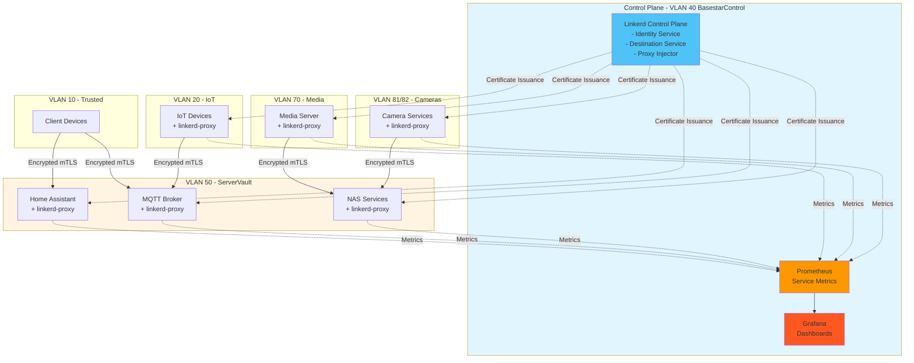

# 🔗 Service Mesh Architecture — Battlestar Ventana Network Blueprint

Generated: 2026-01-21

> **Status:** Planned (not currently implemented)
>
> **Feature State:** This is an architecture proposal for future rollout, not an active production feature in the current environment.
>
> **Review Flag:** Re-evaluate feasibility, scope, and priority during the next architecture review cycle.

This document defines the service mesh strategy for encrypting inter-VLAN traffic in the Battlestar Ventana network. It provides a decision matrix for technology selection, deployment architecture, encryption tiers, implementation steps, and monitoring integration.

---

## 1. Executive Summary

A service mesh provides transparent mTLS encryption, traffic management, and observability for service-to-service communication across VLANs. This architecture enhances the existing VLAN-based segmentation by adding:

- **End-to-end encryption** for inter-VLAN traffic without application changes
- **Zero-trust security** with automatic certificate rotation and identity verification
- **Enhanced observability** with request-level metrics and distributed tracing
- **Traffic management** capabilities (retries, timeouts, circuit breaking)

This document recommends **Linkerd** as the service mesh implementation and outlines a phased rollout strategy prioritizing critical services.

---

## 2. Decision Matrix: Linkerd vs Istio

The following matrix compares the two leading service mesh solutions for this environment:

| Criteria                  | Linkerd                        | Istio                        | Weight | Winner  |
| ------------------------- | ------------------------------ | ---------------------------- | ------ | ------- |
| **Resource Overhead**     | ~10-20MB per proxy             | ~50-100MB per proxy          | High   | Linkerd |
| **Complexity**            | Simple, opinionated            | Complex, highly configurable | High   | Linkerd |
| **mTLS by Default**       | Automatic, zero-config         | Requires configuration       | High   | Linkerd |
| **Performance**           | Ultra-lightweight (Rust proxy) | Feature-rich (Envoy)         | Medium | Linkerd |
| **Feature Set**           | Core features, focused         | Comprehensive, extensible    | Medium | Istio   |
| **Multi-cluster Support** | Basic                          | Advanced                     | Low    | Istio   |
| **Observability**         | Excellent built-in dashboards  | Flexible, requires setup     | High   | Linkerd |
| **Community & Support**   | Growing, CNCF graduated        | Large, mature ecosystem      | Medium | Istio   |
| **Homelab Suitability**   | Ideal for resource constraints | Better for enterprise/large  | High   | Linkerd |
| **Learning Curve**        | Minimal                        | Steep                        | High   | Linkerd |
| **Operational Burden**    | Low                            | High                         | High   | Linkerd |

### Recommendation: Linkerd

**Linkerd is recommended** for the Battlestar Ventana network based on:

1. **Resource Efficiency**: Homelab environments benefit from lightweight components
2. **Operational Simplicity**: Minimal configuration required for mTLS
3. **Zero-Config mTLS**: Automatic encryption without application modifications
4. **Built-in Observability**: Native Grafana dashboards align with existing monitoring stack
5. **Lower Complexity**: Easier to maintain and troubleshoot in a homelab setting

Istio should be considered only if advanced traffic routing, multi-cluster federation, or extensive customization becomes critical.

---

## 3. Architecture Overview

### Service Mesh Deployment Diagram



### Data Plane Architecture

Each meshed service pod/container includes:

- **Application Container**: The actual service (unchanged)
- **Linkerd Proxy**: Sidecar proxy (linkerd2-proxy) handling all network traffic
- **Init Container**: Sets up iptables rules to redirect traffic through proxy

Traffic flow:

1. Outbound traffic from app → intercepted by proxy → encrypted mTLS → destination proxy
2. Destination proxy → decrypts → forwards to destination app
3. All traffic automatically authenticated and encrypted without application awareness

---

## 4. Service Encryption Tiers

Services are prioritized into encryption tiers based on sensitivity and traffic patterns:

### Tier 1: Critical (Phase 1 - Week 1-2)

**Priority**: Immediate  
**Rationale**: Highest security risk, contains sensitive data or credentials

| Service        | VLAN | Risk Factor                    | Justification                                |
| -------------- | ---- | ------------------------------ | -------------------------------------------- |
| Home Assistant | 50   | Contains authentication tokens | Central control plane for IoT and automation |
| MQTT Broker    | 50   | Plaintext telemetry by default | Transmits sensor data, control commands      |
| NAS Services   | 50   | File shares, backup data       | Contains personal/sensitive files            |

### Tier 2: High (Phase 2 - Week 3-4)

**Priority**: High  
**Rationale**: Frequently accessed, moderate sensitivity

| Service         | VLAN | Risk Factor                      | Justification                                  |
| --------------- | ---- | -------------------------------- | ---------------------------------------------- |
| DNS/DHCP        | 40   | Network poisoning risk           | Infrastructure service, all VLANs depend on it |
| Cameras (Local) | 81   | Video streams, privacy-sensitive | Local processing, moderate traffic             |
| Media Server    | 70   | Content access                   | High traffic volume, moderate sensitivity      |

### Tier 3: Medium (Phase 3 - Week 5-6)

**Priority**: Medium  
**Rationale**: Lower risk or lower traffic volume

| Service         | VLAN | Risk Factor                | Justification                                   |
| --------------- | ---- | -------------------------- | ----------------------------------------------- |
| IoT Devices     | 20   | Telemetry data             | Already isolated VLAN, limited attack surface   |
| Printers        | 60   | Print job metadata         | Low sensitivity, occasional use                 |
| Cameras (Cloud) | 82   | Encrypted to cloud already | External encryption provided, redundant benefit |

### Tier 4: Low (Phase 4 - Week 7+)

**Priority**: Optional  
**Rationale**: Minimal benefit or already isolated

| Service       | VLAN | Risk Factor                  | Justification                               |
| ------------- | ---- | ---------------------------- | ------------------------------------------- |
| Guest Devices | 30   | Internet-only, no LAN access | Fully isolated, no inter-VLAN communication |
| Work VLAN     | 90   | VPN-tunneled already         | Traffic encrypted at VPN layer              |

---

## 5. Implementation Steps

### Phase 1: Control Plane Deployment

#### Step 1: Prerequisites

```bash
# Install Linkerd CLI on management host
curl --proto '=https' --tlsv1.2 -sSfL https://run.linkerd.io/install | sh
export PATH=$PATH:$HOME/.linkerd2/bin

# Verify Kubernetes cluster is ready (if using K8s)
linkerd check --pre

# OR for Docker Swarm/Compose environments:
# Install linkerd2-proxy binaries on each host
```

#### Step 2: Install Linkerd Control Plane

Deploy control plane to VLAN 40 (BasestarControl):

```bash
# Generate trust anchor certificate (valid 1 year)
linkerd install --identity-trust-anchors-file ca.crt \
  --identity-issuer-certificate-file issuer.crt \
  --identity-issuer-key-file issuer.key | kubectl apply -f -

# Wait for control plane readiness
linkerd check

# Install observability components
linkerd viz install | kubectl apply -f -
```

**Configuration Notes:**

- Trust anchor: 1-year validity minimum, store securely
- Issuer certificates: Auto-rotated every 90 days
- Control plane namespace: `linkerd` (VLAN 40)
- High availability: 3 replicas for critical components

#### Step 3: Validate Control Plane

```bash
# Check all control plane pods running
linkerd check

# Verify mTLS identity service
linkerd identity

# Access Linkerd dashboard
linkerd viz dashboard &
```

---

### Phase 2: Service Injection (Per-Tier Rollout)

#### Tier 1 Services (Critical)

##### Home Assistant (VLAN 50)

```bash
# Annotate namespace for auto-injection
kubectl annotate namespace servervault linkerd.io/inject=enabled

# OR manually inject sidecar into deployment
kubectl get deploy -n servervault home-assistant -o yaml | \
  linkerd inject - | \
  kubectl apply -f -

# Verify proxy injection
linkerd -n servervault check --proxy
```

##### MQTT Broker (VLAN 50)

```bash
# Inject MQTT deployment
kubectl get deploy -n servervault mqtt-broker -o yaml | \
  linkerd inject - | \
  kubectl apply -f -

# Test mTLS connectivity
linkerd -n servervault tap deploy/mqtt-broker
```

##### NAS Services (VLAN 50)

```bash
# Inject NAS service
kubectl get deploy -n servervault nas -o yaml | \
  linkerd inject - | \
  kubectl apply -f -
```

#### Verification After Each Injection

```bash
# Check mTLS status for all meshed services
linkerd -n servervault stat deploy

# View live request metrics
linkerd -n servervault tap deploy/home-assistant --to deploy/mqtt-broker

# Verify certificate rotation
linkerd identity --all-namespaces
```

---

### Phase 3: mTLS Verification

#### Manual Testing

```bash
# Test encrypted connection from client to service
linkerd diagnostics proxy-metrics deploy/home-assistant | grep response_latency

# Capture traffic to verify encryption (should be TLS)
tcpdump -i any -n port 4143 -A | grep -i "home-assistant"

# Validate no plaintext traffic
linkerd tap deploy/home-assistant --output=json | jq '.tls'
```

#### Automated Monitoring

Add Linkerd metrics to existing Prometheus:

```yaml
# prometheus.yml addition
scrape_configs:
  - job_name: "linkerd-controller"
    kubernetes_sd_configs:
      - role: pod
        namespaces:
          names: ["linkerd"]
    relabel_configs:
      - source_labels:
          [__meta_kubernetes_pod_label_linkerd_io_control_plane_component]
        action: keep
        regex: .+

  - job_name: "linkerd-proxy"
    kubernetes_sd_configs:
      - role: pod
    relabel_configs:
      - source_labels: [__meta_kubernetes_pod_container_name]
        action: keep
        regex: ^linkerd-proxy$
```

#### Key Metrics to Monitor

| Metric                           | Description                 | Alert Threshold     |
| -------------------------------- | --------------------------- | ------------------- |
| `request_total`                  | Total requests through mesh | Baseline +/- 20%    |
| `response_latency_ms_p99`        | 99th percentile latency     | > 500ms             |
| `tcp_open_connections`           | Active mTLS connections     | < 10 (low adoption) |
| `identity_cert_expiry_timestamp` | Certificate expiration time | < 7 days            |
| `response_errors_total`          | Failed requests             | > 1% error rate     |

---

## 6. Monitoring and Metrics Integration

### Grafana Dashboard Integration

Linkerd provides pre-built Grafana dashboards:

```bash
# Import Linkerd dashboards to existing Grafana
linkerd viz dashboard &

# Export dashboard JSON for integration (run from repository root)
curl -s http://localhost:50750/api/dashboards/linkerd-namespace.json > \
  dashboards/linkerd-namespace.json
```

### Key Dashboard Panels

1. **Success Rate**: Percentage of successful requests (target: >99.9%)
2. **Request Volume**: RPS per service
3. **Latency Distribution**: p50, p95, p99 latencies
4. **mTLS Status**: Percentage of encrypted connections (target: 100%)
5. **Certificate Rotation**: Time until next cert rotation

### Alert Rules

Add to `alerts/alert_rules.yaml`:

```yaml
groups:
  - name: linkerd_mesh
    interval: 30s
    rules:
      - alert: LinkerdCertificateExpiringSoon
        expr: (identity_cert_expiry_timestamp - time()) < (7 * 24 * 60 * 60)
        labels:
          severity: warning
        annotations:
          summary: "Linkerd certificate expiring in < 7 days"

      - alert: LinkerdHighErrorRate
        expr: sum(rate(response_errors_total[5m])) / sum(rate(request_total[5m])) > 0.01
        labels:
          severity: critical
        annotations:
          summary: "Linkerd mesh error rate > 1%"

      - alert: LinkerdProxyMissing
        expr: absent(up{job="linkerd-proxy"})
        for: 5m
        labels:
          severity: warning
        annotations:
          summary: "Linkerd proxy metrics not available"

      - alert: LinkerdHighLatency
        expr: histogram_quantile(0.99, response_latency_ms_bucket) > 500
        for: 5m
        labels:
          severity: warning
        annotations:
          summary: "Linkerd p99 latency > 500ms"
```

### Distributed Tracing Integration

Linkerd supports distributed tracing with Jaeger (already referenced in repo):

```bash
# Verify Jaeger is deployed and accessible (prerequisite)
kubectl get svc -n jaeger jaeger-collector || echo "Warning: Jaeger not found, install before proceeding"

# Enable tracing with OpenTelemetry (generate config)
linkerd install --set tracing.collector=jaeger-collector.jaeger:14268 > linkerd-tracing.yaml

# Review the configuration before applying
cat linkerd-tracing.yaml

# Apply the configuration only if prerequisites are met
kubectl apply -f linkerd-tracing.yaml

# Configure trace sampling rate (10% for homelab)
kubectl annotate namespace servervault config.linkerd.io/trace-collector=jaeger-collector.jaeger:14268
kubectl annotate namespace servervault config.linkerd.io/trace-collector-sampling-rate=0.1
```

---

## 7. Rollout Timeline and Priorities

### Phase Breakdown

| Phase | Timeline | Services                         | Success Criteria                                   |
| ----- | -------- | -------------------------------- | -------------------------------------------------- |
| 0     | Week 0   | Control plane deployment         | `linkerd check` passes, dashboard accessible       |
| 1     | Week 1-2 | Home Assistant, MQTT, NAS        | 100% mTLS coverage, <5% latency increase           |
| 2     | Week 3-4 | DNS/DHCP, Cameras (Local), Media | No service disruptions, metrics flowing to Grafana |
| 3     | Week 5-6 | IoT devices, Printers            | >95% mesh adoption across critical services        |
| 4     | Week 7+  | Optional: Guest, Work VLAN       | Full mesh deployment, automated cert rotation      |

### Rollback Plan

If issues arise during rollout:

1. **Immediate**: Remove `linkerd.io/inject` annotation from affected namespace
2. **Restart**: Roll deployment without proxy injection: `kubectl rollout restart deploy/<name>`
3. **Investigate**: Check proxy logs: `kubectl logs -n <namespace> <pod> -c linkerd-proxy`
4. **Revert**: If control plane issues, uninstall: `linkerd uninstall | kubectl delete -f -`

---

## 8. Security Considerations

### Certificate Management

- **Trust Anchor**: Manually managed, 1-year validity
- **Issuer Certificates**: Auto-rotated by Linkerd every 90 days
- **Workload Certificates**: Auto-rotated every 24 hours
- **Storage**: Store trust anchor and issuer keys in secure vault (e.g., Kubernetes Secrets with encryption at rest)

### Network Policies

Service mesh complements (not replaces) existing firewall rules:

- **Firewall**: VLAN-level access control (Layer 3/4)
- **Service Mesh**: Service-level mTLS and authorization (Layer 7)

Maintain existing firewall-matrix.md rules as defense-in-depth.

### Zero-Trust Enforcement

Enable Linkerd authorization policies for granular access control:

```yaml
# Example: Only allow Home Assistant to call MQTT
apiVersion: policy.linkerd.io/v1beta1
kind: Server
metadata:
  name: mqtt-server
  namespace: servervault
spec:
  podSelector:
    matchLabels:
      app: mqtt-broker
  port: 1883
---
apiVersion: policy.linkerd.io/v1alpha1
kind: AuthorizationPolicy
metadata:
  name: allow-home-assistant-to-mqtt
  namespace: servervault
spec:
  targetRef:
    kind: Server
    name: mqtt-server
  requiredAuthenticationRefs:
    - kind: ServiceAccount
      name: home-assistant
```

---

## 9. Performance Impact

### Expected Overhead

- **Latency**: +1-5ms per hop (proxy processing)
- **Memory**: +10-20MB per pod (linkerd-proxy sidecar)
- **CPU**: +0.1-0.5 cores per 1000 RPS
- **Network**: Minimal overhead (<1% due to efficient Rust proxy)

### Optimization Tips

1. **Resource Limits**: Set appropriate proxy resource requests/limits
2. **Keep-Alive**: Enable HTTP/2 connection pooling
3. **Locality**: Co-locate frequently communicating services in same VLAN
4. **Skip Ports**: Exclude high-throughput, low-security ports from mesh

---

## 10. Operational Procedures

### Day 2 Operations

**Weekly Tasks:**

- Review mTLS coverage dashboard: `linkerd viz stat deploy --all-namespaces`
- Check certificate expiry: `linkerd identity --all-namespaces`
- Validate no plaintext traffic: `linkerd tap --all-namespaces | grep 'tls=""'`

**Monthly Tasks:**

- Rotate trust anchor if < 3 months until expiry
- Review and update authorization policies
- Audit mesh adoption rate across services

**Emergency Procedures:**

- Certificate rotation failure: Manual issuer cert renewal via `linkerd upgrade`
- Control plane outage: Workloads continue with last-known certificates (24hr grace)
- Proxy crash loop: Check application compatibility, exclude problematic ports

---

## 11. References and Resources

### Official Documentation

- Linkerd Documentation: <https://linkerd.io/docs/>
- Linkerd Architecture: <https://linkerd.io/2.14/reference/architecture/>
- mTLS Guide: <https://linkerd.io/2.14/features/automatic-mtls/>

### Internal Documentation

- [Firewall Matrix](../docs/firewall-matrix.md) - VLAN access rules
- [Services Documentation](../docs/services.md) - Service/port mappings
- [Project Architecture Blueprint](../docs/Project_Architecture_Blueprint.md) - Overall architecture

### Community Resources

- Linkerd Slack: <https://slack.linkerd.io/>
- CNCF Linkerd Project: <https://www.cncf.io/projects/linkerd/>

---

## 12. Appendix: Alternative Architectures

### A. WireGuard-based mTLS (Alternative to Service Mesh)

For environments without Kubernetes, consider WireGuard VPN tunnels between VLANs:

**Pros**: Simpler, kernel-level encryption, no application changes  
**Cons**: Lacks observability, manual certificate management, no Layer 7 features

### B. Nginx Ingress with mTLS (Hybrid Approach)

Use Nginx Ingress Controller with client certificates for edge termination:

**Pros**: Simpler than full mesh, centralized certificate management  
**Cons**: Only encrypts ingress traffic, no inter-service encryption

### C. Istio (Enterprise Alternative)

If requirements change to need advanced traffic management:

**Migration Path**: Export Linkerd configs → Translate to Istio CRDs → Gradual cutover  
**Timeline**: 2-3 weeks additional effort

---

🔗 _The service mesh architecture provides transparent mTLS encryption across the Battlestar Ventana network, enhancing security without application modifications. Linkerd's lightweight design makes it ideal for homelab deployments._
